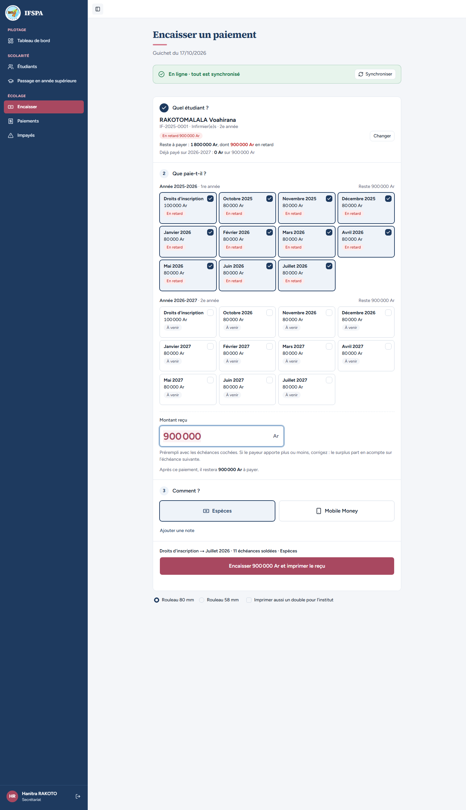
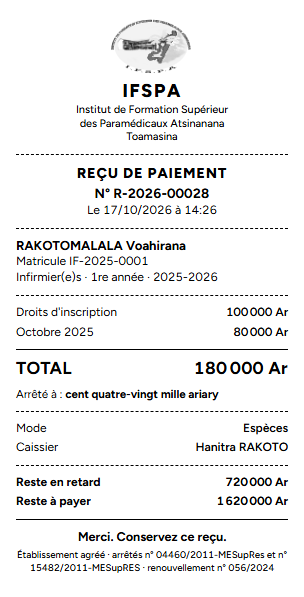
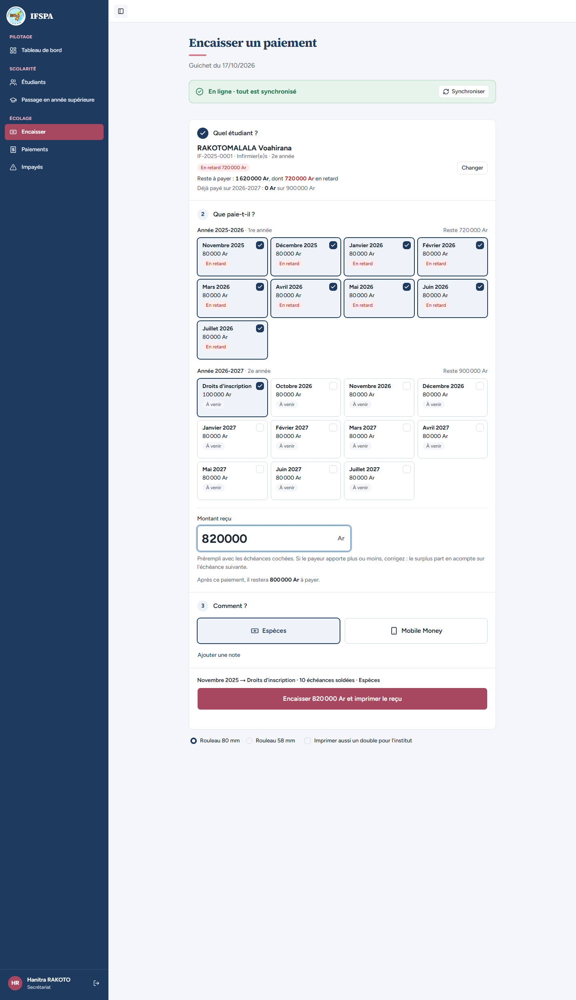
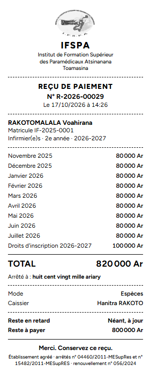
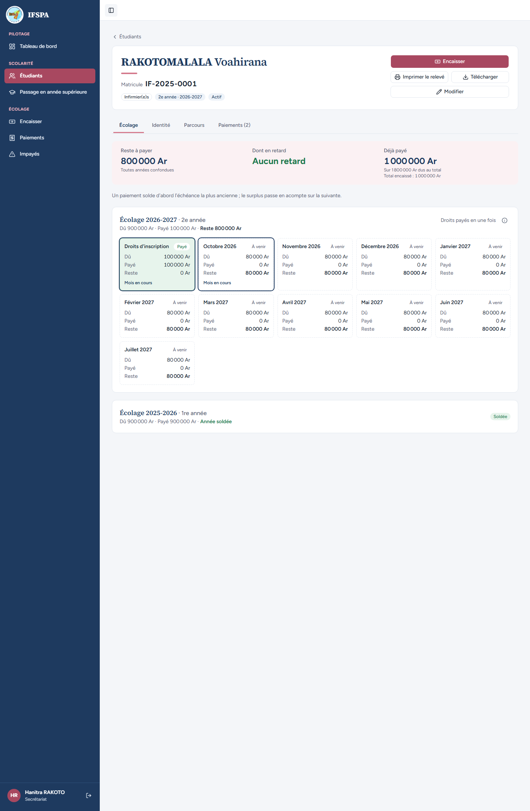

# UC06-06. Un étudiant qui doit aussi l'année précédente : le plus ancien est soldé d'abord

| | |
|---|---|
| Use case | UC06. Encaisser un parent au guichet |
| Règles couvertes | R-REP (toutes années confondues, la plus ancienne d'abord), R-RET (le retard de l'année précédente est coché d'office, l'année en cours à venir ne l'est pas), R-RECU |
| Rôle | Secrétariat, compte « Hanitra RAKOTO » |
| Durée estimée | 10 minutes |

## La situation

Voahirana RAKOTOMALALA est passée en 2e année sans avoir payé sa 1re année : elle doit 900 000 Ar sur 2025-2026 (en retard) et 900 000 Ar sur 2026-2027 (à venir). Sa mère vient payer. Le guichet affiche tout l'impayé, année par année, et solde d'abord 2025-2026. Un second paiement termine l'année précédente puis entame la nouvelle.

## Avant de commencer

- Mêmes préparatifs que [UC06-01](UC06-01-deux-mois-especes.md). Avoir déroulé UC06-01 à 05 : les reçus de ce cas sont les **R-2026-00028** et **R-2026-00029**.
- Étudiante : RAKOTOMALALA Voahirana, **IF-2025-0001**, 1 800 000 Ar dus sur deux années (préparation, sections B1 et D).

## Étapes

| # | Qui | Action | Résultat attendu | Capture | ✓ |
|---|---|---|---|---|---|
| 1 | Secrétariat | **Encaisser**, chercher `RAKOTOMALALA`, Entrée. | « IF-2025-0001 · Infirmier(e)s · 2e année », « Reste à payer : **1 800 000 Ar**, dont 900 000 Ar en retard ». Deux groupes : « Année 2025-2026 · 1re année » (Reste 900 000 Ar) et « Année 2026-2027 · 2e année » (Reste 900 000 Ar). Les **11 échéances de 2025-2026 sont cochées d'office**, aucune de 2026-2027. « Montant reçu » **900 000**. |  | |
| 2 | Secrétariat | Cliquer **Novembre 2025** (groupe 2025-2026), puis **Encaisser 180 000 Ar et imprimer le reçu**. | « Montant reçu » 180 000. « Paiement enregistré : reçu **R-2026-00028**. » Ticket : « Infirmier(e)s · 1re année · 2025-2026 », Droits d'inscription 100 000 Ar, Octobre 2025 80 000 Ar ; Reste en retard 720 000 Ar ; Reste à payer **1 620 000 Ar**. |  | |
| 3 | Secrétariat | Chercher de nouveau `RAKOTOMALALA`, Entrée, saisir `820000`. | « Reste à payer : 1 620 000 Ar, dont 720 000 Ar en retard ». Les 9 échéances restantes de 2025-2026 (novembre 2025 à juillet 2026) **et** « Droits d'inscription » de 2026-2027 sont cochés ; « Après ce paiement, il restera 800 000 Ar à payer. » |  | |
| 4 | Secrétariat | Cliquer **Encaisser 820 000 Ar et imprimer le reçu**, regarder le ticket. | « Paiement enregistré : reçu **R-2026-00029**. » Ticket : Novembre 2025, Décembre 2025, … Juillet 2026 (80 000 Ar chacun), puis « Droits d'inscription 2026-2027 » 100 000 Ar ; TOTAL 820 000 Ar ; « Arrêté à : huit cent vingt mille ariary » ; Reste en retard « Néant, à jour » ; Reste à payer 800 000 Ar. L'en-tête du ticket indique « 2e année · 2026-2027 » alors que neuf lignes concernent 2025-2026 (voir « Questions » du rapport). |  | |
| 5 | Secrétariat | Menu **Étudiants**, ouvrir RAKOTOMALALA Voahirana. | Fiche : « Paiements (2) », Reste à payer 800 000 Ar, **Aucun retard**, déjà payé 1 000 000 Ar sur 1 800 000 Ar. « Écolage 2026-2027 · 2e année » : Droits d'inscription **Payé**, le reste à venir. « Écolage 2025-2026 · 1re année » : **Soldée** (900 000 Ar payés, « Année soldée »). |  | |

## Ce que ce scénario ne couvre pas

- Le même calcul côté serveur : couvert par Vitest, `tests/integration/actions-paiements.test.ts` (« couvre deux années : l'année précédente est soldée d'abord, puis la suivante en acompte », « un petit paiement va d'abord à l'année précédente, sans toucher à l'année en cours »).
- Année précédente clôturée : l'encaissement reste possible (décision provisoire n° 3), non déroulé.

## Dernière exécution par l'agent

- 17/10/2026 : ✅ 5 étapes sur 5. Voir [RAPPORT_2026-10-17_UC06](../../rapports/RAPPORT_2026-10-17_UC06.md), question n° 2 (en-tête du ticket).
- Parcours : [UC06-06-impayes-annee-precedente.recette.ts](../../parcours/UC06-06-impayes-annee-precedente.recette.ts).
