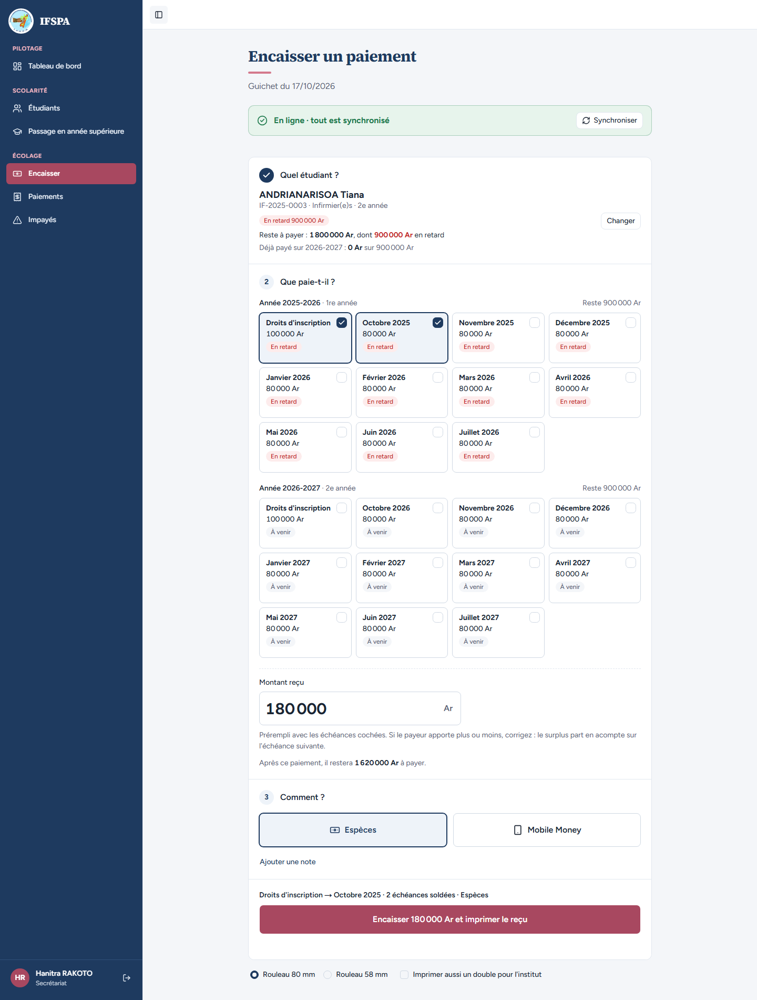
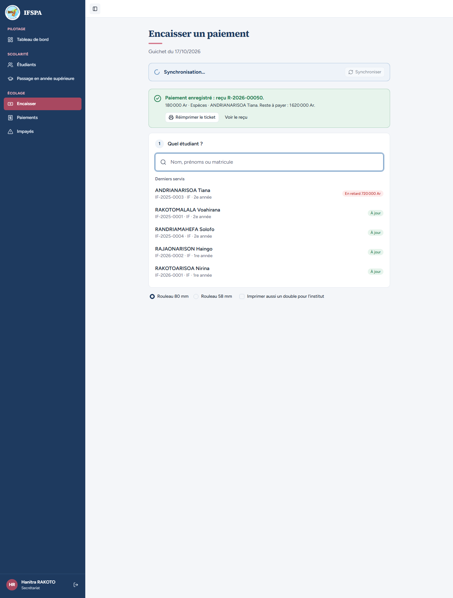
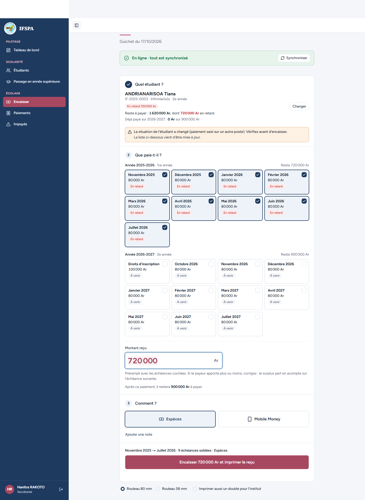
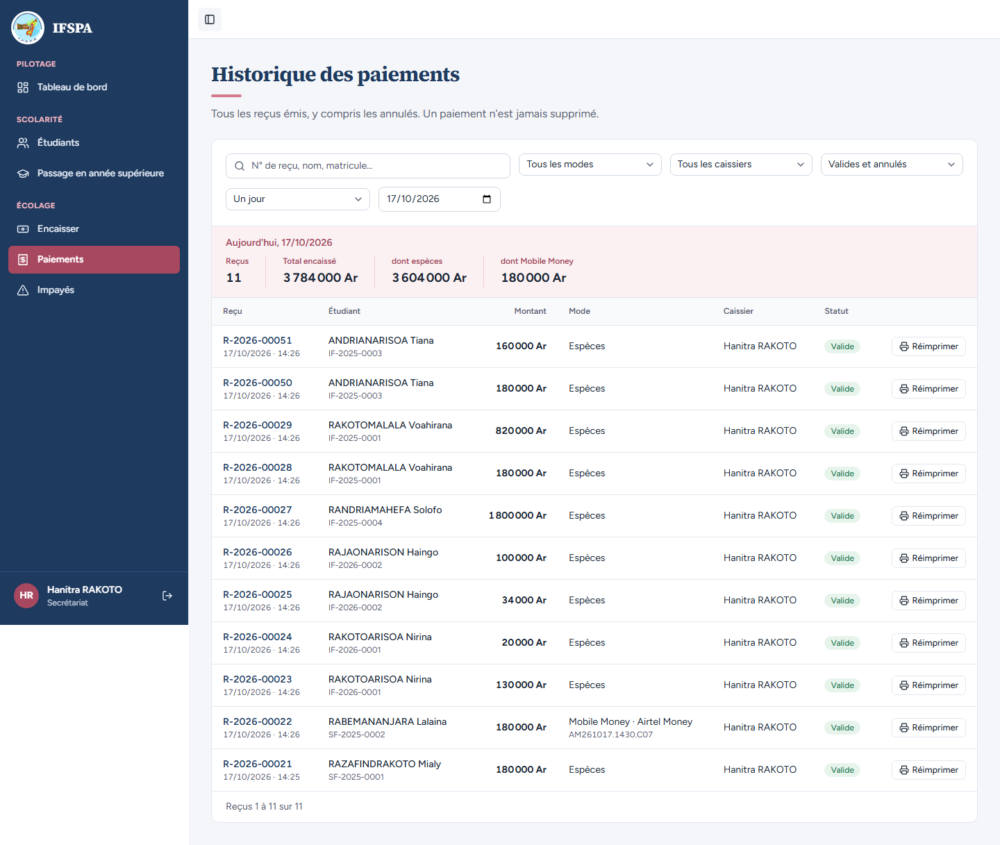

# UC06-07. Un autre poste a encaissé entre-temps : le second paiement est refusé, la liste se met à jour

| | |
|---|---|
| Use case | UC06. Encaisser un parent au guichet |
| Règles couvertes | Décision provisoire n° 22 (deux postes en ligne sur le même étudiant : le second est refusé, pas réparti sur ce qui reste), R-REP, R-ROLE |
| Rôle | Secrétariat, compte « Hanitra RAKOTO », sur deux postes |
| Durée estimée | 12 minutes |

## La situation

Deux guichets sont ouverts. Au poste 1, la secrétaire prépare l'encaissement de 180 000 Ar pour Tiana ANDRIANARISOA. Pendant ce temps, la famille a aussi payé au poste 2, qui a encaissé les mêmes mois. Quand le poste 1 valide, l'application refuse : elle ne répartit pas à l'aveugle le paiement sur d'autres mois, elle recharge la situation et demande de vérifier. Après vérification, la secrétaire encaisse ce qui reste réellement à payer.

## Avant de commencer

- Mêmes préparatifs que [UC06-01](UC06-01-deux-mois-especes.md). Avoir déroulé UC06-01 à 06 dans le même navigateur (poste 1).
- Un **second poste** : un autre navigateur ou une fenêtre de navigation privée, connecté lui aussi au compte **secrétariat**, avec Internet. Les reçus de ce cas sont le **R-2026-00050** (poste 2, qui réserve ses propres numéros en ouvrant Encaisser) et le **R-2026-00051** (poste 1).
- Étudiant : ANDRIANARISOA Tiana, **IF-2025-0003**, 1 800 000 Ar dus sur deux années (préparation, sections B3 et D).

## Étapes

| # | Qui | Action | Résultat attendu | Capture | ✓ |
|---|---|---|---|---|---|
| 1 | Secrétariat, poste 1 | **Encaisser**, chercher `ANDRIANARISOA`, Entrée, cliquer **Novembre 2025**. **Ne pas encaisser.** | « IF-2025-0003 · Infirmier(e)s · 2e année », « Reste à payer : 1 800 000 Ar », « Montant reçu » 180 000, bouton « Encaisser 180 000 Ar et imprimer le reçu » prêt. |  | |
| 2 | Secrétariat, poste 2 | Dans l'autre navigateur : **Encaisser**, `ANDRIANARISOA`, Entrée, **Novembre 2025**, **Encaisser 180 000 Ar et imprimer le reçu**. | « Paiement enregistré : reçu **R-2026-00050**. » avec « 180 000 Ar · Espèces · ANDRIANARISOA Tiana. Reste à payer : 1 620 000 Ar. » |  | |
| 3 | Secrétariat, poste 1 | Revenir au poste 1 et cliquer **Encaisser 180 000 Ar et imprimer le reçu**. | **Refus** : encadré orange « **La situation de l'étudiant a changé (paiement saisi sur un autre poste). Vérifiez avant d'encaisser.** » puis « La liste ci-dessous vient d'être mise à jour. » « Reste à payer : **1 620 000 Ar**, dont 720 000 Ar en retard ». Les droits et octobre 2025 ont disparu de la liste, qui commence à Novembre 2025 ; « Montant reçu » 720 000. **Aucune impression, aucun reçu** : rien n'a été enregistré. |  | |
| 4 | Secrétariat, poste 1 | Cliquer la carte **Janvier 2026** (pour ne garder que novembre et décembre), puis **Encaisser 160 000 Ar et imprimer le reçu**. | « Montant reçu » 160 000. « Paiement enregistré : reçu **R-2026-00051**. » avec « Reste à payer : 1 460 000 Ar. » Ticket : Novembre 2025 et Décembre 2025. Le refus n'a consommé aucun numéro : R-2026-00051 suit R-2026-00050. | | |
| 5 | Secrétariat | Menu **Paiements**. | Exactement **deux** reçus pour ANDRIANARISOA Tiana (R-2026-00050 et R-2026-00051), tous deux « Valide », aucun « À vérifier ». |  | |

## Ce que ce scénario ne couvre pas

- Le refus **côté serveur** sans écran : couvert par Vitest, `tests/integration/actions-paiements.test.ts` (« reste dû affiché faux : SITUATION_CHANGEE, ni paiement ni numéro de reçu consommé », « deux encaissements simultanés… : un seul passe »).
- Le cas inverse, un poste **hors ligne**, est enregistré « à vérifier » : voir UC13-05.
- La décision n° 22 est provisoire (voir `STATUS.md`) : ce scénario décrit le comportement actuel.

## Dernière exécution par l'agent

- 17/10/2026 : ✅ 5 étapes sur 5. Voir [RAPPORT_2026-10-17_UC06](../../rapports/RAPPORT_2026-10-17_UC06.md).
- Parcours : [UC06-07-situation-changee.recette.ts](../../parcours/UC06-07-situation-changee.recette.ts).
