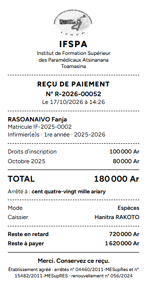
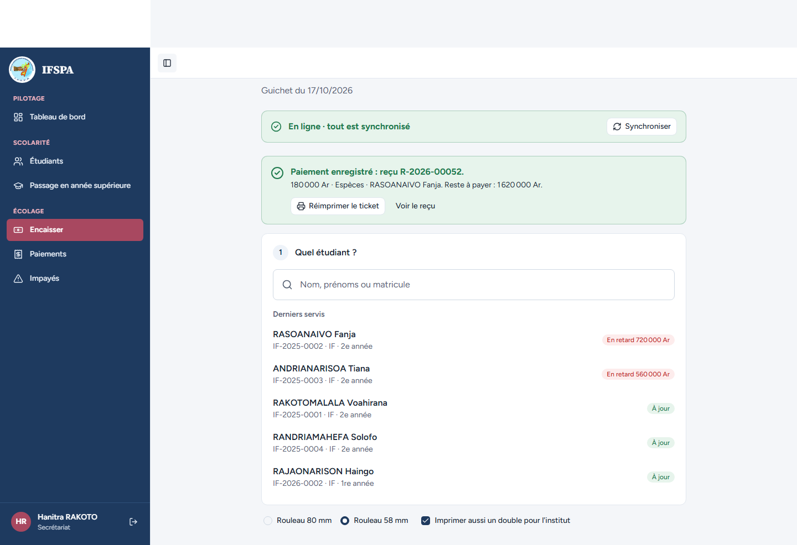
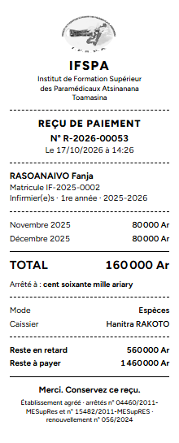
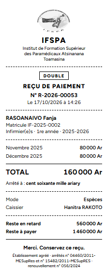

# UC06-08. Le ticket en 80 mm, en 58 mm et avec le double de l'institut

| | |
|---|---|
| Use case | UC06. Encaisser un parent au guichet |
| Règles couvertes | R-RECU (ticket 80 mm, 58 mm en option, monochrome, sans QR code, double pour l'institut, réimpression) |
| Rôle | Secrétariat, compte « Hanitra RAKOTO » |
| Durée estimée | 8 minutes |

## La situation

L'institut a un rouleau de 80 mm, mais un poste du guichet a un petit rouleau de 58 mm et veut garder un double du ticket. La secrétaire encaisse d'abord avec les options par défaut (80 mm), puis choisit « Rouleau 58 mm » et « Imprimer aussi un double pour l'institut » : au paiement suivant, le ticket étroit et son double sortent ensemble. Ces choix sont mémorisés par poste.

## Avant de commencer

- Mêmes préparatifs que [UC06-01](UC06-01-deux-mois-especes.md). Avoir déroulé UC06-01 à 07 : les reçus de ce cas sont les **R-2026-00052** et **R-2026-00053**.
- Étudiante : RASOANAIVO Fanja, **IF-2025-0002**, 1 800 000 Ar dus sur deux années (préparation, sections B2 et D).
- Sous les options en bas de l'écran Encaisser, « Rouleau 80 mm » est coché et « Imprimer aussi un double » ne l'est pas.

## Étapes

| # | Qui | Action | Résultat attendu | Capture | ✓ |
|---|---|---|---|---|---|
| 1 | Secrétariat | **Encaisser**, chercher `RASOANAIVO`, Entrée, cliquer **Novembre 2025**, **Encaisser 180 000 Ar et imprimer le reçu**. | « Paiement enregistré : reçu **R-2026-00052**. » Ticket **80 mm** (largeur d'environ 8 cm à l'aperçu), texte noir sur blanc, **sans QR code**, un seul visuel (le logo) : Droits d'inscription 100 000 Ar, Octobre 2025 80 000 Ar, TOTAL 180 000 Ar, « cent quatre-vingt mille ariary », Reste à payer 1 620 000 Ar, « Merci. Conservez ce reçu. » |  | |
| 2 | Secrétariat | Cocher **Rouleau 58 mm** et **Imprimer aussi un double pour l'institut** (sous la recherche). | « Rouleau 58 mm » coché, « Imprimer aussi un double pour l'institut » coché. |  | |
| 3 | Secrétariat | Chercher `RASOANAIVO`, Entrée, cliquer **Janvier 2026** (pour garder novembre et décembre), **Encaisser 160 000 Ar et imprimer le reçu**. | « Paiement enregistré : reçu **R-2026-00053**. » **Une seule impression** lance **deux tickets** : le ticket **58 mm** (largeur d'environ 5,8 cm) puis son **double**, identique, avec la mention encadrée « **DOUBLE** » en tête. Novembre 2025 et Décembre 2025 à 80 000 Ar, TOTAL 160 000 Ar, Reste à payer 1 460 000 Ar. |   | |
| 4 | Secrétariat | Cliquer **Réimprimer le ticket**. | L'impression est relancée (même ticket 58 mm et son double). Le message de succès reste affiché. |  | |
| 5 | Secrétariat | Remettre **Rouleau 80 mm** et décocher le double. | Options par défaut du poste rétablies. | | |

## Ce que ce scénario ne couvre pas

- Le rendu sur l'imprimante thermique réelle (largeur utile, coupe, contraste du logo) : à faire par vous (voir le rapport). Le parcours mesure la largeur des tickets à l'aperçu en média « impression » (80 mm ≈ 302 px, 58 mm ≈ 219 px).
- Réimpression d'un reçu depuis Paiements et reçu annulé « ANNULÉ » : scénario UC07 (à écrire).

## Dernière exécution par l'agent

- 17/10/2026 : ✅ 5 étapes sur 5. Voir [RAPPORT_2026-10-17_UC06](../../rapports/RAPPORT_2026-10-17_UC06.md).
- Parcours : [UC06-08-ticket-80-58-double.recette.ts](../../parcours/UC06-08-ticket-80-58-double.recette.ts).
