# UC07-01. L'administrateur contrôle la caisse du jour, retrouve un reçu et le réimprime

| | |
|---|---|
| Use case | UC07. Contrôler les paiements et annuler un reçu |
| Règles couvertes | R-ANN (l'historique garde tous les reçus, rien ne se supprime), R-RECU (réimpression du ticket), R-ROLE (l'administrateur voit « Numéros non utilisés »), décision provisoire n° 19 (totaux de la liste filtrée) |
| Rôle | Administrateur, compte « Administrateur IFSPA » |
| Durée estimée | 10 minutes |

## La situation

En fin de journée, l'administrateur veut vérifier ce que le guichet a encaissé : combien en espèces, combien en Mobile Money, qui a encaissé quoi. Une mère rappelle pour un reçu perdu : il le retrouve par son numéro, puis par le nom de l'étudiante, et réimprime le ticket.

## Avant de commencer

1. `pnpm db:up`, `pnpm recette:base`, `pnpm build`, `pnpm recette:app`, puis ouvrir `http://localhost:3200`.
2. Avoir déroulé [00-PREPARATION.md](../00-PREPARATION.md), sections A, B, C (**pas la D**) puis **F** (quatre reçus du jour : R-2026-00021 à 00023 et R-2026-00044).
3. Se connecter avec le compte **administrateur** (identifiants `SEED_ADMIN_*` de `.env`) ; « Administrateur IFSPA » s'affiche en bas de la barre latérale.
4. Dérouler les cas UC07-01 à UC07-05 **dans l'ordre** : chacun laisse son état au suivant. Les heures des reçus (`HH:MM`) et la date du jour (`JJ/MM/AAAA`) sont celles de votre exécution.

## Étapes

| # | Qui | Action | Résultat attendu | Capture | ✓ |
|---|---|---|---|---|---|
| 1 | Administrateur | Menu **Paiements**. | Titre « Historique des paiements », « Tous les reçus émis, y compris les annulés. Un paiement n'est jamais supprimé. » Bandeau « Aujourd'hui, JJ/MM/AAAA » : Reçus **4**, Total encaissé **540 000 Ar**, dont espèces **260 000 Ar**, dont Mobile Money **280 000 Ar**. Quatre lignes, toutes « Valide », avec « Réimprimer » et « Annuler » : R-2026-00044 (ANDRIANARISOA Tiana, 100 000 Ar, Mobile Money · Orange Money, Administrateur IFSPA), R-2026-00023 (RASOANAIVO Fanja, 180 000 Ar, Mobile Money · MVola, Hanitra RAKOTO), R-2026-00022 (RAKOTOMALALA Voahirana, 80 000 Ar, Espèces) et R-2026-00021 (180 000 Ar, Espèces). « Reçus 1 à 4 sur 4 ». En bas : « Numéros non utilisés (40) » (le nombre dépend des postes ouverts). | 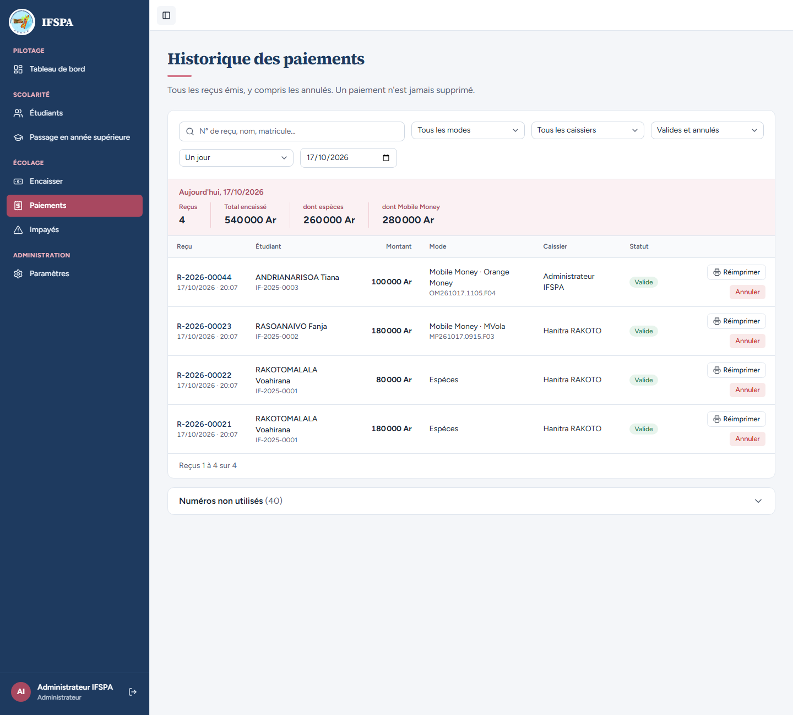 | |
| 2 | Administrateur | Dans « Rechercher un reçu ou un étudiant » (« N° de reçu, nom, matricule… »), taper `00023`. | Un seul reçu : **R-2026-00023**, RASOANAIVO Fanja, IF-2025-0002, 180 000 Ar, « Mobile Money · MVola », référence MP261017.0915.F03, Hanitra RAKOTO. Les totaux suivent la recherche : Reçus 1, Total encaissé 180 000 Ar, dont espèces 0 Ar, dont Mobile Money 180 000 Ar. | 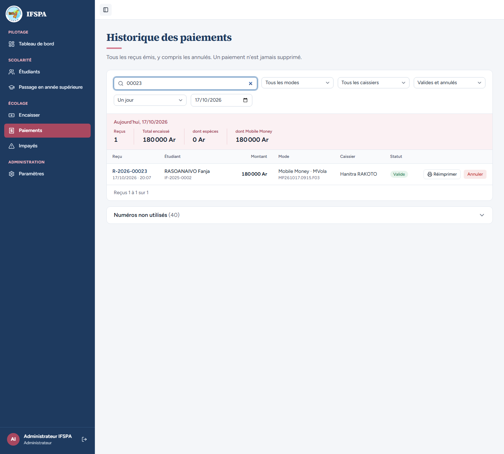 | |
| 3 | Administrateur | Revenir à **Paiements** (liste du jour), taper `voahirana`. | Deux reçus : R-2026-00022 et R-2026-00021, RAKOTOMALALA Voahirana, IF-2025-0001. Total encaissé 260 000 Ar. | 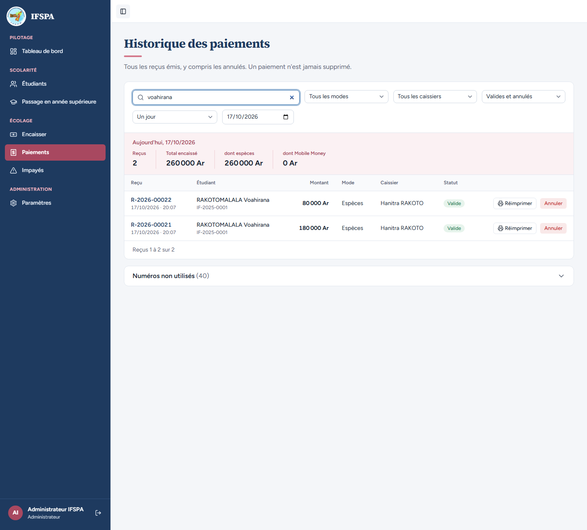 | |
| 4 | Administrateur | Revenir à **Paiements**. Liste « Tous les modes » : choisir **Mobile Money (tous)**, puis **Espèces**. | Mobile Money (tous) : 2 reçus (R-2026-00044 et R-2026-00023), Total encaissé 280 000 Ar, dont espèces 0 Ar. Espèces : 2 reçus (R-2026-00022 et R-2026-00021), Total encaissé 260 000 Ar, dont Mobile Money 0 Ar. | 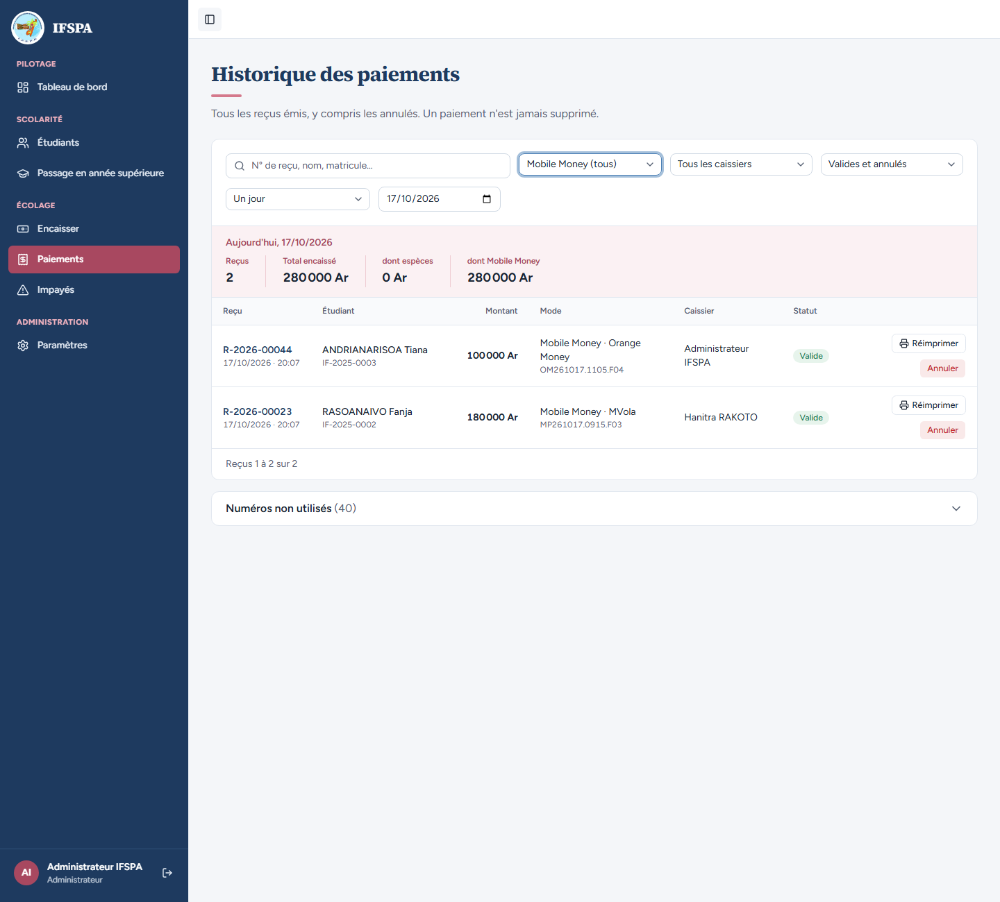 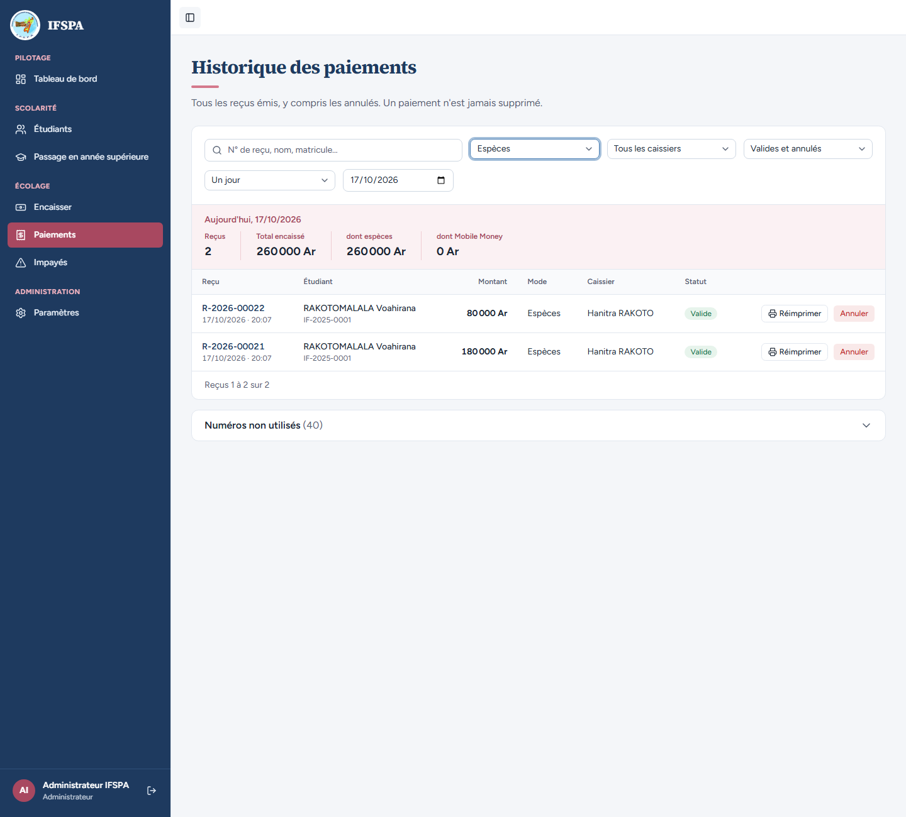 | |
| 5 | Administrateur | Revenir à **Paiements**. Liste « Tous les caissiers » : choisir **Administrateur IFSPA**, puis **Hanitra RAKOTO**. | Administrateur IFSPA : 1 reçu (R-2026-00044), Total encaissé 100 000 Ar. Hanitra RAKOTO : 3 reçus, Total encaissé 440 000 Ar. | 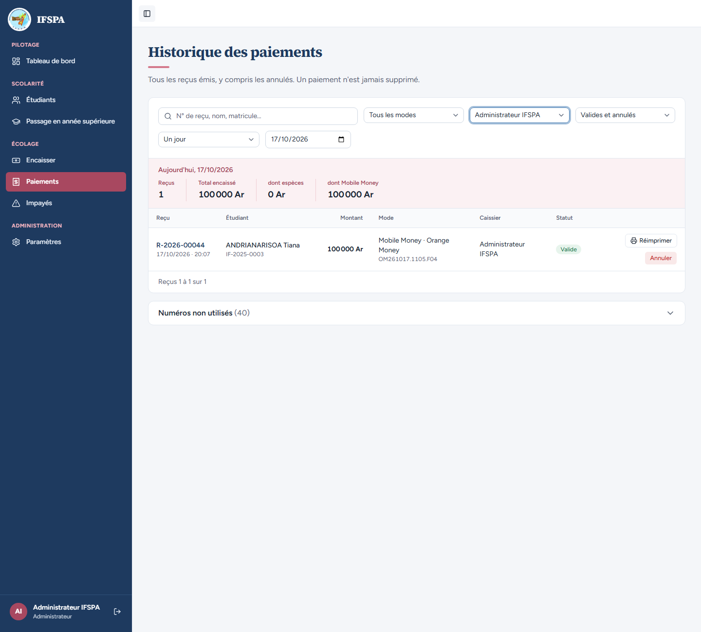 | |
| 6 | Administrateur | Revenir à **Paiements**. Liste « Valides et annulés » : choisir **Annulés seulement**, puis **À vérifier**, puis **Valides seulement**. | Annulés seulement et À vérifier : Reçus 0, « Aucun paiement ne correspond à ces filtres. Les reçus émis au guichet apparaissent ici dès qu'ils sont enregistrés. », boutons « Voir ce mois-ci » et « Effacer les filtres », « Aucun reçu » (aucun reçu n'est encore annulé ni à vérifier). Valides seulement : les 4 reçus. | 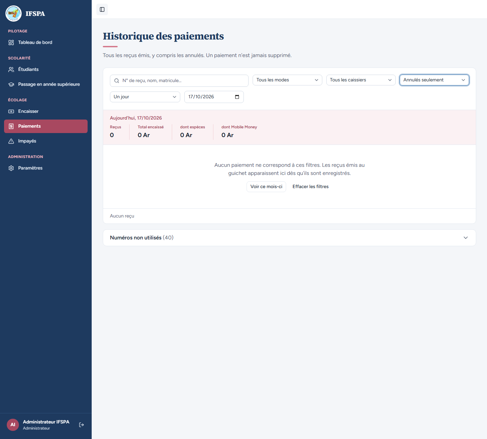 | |
| 7 | Administrateur | Revenir à **Paiements**. Liste « Un jour » : choisir **Un mois**, puis **Une année scolaire**, puis, dans la liste « Année scolaire », **2025-2026**. | Un mois : « Octobre 2026 » (ou le mois en cours), 4 reçus, 540 000 Ar. Une année scolaire : « Année 2026-2027 », 4 reçus. Année 2025-2026 : « Année 2025-2026 », Reçus 0, « Aucun paiement ne correspond à ces filtres. », « Effacer les filtres ». | 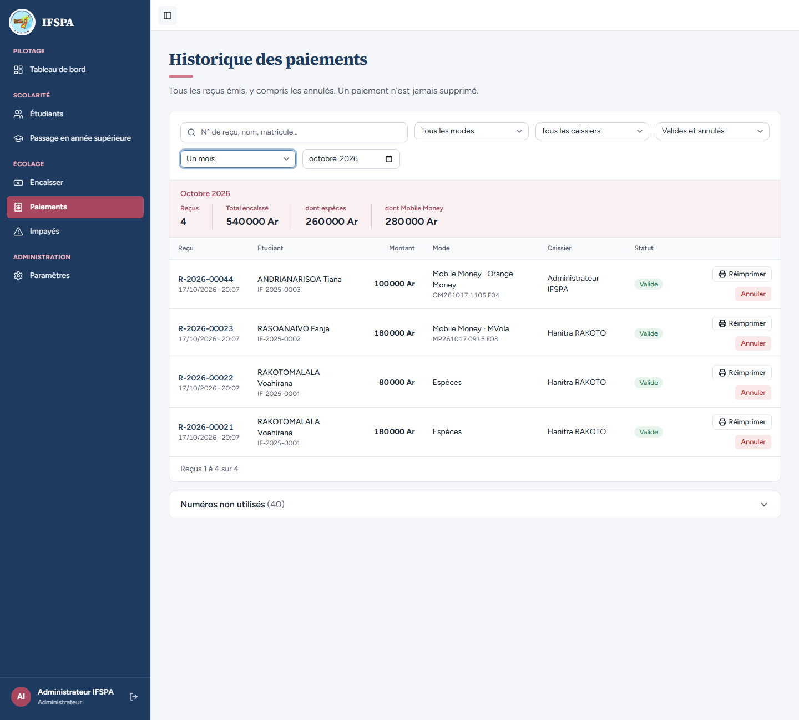 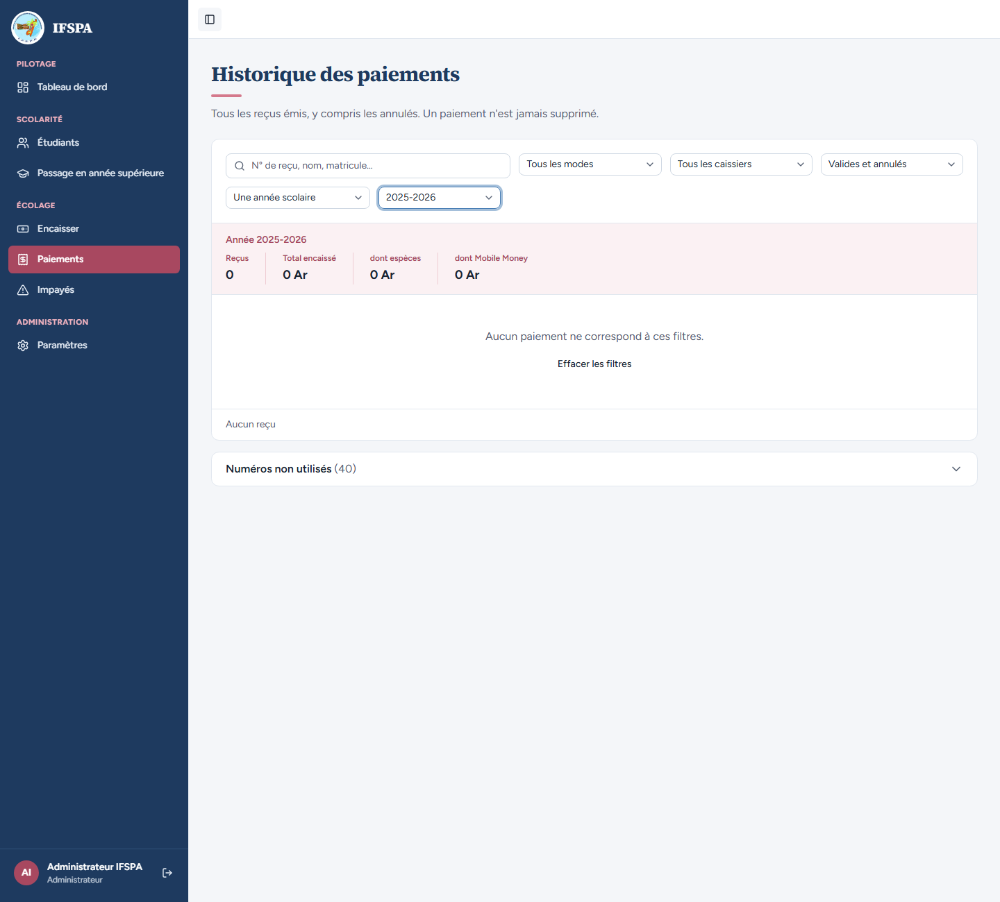 | |
| 8 | Administrateur | Revenir à **Paiements**. Cliquer **Réimprimer** sur la ligne R-2026-00023. | Page « Reçu R-2026-00023 », « RASOANAIVO Fanja · 180 000 Ar · JJ/MM/AAAA à HH:MM ». Choix « Rouleau 80 mm » (coché), « Rouleau 58 mm », « Imprimer aussi un double pour l'institut », bouton « Imprimer le ticket ». Aperçu du ticket à l'échelle réelle, sans mention ANNULÉ. | 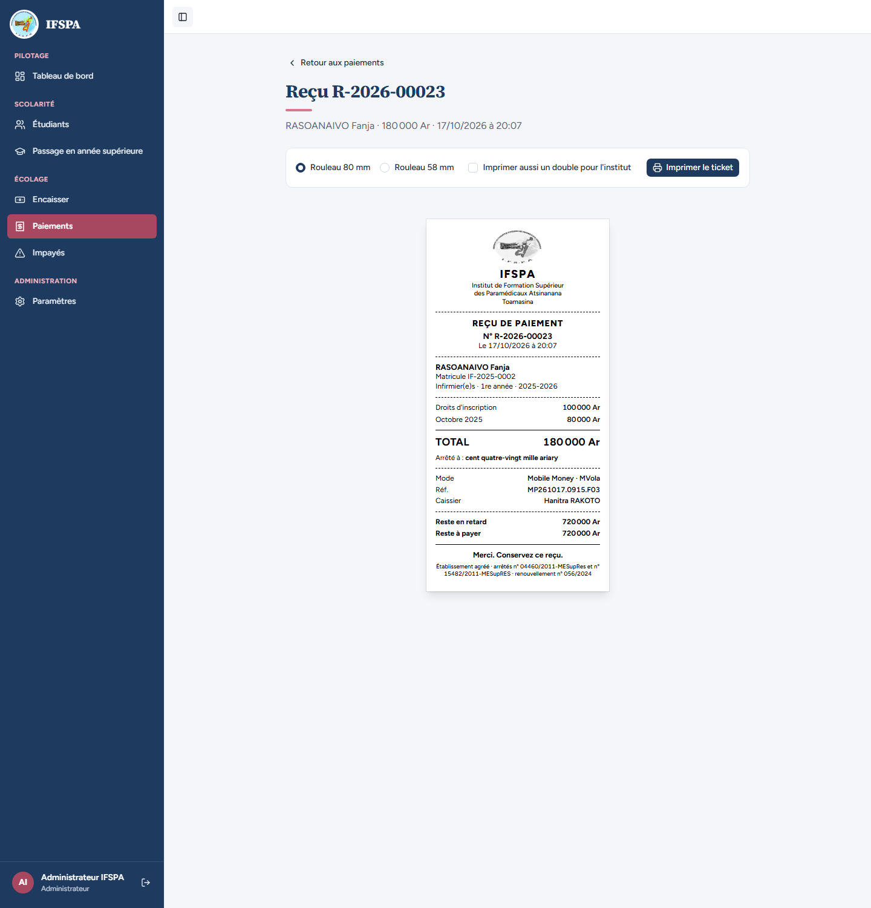 | |
| 9 | Administrateur | Cliquer **Imprimer le ticket** et regarder l'aperçu avant impression. | L'impression se lance. Ticket 80 mm noir et blanc : « N° R-2026-00023 », RASOANAIVO Fanja, « Matricule IF-2025-0002 », Droits d'inscription 100 000 Ar, Octobre 2025 80 000 Ar, TOTAL 180 000 Ar, « Arrêté à : cent quatre-vingt mille ariary », Mode « Mobile Money · MVola », Réf. MP261017.0915.F03, Caissier Hanitra RAKOTO, Reste en retard 720 000 Ar, Reste à payer 720 000 Ar. | 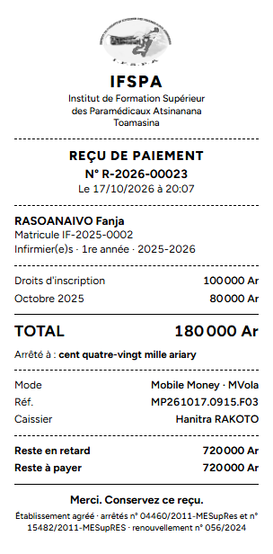 | |
| 10 | Administrateur | Revenir à **Paiements** (liste du jour). Cliquer **Numéros non utilisés (40)** en bas de page. | Le panneau s'ouvre : « Un poste hors ligne réserve ses numéros de reçu à l'avance. Ceux qui n'ont servi à aucun ticket restent vides : ce n'est pas une erreur, mais un contrôle peut les demander. » ; « 2026 · 40 numéros encore détenus par les postes » ; deux lignes « Administrateur IFSPA · poste xxxxxxxx » et « Hanitra RAKOTO · poste xxxxxxxx », chacune « 20 numéros libres (1 bloc) ». | 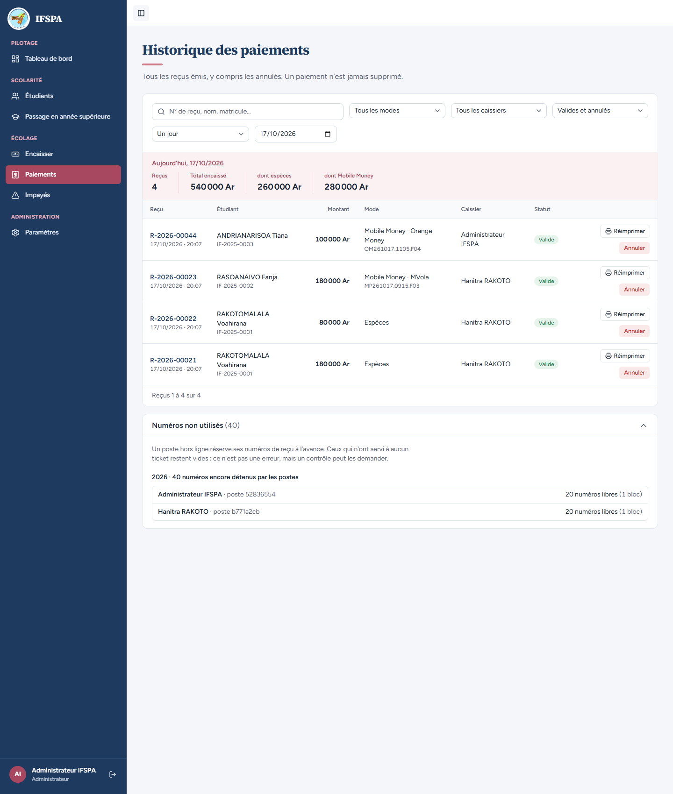 | |

## Ce que ce scénario ne couvre pas

- Pagination (plus de 50 reçus), période « Entre deux dates » et choix d'un jour précis : non déroulés (le code est le même que « Un mois »).
- Pas d'export Excel des paiements (décision provisoire n° 19 : hors plan).
- Impression sur l'imprimante thermique réelle : à faire par Diano (voir le rapport).
- Écran mobile : non déroulé.

## Dernière exécution par l'agent

- 17/10/2026 : ✅ 10 étapes sur 10. Voir [RAPPORT_2026-10-17_UC07](../../rapports/RAPPORT_2026-10-17_UC07.md).
- Parcours : [UC07-01-controle-journee.recette.ts](../../parcours/UC07-01-controle-journee.recette.ts) (préparation : [00d-preparation-journee.recette.ts](../../parcours/00d-preparation-journee.recette.ts)).
