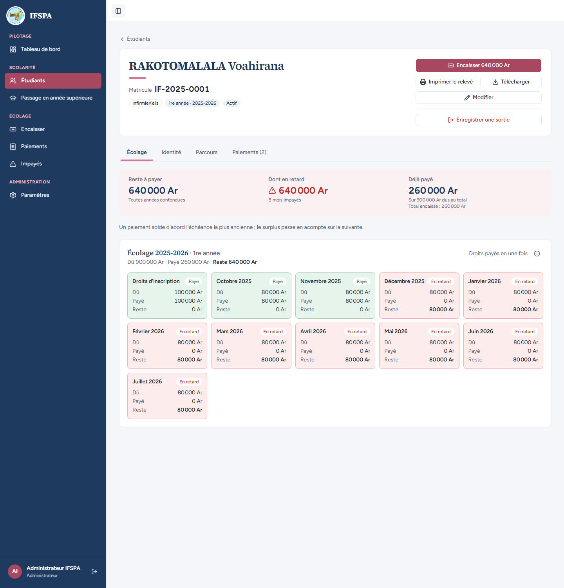
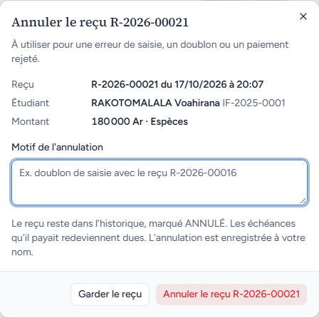
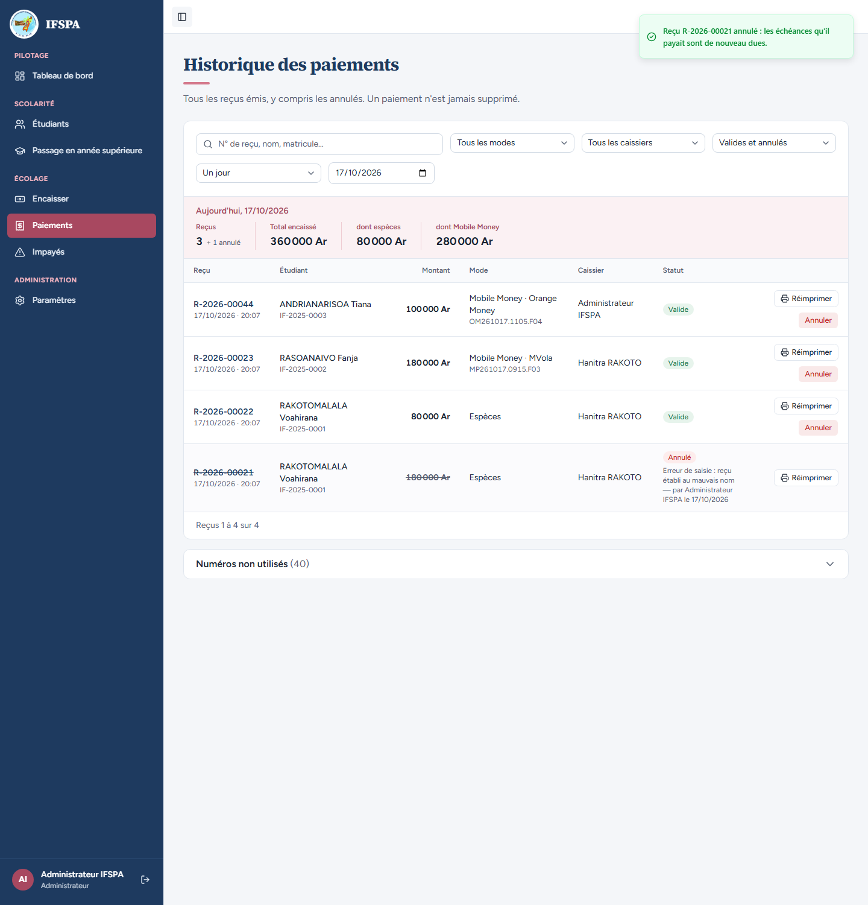
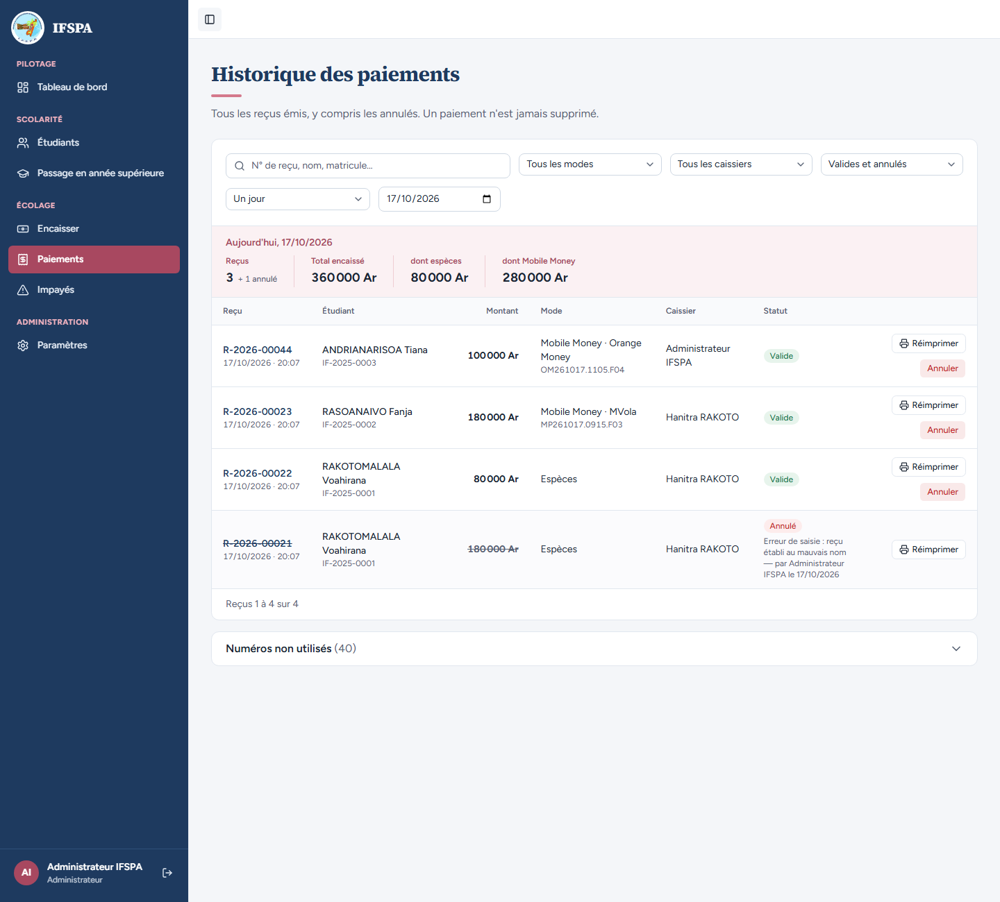
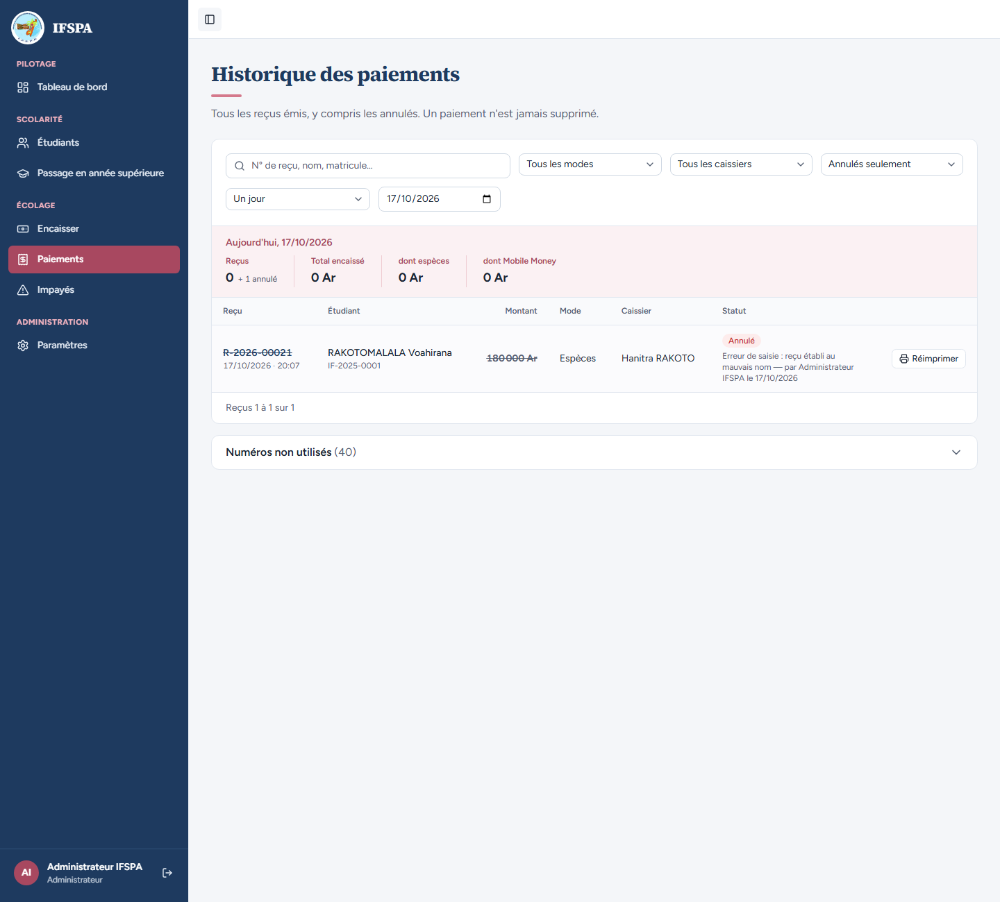
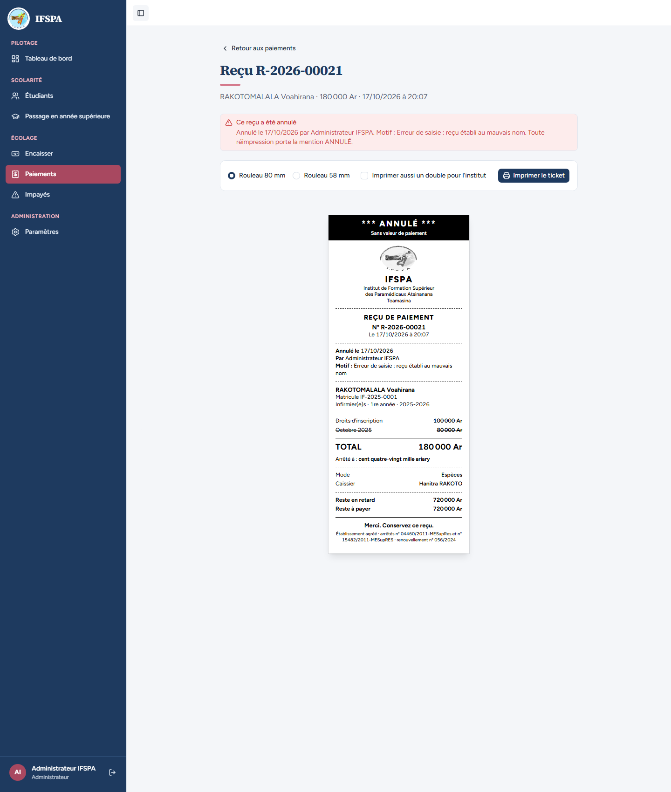
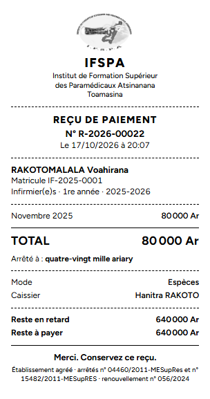
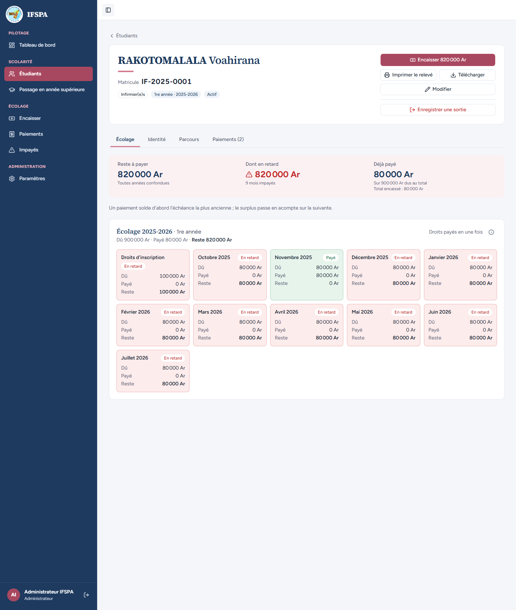
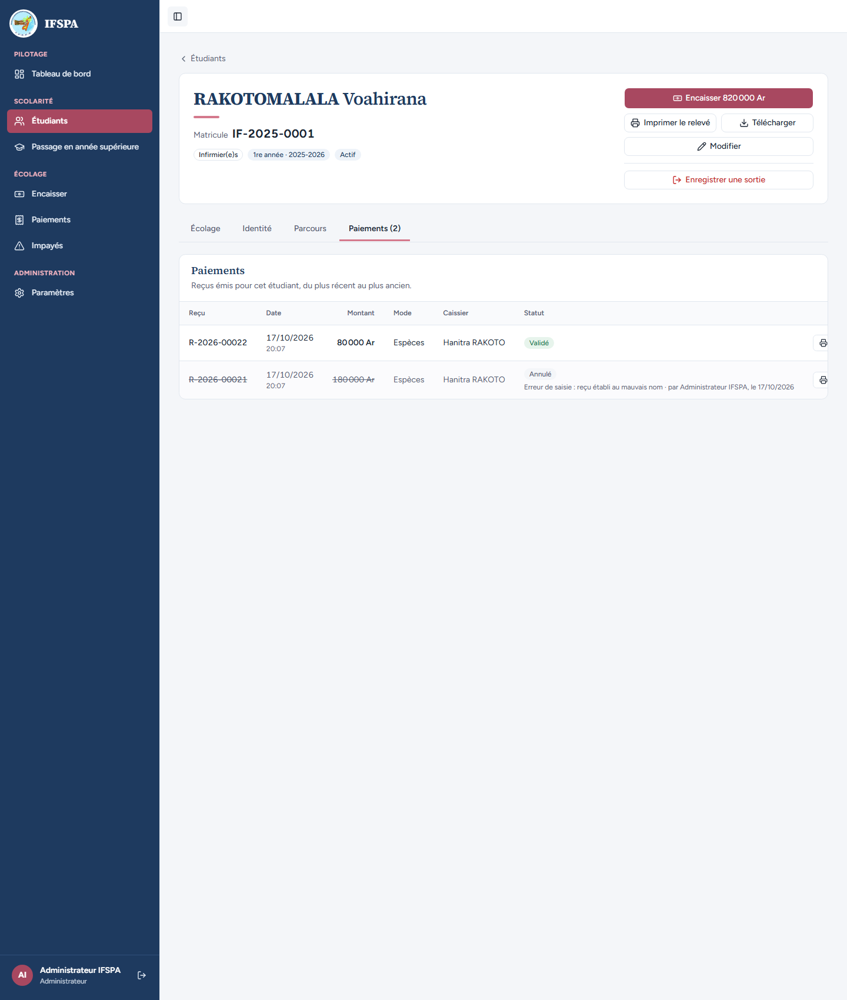
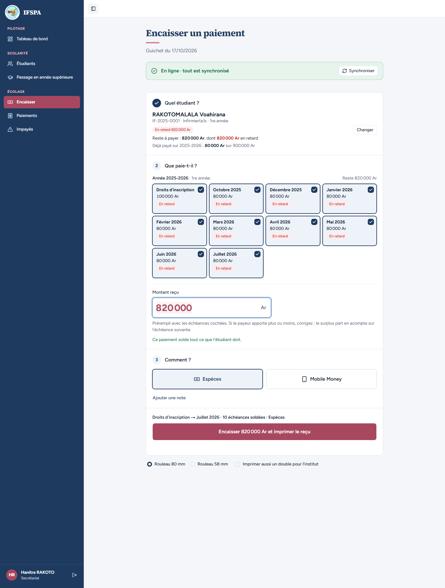

# UC07-02. L'administrateur annule le reçu de Voahirana RAKOTOMALALA : son reste dû remonte

| | |
|---|---|
| Use case | UC07. Contrôler les paiements et annuler un reçu |
| Règles couvertes | R-ANN (le reçu reste dans l'historique, motif, auteur et date, ticket ANNULÉ), R-ROLE (annulation réservée à l'administrateur), R-RET et R-REP (les échéances redeviennent dues, en retard, cochées d'office au guichet), décision provisoire n° 13 (le ticket réimprimé garde les valeurs d'émission) |
| Rôle | Administrateur (étapes 1 à 8), puis secrétariat (étape 9) |
| Durée estimée | 12 minutes |

## La situation

La secrétaire a établi le reçu de 180 000 Ar (droits d'inscription et octobre) au nom de RAKOTOMALALA Voahirana alors que le parent payait pour une autre étudiante. L'administrateur annule ce reçu en écrivant le motif. Le reçu reste dans l'historique, marqué ANNULÉ ; les droits et octobre redeviennent dus ; le second reçu de la même étudiante (novembre) n'est pas touché.

## Avant de commencer

1. `pnpm db:up`, `pnpm recette:base`, `pnpm build`, `pnpm recette:app`, puis ouvrir `http://localhost:3200`.
2. Avoir déroulé [00-PREPARATION.md](../00-PREPARATION.md), sections A, B, C puis F, et le cas [UC07-01](UC07-01-controle-journee.md) (il ne modifie rien).
3. Se connecter avec le compte **administrateur** pour les étapes 1 à 8, puis avec le compte **secrétariat** (identifiants `SEED_USER_*` de `.env`, « Hanitra RAKOTO ») pour l'étape 9.
4. Reçus concernés : **R-2026-00021** (droits d'inscription + octobre 2025, 180 000 Ar, espèces, annulé dans ce cas) et **R-2026-00022** (novembre 2025, 80 000 Ar, espèces).

## Étapes

| # | Qui | Action | Résultat attendu | Capture | ✓ |
|---|---|---|---|---|---|
| 1 | Administrateur | Menu **Paiements**, cliquer le nom **RAKOTOMALALA Voahirana** sur la ligne R-2026-00021. | Fiche IF-2025-0001. « Reste à payer **640 000 Ar** » (« Toutes années confondues »), « Dont en retard 640 000 Ar » (« 8 mois impayés »), « Déjà payé **260 000 Ar** » (« Sur 900 000 Ar dus au total »). Droits d'inscription, Octobre 2025 et Novembre 2025 sont « Payé » ; Décembre 2025 à Juillet 2026 « En retard ». Onglet « Paiements (2) ». |  | |
| 2 | Administrateur | Revenir à **Paiements**. Cliquer **Annuler** sur la ligne R-2026-00021. | Fenêtre « Annuler le reçu R-2026-00021 » : « À utiliser pour une erreur de saisie, un doublon ou un paiement rejeté. » ; Reçu « R-2026-00021 du JJ/MM/AAAA à HH:MM » ; Étudiant « RAKOTOMALALA Voahirana IF-2025-0001 » ; Montant « 180 000 Ar · Espèces ». Champ « Motif de l'annulation » vide (« Ex. doublon de saisie avec le reçu R-2026-00016 »). « Le reçu reste dans l'historique, marqué ANNULÉ. Les échéances qu'il payait redeviennent dues. L'annulation est enregistrée à votre nom. » Boutons « Garder le reçu » et « Annuler le reçu R-2026-00021 ». |  | |
| 3 | Administrateur | Saisir le motif `Erreur de saisie : reçu établi au mauvais nom`, puis cliquer **Annuler le reçu R-2026-00021**. | La fenêtre se ferme. Bulle verte : « Reçu R-2026-00021 annulé : les échéances qu'il payait sont de nouveau dues. » |  | |
| 4 | Administrateur | Regarder la liste du jour. | La ligne R-2026-00021 reste, numéro et montant barrés, badge rouge **Annulé**, « Erreur de saisie : reçu établi au mauvais nom — par Administrateur IFSPA le JJ/MM/AAAA ». Plus de bouton « Annuler » sur cette ligne, « Réimprimer » reste. Récapitulatif : Reçus **3** « + 1 annulé », Total encaissé **360 000 Ar**, dont espèces **80 000 Ar**, dont Mobile Money **280 000 Ar** (le reçu annulé sort des totaux). « Reçus 1 à 4 sur 4 ». |  | |
| 5 | Administrateur | Liste « Valides et annulés » : choisir **Annulés seulement**, puis **Valides seulement**. | Annulés seulement : 1 reçu (R-2026-00021), « Reçus 0 + 1 annulé », Total encaissé 0 Ar. Valides seulement : 3 reçus, R-2026-00021 absent. |  | |
| 6 | Administrateur | Revenir à **Paiements**, cliquer **Réimprimer** sur R-2026-00021, puis regarder l'aperçu avant impression. | Page « Reçu R-2026-00021 », alerte « **Ce reçu a été annulé** » : « Annulé le JJ/MM/AAAA par Administrateur IFSPA. Motif : Erreur de saisie : reçu établi au mauvais nom. Toute réimpression porte la mention ANNULÉ. » Ticket : bandeau noir « **\*\*\* ANNULÉ \*\*\*** » et « Sans valeur de paiement » ; « Annulé le JJ/MM/AAAA », « Par Administrateur IFSPA », « Motif : Erreur de saisie : reçu établi au mauvais nom » ; lignes (Droits d'inscription 100 000 Ar, Octobre 2025 80 000 Ar) et TOTAL 180 000 Ar **barrés** ; Reste en retard 720 000 Ar et Reste à payer 720 000 Ar, valeurs de l'émission (décision provisoire n° 13). |   | |
| 7 | Administrateur | Revenir à **Paiements**, **Réimprimer** sur R-2026-00022. | Aucune alerte « annulé ». Ticket sans mention ANNULÉ : Novembre 2025 80 000 Ar, TOTAL 80 000 Ar, « quatre-vingt mille ariary », Reste à payer 640 000 Ar (valeur de l'émission, inchangée). |  | |
| 8 | Administrateur | Revenir à **Paiements**, ouvrir la fiche de RAKOTOMALALA Voahirana, puis l'onglet **Paiements (2)**. | Reste à payer **820 000 Ar**, dont en retard 820 000 Ar (« 9 mois impayés »), Déjà payé **80 000 Ar**. Droits d'inscription (100 000 Ar, payé 0 Ar) et Octobre 2025 sont de nouveau « En retard » ; Novembre 2025 reste « Payé ». Onglet Paiements : R-2026-00022 « Validé » ; R-2026-00021 barré, « Annulé », « Erreur de saisie : reçu établi au mauvais nom · par Administrateur IFSPA, le JJ/MM/AAAA ». |   | |
| 9 | Secrétariat | Se connecter avec le compte secrétariat. Menu **Encaisser**, chercher `RAKOTOMALALA`, Entrée. | « Reste à payer : **820 000 Ar**, dont 820 000 Ar en retard » ; « Déjà payé sur 2025-2026 : 80 000 Ar sur 900 000 Ar ». **Droits d'inscription** et **Octobre 2025** sont de nouveau là, cochés d'office, « En retard » ; Novembre 2025 n'est plus proposé (soldé). « Montant reçu » **820 000**, « Ce paiement solde tout ce que l'étudiant doit. », bouton « Encaisser 820 000 Ar et imprimer le reçu ». « Hanitra RAKOTO » est en bas de la barre latérale. |  | |

## Ce que ce scénario ne couvre pas

- Le refus **côté serveur** de l'annulation par un compte secrétariat est couvert par Vitest : `tests/integration/actions-paiements.test.ts` (« refuse le rôle user avec le message réel, sans rien modifier », « refuse l'appel direct avec une entrée invalide »). Voir aussi [UC07-04](UC07-04-secretariat-sans-annulation.md).
- « Les échéances couvertes redeviennent dues, acomptes compris » et « le reçu annulé garde ses montants et restes d'émission » : couverts par Vitest (`tests/integration/actions-paiements.test.ts`, bloc `annulerPaiement`).
- **Effet sur une admission** (décision provisoire n° 24) : un passage en année supérieure dont une inscription porte un reçu, même annulé, ne peut plus être annulé. Non déroulé ici : voir UC10.
- Le motif est visible de tous, secrétariat compris ([UC07-04](UC07-04-secretariat-sans-annulation.md)).
- Ordinateur seulement ; imprimante réelle : à faire par Diano.

## Dernière exécution par l'agent

- 17/10/2026 : ✅ 9 étapes sur 9. Voir [RAPPORT_2026-10-17_UC07](../../rapports/RAPPORT_2026-10-17_UC07.md).
- Parcours : [UC07-02-annulation-motif.recette.ts](../../parcours/UC07-02-annulation-motif.recette.ts).
