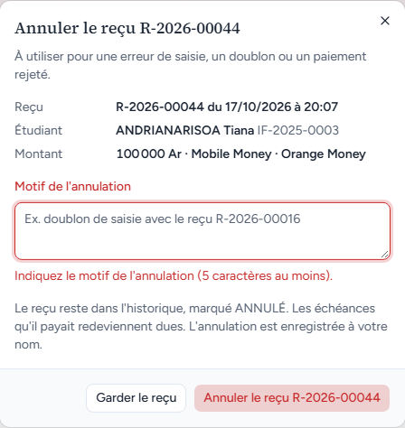
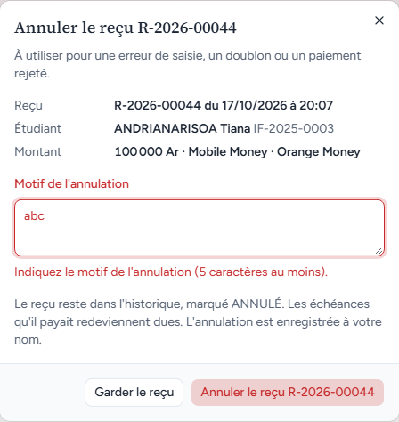
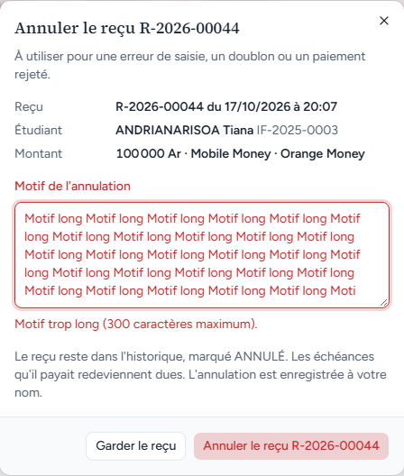
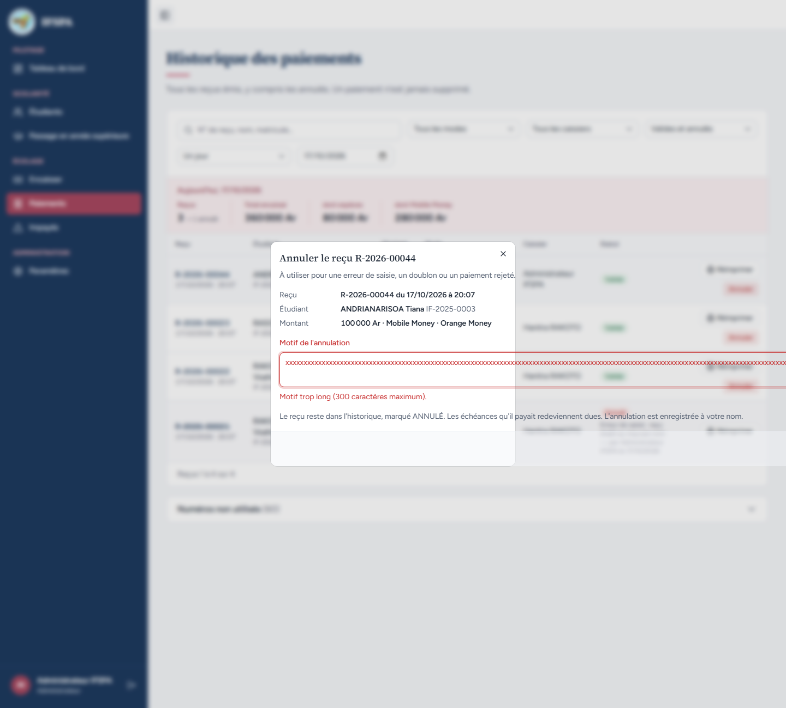
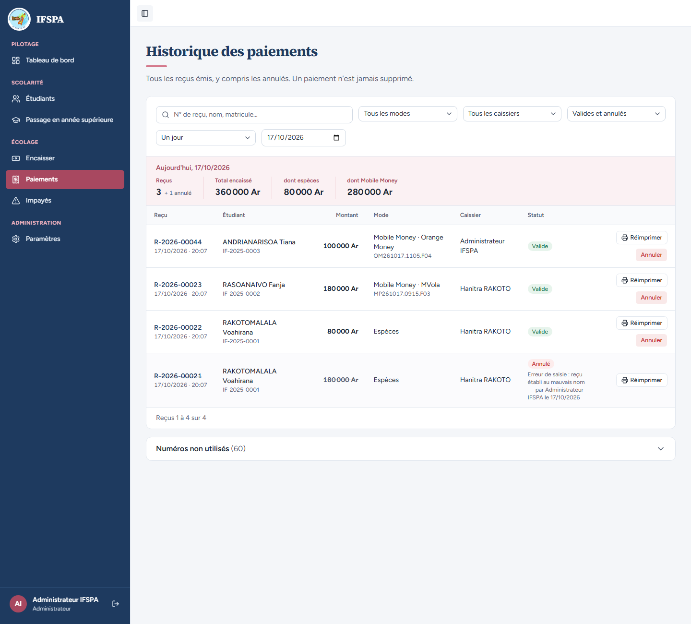
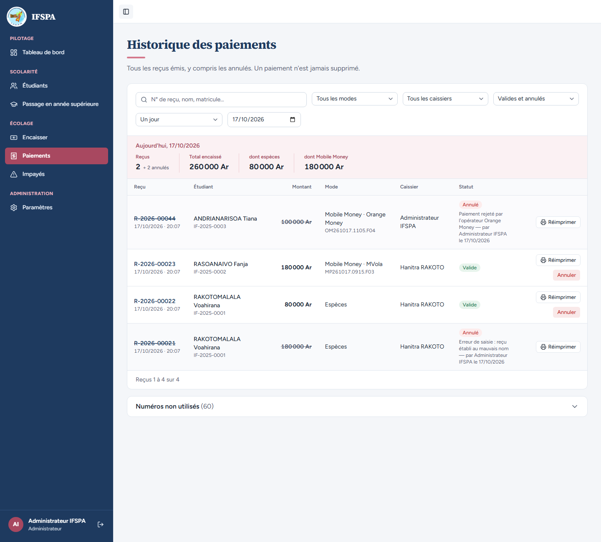

# UC07-03. L'annulation est refusée sans motif, et quand le reçu vient d'être annulé par un autre

| | |
|---|---|
| Use case | UC07. Contrôler les paiements et annuler un reçu |
| Règles couvertes | R-ANN (motif obligatoire, une annulation déjà faite est refusée sans rien écraser) |
| Rôle | Administrateur, compte « Administrateur IFSPA » |
| Durée estimée | 8 minutes |

## La situation

L'administrateur ouvre la fenêtre d'annulation du reçu R-2026-00044 (ANDRIANARISOA Tiana) mais oublie le motif, puis en met un trop court. Il se ravise un instant. Pendant ce temps, un second administrateur annule le même reçu : quand le premier valide à son tour, rien n'est écrasé, le reçu garde la première annulation.

## Avant de commencer

1. `pnpm db:up`, `pnpm recette:base`, `pnpm build`, `pnpm recette:app`, puis ouvrir `http://localhost:3200`.
2. Avoir déroulé [00-PREPARATION.md](../00-PREPARATION.md), sections A, B, C puis F, et les cas [UC07-01](UC07-01-controle-journee.md) et [UC07-02](UC07-02-annulation-motif.md) (R-2026-00021 est déjà annulé : les totaux de l'étape 5 en dépendent).
3. Se connecter avec le compte **administrateur** (identifiants `SEED_ADMIN_*` de `.env`) dans deux fenêtres distinctes pour l'étape 6 (une fenêtre de navigation privée convient).
4. Reçu concerné : **R-2026-00044**, ANDRIANARISOA Tiana, 100 000 Ar, Mobile Money · Orange Money.

## Étapes

| # | Qui | Action | Résultat attendu | Capture | ✓ |
|---|---|---|---|---|---|
| 1 | Administrateur | Menu **Paiements**. Cliquer **Annuler** sur R-2026-00044, laisser « Motif de l'annulation » vide, cliquer **Annuler le reçu R-2026-00044**. | La fenêtre reste ouverte (Reçu « R-2026-00044 du JJ/MM/AAAA à HH:MM », Étudiant « ANDRIANARISOA Tiana IF-2025-0003 », Montant « 100 000 Ar · Mobile Money · Orange Money »). Le champ passe en rouge, prend le focus, et le message dit « **Indiquez le motif de l'annulation (5 caractères au moins).** » |  | |
| 2 | Administrateur | Écrire `abc` dans le motif, cliquer **Annuler le reçu R-2026-00044**. Puis remplacer par six espaces et valider de nouveau. | Même message dans les deux cas : « Indiquez le motif de l'annulation (5 caractères au moins). » (les espaces seuls ne comptent pas). La fenêtre reste ouverte. |  | |
| 3 | Administrateur | Coller un motif de 301 caractères avec des espaces (par exemple « Motif long » répété), valider. | « **Motif trop long (300 caractères maximum).** » La fenêtre reste ouverte. |  | |
| 4 | Administrateur | Remplacer le motif par 301 fois la lettre `x` (aucun espace). | Attendu : la fenêtre reste utilisable (texte à la ligne ou défilement dans le champ, boutons visibles). **Constaté : ❌ le texte déborde de la fenêtre et le bouton « Annuler le reçu R-2026-00044 » sort de l'écran** (voir le rapport, anomalie mineure). Effacer le champ pour continuer. |  | |
| 5 | Administrateur | Cliquer **Garder le reçu**. | La fenêtre se ferme. R-2026-00044 reste « Valide », son bouton « Annuler » est toujours là, Total encaissé 360 000 Ar (R-2026-00021 est déjà annulé). |  | |
| 6 | Administrateur | **Fenêtre 1** : cliquer **Annuler** sur R-2026-00044, écrire `Doublon de saisie avec un autre poste`, ne pas valider. **Fenêtre 2** (second navigateur, même compte) : Paiements, **Annuler** sur R-2026-00044, motif `Paiement rejeté par l'opérateur Orange Money`, **Annuler le reçu R-2026-00044**. Revenir à la fenêtre 1 et cliquer **Annuler le reçu R-2026-00044**. | Fenêtre 2 : la ligne passe à « Annulé ». Fenêtre 1 : l'annulation est refusée par le serveur (« Le reçu R-2026-00044 est déjà annulé. »), la ligne se met à jour et la fenêtre disparaît avec le bouton « Annuler » : le message n'est lisible qu'un instant (voir le rapport). | | |
| 7 | Administrateur | Fenêtre 1 : regarder la ligne R-2026-00044. | La ligne est « Annulé » avec le motif et l'auteur de la **première** annulation : « Paiement rejeté par l'opérateur Orange Money — par Administrateur IFSPA le JJ/MM/AAAA » ; le motif « Doublon de saisie avec un autre poste » n'apparaît nulle part. Plus de bouton « Annuler ». Reçus **2** « + 2 annulés », Total encaissé **260 000 Ar**, dont espèces 80 000 Ar, dont Mobile Money 180 000 Ar. |  | |

## Ce que ce scénario ne couvre pas

- Le message exact « Le reçu R-2026-00044 est déjà annulé. » n'a pas pu être capturé : il ne s'affiche qu'un instant avant que la fenêtre ne disparaisse (étape 6). Il est vérifié côté serveur par Vitest : `tests/integration/actions-paiements.test.ts` (« refuse d'annuler deux fois, sans modifier l'auteur ni la date de la première annulation », « deux annulations simultanées : une seule aboutit ») et `tests/integration/actions-verification.test.ts` (« annulerPaiement : déjà annulé revalide »).
- Motif trop court ou absent côté serveur : couvert par Vitest, `tests/integration/actions-paiements.test.ts` (« refuse un motif de moins de 5 caractères »).
- Ordinateur seulement.

## Dernière exécution par l'agent

- 17/10/2026 : ✅ 6 étapes sur 7, **❌ étape 4** (constat mineur, motif de 301 caractères sans espace : le bouton sort de l'écran). Voir [RAPPORT_2026-10-17_UC07](../../rapports/RAPPORT_2026-10-17_UC07.md). L'étape 6 se déroule dans le parcours avec un second navigateur ; la capture manque parce que le message disparaît.
- Parcours : [UC07-03-refus-annulation.recette.ts](../../parcours/UC07-03-refus-annulation.recette.ts).
