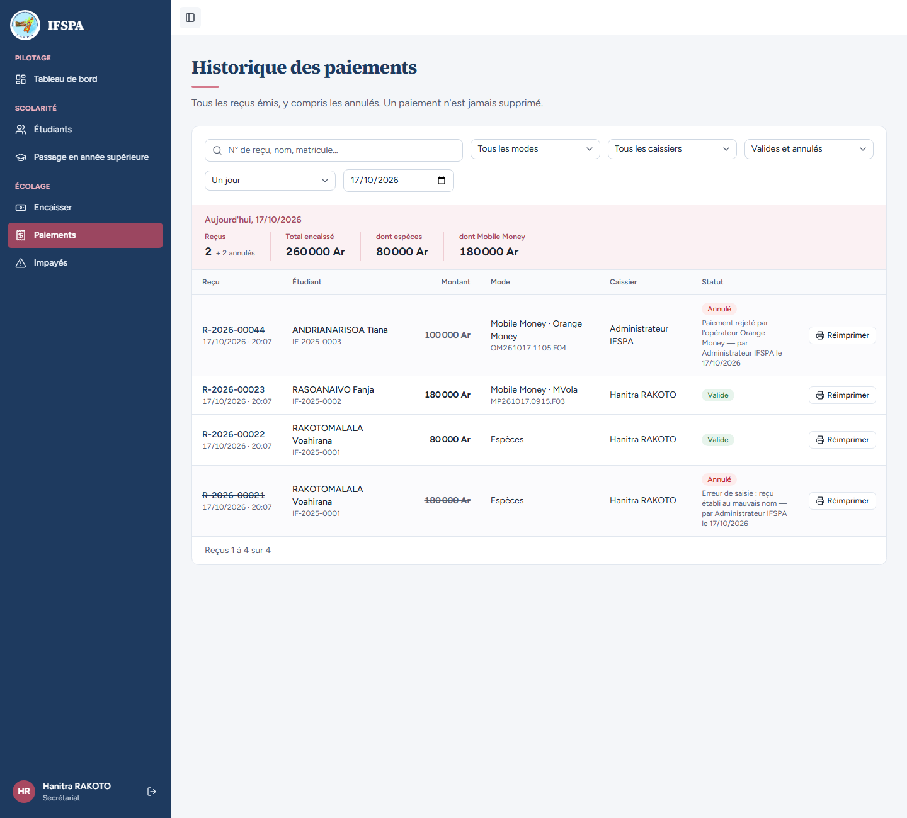
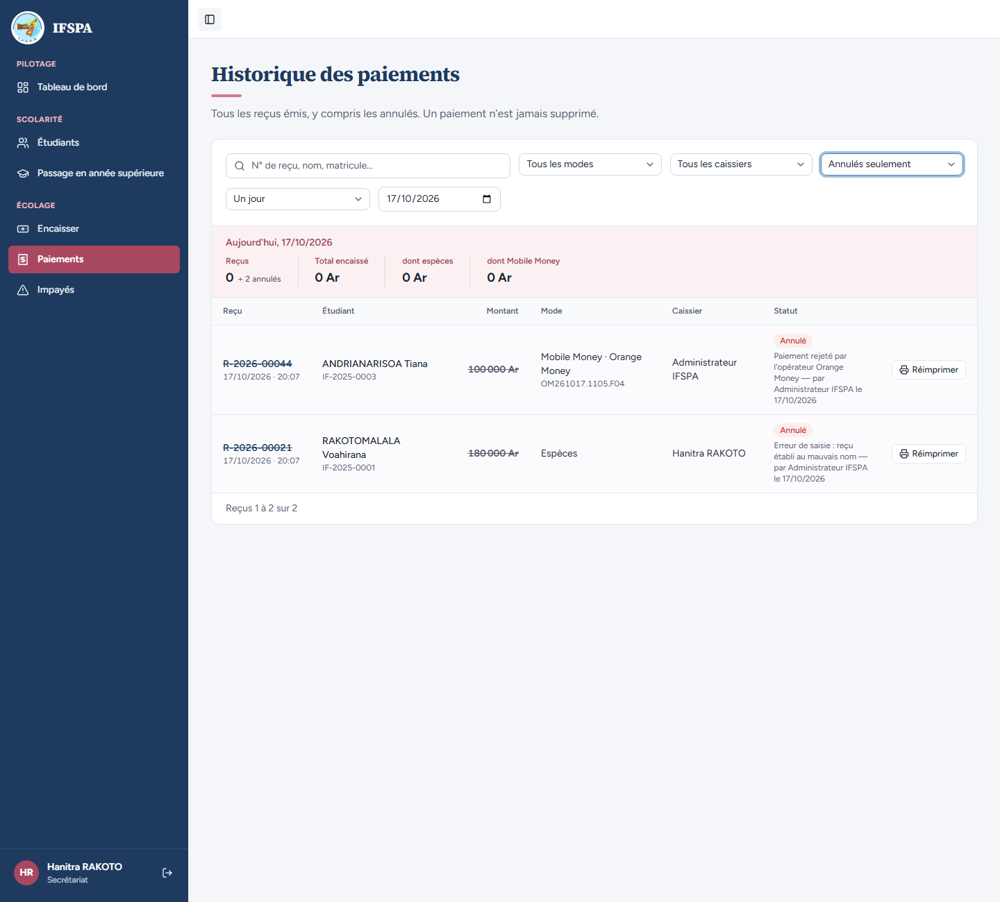
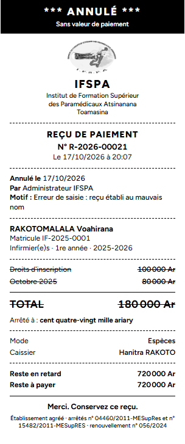
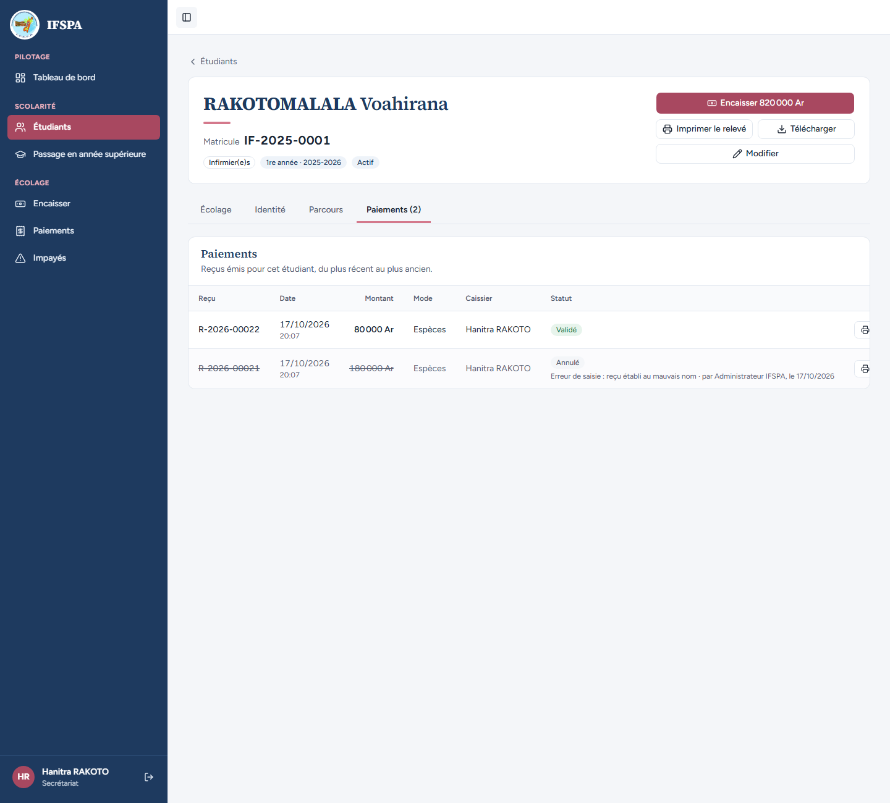

# UC07-04. La secrétaire consulte les paiements et réimprime un ticket, sans pouvoir annuler

| | |
|---|---|
| Use case | UC07. Contrôler les paiements et annuler un reçu |
| Règles couvertes | R-ROLE (le secrétariat ne supprime ni n'annule rien, ne voit pas « Numéros non utilisés »), R-ANN (le reçu annulé reste lisible et porte ANNULÉ), R-RECU (réimpression) |
| Rôle | Secrétariat, compte « Hanitra RAKOTO » |
| Durée estimée | 8 minutes |

## La situation

Une mère revient avec son ticket et la secrétaire cherche le reçu dans l'historique. Elle peut le lire, le chercher, le réimprimer, voir qu'un reçu a été annulé et pourquoi. Mais aucun bouton ne lui permet d'annuler : cela revient à l'administrateur.

## Avant de commencer

1. `pnpm db:up`, `pnpm recette:base`, `pnpm build`, `pnpm recette:app`, puis ouvrir `http://localhost:3200`.
2. Avoir déroulé [00-PREPARATION.md](../00-PREPARATION.md), sections A, B, C puis F, et les cas [UC07-01](UC07-01-controle-journee.md) à [UC07-03](UC07-03-refus-annulation.md) **dans l'ordre** : R-2026-00021 et R-2026-00044 doivent être annulés.
3. Se connecter avec le compte **secrétariat** (identifiants `SEED_USER_*` de `.env`) ; « Hanitra RAKOTO », « Secrétariat » s'affichent en bas de la barre latérale.

## Étapes

| # | Qui | Action | Résultat attendu | Capture | ✓ |
|---|---|---|---|---|---|
| 1 | Secrétariat | Menu **Paiements**. | Titre « Historique des paiements ». « Hanitra RAKOTO » et « Secrétariat » en bas de la barre latérale. Aucune rubrique Paramètres. Reçus **2** « + 2 annulés », Total encaissé **260 000 Ar**, dont espèces 80 000 Ar, dont Mobile Money 180 000 Ar. Quatre lignes : R-2026-00044 et R-2026-00021 « Annulé » (numéro et montant barrés, motif « Paiement rejeté par l'opérateur Orange Money — par Administrateur IFSPA le … » et « Erreur de saisie : reçu établi au mauvais nom — par Administrateur IFSPA le … »), R-2026-00023 et R-2026-00022 « Valide ». |  | |
| 2 | Secrétariat | Regarder la colonne des actions et le bas de page. | Une seule action par ligne : **Réimprimer** (4 lignes). **Aucun bouton « Annuler »**, aucun « Marquer comme vérifié », et pas de section « Numéros non utilisés » (elle n'apparaît que pour l'administrateur). |  | |
| 3 | Secrétariat | Taper `00022` dans la recherche ; puis, de retour sur **Paiements**, choisir **Annulés seulement** dans la liste de statut. | `00022` : un seul reçu, RAKOTOMALALA Voahirana. Annulés seulement : deux reçus (R-2026-00044 et R-2026-00021) avec leur motif lisible. Recherche et filtres fonctionnent comme pour l'administrateur. |  | |
| 4 | Secrétariat | Revenir à **Paiements**, **Réimprimer** sur R-2026-00023, puis **Imprimer le ticket**. | Page « Reçu R-2026-00023 ». L'impression se lance. Ticket 80 mm : « N° R-2026-00023 », RASOANAIVO Fanja, Droits d'inscription 100 000 Ar, Octobre 2025 80 000 Ar, TOTAL 180 000 Ar, Mobile Money · MVola, Réf. MP261017.0915.F03, Caissier Hanitra RAKOTO, Reste à payer 720 000 Ar. Pas de mention ANNULÉ. |  | |
| 5 | Secrétariat | Revenir à **Paiements**, **Réimprimer** sur R-2026-00021 (annulé). | Alerte « Ce reçu a été annulé » avec le motif, aucun bouton d'annulation. Ticket : « *** ANNULÉ *** », « Sans valeur de paiement », « Par Administrateur IFSPA », lignes barrées. |  | |
| 6 | Secrétariat | Revenir à **Paiements**, cliquer le nom **RAKOTOMALALA Voahirana**, onglet **Paiements (2)**. | Fiche IF-2025-0001 : boutons « Encaisser 820 000 Ar », « Imprimer le relevé », « Télécharger », « Modifier » ; **pas** de « Enregistrer une sortie » (réservé à l'administrateur). Onglet Paiements : R-2026-00022 « Validé » ; R-2026-00021 barré, « Annulé » avec son motif. Aucun bouton « Annuler », seulement le bouton d'impression. |  | |

## Ce que ce scénario ne couvre pas

- **Refus côté serveur** : un appel direct à l'action d'annulation avec le rôle secrétariat ne se démontre pas dans le navigateur. Il est couvert par Vitest : `tests/integration/actions-paiements.test.ts`, bloc `annulerPaiement` (« refuse le rôle user avec le message réel, sans rien modifier » : « Cette action est réservée à l'administrateur. », le paiement reste valide et rien n'est revalidé ; « refuse l'appel direct avec une entrée invalide » ; « sans session : redirigé vers la connexion »). Pour « Marquer comme vérifié » : `tests/integration/actions-verification.test.ts` (« refuse le rôle user côté serveur, sans rien modifier »).
- « Marquer comme vérifié » n'est pas visible ici faute de reçu à vérifier : il est vu côté secrétariat dans [UC07-05](UC07-05-a-verifier.md), étape 4.
- Accès direct aux Paramètres par l'adresse : voir UC01 et [UC15-07](../UC15-reprise/UC15-07-secretariat-refuse.md).
- Ordinateur seulement.

## Dernière exécution par l'agent

- 17/10/2026 : ✅ 6 étapes sur 6. Voir [RAPPORT_2026-10-17_UC07](../../rapports/RAPPORT_2026-10-17_UC07.md). Constat mineur : le bouton « Réimprimer » de la fiche est rogné quand un motif d'annulation est long (voir le rapport).
- Parcours : [UC07-04-secretariat-sans-annulation.recette.ts](../../parcours/UC07-04-secretariat-sans-annulation.recette.ts).
