# UC07-05. Deux reçus du guichet hors ligne arrivent « à vérifier » : l'administrateur en vérifie un et annule l'autre

| | |
|---|---|
| Use case | UC07. Contrôler les paiements et annuler un reçu |
| Règles couvertes | R-ANN (annulation d'un reçu à vérifier), R-ROLE (« Marquer comme vérifié » et « Annuler » réservés à l'administrateur), R-HL (reçu hors ligne enregistré avec une remarque), R-REP (répartition du serveur), décisions provisoires n° 37 et 47 (réimpression d'un reçu à vérifier), n° 43 (un reçu à vérifier annulé sort du filtre) |
| Rôle | Secrétariat (étapes 1 à 4), puis administrateur (étapes 5 à 12) |
| Durée estimée | 15 minutes |

## La situation

Internet est coupé au guichet. La secrétaire continue d'encaisser sur son poste : 180 000 Ar pour Mialy RAZAFINDRAKOTO et 180 000 Ar pour Lalaina RABEMANANJARA (les droits et octobre). Pendant la coupure, un second poste a déjà encaissé les mêmes mois pour les deux étudiantes. Quand Internet revient, les deux reçus du premier poste sont enregistrés mais signalés « À vérifier ». L'administrateur lit la note : il valide le reçu de Mialy, et annule celui de Lalaina qui fait doublon.

## Avant de commencer

1. `pnpm db:up`, `pnpm recette:base`, `pnpm build`, `pnpm recette:app`, puis ouvrir `http://localhost:3200` dans Chrome ou Edge (le service worker n'existe que sur le build).
2. Avoir déroulé [00-PREPARATION.md](../00-PREPARATION.md), sections A, B, C puis F, et les cas [UC07-01](UC07-01-controle-journee.md) à [UC07-04](UC07-04-secretariat-sans-annulation.md) **dans l'ordre**. Les deux étudiantes n'ont encore rien payé : RAZAFINDRAKOTO Mialy (SF-2025-0001) et RABEMANANJARA Lalaina (SF-2025-0002), 900 000 Ar en retard chacune.
3. Il faut deux postes : le **poste 1** (navigateur principal) et le **poste 2** (un autre navigateur ou une fenêtre de navigation privée, avec Internet), tous deux connectés avec le compte **secrétariat**, plus une fenêtre **administrateur** (identifiants `SEED_ADMIN_*`) pour les étapes 5 à 12.
4. Couper Internet sur le poste 1 : outils de développement du navigateur › Réseau › « Hors connexion ». Rétablir ensuite.
5. **Numéros de reçu** : ils dépendent des postes ouverts. Dans la recette automatisée, les deux reçus du poste 1 sont **R-2026-00085** (Mialy) et **R-2026-00086** (Lalaina), ceux du poste 2 R-2026-00125 et R-2026-00126. Dans votre navigateur ils seront autres : lisez-les à l'écran et remplacez-les dans les étapes.

## Étapes

| # | Qui | Action | Résultat attendu | Capture | ✓ |
|---|---|---|---|---|---|
| 1 | Secrétariat, poste 1 | Menu **Encaisser** avec Internet (bandeau « En ligne · tout est synchronisé »), couper Internet, recharger la page. Chercher `RAZAFINDRAKOTO`, Entrée ; cliquer la carte **Novembre 2025** pour ne garder que les droits et octobre ; **Encaisser 180 000 Ar et imprimer le reçu**. Recommencer pour `RABEMANANJARA`. | Bandeau « Hors ligne · vous pouvez continuer à encaisser ». Pour chaque étudiante « Reste à payer : 900 000 Ar » puis le message « Ticket R-… remis » (R-2026-00085, puis R-2026-00086). Ticket de Mialy : Droits d'inscription 100 000 Ar, Octobre 2025 80 000 Ar, TOTAL 180 000 Ar, Reste à payer 720 000 Ar. Bandeau « 2 paiements en attente ». | 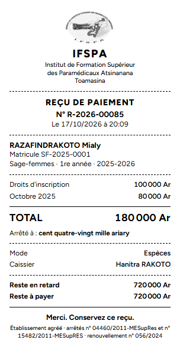 | |
| 2 | Secrétariat, poste 2 | Avec Internet, sur le second poste : **Encaisser**, `RAZAFINDRAKOTO`, Entrée, carte **Novembre 2025**, **Encaisser 180 000 Ar et imprimer le reçu** ; recommencer pour `RABEMANANJARA`. | Deux messages « Paiement enregistré : reçu R-… ». Le serveur a maintenant 180 000 Ar de payé pour chaque étudiante. | | |
| 3 | Secrétariat, poste 1 | Rétablir Internet sur le poste 1 et attendre. | Bandeau « En ligne · tout est synchronisé », « **2 paiements envoyés au serveur** · **2 à vérifier par l'administrateur** », puis pour chaque reçu : « Reçu R-2026-00085 enregistré, à vérifier par l'administrateur : Situation changée avant la synchronisation : le poste affichait 900 000 Ar de reste dû, le serveur 720 000 Ar. » (idem R-2026-00086). | 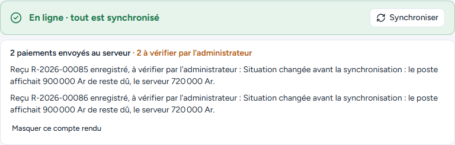 | |
| 4 | Secrétariat, poste 1 | Menu **Paiements**. Dans le récapitulatif, cliquer **Les voir** à côté de « À vérifier 2 ». | « Hanitra RAKOTO » en bas de la barre latérale. Statut « À vérifier » : 2 reçus (R-2026-00086 RABEMANANJARA Lalaina, R-2026-00085 RAZAFINDRAKOTO Mialy), 180 000 Ar, Espèces, badges « Valide » **et** « À vérifier » avec la note « Situation changée avant la synchronisation : le poste affichait 900 000 Ar de reste dû, le serveur 720 000 Ar. » Total encaissé 360 000 Ar. **Seul « Réimprimer » est proposé** : ni « Marquer comme vérifié », ni « Annuler ». | 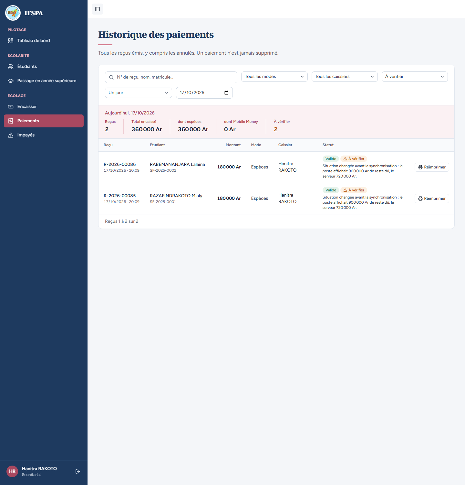 | |
| 5 | Administrateur | Dans la fenêtre administrateur : **Paiements**, cliquer **Les voir** à côté de « À vérifier 2 ». | « Administrateur IFSPA » en bas de la barre latérale. Mêmes deux reçus, chacun avec trois boutons : **Réimprimer**, **Marquer comme vérifié** et **Annuler**. | 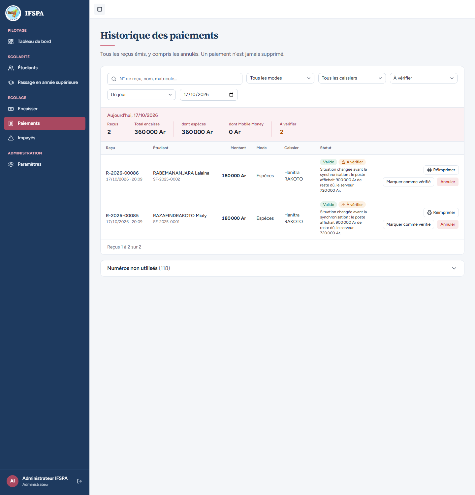 | |
| 6 | Administrateur | Sur R-2026-00085 (Mialy), cliquer **Marquer comme vérifié**. | Fenêtre « Vérifier le reçu R-2026-00085 » : « Ce paiement a été saisi hors ligne puis enregistré avec une remarque. » ; Reçu, Étudiant « RAZAFINDRAKOTO Mialy SF-2025-0001 », Montant « 180 000 Ar · Espèces » ; cadre « À vérifier : Situation changée avant la synchronisation… » ; « « Marquer comme vérifié » ne change aucun montant : le reçu reste valide et la vérification est enregistrée à votre nom. Si le paiement est faux, fermez cette fenêtre et annulez le reçu. » Boutons « Pas maintenant » et « Marquer le reçu R-2026-00085 comme vérifié ». | 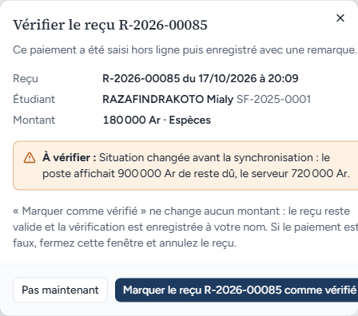 | |
| 7 | Administrateur | Cliquer **Marquer le reçu R-2026-00085 comme vérifié**, puis ouvrir **Paiements** (liste du jour). | La ligne R-2026-00085 porte « **Vérifié le JJ/MM/AAAA par Administrateur IFSPA** » suivi de la note, le badge « Valide » et plus de badge « À vérifier » ni de bouton « Marquer comme vérifié ». Le récapitulatif n'indique plus qu'« À vérifier 1 » avec son lien « Les voir ». Reçus 6 « + 2 annulés », Total encaissé 980 000 Ar (la vérification ne change aucun montant). | 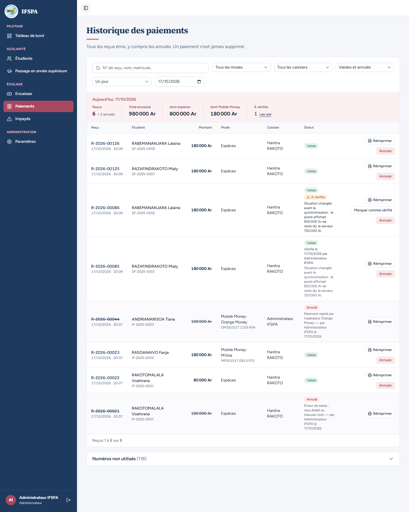 | |
| 8 | Administrateur | Cliquer **Les voir**, puis **Annuler** sur R-2026-00086 (Lalaina). Motif `Doublon : le même mois a été encaissé par l'autre poste`, **Annuler le reçu R-2026-00086**. | Fenêtre « Annuler le reçu R-2026-00086 » (Étudiant « RABEMANANJARA Lalaina SF-2025-0002 »). Bulle verte « Reçu R-2026-00086 annulé : les échéances qu'il payait sont de nouveau dues. » La liste filtrée « À vérifier » est vide : « Aucun paiement ne correspond à ces filtres. » ; la carte « À vérifier » et le lien « Les voir » ont disparu du récapitulatif (décision provisoire n° 43 : annulé, il n'y a plus rien à vérifier). | 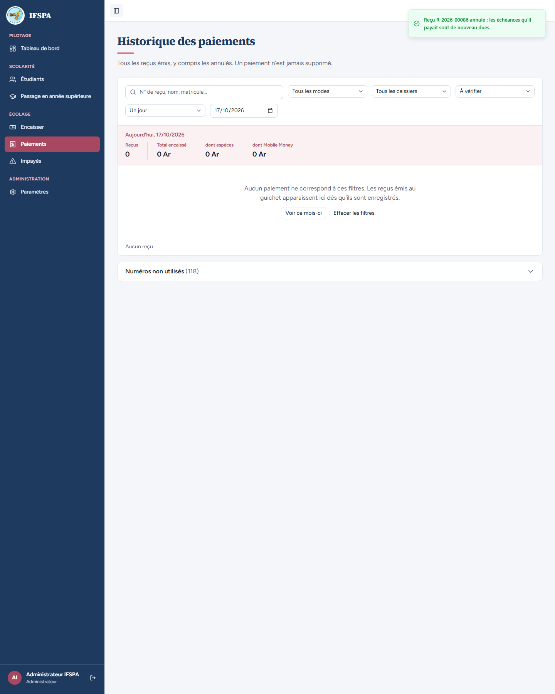 | |
| 9 | Administrateur | Liste de statut : choisir **Annulés seulement**. | « Reçus 0 + 3 annulés » : R-2026-00086, R-2026-00044 et R-2026-00021. La ligne R-2026-00086 porte « Annulé » et « Doublon : le même mois a été encaissé par l'autre poste — par Administrateur IFSPA le JJ/MM/AAAA », sans badge « À vérifier ». | 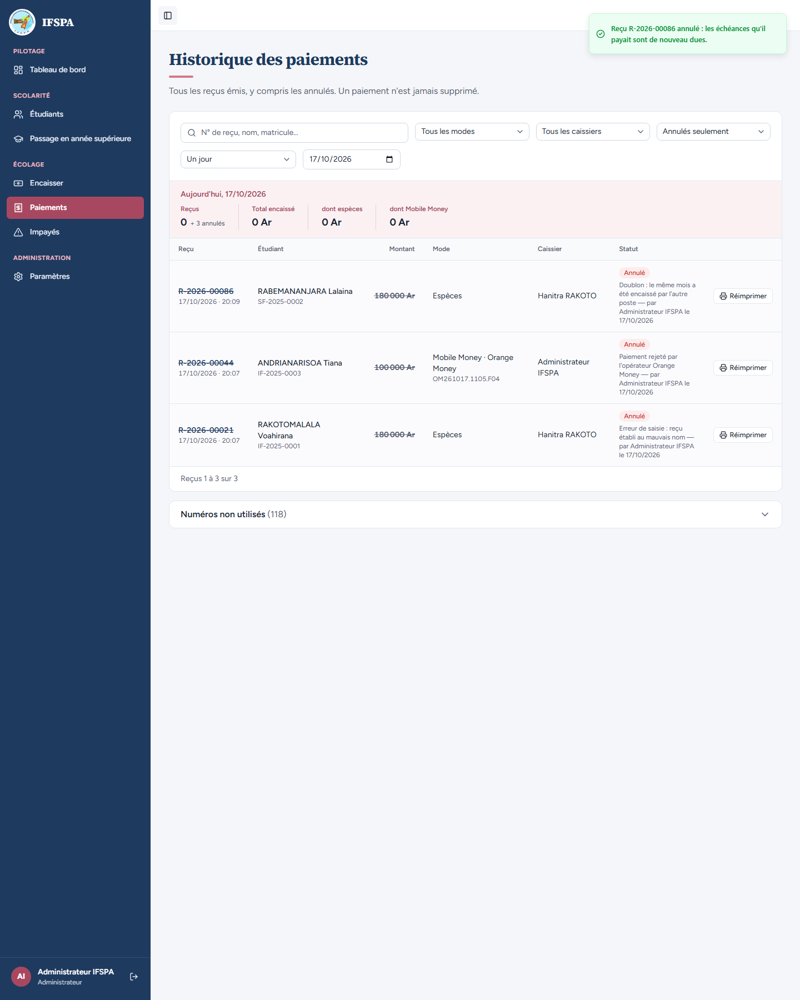 | |
| 10 | Administrateur | Cliquer le nom **RABEMANANJARA Lalaina**. | Fiche SF-2025-0002 : Reste à payer **720 000 Ar** (9 mois impayés), Déjà payé **180 000 Ar** : seul le reçu du poste 2 compte ; Droits d'inscription et Octobre 2025 « Payé », Novembre 2025 « En retard ». Le bouton d'encaissement affiche « Encaisser 720 000 Ar ». | 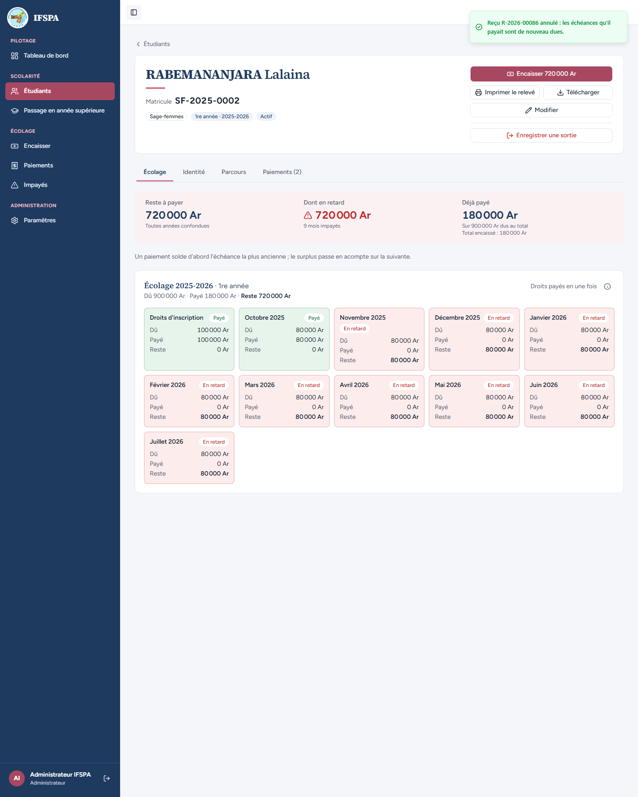 | |
| 11 | Administrateur | **Paiements**, **Réimprimer** sur R-2026-00085 (le reçu vérifié de Mialy). | Même numéro que le ticket remis hors ligne, mais lignes et reste du **serveur** : Novembre 2025 80 000 Ar, Décembre 2025 80 000 Ar, Janvier 2026 20 000 Ar (« Acompte · reste dû 60 000 Ar »), TOTAL 180 000 Ar, Reste en retard 540 000 Ar, Reste à payer 540 000 Ar (le ticket remis annonçait Droits + Octobre et 720 000 Ar). Aucune mention de cette différence (décisions provisoires n° 37 et 47). | 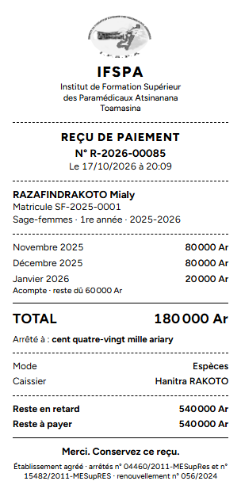 | |
| 12 | Administrateur | Revenir à **Paiements**, cliquer **Numéros non utilisés** en bas de page. | « 2026 · N numéros encore détenus par les postes » (118 dans la recette automatisée) ; une ligne par poste et par caissier, « 20 numéros libres (1 bloc) », sauf le poste 1 du secrétariat qui a utilisé deux numéros de son bloc (« 18 numéros libres »). | 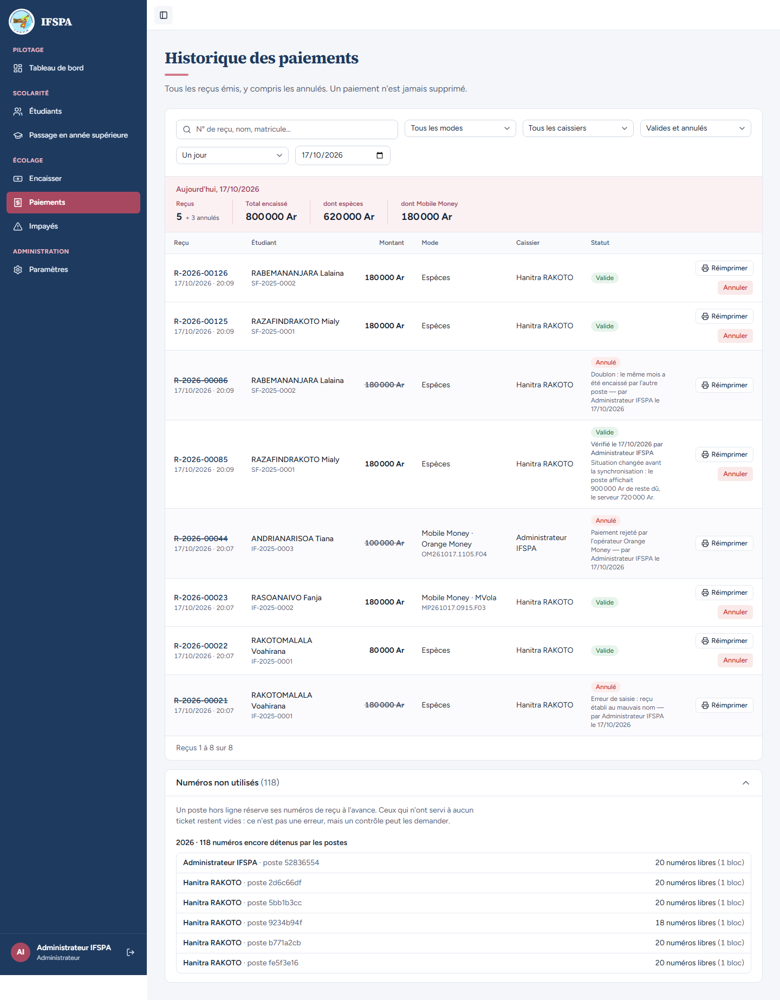 | |

## Ce que ce scénario ne couvre pas

- Le refus **côté serveur** de « Marquer comme vérifié » et de l'annulation par le secrétariat est couvert par Vitest : `tests/integration/actions-verification.test.ts` (« refuse le rôle user côté serveur, sans rien modifier » ; « déjà vérifié : refusé, la première vérification est conservée » ; « paiement annulé : refusé, il n'y a plus rien à vérifier ») et `tests/integration/actions-paiements.test.ts` (bloc `annulerPaiement`).
- La sortie du filtre « À vérifier » d'un reçu annulé (décision n° 43) est aussi couverte par `tests/integration/actions-verification.test.ts` (« un paiement à vérifier puis annulé sort du filtre et du compteur, mais reste à vérifier en base »).
- La coupure **réelle** d'Internet (câble, Wi-Fi sans accès) : voir [UC13-07](../UC13-hors-ligne/UC13-07-wifi-sans-internet.md) et le rapport. Ici le navigateur est mis « Hors connexion ».
- Le même conflit vu du poste (bandeau, files d'attente) : [UC13-05](../UC13-hors-ligne/UC13-05-conflit-verifier.md).
- Ordinateur seulement.

## Dernière exécution par l'agent

- 17/10/2026 : ✅ 12 étapes sur 12. Voir [RAPPORT_2026-10-17_UC07](../../rapports/RAPPORT_2026-10-17_UC07.md).
- Parcours : [UC07-05-a-verifier.recette.ts](../../parcours/UC07-05-a-verifier.recette.ts) (aides : [aides-paiements.ts](../../parcours/aides-paiements.ts)).
