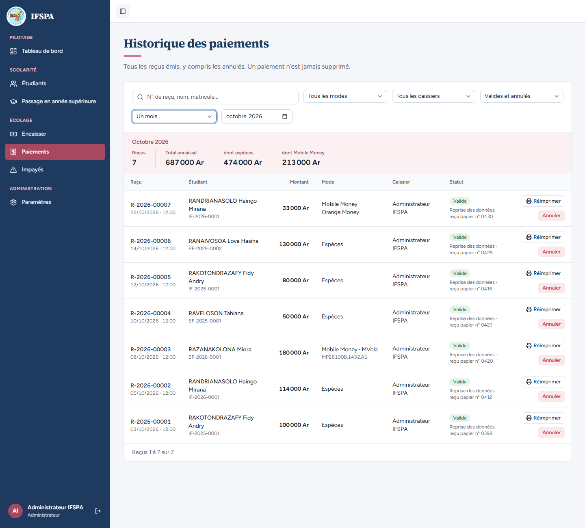
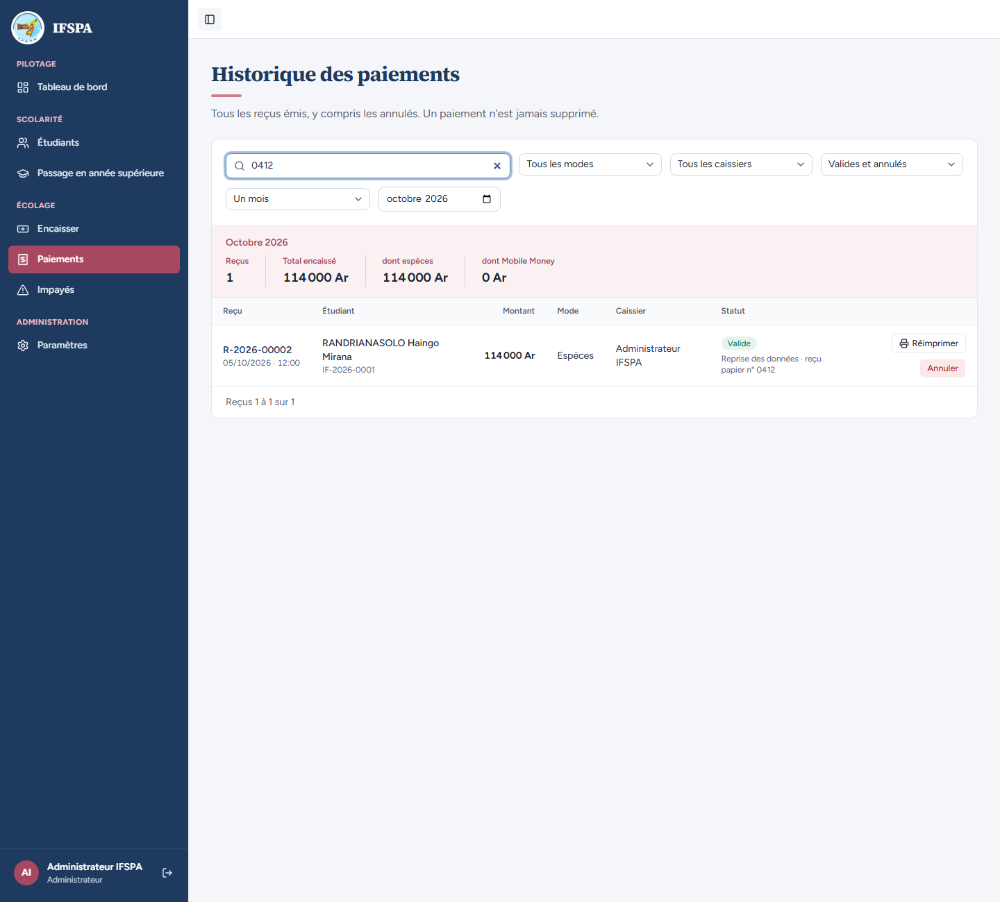
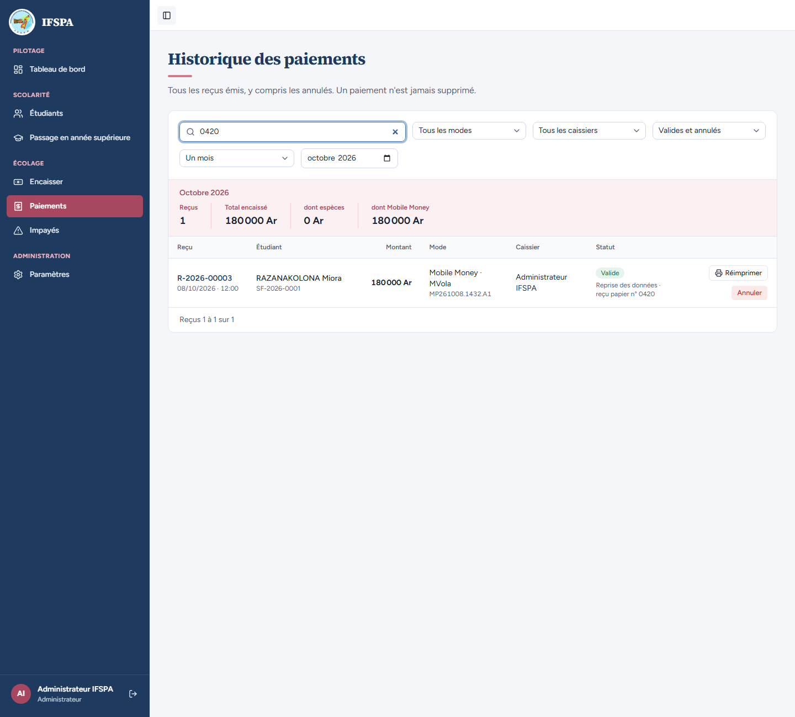
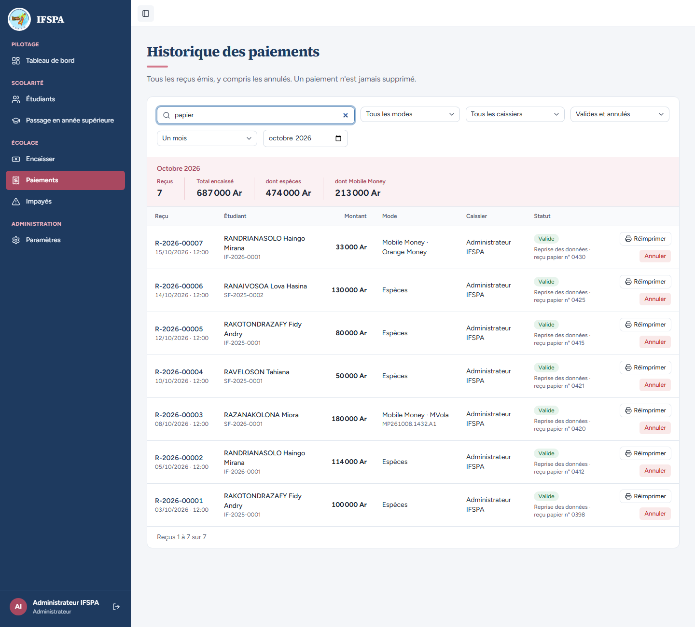
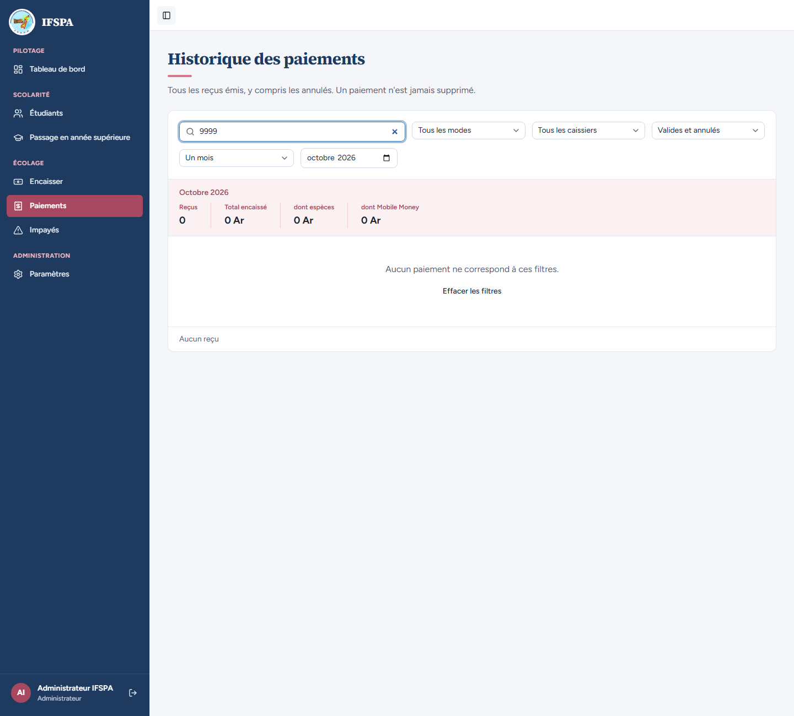
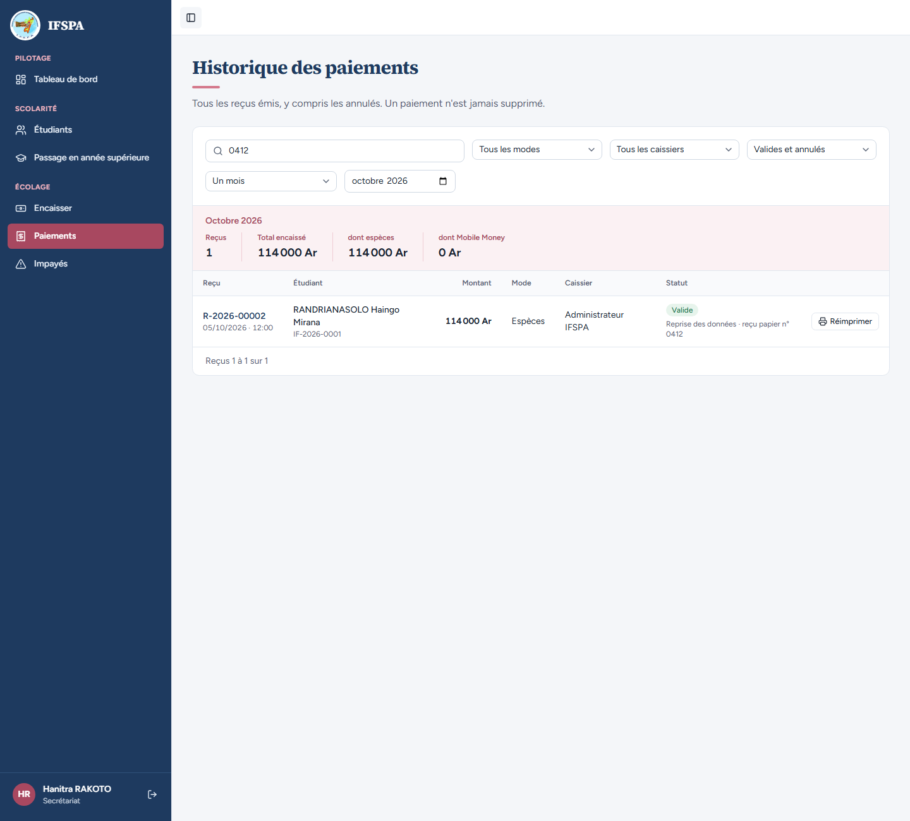
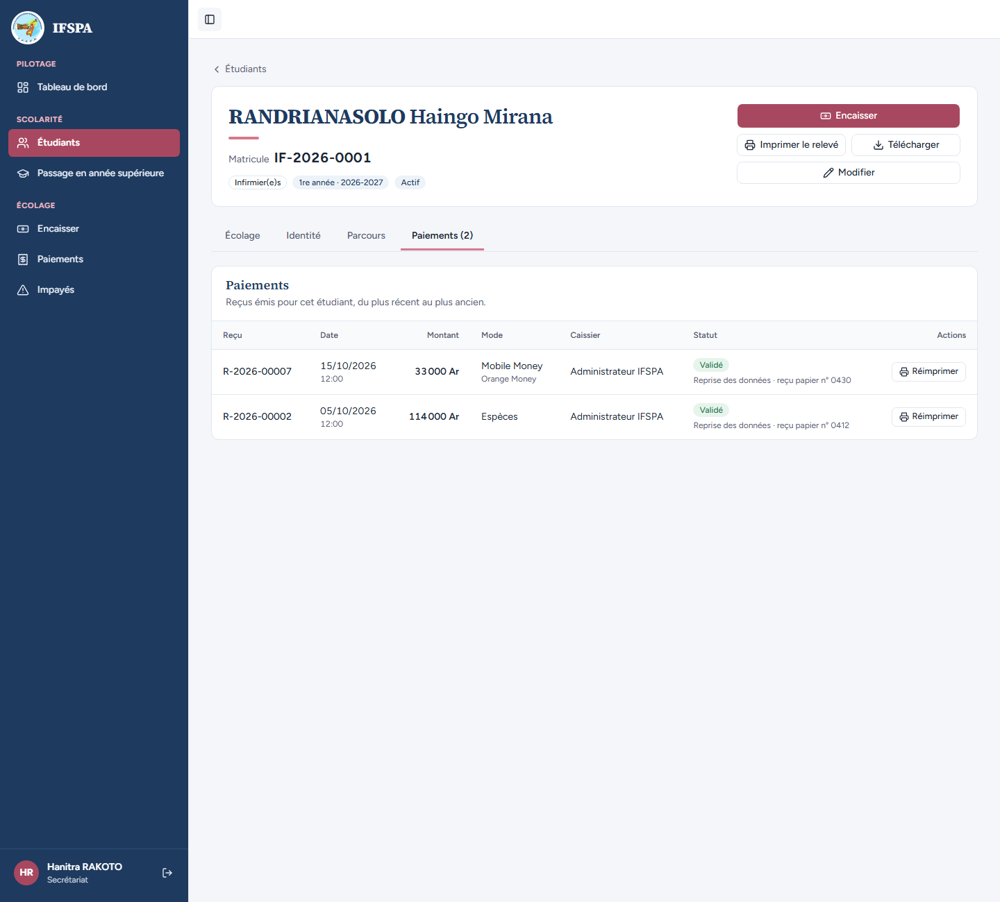
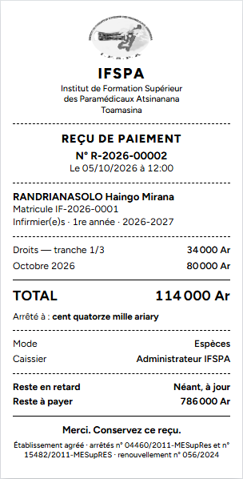

# UC07-06. Retrouver un paiement repris par le n° de son reçu papier

| | |
|---|---|
| Use case | UC07. Contrôler les paiements et annuler un reçu |
| Règles couvertes | R-REPRISE (le n° du reçu papier est gardé et lisible), R-ANN (l'historique garde tout), décision provisoire n° 62 (l'observation s'affiche dans Paiements et sur la fiche, pas sur le ticket) |
| Rôle | Administrateur (étapes 0 à 4), puis secrétariat (étapes 5 à 7) |
| Durée estimée | 10 minutes |

## La situation

L'institut a repris ses paiements depuis son classeur Excel. Un parent présente un vieux reçu papier n° 0412 : la secrétaire veut retrouver le paiement correspondant dans l'application, sans connaître le nom de l'étudiant. Elle tape le numéro dans la recherche de Paiements ; la ligne affiche aussi « Reprise des données · reçu papier n° 0412 ».

## Avant de commencer

1. `pnpm db:up`, `pnpm recette:base`, `pnpm build`, `pnpm recette:app`, puis ouvrir `http://localhost:3200`.
2. Dérouler **uniquement la section E** de [00-PREPARATION.md](../00-PREPARATION.md) (année 2025-2026 créée puis clôturée), **sans** les sections A à D ni F : les reçus R-2026-00001 à 00007 de ce cas en seraient décalés.
3. Importer le classeur [reprise-ifspa-2026-2027.xlsx](../UC15-reprise/fichiers/reprise-ifspa-2026-2027.xlsx) en suivant [UC15-01](../UC15-reprise/UC15-01-nominal.md), **étapes 3 à 7** (compte administrateur). Résultat : « Import terminé : 6 étudiants créés, 7 paiements enregistrés pour 687 000 Ar (reçus R-2026-00001 à R-2026-00007). » C'est l'étape 0 ci-dessous.
4. Comptes : administrateur (identifiants `SEED_ADMIN_*` de `.env`) pour les étapes 1 à 4, secrétariat (`SEED_USER_*`, « Hanitra RAKOTO ») pour les étapes 5 à 7.

## Étapes

| # | Qui | Action | Résultat attendu | Capture | ✓ |
|---|---|---|---|---|---|
| 0 | Administrateur | Paramètres › Reprise des données : déposer `reprise-ifspa-2026-2027.xlsx`, **Analyser le fichier**, **Importer 6 étudiants et 7 paiements**, **Importer maintenant**. | « Import terminé : 6 étudiants créés, 7 paiements enregistrés pour 687 000 Ar (reçus R-2026-00001 à R-2026-00007). » (voir UC15-01 pour les captures). | | |
| 1 | Administrateur | Menu **Paiements**, liste « Un jour » : choisir **Un mois**. | « Octobre 2026 » (les reçus sont datés du 03 au 15 octobre, à 12:00) : Reçus **7**, Total encaissé **687 000 Ar**, dont espèces 474 000 Ar, dont Mobile Money 213 000 Ar. Chaque ligne « Valide », caissier « Administrateur IFSPA », porte sous le statut « **Reprise des données · reçu papier n° …** » : R-2026-00007 (0430), 00006 (0425), 00005 (0415), 00004 (0421), 00003 (0420), 00002 (0412), 00001 (0398). |  | |
| 2 | Administrateur | Dans « Rechercher un reçu ou un étudiant », taper `0412`. | Un seul reçu : **R-2026-00002**, 05/10/2026 à 12:00, RANDRIANASOLO Haingo Mirana, IF-2026-0001, 114 000 Ar, Espèces, Administrateur IFSPA, « Reprise des données · reçu papier n° 0412 ». Total encaissé 114 000 Ar. |  | |
| 3 | Administrateur | Remplacer par `0420`. | Un seul reçu : **R-2026-00003**, RAZANAKOLONA Miora, SF-2026-0001, 180 000 Ar, « Mobile Money · MVola », MP261008.1432.A1, « reçu papier n° 0420 ». |  | |
| 4 | Administrateur | Remplacer par `papier`, puis par `9999`. | `papier` : les 7 reçus repris (la recherche porte sur toute l'observation). `9999` : Reçus 0, « Aucun paiement ne correspond à ces filtres. », « Effacer les filtres ». |   | |
| 5 | Secrétariat | Se connecter avec le compte secrétariat. **Paiements**, **Un mois**, taper `0412`. | Même ligne R-2026-00002 avec « Reprise des données · reçu papier n° 0412 ». Reçus 1, 114 000 Ar. Seul « Réimprimer » est proposé (pas de « Annuler »). « Hanitra RAKOTO » en bas de la barre latérale. |  | |
| 6 | Secrétariat | Cliquer le nom **RANDRIANASOLO Haingo Mirana**, onglet **Paiements (2)**. | Fiche IF-2026-0001 : R-2026-00007 (15/10/2026 à 12:00, 33 000 Ar, Mobile Money, Orange Money) « Reprise des données · reçu papier n° 0430 » et R-2026-00002 (05/10/2026 à 12:00, 114 000 Ar, Espèces) « Reprise des données · reçu papier n° 0412 », tous deux « Validé », caissier Administrateur IFSPA. |  | |
| 7 | Secrétariat | Cliquer **Réimprimer** sur R-2026-00002. | Ticket : « N° R-2026-00002 », « Le 05/10/2026 à 12:00 », Droits — tranche 1/3 34 000 Ar, Octobre 2026 80 000 Ar, TOTAL 114 000 Ar, Reste à payer 786 000 Ar. **Le n° du reçu papier n'y figure pas** (décision provisoire n° 62). |  | |

## Ce que ce scénario ne couvre pas

- Le n° de reçu papier n'est pas imprimé sur le ticket réimprimé (décision provisoire n° 62, « Où afficher l'observation »). Ce n'est pas une anomalie.
- La note libre « Ajouter une note » du guichet (observation d'un encaissement ordinaire) suit le même affichage : non déroulé ici.
- Import lui-même (rapport, erreurs, relance) : voir UC15.
- Ordinateur seulement.

## Dernière exécution par l'agent

- 17/10/2026 : ✅ 8 étapes sur 8 (étape 0 comprise). Voir [RAPPORT_2026-10-17_UC07](../../rapports/RAPPORT_2026-10-17_UC07.md). Cela lève l'anomalie notée dans UC15-01 (« le n° du reçu papier n'est affiché nulle part »).
- Parcours : [UC07-06-recu-papier-repris.recette.ts](../../parcours/UC07-06-recu-papier-repris.recette.ts) (préparation : [00c-preparation-reprise.recette.ts](../../parcours/00c-preparation-reprise.recette.ts), fichier : [fabriquer-fichiers-reprise.py](../../parcours/fabriquer-fichiers-reprise.py)).
