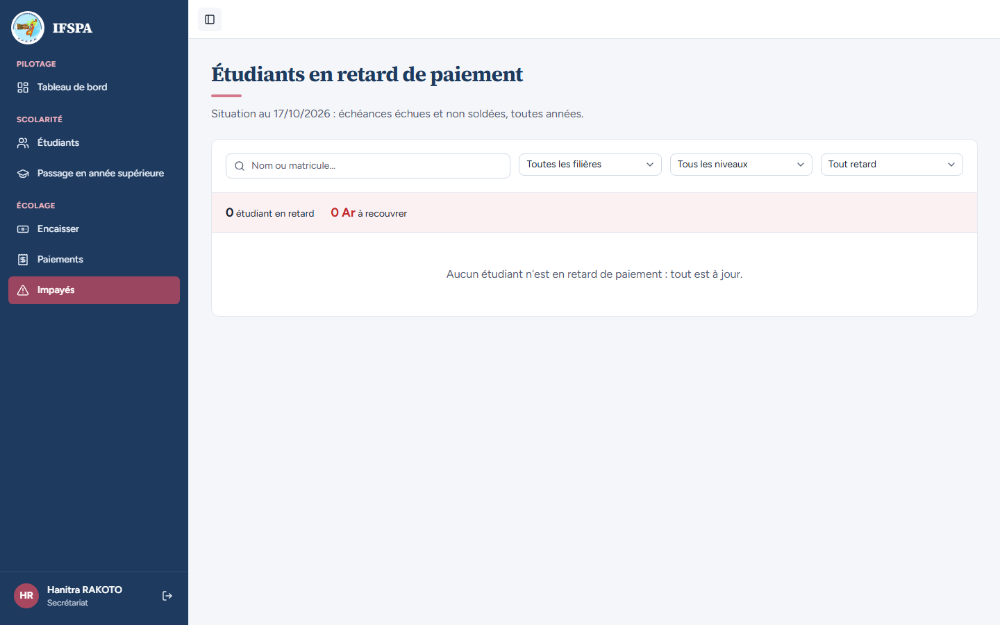

# UC08-01. Rien n'est en retard : la liste des impayés le dit

| | |
|---|---|
| Use case | UC08. Relancer les impayés |
| Règles couvertes | R-IMP (liste des étudiants en retard, export Excel proposé seulement s'il y a des lignes), R-ROLE (le secrétariat accède à Impayés) |
| Rôle | Secrétariat, compte « Hanitra RAKOTO » |
| Durée estimée | 2 minutes |

## La situation

La secrétaire ouvre la page Impayés avant la rentrée : aucun étudiant n'est inscrit, donc personne n'est en retard. La page doit le dire clairement, sans tableau vide ni bouton d'export inutile.

## Avant de commencer

1. `pnpm db:up` (si Postgres ne tourne pas), `pnpm recette:base`, `pnpm build`, `pnpm recette:app`, puis ouvrir `http://localhost:3200`.
2. **Ne pas** dérouler [00-PREPARATION.md](../00-PREPARATION.md) : ce cas se fait sur la base fraîche, avant la préparation (la préparation ne crée rien qui gêne ce cas, mais il n'aurait plus rien à montrer).
3. Se connecter avec le compte **secrétariat** (identifiants `SEED_USER_*` de `.env`).

## Étapes

| # | Qui | Action | Résultat attendu | Capture | ✓ |
|---|---|---|---|---|---|
| 1 | Secrétariat | Après la connexion, cliquer **Impayés** dans le menu (rubrique Écolage). | Titre « Étudiants en retard de paiement », « Situation au (date du jour) : échéances échues et non soldées, toutes années. » « Hanitra RAKOTO » et « Secrétariat » en bas de la barre latérale. Les quatre champs : « Nom ou matricule… », « Toutes les filières », « Tous les niveaux », « Tout retard ». Bandeau « 0 étudiant en retard » et « 0 Ar à recouvrer ». Message « Aucun étudiant n'est en retard de paiement : tout est à jour. » |  | |
| 2 | Secrétariat | Regarder le haut à droite de la page. | **Pas de bouton « Exporter (Excel) »** (il n'apparaît que s'il y a au moins un étudiant en retard), pas de lien « Effacer les filtres » (aucun filtre posé). | | |

## Ce que ce scénario ne couvre pas

- La liste avec des étudiants en retard : [UC08-02](UC08-02-liste-du-jour.md).
- Les étudiants à jour mais inscrits (rien en retard avec des inscrits) : le cas est vu au passage dans [UC08-02](UC08-02-liste-du-jour.md), étape 4 (RAKOTOARISOA Nirina absent de la liste).
- Ordinateur seulement ; le téléphone est vu dans [UC08-08](UC08-08-telephone.md).

## Dernière exécution par l'agent

- 17/10/2026 : ✅ 2 étapes sur 2. Voir [RAPPORT_2026-10-17_UC08](../../rapports/RAPPORT_2026-10-17_UC08.md).
- Parcours : [UC08-01-liste-vide.recette.ts](../../parcours/UC08-01-liste-vide.recette.ts).
