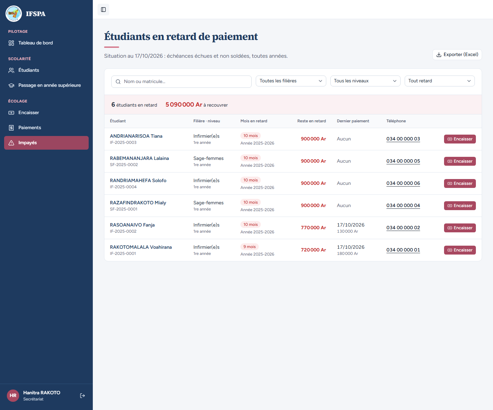
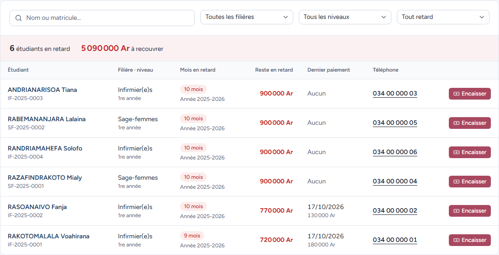
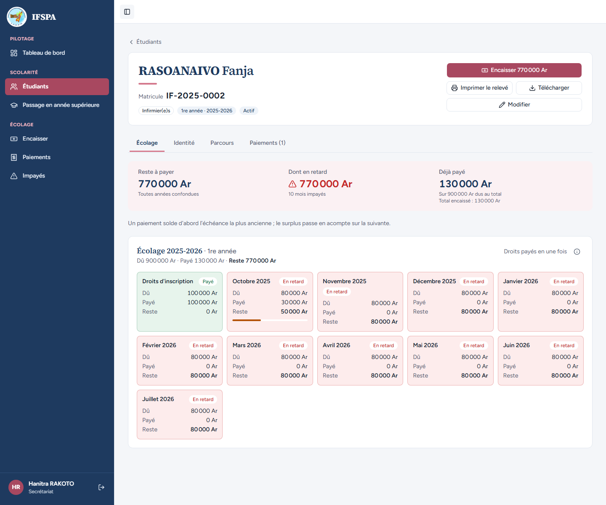

# UC08-02. La secrétaire prépare la relance : qui est en retard, de combien, et comment le joindre

| | |
|---|---|
| Use case | UC08. Relancer les impayés |
| Règles couvertes | R-IMP (étudiants en retard, montant, mois de retard, années concernées, dernier paiement, téléphone), R-RET (retard à partir du 1er du mois suivant : les échéances d'octobre 2025 à juillet 2026 sont échues, celles de 2026-2027 ne le sont pas), décision provisoire n° 21 (toutes années comptées, année affichée par ligne), R-ROLE (le secrétariat accède à Impayés) |
| Rôle | Secrétariat, compte « Hanitra RAKOTO » |
| Durée estimée | 8 minutes |

## La situation

C'est lundi matin. La secrétaire veut savoir qui relancer. Elle ouvre Impayés : la liste classe les étudiants du plus long retard au plus court, avec ce qu'il faut pour téléphoner (numéro cliquable) ou aller encaisser. Un étudiant inscrit pour l'année en cours, qui n'est pas en retard, n'y figure pas.

## Avant de commencer

1. `pnpm db:up`, `pnpm recette:base`, `pnpm build`, `pnpm recette:app`, puis ouvrir `http://localhost:3200`.
2. Avoir déroulé [00-PREPARATION.md](../00-PREPARATION.md), **sections A, B, C puis G** (pas D ni F). Six étudiants sont en retard (5 090 000 Ar), RAKOTOARISOA Nirina est à jour.
3. Se connecter avec le compte **secrétariat** (identifiants `SEED_USER_*` de `.env`).

## Étapes

| # | Qui | Action | Résultat attendu | Capture | ✓ |
|---|---|---|---|---|---|
| 1 | Secrétariat | Cliquer **Impayés** dans le menu. | Titre « Étudiants en retard de paiement », « Situation au (date du jour) : échéances échues et non soldées, toutes années. » « Hanitra RAKOTO » en bas de la barre latérale. Bandeau « **6** étudiants en retard » et « **5 090 000 Ar** à recouvrer ». Six lignes. Bouton « Exporter (Excel) » en haut à droite. |  | |
| 2 | Secrétariat | Lire l'ordre des lignes et les titres de colonnes. | Colonnes : Étudiant, Filière · niveau, Mois en retard, Reste en retard, Dernier paiement, Téléphone. Ordre (du plus de mois de retard au moins, puis du plus gros montant) : ANDRIANARISOA Tiana, RABEMANANJARA Lalaina, RANDRIAMAHEFA Solofo, RAZAFINDRAKOTO Mialy (tous 10 mois, 900 000 Ar), RASOANAIVO Fanja (10 mois, 770 000 Ar), RAKOTOMALALA Voahirana (9 mois, 720 000 Ar). |  | |
| 3 | Secrétariat | Lire la ligne de **RASOANAIVO Fanja**, puis celles de **RAKOTOMALALA Voahirana** et d'**ANDRIANARISOA Tiana**. | Fanja : IF-2025-0002, Infirmier(e)s, 1re année, badge « 10 mois », « Année 2025-2026 », **770 000 Ar**, dernier paiement « 17/10/2026 » et « 130 000 Ar » (date du jour de la préparation), téléphone « 034 00 000 02 ». Voahirana : « 9 mois », 720 000 Ar, dernier paiement 180 000 Ar. Tiana : « Aucun » dernier paiement, 900 000 Ar. |  | |
| 4 | Secrétariat | Chercher dans la liste RAKOTOARISOA Nirina (IF-2026-0001). | Absente : elle est inscrite pour 2026-2027 et rien n'y est en retard (octobre 2026 est le mois en cours), bien qu'elle ait un acompte partiel. | | |
| 5 | Secrétariat | Repérer le numéro de Fanja « 034 00 000 02 » (souligné) : sur un navigateur de bureau, passer la souris dessus et lire l'adresse affichée en bas de la fenêtre. | Le numéro est un **lien d'appel** (adresse `tel:0340000002`). | | |
| 6 | Secrétariat | Cliquer le nom **RASOANAIVO Fanja**. | La fiche s'ouvre : « Reste à payer 770 000 Ar » toutes années confondues, « Dont en retard 770 000 Ar », « 10 mois impayés », « Déjà payé 130 000 Ar ». Octobre 2025 est « En retard » avec 30 000 Ar payés : les chiffres sont ceux de la liste. |  | |

## Ce que ce scénario ne couvre pas

- **Plusieurs années en retard** (libellé « Années 2024-2025, 2025-2026 ») : non démontré à l'écran. Avant le 1er novembre 2026, seules les échéances de 2025-2026 peuvent être en retard sans préparation lourde (années antérieures). Le calcul « une échéance en retard d'une année précédente suffit, et l'année est signalée » est couvert par Vitest, `tests/integration/lectures-paiements.test.ts` (bloc `lireImpayes`).
- Passage au retard le 1er du mois suivant (octobre non échu le 31/10, échu le 1er novembre) : couvert par Vitest, même fichier (« la limite : rien en retard le 31 octobre ; le 1er novembre, seul celui qui n'a rien payé l'est »).
- Le **reste dû total** (échéances à venir comprises) n'est pas affiché à l'écran : il figure dans l'export Excel ([UC08-04](UC08-04-export-excel.md), [UC08-09](UC08-09-export-apres-passage.md)).
- Un clic réel sur le lien d'appel (téléphonie) ne s'automatise pas : seule l'adresse `tel:` est vérifiée.
- Ordinateur ici ; téléphone : [UC08-08](UC08-08-telephone.md).

## Dernière exécution par l'agent

- 17/10/2026 : ✅ 6 étapes sur 6. Voir [RAPPORT_2026-10-17_UC08](../../rapports/RAPPORT_2026-10-17_UC08.md).
- Parcours : [UC08-02-liste-du-jour.recette.ts](../../parcours/UC08-02-liste-du-jour.recette.ts).
