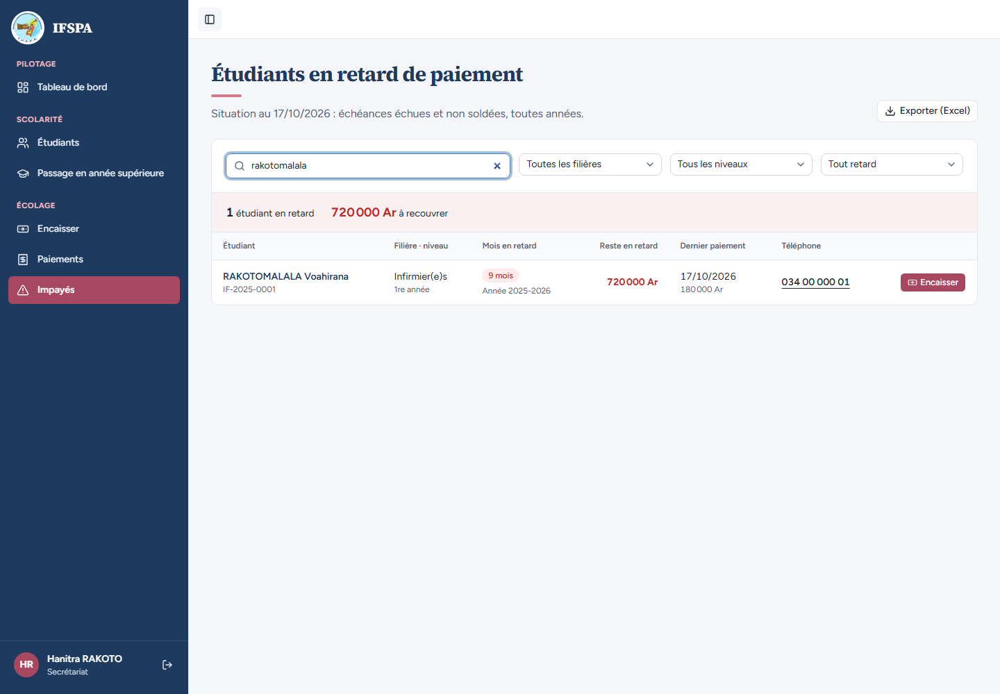
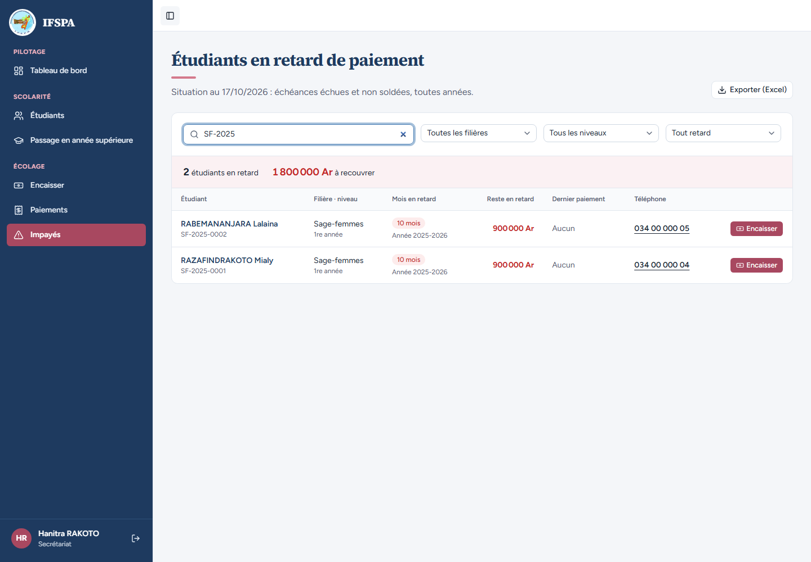
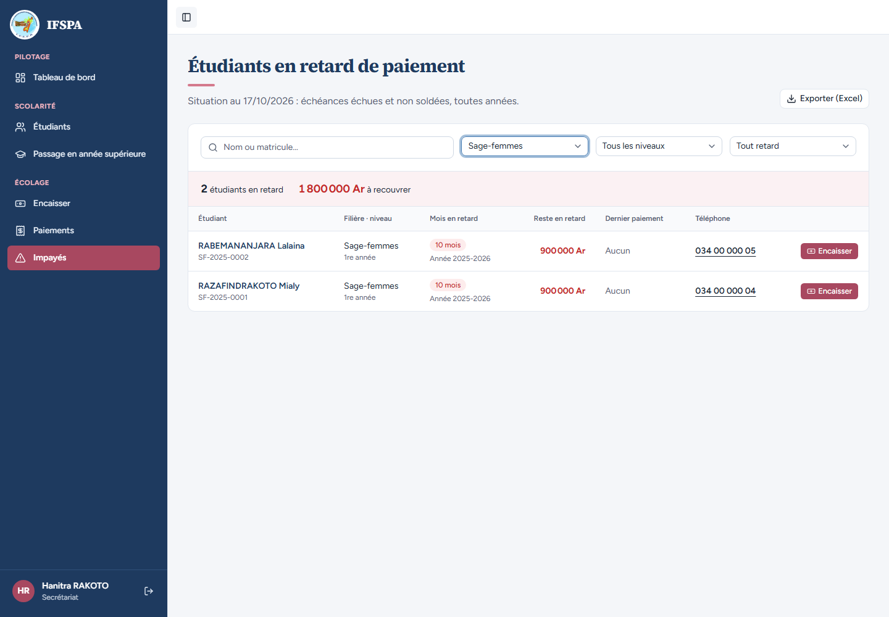
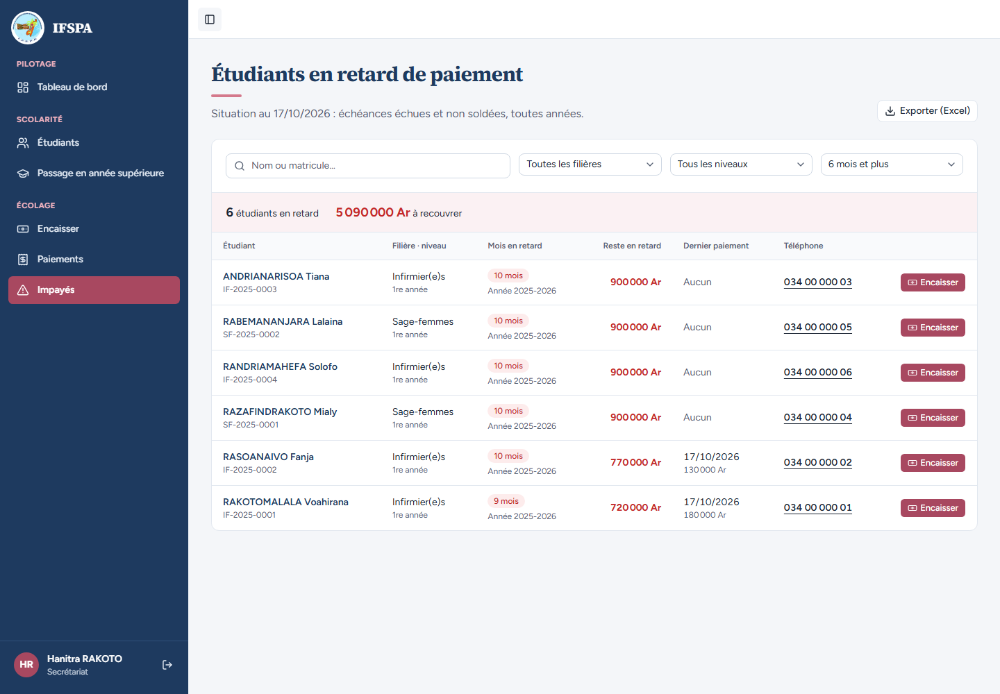
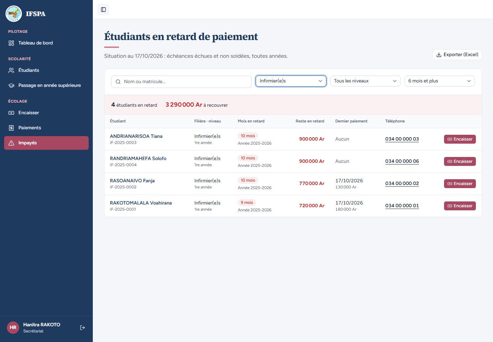
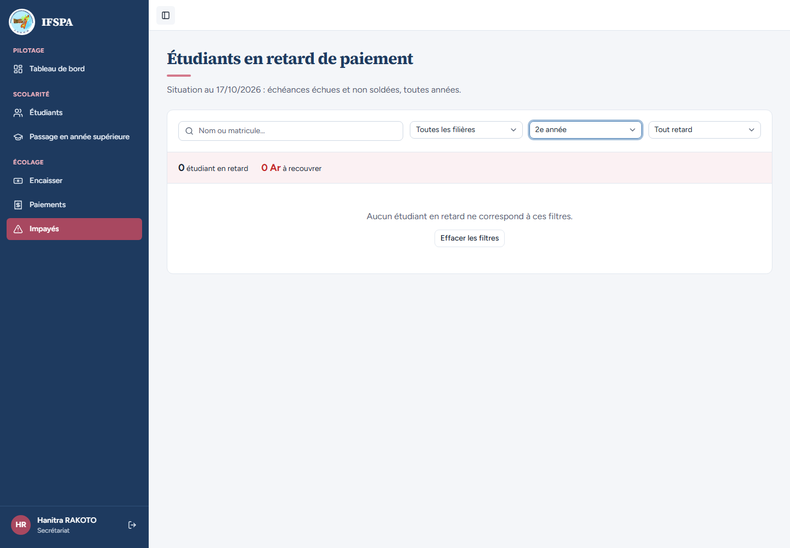

# UC08-03. Retrouver un étudiant ou un groupe parmi les impayés

| | |
|---|---|
| Use case | UC08. Relancer les impayés |
| Règles couvertes | R-IMP (liste filtrable : recherche, filière, niveau, mois de retard ; message « aucun résultat » avec lien pour effacer les filtres), R-ROLE (secrétariat) |
| Rôle | Secrétariat, compte « Hanitra RAKOTO » |
| Durée estimée | 8 minutes |

## La situation

Une mère appelle pour le dossier d'une étudiante en Sage-femmes ; la responsable veut aussi relancer filière par filière. La secrétaire cherche par nom, par prénom ou par matricule, puis filtre par filière, par niveau et par nombre de mois de retard. Quand rien ne correspond, l'écran le dit et propose d'effacer les filtres.

## Avant de commencer

1. `pnpm db:up`, `pnpm recette:base`, `pnpm build`, `pnpm recette:app`, puis ouvrir `http://localhost:3200`.
2. Avoir déroulé [00-PREPARATION.md](../00-PREPARATION.md), **sections A, B, C puis G**. Aucun paiement de [UC08-05](UC08-05-solde-disparait.md) à [UC08-07](UC08-07-abandon-hors-liste.md) ne doit encore avoir été fait (six étudiants en retard, 5 090 000 Ar).
3. Se connecter avec le compte **secrétariat** (identifiants `SEED_USER_*` de `.env`).

## Étapes

| # | Qui | Action | Résultat attendu | Capture | ✓ |
|---|---|---|---|---|---|
| 1 | Secrétariat | Menu **Impayés**, taper `rakotomalala` (minuscules) dans « Nom ou matricule… », attendre une demi-seconde. | L'adresse porte `?q=rakotomalala`. « 1 étudiant en retard », « 720 000 Ar à recouvrer », une seule ligne : RAKOTOMALALA Voahirana, IF-2025-0001. |  | |
| 2 | Secrétariat | Remplacer par `mialy`, puis par `SF-2025`. | `mialy` : 1 étudiant, 900 000 Ar, RAZAFINDRAKOTO Mialy. `SF-2025` : « 2 étudiants en retard », « 1 800 000 Ar à recouvrer », RABEMANANJARA Lalaina et RAZAFINDRAKOTO Mialy. |  | |
| 3 | Secrétariat | Revenir sur **Impayés** (sans recherche), ouvrir la liste « Toutes les filières » et choisir **Sage-femmes**. | L'adresse porte `?filiereId=…`. « 2 étudiants en retard », « 1 800 000 Ar à recouvrer », deux lignes (les deux Sage-femmes). |  | |
| 4 | Secrétariat | Revenir sur **Impayés**, ouvrir « Tout retard » : lire les choix, puis choisir **6 mois et plus**. | Les choix sont « Tout retard », « 2 mois et plus », « 3 mois et plus », « 4 mois et plus », « 6 mois et plus ». Avec « 6 mois et plus » : les six étudiants restent (9 ou 10 mois de retard), 5 090 000 Ar. L'adresse porte `?moisMin=6`. |  | |
| 5 | Secrétariat | Garder « 6 mois et plus » et choisir la filière **Infirmier(e)s**. | « 4 étudiants en retard », « 3 290 000 Ar à recouvrer » : ANDRIANARISOA Tiana, RANDRIAMAHEFA Solofo, RASOANAIVO Fanja, RAKOTOMALALA Voahirana. Aucune Sage-femme. |  | |
| 6 | Secrétariat | Revenir sur **Impayés**, ouvrir « Tous les niveaux » et choisir **2e année**. | « 0 étudiant en retard », « 0 Ar à recouvrer ». Message « Aucun étudiant en retard ne correspond à ces filtres. » et bouton « Effacer les filtres ». **Plus de bouton « Exporter (Excel) »**. |  | |
| 7 | Secrétariat | Cliquer **Effacer les filtres**. | L'adresse redevient `/app/impayes` sans paramètre ; « 6 étudiants en retard », « 5 090 000 Ar à recouvrer », six lignes. |  | |

## Ce que ce scénario ne couvre pas

- **Filtre par année** : la page n'en propose pas (seulement recherche, filière, niveau, mois de retard) ; l'année s'affiche sur chaque ligne (« Année 2025-2026 »). Question posée dans le rapport.
- **Le filtre « Mois de retard » qui écarte quelqu'un** est vu dans [UC08-06](UC08-06-paiement-partiel.md), étapes 4 et 5 (RANDRIAMAHEFA Solofo passe à 5 mois) : ici tous les étudiants ont 9 ou 10 mois.
- Le filtre « Niveau » porte sur le niveau **actuel** de l'étudiant (dernière inscription), pas sur l'année de l'impayé. Seul « 2e année » sans résultat est vu ici ; un niveau avec résultat est vu dans [UC08-09](UC08-09-export-apres-passage.md) (liste après passage).
- Les filtres appliqués correctement côté serveur (filière, niveau, mois minimum, recherche) : couvert par Vitest, `tests/integration/lectures-paiements.test.ts`, bloc `lireImpayes` (« filtres : filière, niveau, mois en retard minimum, recherche »).
- Ordinateur seulement ; filtre sur téléphone : [UC08-08](UC08-08-telephone.md), étape 3.

## Dernière exécution par l'agent

- 17/10/2026 : ✅ 7 étapes sur 7. Voir [RAPPORT_2026-10-17_UC08](../../rapports/RAPPORT_2026-10-17_UC08.md).
- Parcours : [UC08-03-filtres-recherche.recette.ts](../../parcours/UC08-03-filtres-recherche.recette.ts).
