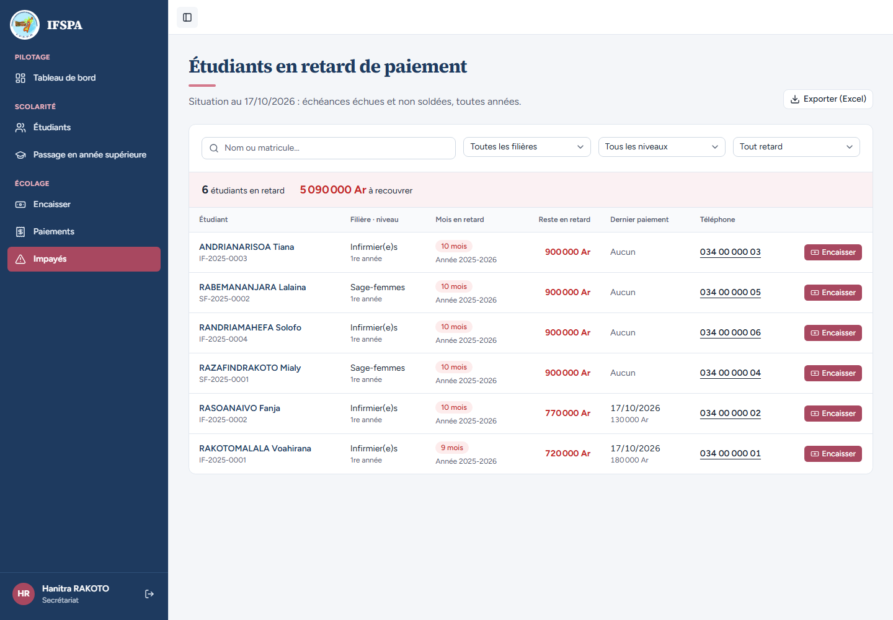
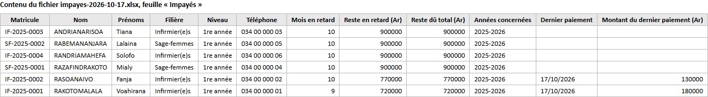
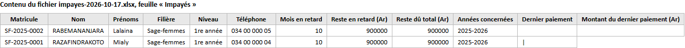

# UC08-04. La responsable emporte la liste des impayés dans Excel

| | |
|---|---|
| Use case | UC08. Relancer les impayés |
| Règles couvertes | R-IMP (export Excel de la liste, avec les filtres de l'écran), R-ROLE (le secrétariat y a accès ; sans session l'export est refusé) |
| Rôle | Secrétariat, compte « Hanitra RAKOTO » |
| Durée estimée | 8 minutes (plus l'ouverture du fichier dans Excel) |

## La situation

La responsable veut la liste des familles à relancer sur papier, par filière. La secrétaire exporte la liste complète, puis seulement les Sage-femmes. Le fichier reprend exactement ce que montre l'écran, avec en plus le reste dû total de chaque étudiant.

## Avant de commencer

1. `pnpm db:up`, `pnpm recette:base`, `pnpm build`, `pnpm recette:app`, puis ouvrir `http://localhost:3200`.
2. Avoir déroulé [00-PREPARATION.md](../00-PREPARATION.md), **sections A, B, C puis G**, avant tout paiement de [UC08-05](UC08-05-solde-disparait.md) à [UC08-07](UC08-07-abandon-hors-liste.md).
3. Se connecter avec le compte **secrétariat** (identifiants `SEED_USER_*` de `.env`). Excel (ou LibreOffice) installé pour ouvrir le fichier.

## Étapes

| # | Qui | Action | Résultat attendu | Capture | ✓ |
|---|---|---|---|---|---|
| 1 | Secrétariat | Menu **Impayés**. Repérer « Exporter (Excel) » en haut à droite. | Six étudiants, 5 090 000 Ar. Le bouton pointe vers `/api/export/impayes` (sans paramètre : aucun filtre). |  | |
| 2 | Secrétariat | Cliquer **Exporter (Excel)**. | Un fichier **impayes-AAAA-MM-JJ.xlsx** est téléchargé (ici `impayes-2026-10-17.xlsx`, la date du jour). Une feuille nommée **Impayés** (nom relu dans le fichier ; ligne d'en-tête figée et en gras d'après le code, non vérifié dans Excel). | | |
| 3 | Secrétariat | Ouvrir le fichier dans Excel. | Douze colonnes, dans cet ordre : Matricule, Nom, Prénoms, Filière, Niveau, Téléphone, Mois en retard, Reste en retard (Ar), Reste dû total (Ar), Années concernées, Dernier paiement, Montant du dernier paiement (Ar). Six lignes, dans l'ordre de l'écran : IF-2025-0003 ANDRIANARISOA Tiana, SF-2025-0002 RABEMANANJARA Lalaina, IF-2025-0004 RANDRIAMAHEFA Solofo, SF-2025-0001 RAZAFINDRAKOTO Mialy, IF-2025-0002 RASOANAIVO Fanja, IF-2025-0001 RAKOTOMALALA Voahirana. La capture montre le contenu relu dans le fichier (l'agent l'a lu avec Python, il ne l'a pas ouvert dans Excel). |  | |
| 4 | Secrétariat | Lire les montants. | Tiana, Lalaina, Solofo, Mialy : 10 mois, 900 000 Ar en retard, 900 000 Ar de reste dû total, « 2025-2026 », **dernier paiement vide**. Fanja : 10 mois, 770 000 / 770 000, « 2025-2026 », « 17/10/2026 », 130 000. Voahirana : 9 mois, 720 000 / 720 000, « 17/10/2026 », 180 000. Les montants sont des nombres (ils se somment : 5 090 000 sur la colonne « Reste en retard (Ar) »). RAKOTOARISOA Nirina (à jour) n'y est pas. | | |
| 5 | Secrétariat | Revenir sur **Impayés**, choisir la filière **Sage-femmes**, puis cliquer **Exporter (Excel)**. | Le bouton pointe maintenant vers `/api/export/impayes?filiereId=…`. Même nom de fichier ; le classeur ne contient que **deux lignes** : SF-2025-0002 RABEMANANJARA Lalaina et SF-2025-0001 RAZAFINDRAKOTO Mialy (900 000 Ar chacune, dernier paiement vide). |  | |
| 6 | (sans connexion) | Dans un navigateur où l'on n'est pas connecté, ouvrir `http://localhost:3200/api/export/impayes`. | Réponse 401, texte « Session expirée : reconnectez-vous. » Aucun fichier. | | |

## Ce que ce scénario ne couvre pas

- **Ouverture dans Excel réel** : non démontré. Le contenu a été relu avec Python (`zipfile`, feuille `xl/worksheets/sheet1.xml`) : les nombres sont des valeurs entières (900000) ; le format d'affichage « #,##0 » prévu par le code (espaces ou virgules entre milliers selon la langue d'Excel) n'a pas été vérifié, ni l'accent de « Impayés » dans un autre tableur.
- La colonne « Reste dû total » ne diffère de « Reste en retard » que lorsqu'un étudiant a des échéances à venir : voir [UC08-09](UC08-09-export-apres-passage.md).
- L'export est aussi refusé au serveur sans session (étape 6, démontrée) ; le rôle n'intervient pas (admin et secrétariat y ont droit, aucune règle de rôle à tester côté serveur).
- Ordinateur seulement.

## Dernière exécution par l'agent

- 17/10/2026 : ✅ 6 étapes sur 6. Voir [RAPPORT_2026-10-17_UC08](../../rapports/RAPPORT_2026-10-17_UC08.md).
- Parcours : [UC08-04-export-excel.recette.ts](../../parcours/UC08-04-export-excel.recette.ts).
