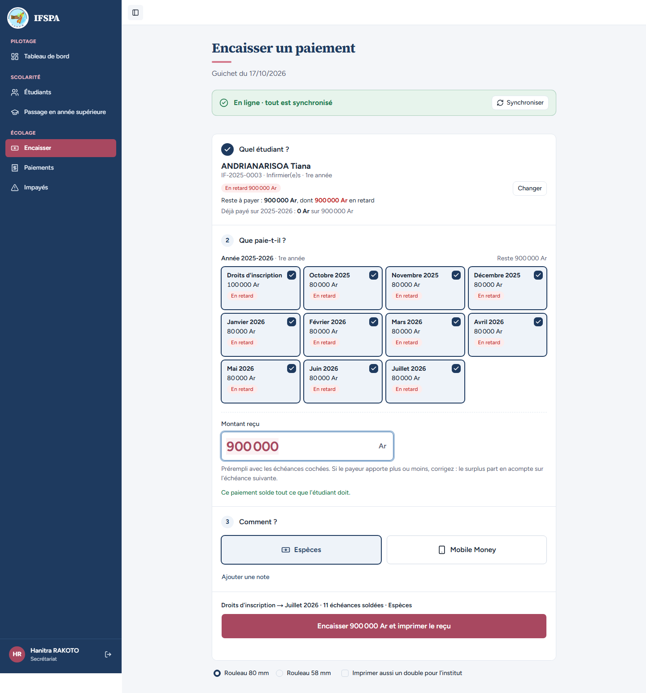
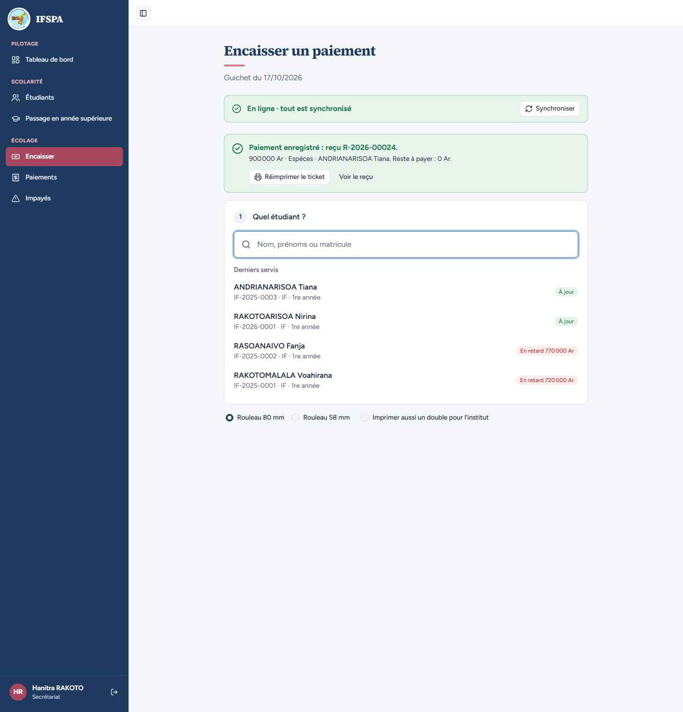
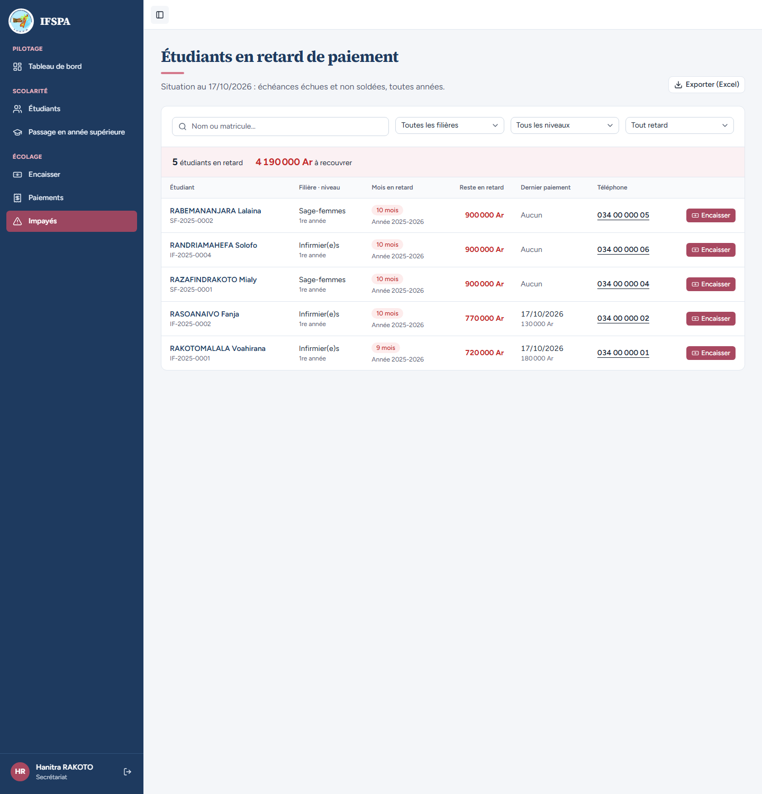
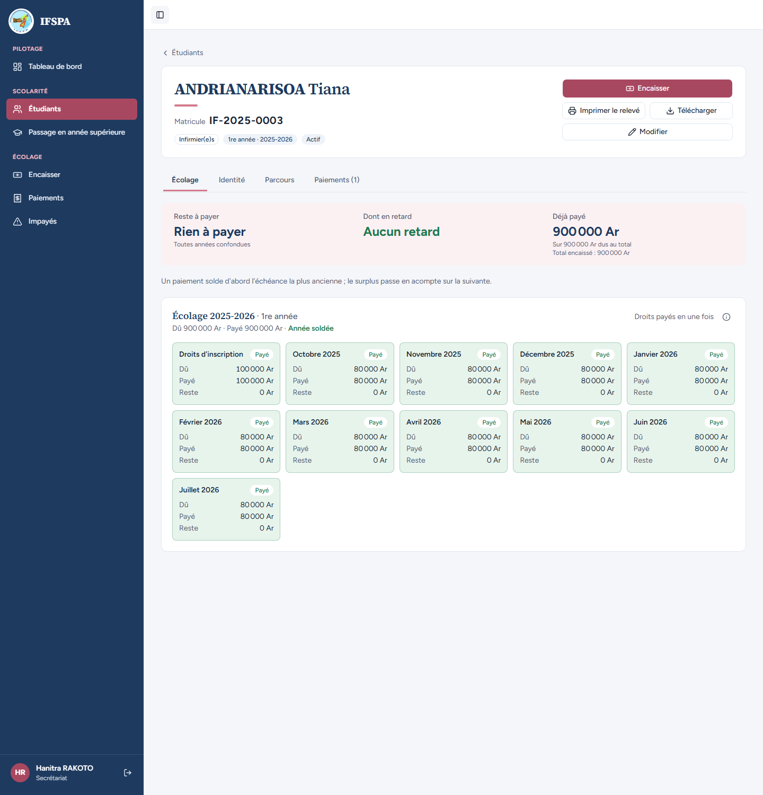

# UC08-05. Un parent solde tout l'impayé depuis la liste : l'étudiant sort de la liste

| | |
|---|---|
| Use case | UC08. Relancer les impayés |
| Règles couvertes | R-IMP (la liste suit les paiements), R-RET (échéances en retard cochées d'office au guichet), R-REP (solde de la plus ancienne à la plus récente), R-ROLE (secrétariat) |
| Rôle | Secrétariat, compte « Hanitra RAKOTO » |
| Durée estimée | 6 minutes |

## La situation

La secrétaire a téléphoné au père de ANDRIANARISOA Tiana, qui vient payer tout ce qui est en retard. Elle clique « Encaisser » sur la ligne de Tiana dans Impayés : le guichet s'ouvre sur lui, tout est coché. Après le paiement, Tiana n'est plus dans la liste.

## Avant de commencer

1. `pnpm db:up`, `pnpm recette:base`, `pnpm build`, `pnpm recette:app`, puis ouvrir `http://localhost:3200`.
2. Avoir déroulé [00-PREPARATION.md](../00-PREPARATION.md), **sections A, B, C puis G**, et les cas [UC08-02](UC08-02-liste-du-jour.md) à [UC08-04](UC08-04-export-excel.md) (qui ne modifient rien). **Utiliser le même navigateur que la section G** : les numéros de reçu en dépendent (R-2026-00024 ici, voir la section F de la préparation).
3. Se connecter avec le compte **secrétariat** (identifiants `SEED_USER_*` de `.env`).

## Étapes

| # | Qui | Action | Résultat attendu | Capture | ✓ |
|---|---|---|---|---|---|
| 1 | Secrétariat | Menu **Impayés** (6 étudiants, 5 090 000 Ar), cliquer **Encaisser** sur la ligne de ANDRIANARISOA Tiana. | Le guichet « Encaisser un paiement » s'ouvre directement sur l'étudiant : ANDRIANARISOA Tiana, IF-2025-0003, « En retard 900 000 Ar », « Reste à payer : 900 000 Ar, dont 900 000 Ar en retard ». Les 11 échéances (droits d'inscription, octobre 2025 à juillet 2026) sont **cochées**, « Montant reçu » vaut **900 000**, message vert « Ce paiement solde tout ce que l'étudiant doit. » Bouton « Encaisser 900 000 Ar et imprimer le reçu ». |  | |
| 2 | Secrétariat | Cliquer **Encaisser 900 000 Ar et imprimer le reçu**. | « Paiement enregistré : reçu **R-2026-00024**. » « 900 000 Ar · Espèces · ANDRIANARISOA Tiana. Reste à payer : 0 Ar. » Boutons « Réimprimer le ticket » et « Voir le reçu ». Dans « Derniers servis », Tiana est « À jour ». Bandeau vert « En ligne · tout est synchronisé ». |  | |
| 3 | Secrétariat | Cliquer **Impayés** dans le menu. | « **5** étudiants en retard », « **4 190 000 Ar** à recouvrer » (5 090 000 − 900 000). **ANDRIANARISOA Tiana n'est plus dans la liste.** |  | |
| 4 | Secrétariat | Menu **Étudiants**, ouvrir ANDRIANARISOA Tiana. | Fiche IF-2025-0003 : « Reste à payer **Rien à payer** », « Dont en retard **Aucun retard** », « Déjà payé 900 000 Ar », « Année soldée », les onze échéances « Payé ». |  | |

## Ce que ce scénario ne couvre pas

- Le détail du ticket, du paiement partiel et des refus : [UC06](../UC06-encaisser/UC06-01-deux-mois-especes.md).
- Un étudiant qui reste dans la liste avec un montant plus bas : [UC08-06](UC08-06-paiement-partiel.md).
- Ordinateur seulement ; le bouton « Encaisser » sur téléphone : [UC08-08](UC08-08-telephone.md).

## Dernière exécution par l'agent

- 17/10/2026 : ✅ 4 étapes sur 4. Voir [RAPPORT_2026-10-17_UC08](../../rapports/RAPPORT_2026-10-17_UC08.md).
- Parcours : [UC08-05-solde-disparait.recette.ts](../../parcours/UC08-05-solde-disparait.recette.ts).
