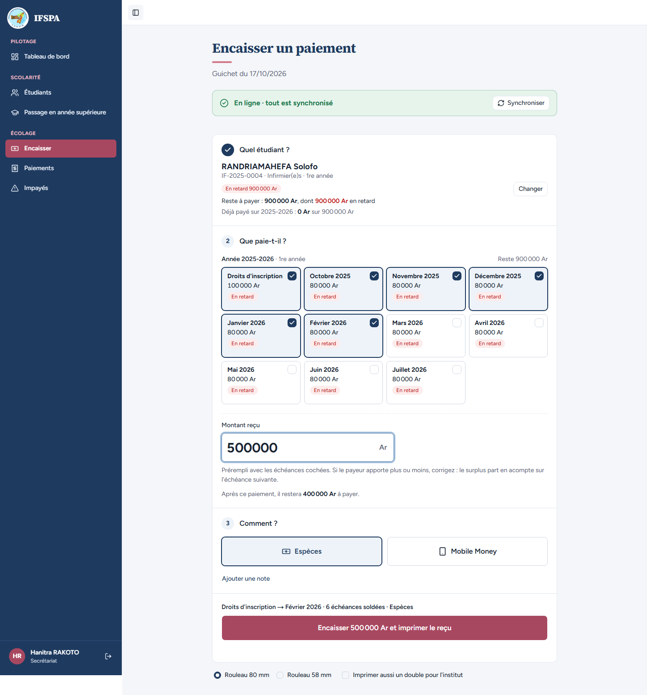
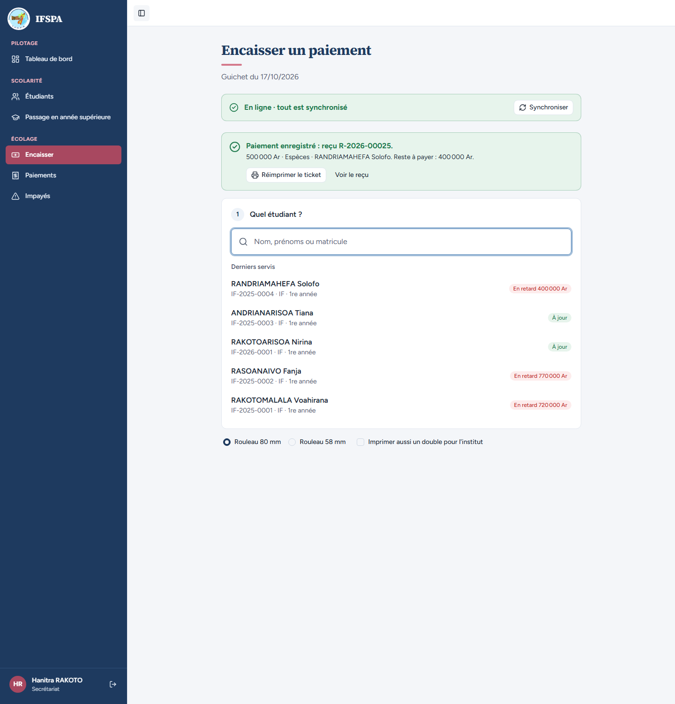
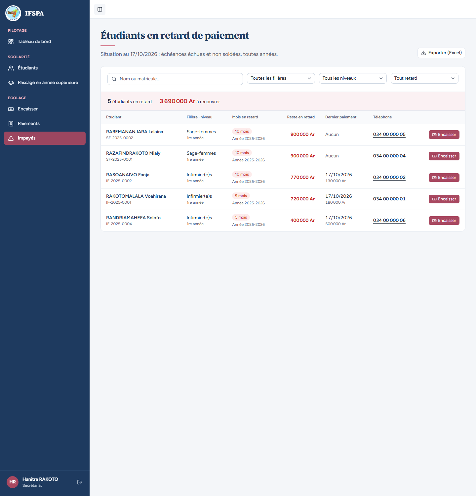
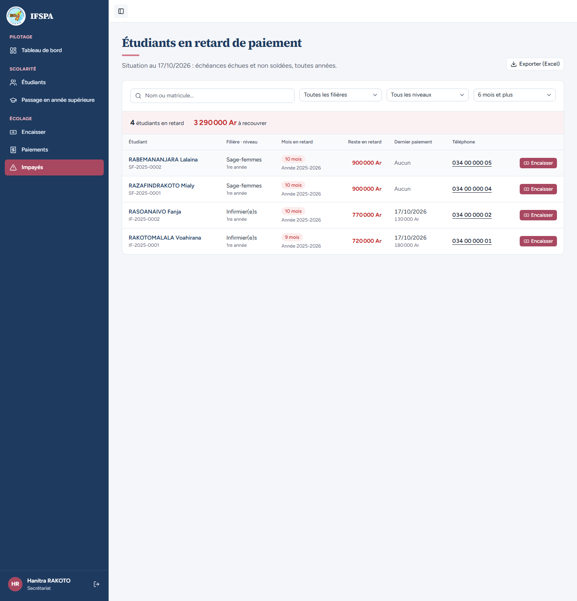
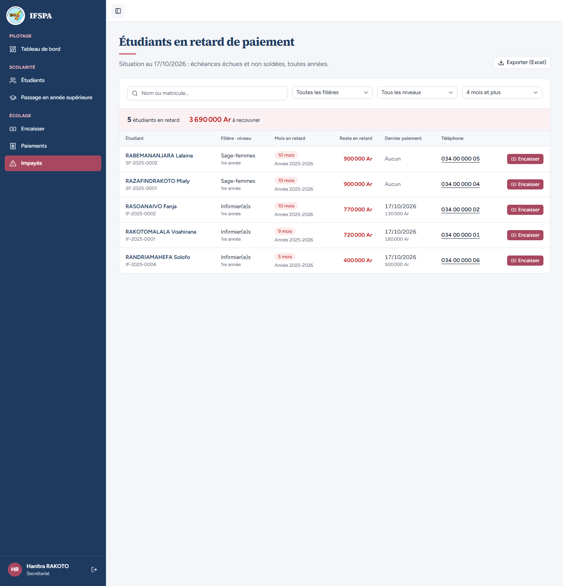

# UC08-06. Un parent paie une partie : la ligne baisse, l'étudiant reste à relancer

| | |
|---|---|
| Use case | UC08. Relancer les impayés |
| Règles couvertes | R-IMP (montant, nombre de mois et dernier paiement mis à jour ; filtre « Mois de retard »), R-REP (le paiement solde de la plus ancienne échéance à la plus récente), R-PAR (montant libre, inférieur au dû), R-ROLE (secrétariat) |
| Rôle | Secrétariat, compte « Hanitra RAKOTO » |
| Durée estimée | 8 minutes |

## La situation

La mère de RANDRIAMAHEFA Solofo ne peut pas tout payer : elle apporte 500 000 Ar. La secrétaire part de la ligne de Solofo dans Impayés, saisit le montant, encaisse. Solofo reste dans la liste, mais avec moins de mois en retard et un montant plus bas, et la date de son dernier paiement.

## Avant de commencer

1. `pnpm db:up`, `pnpm recette:base`, `pnpm build`, `pnpm recette:app`, puis ouvrir `http://localhost:3200`.
2. Avoir déroulé [00-PREPARATION.md](../00-PREPARATION.md), **sections A, B, C puis G**, puis [UC08-05](UC08-05-solde-disparait.md) (ANDRIANARISOA Tiana a tout payé : 5 étudiants, 4 190 000 Ar). Même navigateur que la section G (le reçu est R-2026-00025).
3. Se connecter avec le compte **secrétariat** (identifiants `SEED_USER_*` de `.env`).

## Étapes

| # | Qui | Action | Résultat attendu | Capture | ✓ |
|---|---|---|---|---|---|
| 1 | Secrétariat | Menu **Impayés** (5 étudiants, 4 190 000 Ar). La ligne de RANDRIAMAHEFA Solofo montre « 10 mois », 900 000 Ar, « Aucun ». Cliquer **Encaisser** sur cette ligne. | Le guichet s'ouvre sur Solofo ; « Montant reçu » vaut 900 000 (toutes les échéances en retard sont cochées). | | |
| 2 | Secrétariat | Remplacer le montant par `500000`. | Le bouton devient « Encaisser 500 000 Ar et imprimer le reçu ». |  | |
| 3 | Secrétariat | Cliquer **Encaisser 500 000 Ar et imprimer le reçu**. | « Paiement enregistré : reçu **R-2026-00025**. » « 500 000 Ar · Espèces · RANDRIAMAHEFA Solofo. Reste à payer : 400 000 Ar. » Dans « Derniers servis », Solofo : « En retard 400 000 Ar ». Bandeau « En ligne · tout est synchronisé ». |  | |
| 4 | Secrétariat | Cliquer **Impayés**. | « 5 étudiants en retard », « **3 690 000 Ar** à recouvrer » (4 190 000 − 500 000). Solofo : badge « **5 mois** », « Année 2025-2026 », **400 000 Ar**, dernier paiement « 17/10/2026 » et « 500 000 Ar ». (Les 500 000 Ar ont soldé les droits d'inscription et cinq mois, octobre 2025 à février 2026 ; restent mars à juillet 2026.) |  | |
| 5 | Secrétariat | Ouvrir « Tout retard » et choisir **6 mois et plus**. | « **4** étudiants en retard », « **3 290 000 Ar** » : Solofo (5 mois) n'est plus listé ; les quatre autres ont 9 ou 10 mois (RABEMANANJARA Lalaina, RAZAFINDRAKOTO Mialy, RASOANAIVO Fanja, RAKOTOMALALA Voahirana). |  | |
| 6 | Secrétariat | Choisir **4 mois et plus**. | « **5** étudiants en retard », « 3 690 000 Ar » : Solofo revient (5 mois ≥ 4). |  | |

## Ce que ce scénario ne couvre pas

- Le refus d'un montant au-delà du dû, le paiement avec acompte et le ticket : [UC06](../UC06-encaisser/UC06-03-partiel-acompte.md) et [UC06-05](../UC06-encaisser/UC06-05-refus-trop-percu.md).
- Ordinateur seulement.

## Dernière exécution par l'agent

- 17/10/2026 : ✅ 6 étapes sur 6. Voir [RAPPORT_2026-10-17_UC08](../../rapports/RAPPORT_2026-10-17_UC08.md).
- Parcours : [UC08-06-paiement-partiel.recette.ts](../../parcours/UC08-06-paiement-partiel.recette.ts).
