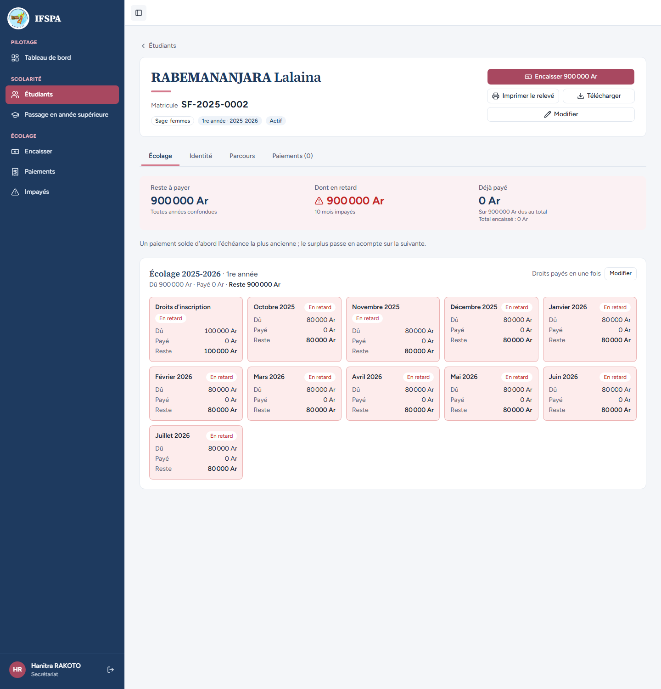
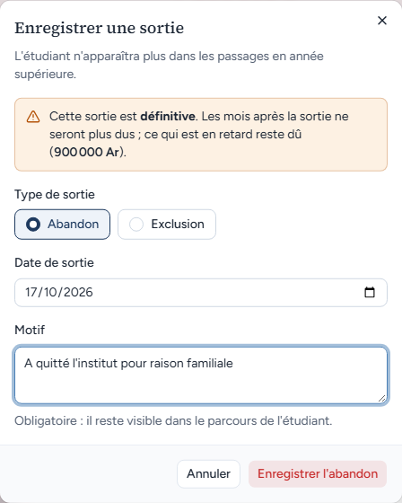
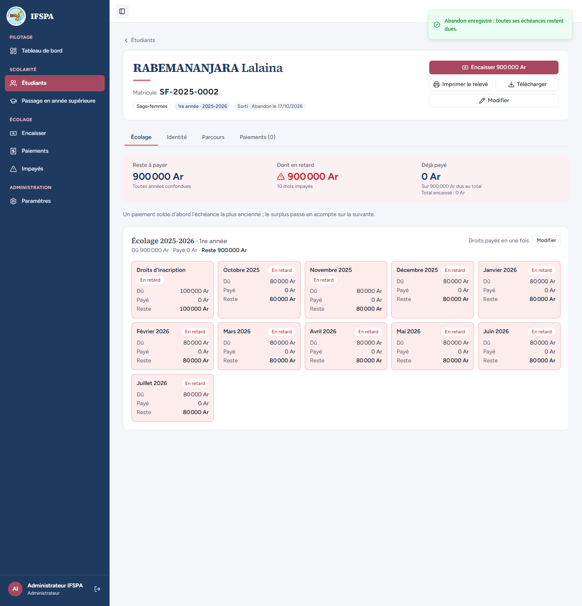
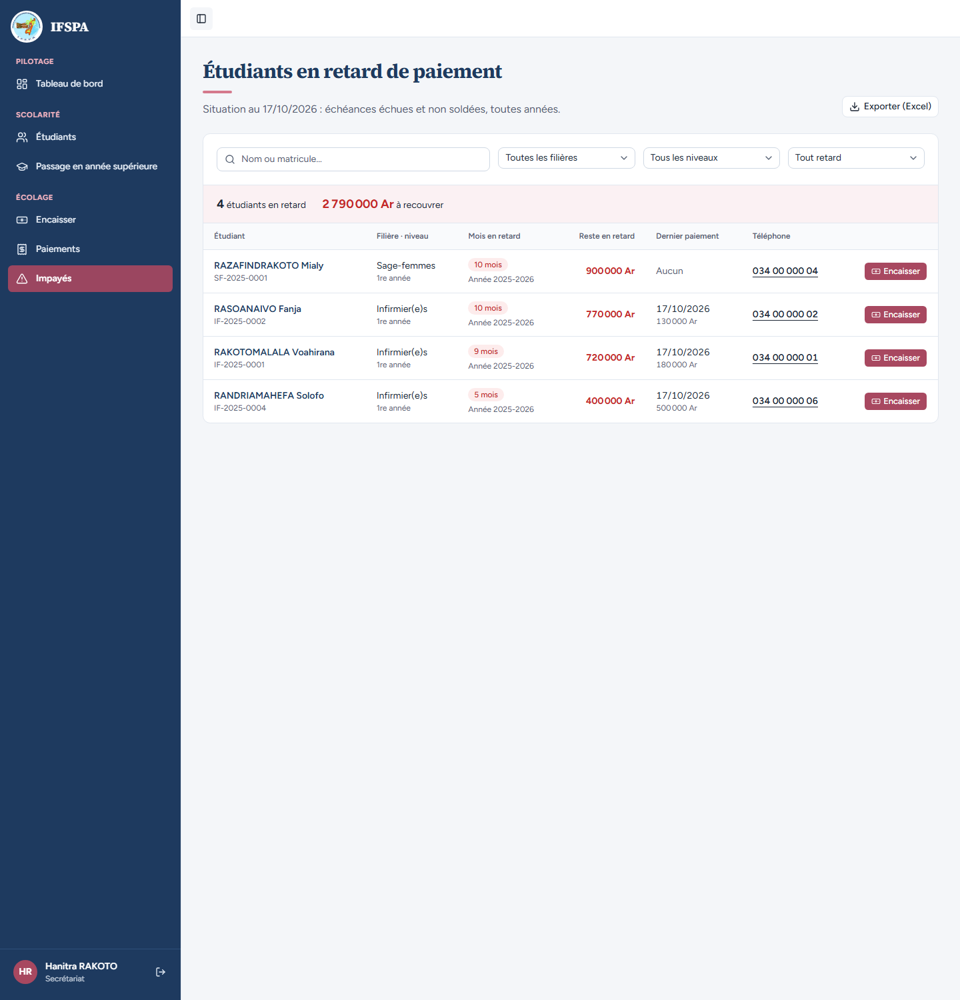
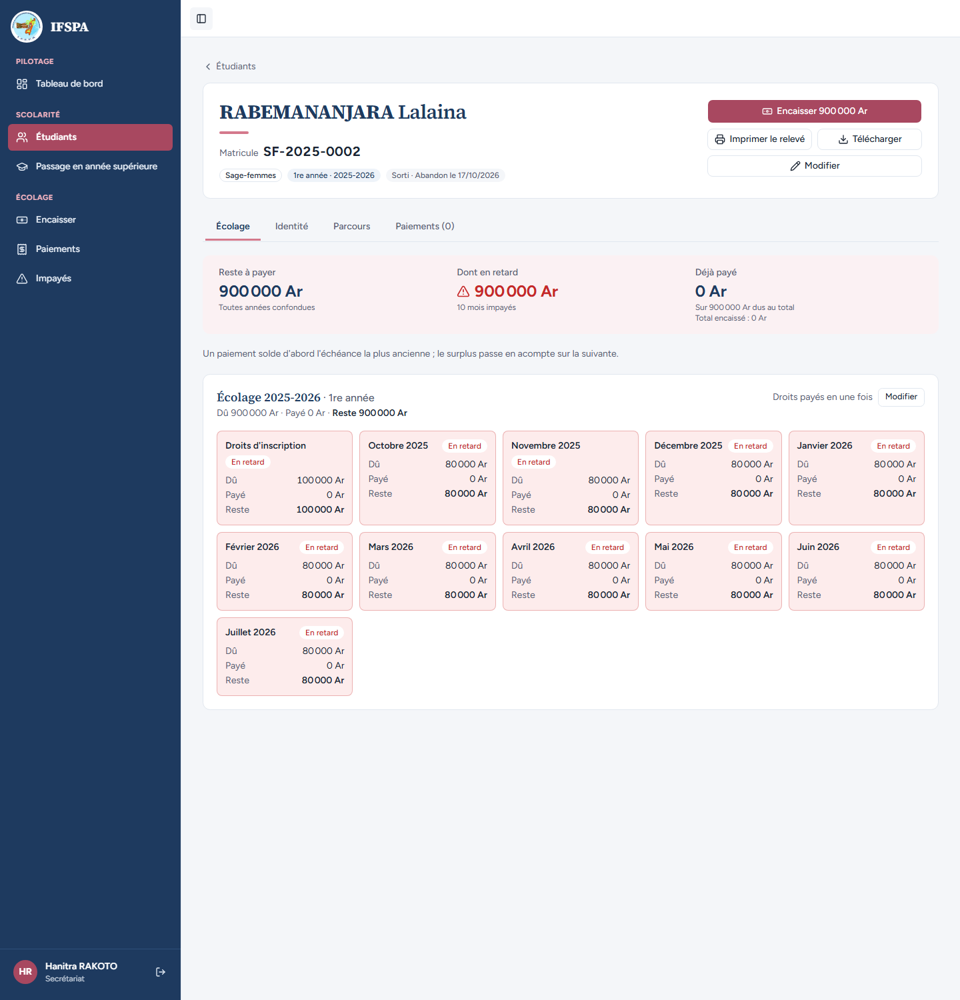

# UC08-07. Une étudiante abandonne : elle sort de la liste des impayés, sa dette reste encaissable

| | |
|---|---|
| Use case | UC08. Relancer les impayés |
| Règles couvertes | R-IMP (la liste ne compte que les étudiants actifs, décision provisoire n° 20), R-SOR (la sortie est réservée à l'administrateur, vue à l'écran), R-ROLE (le bouton « Enregistrer une sortie » est absent pour le secrétariat), R-RET |
| Rôle | Secrétariat, compte « Hanitra RAKOTO », puis Administrateur, compte « Administrateur IFSPA » (autre fenêtre) |
| Durée estimée | 8 minutes |

## La situation

La famille de RABEMANANJARA Lalaina annonce qu'elle ne reviendra pas à l'institut. La secrétaire constate qu'elle ne peut pas enregistrer l'abandon : c'est l'administrateur qui le fait. Ensuite Lalaina n'est plus relancée : elle sort de la liste des impayés. Sa dette reste pourtant due et encaissable.

## Avant de commencer

1. `pnpm db:up`, `pnpm recette:base`, `pnpm build`, `pnpm recette:app`, puis ouvrir `http://localhost:3200`.
2. Avoir déroulé [00-PREPARATION.md](../00-PREPARATION.md), **sections A, B, C puis G**, puis [UC08-05](UC08-05-solde-disparait.md) et [UC08-06](UC08-06-paiement-partiel.md) (5 étudiants, 3 690 000 Ar).
3. Deux fenêtres : le compte **secrétariat** (`SEED_USER_*`) et, dans une fenêtre de navigation privée, le compte **administrateur** (`SEED_ADMIN_*`), tous deux de `.env`.

## Étapes

| # | Qui | Action | Résultat attendu | Capture | ✓ |
|---|---|---|---|---|---|
| 1 | Secrétariat | Menu **Impayés** (5 étudiants, 3 690 000 Ar) : RABEMANANJARA Lalaina est listée à 900 000 Ar. Cliquer son nom. | Fiche SF-2025-0002, Sage-femmes, « Actif », « Reste à payer 900 000 Ar », « Encaisser 900 000 Ar », « Imprimer le relevé », « Télécharger », « Modifier ». **Pas de bouton « Enregistrer une sortie »** (« Hanitra RAKOTO » en bas de la barre latérale). |  | |
| 2 | Administrateur | Ouvrir la fiche de RABEMANANJARA Lalaina (Étudiants), cliquer **Enregistrer une sortie**. | Fenêtre « Enregistrer une sortie » : « L'étudiant n'apparaîtra plus dans les passages en année supérieure. » Avertissement « Cette sortie est définitive. Les mois après la sortie ne seront plus dus ; ce qui est en retard reste dû (900 000 Ar). » « Abandon » est déjà choisi, « Date de sortie » vaut la date du jour. Saisir le motif `A quitté l'institut pour raison familiale` (obligatoire). |  | |
| 3 | Administrateur | Cliquer **Enregistrer l'abandon**. | Message « Abandon enregistré : toutes ses échéances restent dues. » La fiche affiche le badge « Sorti · Abandon le (date du jour) ». « Administrateur IFSPA » en bas de la barre latérale, rubrique Paramètres visible. |  | |
| 4 | Secrétariat | Cliquer **Impayés**. | « **4** étudiants en retard », « **2 790 000 Ar** à recouvrer » (3 690 000 − 900 000). **RABEMANANJARA Lalaina n'est plus dans la liste.** |  | |
| 5 | Secrétariat | Menu **Étudiants**, ouvrir RABEMANANJARA Lalaina. | Badge « Sorti · Abandon le (date du jour) ». « Reste à payer 900 000 Ar » et « Dont en retard 900 000 Ar » sont inchangés ; le bouton « Encaisser 900 000 Ar » est toujours là (décision provisoire n° 20 : une dette de sortie reste encaissable). Toujours pas de bouton « Enregistrer une sortie ». |  | |

## Ce que ce scénario ne couvre pas

- **Refus côté serveur** de la sortie par le secrétariat (appel direct à l'action) : non démontré dans le navigateur. Couvert par Vitest : `tests/integration/actions-sorties.test.ts` (voir ce fichier pour le refus du rôle `user`) ; ici seule l'absence du bouton est démontrée. Le cas UC11 (sortie) reste à écrire.
- Un étudiant exclu ou diplômé (même règle d'exclusion de la liste) : couvert par Vitest, `tests/integration/lectures-paiements.test.ts` (« ne liste que les étudiants ACTIF en retard, jamais les diplômés, abandons ni exclus »).
- Le badge « Sorti » et l'encaissement d'un étudiant sorti au guichet : [UC11](../../MATRICE.md) (à écrire).
- Ordinateur seulement.

## Dernière exécution par l'agent

- 17/10/2026 : ✅ 5 étapes sur 5. Voir [RAPPORT_2026-10-17_UC08](../../rapports/RAPPORT_2026-10-17_UC08.md).
- Parcours : [UC08-07-abandon-hors-liste.recette.ts](../../parcours/UC08-07-abandon-hors-liste.recette.ts).
