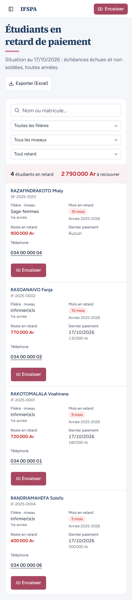
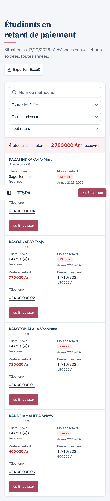
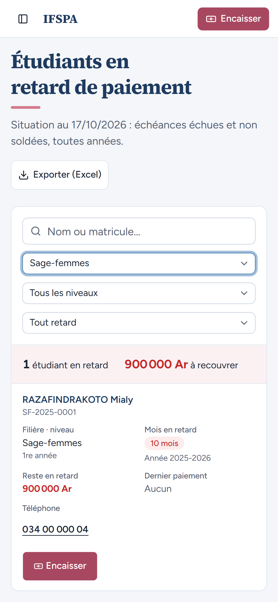
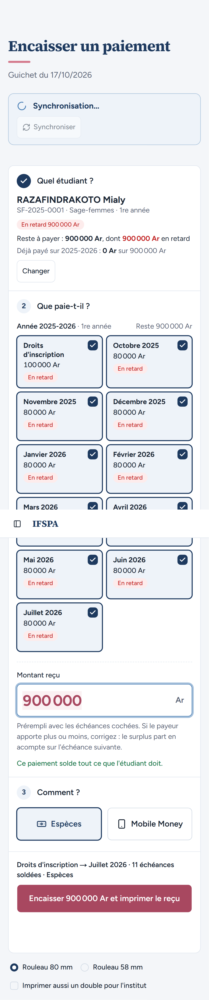

# UC08-08. La secrétaire relance depuis son téléphone : appeler, filtrer, aller encaisser

| | |
|---|---|
| Use case | UC08. Relancer les impayés |
| Règles couvertes | R-IMP (liste utilisable sur téléphone : numéro d'appel, bouton Encaisser, filtres), R-ROLE (secrétariat) |
| Rôle | Secrétariat, compte « Hanitra RAKOTO » |
| Durée estimée | 5 minutes |

## La situation

La secrétaire n'est pas à son bureau. Sur son téléphone, elle ouvre Impayés : chaque étudiant est une carte, le numéro se touche pour appeler, le bouton « Encaisser » ouvre le guichet sur l'étudiant.

## Avant de commencer

1. `pnpm db:up`, `pnpm recette:base`, `pnpm build`, `pnpm recette:app`. Ouvrir `http://localhost:3200` **sur un téléphone** ou dans le navigateur de l'ordinateur en mode appareil mobile (Chrome : F12, bouton « appareil », Pixel 7).
2. Avoir déroulé [00-PREPARATION.md](../00-PREPARATION.md), **sections A, B, C puis G**, puis [UC08-05](UC08-05-solde-disparait.md) à [UC08-07](UC08-07-abandon-hors-liste.md) (4 étudiants, 2 790 000 Ar). Ce cas ne modifie rien.
3. Se connecter avec le compte **secrétariat** (identifiants `SEED_USER_*` de `.env`).

## Étapes

| # | Qui | Action | Résultat attendu | Capture | ✓ |
|---|---|---|---|---|---|
| 1 | Secrétariat | Ouvrir la page Impayés (adresse `/app/impayes`). | Titre « Étudiants en retard de paiement », bouton « Exporter (Excel) », les champs de filtre empilés, « 4 étudiants en retard », « 2 790 000 Ar à recouvrer », puis **une carte par étudiant** : RASOANAIVO Fanja, RAZAFINDRAKOTO Mialy, RAKOTOMALALA Voahirana, RANDRIAMAHEFA Solofo, chacune avec Filière · niveau, Mois en retard, Reste en retard, Dernier paiement, Téléphone et un bouton « Encaisser ». En haut à droite de la barre, un bouton « Encaisser » rapide. |  | |
| 2 | Secrétariat | Regarder le numéro de Fanja « 034 00 000 02 ». | Lien d'appel (`tel:0340000002`), zone tactile d'au moins 44 px de haut. (Le toucher lance l'appel téléphonique du téléphone.) |  | |
| 3 | Secrétariat | Choisir la filière **Sage-femmes**. | « 1 étudiant en retard », « 900 000 Ar à recouvrer » : RAZAFINDRAKOTO Mialy seule (RABEMANANJARA Lalaina est sortie). |  | |
| 4 | Secrétariat | Toucher **Encaisser** sur la carte de Mialy (zone tactile d'au moins 44 px). | Le guichet s'ouvre sur RAZAFINDRAKOTO Mialy (SF-2025-0001), « En retard 900 000 Ar », « Reste à payer : 900 000 Ar, dont 900 000 Ar en retard », échéances cochées, « Montant reçu » 900 000. (Ne rien encaisser.) |  | |

## Ce que ce scénario ne couvre pas

- Un appel réel : seul le lien `tel:` et la taille de la zone tactile sont vérifiés.
- La barre d'en-tête collante apparaît au milieu des captures pleine page (artefact de la capture, pas de l'écran) : voir les captures 1 et 4.
- Ce cas ouvre l'écran Encaisser : si on le déroule dans un nouveau navigateur, il réserve un bloc de numéros de reçu de plus (voir la section F de la préparation) ; à faire en dernier si les numéros comptent.
- Le tableau (ordinateur) : [UC08-02](UC08-02-liste-du-jour.md).

## Dernière exécution par l'agent

- 17/10/2026 : ✅ 4 étapes sur 4 (projet `mobile`, Pixel 7). Voir [RAPPORT_2026-10-17_UC08](../../rapports/RAPPORT_2026-10-17_UC08.md).
- Parcours : [UC08-08-telephone.recette.ts](../../parcours/UC08-08-telephone.recette.ts) (`pnpm recette:parcours UC08-08 --project mobile`).
