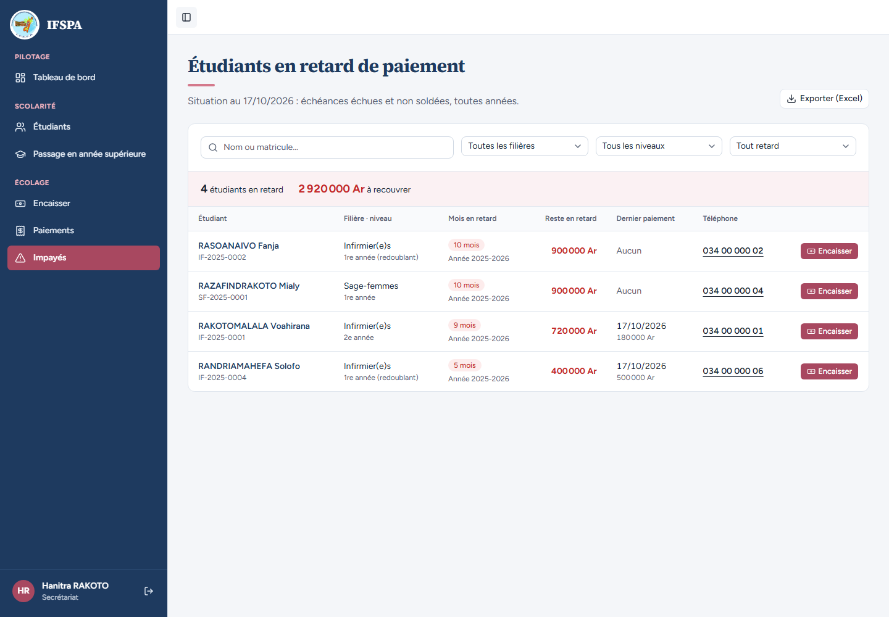
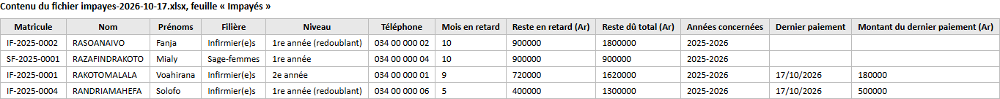

# UC08-09. Après le passage en année supérieure : l'export distingue le retard du reste dû total

| | |
|---|---|
| Use case | UC08. Relancer les impayés |
| Règles couvertes | R-IMP (liste et export, niveau actuel, années concernées), décision provisoire n° 21 (impayés toutes années : les échéances de 2026-2027 comptent dans le reste dû total mais pas dans le retard) |
| Rôle | Secrétariat, compte « Hanitra RAKOTO » |
| Durée estimée | 5 minutes |

## La situation

Le passage en année supérieure a eu lieu, des étudiants doivent encore l'année précédente. La responsable veut savoir, pour chaque famille, ce qui est en retard (2025-2026) et ce qui reste dû en tout (avec 2026-2027, pas encore échue).

## Avant de commencer

1. `pnpm db:up`, `pnpm recette:base`, `pnpm build`, `pnpm recette:app`, puis ouvrir `http://localhost:3200`.
2. Avoir déroulé [00-PREPARATION.md](../00-PREPARATION.md), **sections A, B, C puis G**, les cas [UC08-05](UC08-05-solde-disparait.md) à [UC08-07](UC08-07-abandon-hors-liste.md), puis [UC09-05](../UC09-releve/UC09-05-releve-deux-annees.md) (passage de la classe IF 1re année, Fanja et Solofo redoublent) et [UC09-06](../UC09-releve/UC09-06-releve-recu-annule.md) (reçu R-2026-00022 annulé : Fanja doit de nouveau 900 000 Ar en retard).
3. Se connecter avec le compte **secrétariat** (identifiants `SEED_USER_*` de `.env`).

## Étapes

| # | Qui | Action | Résultat attendu | Capture | ✓ |
|---|---|---|---|---|---|
| 1 | Secrétariat | Menu **Impayés**. | « **4** étudiants en retard », « **2 920 000 Ar** à recouvrer ». RASOANAIVO Fanja : « 1re année (redoublant) » ; RAKOTOMALALA Voahirana : « 2e année » avec « Année 2025-2026 » (l'impayé reste sur l'année où il est né) ; RANDRIAMAHEFA Solofo : « 1re année (redoublant) » ; RAZAFINDRAKOTO Mialy : « 1re année ». |  | |
| 2 | Secrétariat | Cliquer **Exporter (Excel)** et ouvrir le fichier. | Quatre lignes. « Reste en retard (Ar) » / « Reste dû total (Ar) » : Fanja 900000 / **1800000** (niveau « 1re année (redoublant) »), Mialy 900000 / 900000, Voahirana 720000 / **1620000** (niveau « 2e année »), Solofo 400000 / **1300000** (niveau « 1re année (redoublant) »). « Années concernées » : « 2025-2026 » pour tous. La capture montre le contenu relu dans le fichier. |  | |

## Ce que ce scénario ne couvre pas

- Plusieurs années en retard dans la colonne « Années concernées » (voir [UC08-02](UC08-02-liste-du-jour.md), « ne couvre pas »).
- Ouverture dans Excel réel (voir [UC08-04](UC08-04-export-excel.md)).
- Ce cas se déroule après les cas UC09 : il dépend du passage fait dans [UC09-05](../UC09-releve/UC09-05-releve-deux-annees.md). Il n'a pas de numéro d'ordre avant eux.

## Dernière exécution par l'agent

- 17/10/2026 : ✅ 2 étapes sur 2. Voir [RAPPORT_2026-10-17_UC08](../../rapports/RAPPORT_2026-10-17_UC08.md).
- Parcours : [UC08-09-export-apres-passage.recette.ts](../../parcours/UC08-09-export-apres-passage.recette.ts) (à lancer après les parcours UC09-05 et UC09-06, dans une commande à part).
