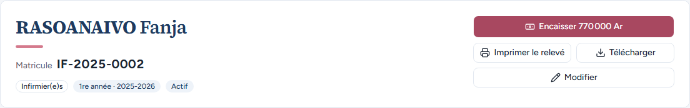
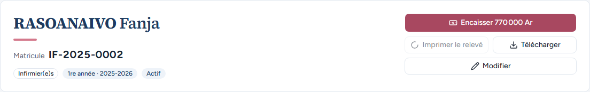
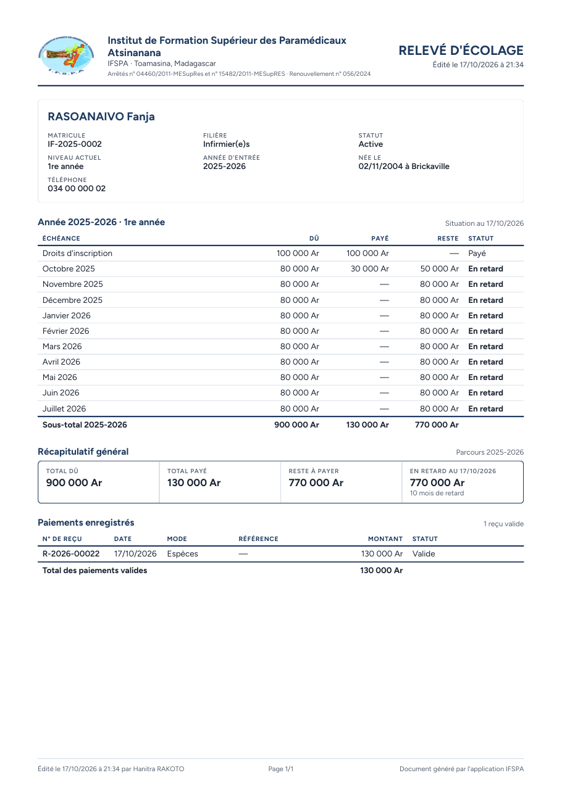
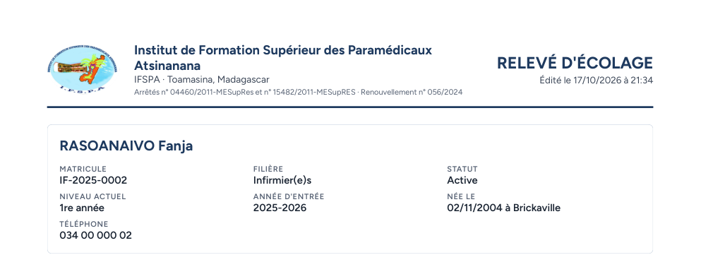
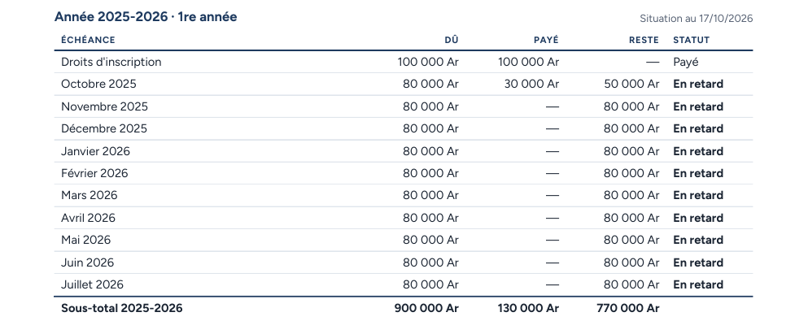
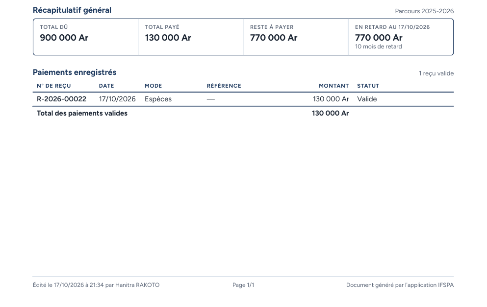

# UC09-01. La mère de Fanja repart avec le relevé de ce qui reste à payer

| | |
|---|---|
| Use case | UC09. Remettre un relevé d'écolage |
| Règles couvertes | R-REL (relevé A4 : identité, grille mois par mois avec dû, payé, reste, statut, sous-total, récapitulatif général, liste des paiements avec n° de reçu, en-tête et pied de page), R-RET (statuts « Payé » et « En retard »), R-ROLE (secrétariat), décision provisoire n° 32 (3 arrêtés, accords au féminin) |
| Rôle | Secrétariat, compte « Hanitra RAKOTO » |
| Durée estimée | 10 minutes |

## La situation

La mère de RASOANAIVO Fanja vient demander où en est l'écolage de sa fille, qui a payé un acompte. La secrétaire ouvre la fiche, imprime le relevé A4 pour le remettre à la famille (ou le télécharge pour l'envoyer) et lit avec elle le tableau mois par mois.

## Avant de commencer

1. `pnpm db:up`, `pnpm recette:base`, `pnpm build`, `pnpm recette:app`, puis ouvrir `http://localhost:3200`.
2. Avoir déroulé [00-PREPARATION.md](../00-PREPARATION.md), **sections A, B, C puis G**, puis les cas [UC08-05](../UC08-impayes/UC08-05-solde-disparait.md) à [UC08-07](../UC08-impayes/UC08-07-abandon-hors-liste.md). Les cas UC09-01 à UC09-04 se déroulent avant le passage en année supérieure ([UC09-05](UC09-05-releve-deux-annees.md)). Pour lire le PDF : un lecteur PDF.
3. Se connecter avec le compte **secrétariat** (identifiants `SEED_USER_*` de `.env`).

## Étapes

| # | Qui | Action | Résultat attendu | Capture | ✓ |
|---|---|---|---|---|---|
| 1 | Secrétariat | Menu **Étudiants**, ouvrir RASOANAIVO Fanja. | Fiche IF-2025-0002. Sous le bouton « Encaisser 770 000 Ar » : « Imprimer le relevé » et « Télécharger » côte à côte, puis « Modifier ». « Hanitra RAKOTO » en bas de la barre latérale. |  | |
| 2 | Secrétariat | Cliquer **Imprimer le relevé**. | Le navigateur charge le PDF (réponse 200, `application/pdf`, ouvert « inline » sous le nom `releve-IF-2025-0002.pdf`) pour l'envoyer à l'imprimante ; aucun message d'erreur à l'écran. **La boîte d'impression elle-même n'est pas démontrée** (voir plus bas) : si elle s'ouvre, la fermer. |  | |
| 3 | Secrétariat | Cliquer **Télécharger**. | Le fichier **releve-IF-2025-0002.pdf** est téléchargé : une seule page, format **A4** (595 × 842 points). |  | |
| 4 | Secrétariat | Ouvrir le PDF, lire le haut de la page. | En-tête : logo IFSPA en couleur, « Institut de Formation Supérieur des Paramédicaux Atsinanana », « IFSPA · Toamasina, Madagascar », ligne des agréments « Arrêtés n° 04460/2011-MESupRes et n° 15482/2011-MESupRES · Renouvellement n° 056/2024 », à droite « RELEVÉ D'ÉCOLAGE » et « Édité le (date) à (heure) ». |  | |
| 5 | Secrétariat | Lire le cadre d'identité. | « RASOANAIVO Fanja » ; Matricule IF-2025-0002 ; Filière Infirmier(e)s ; Statut « **Active** » (accord au féminin) ; Niveau actuel 1re année ; Année d'entrée 2025-2026 ; « Née le 02/11/2004 à Brickaville » ; Téléphone 034 00 000 02. |  | |
| 6 | Secrétariat | Lire le tableau « Année 2025-2026 · 1re année ». | « Situation au (date) ». Colonnes Échéance, Dû, Payé, Reste, Statut. Droits d'inscription : 100 000 Ar, 100 000 Ar, —, **Payé**. Octobre 2025 : 80 000 Ar, 30 000 Ar, 50 000 Ar, **En retard**. Novembre 2025 à juillet 2026 : 80 000 Ar, —, 80 000 Ar, **En retard** (en gras). Ligne « Sous-total 2025-2026 » : 900 000 Ar, 130 000 Ar, 770 000 Ar. |  | |
| 7 | Secrétariat | Lire « Récapitulatif général ». | « Parcours 2025-2026 ». Quatre cases : Total dû **900 000 Ar**, Total payé **130 000 Ar**, Reste à payer **770 000 Ar**, « En retard au (date) » **770 000 Ar** et « 10 mois de retard ». |  | |
| 8 | Secrétariat | Lire « Paiements enregistrés » et le pied de page. | « 1 reçu valide ». Une ligne : **R-2026-00022**, 17/10/2026 (date du jour), Espèces, référence « — », 130 000 Ar, Valide. « Total des paiements valides 130 000 Ar ». Pied de page : « Édité le (date) à (heure) par **Hanitra RAKOTO** », « Page 1/1 », « Document généré par l'application IFSPA ». |  | |

## Ce que ce scénario ne couvre pas

- **Boîte d'impression réelle** (imprimante A4, aperçu avant impression) : non démontrée. Le test charge le PDF comme le bouton le fait, mais l'impression par une fenêtre invisible n'est pas observable dans le navigateur de recette. À vérifier à la main (étape 2).
- **Adresse, téléphone et courriel de l'institut** dans l'en-tête (« adresse et contact à Toamasina » du plan) : absents, les coordonnées ne sont pas saisies et aucun écran ne permet de les saisir (PLAN.md, « pas d'écran de paramétrage » ; STATUS.md, coordonnées à fournir). Seuls la ville et les trois arrêtés s'affichent.
- Octobre 2025 est « En retard » et non « Partiel » bien qu'un acompte de 30 000 Ar y soit versé : un mois échu non soldé est en retard (R-RET). « Partiel » s'affiche pour un mois en cours : [UC09-02](UC09-02-releve-nirina.md).
- Le texte du PDF sélectionné/copié : le point final d'une phrase est extrait « 5 » dans un cas (voir [UC09-04](UC09-04-releve-abandon.md) et le rapport) ; sans effet sur l'affichage.
- Ordinateur seulement ; l'impression directe du relevé sur téléphone n'est pas déroulée.

## Dernière exécution par l'agent

- 17/10/2026 : ✅ 8 étapes sur 8 (l'étape 2 : chargement du PDF démontré, boîte d'impression non démontrée). Voir [RAPPORT_2026-10-17_UC09](../../rapports/RAPPORT_2026-10-17_UC09.md).
- Parcours : [UC09-01-releve-fanja.recette.ts](../../parcours/UC09-01-releve-fanja.recette.ts).
