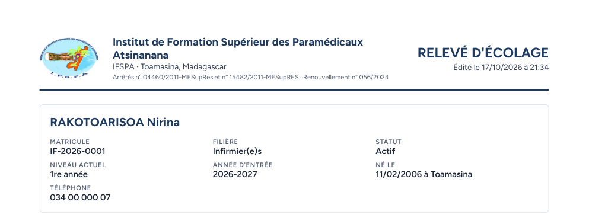
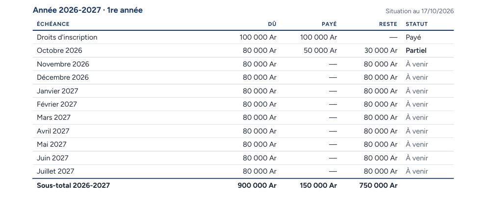
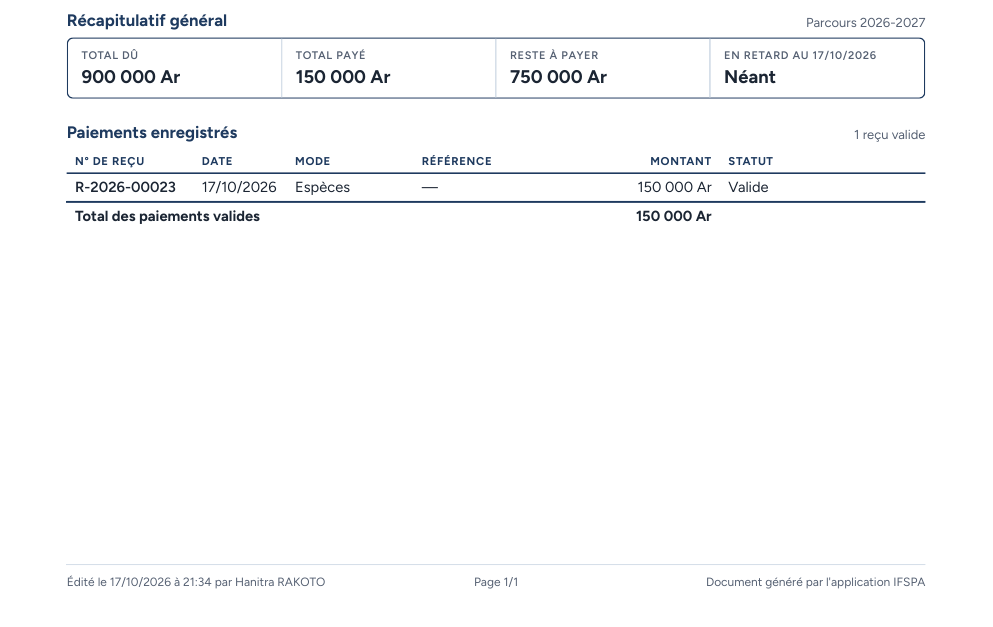

# UC09-02. Le relevé d'un étudiant de l'année en cours : un mois partiel, neuf mois à venir

| | |
|---|---|
| Use case | UC09. Remettre un relevé d'écolage |
| Règles couvertes | R-REL, R-RET (statuts « Payé », « Partiel », « À venir » ; rien en retard), R-PAR (acompte versé sur le mois en cours) |
| Rôle | Secrétariat, compte « Hanitra RAKOTO » |
| Durée estimée | 5 minutes |

## La situation

RAKOTOARISOA Nirina, inscrit pour 2026-2027, a payé ses droits d'inscription et un acompte sur octobre. Son père demande un relevé pour justifier le paiement auprès de son employeur. Rien n'est en retard : le relevé le dit (« Néant »).

## Avant de commencer

1. `pnpm db:up`, `pnpm recette:base`, `pnpm build`, `pnpm recette:app`, puis ouvrir `http://localhost:3200`.
2. Avoir déroulé [00-PREPARATION.md](../00-PREPARATION.md), **sections A, B, C puis G** (G3 : Nirina a payé 150 000 Ar, reçu R-2026-00023).
3. Se connecter avec le compte **secrétariat** (identifiants `SEED_USER_*` de `.env`).

## Étapes

| # | Qui | Action | Résultat attendu | Capture | ✓ |
|---|---|---|---|---|---|
| 1 | Secrétariat | Menu **Étudiants**, ouvrir RAKOTOARISOA Nirina, cliquer **Télécharger**. | Fichier **releve-IF-2026-0001.pdf**, une page A4. | | |
| 2 | Secrétariat | Lire l'identité. | « RAKOTOARISOA Nirina », IF-2026-0001, Infirmier(e)s, Statut « **Actif** » (masculin), Niveau actuel 1re année, Année d'entrée 2026-2027, « **Né le** 11/02/2006 à Toamasina », Téléphone 034 00 000 07. |  | |
| 3 | Secrétariat | Lire le tableau « Année 2026-2027 · 1re année ». | Droits d'inscription : 100 000 Ar, 100 000 Ar, —, **Payé**. Octobre 2026 : 80 000 Ar, 50 000 Ar, 30 000 Ar, **Partiel** (en gras). Novembre 2026 à juillet 2027 : 80 000 Ar, —, 80 000 Ar, **À venir** (en gris, neuf lignes). « Sous-total 2026-2027 » : 900 000 Ar, 150 000 Ar, 750 000 Ar. |  | |
| 4 | Secrétariat | Lire le récapitulatif et les paiements. | Total dû 900 000 Ar, Total payé 150 000 Ar, Reste à payer 750 000 Ar, « En retard au (date) » **Néant** (pas de mention « mois de retard »). Un reçu : **R-2026-00023**, 17/10/2026, Espèces, —, 150 000 Ar, Valide. « Page 1/1 ». |  | |

## Ce que ce scénario ne couvre pas

- « Imprimer le relevé » (boîte d'impression) : voir [UC09-01](UC09-01-releve-fanja.md).
- Le statut « Partiel » n'apparaît que sur un mois en cours ou à venir ; un mois échu avec acompte est « En retard » (R-RET, voir [UC09-01](UC09-01-releve-fanja.md)).
- Ordinateur seulement.

## Dernière exécution par l'agent

- 17/10/2026 : ✅ 4 étapes sur 4. Voir [RAPPORT_2026-10-17_UC09](../../rapports/RAPPORT_2026-10-17_UC09.md).
- Parcours : [UC09-02-releve-nirina.recette.ts](../../parcours/UC09-02-releve-nirina.recette.ts).
