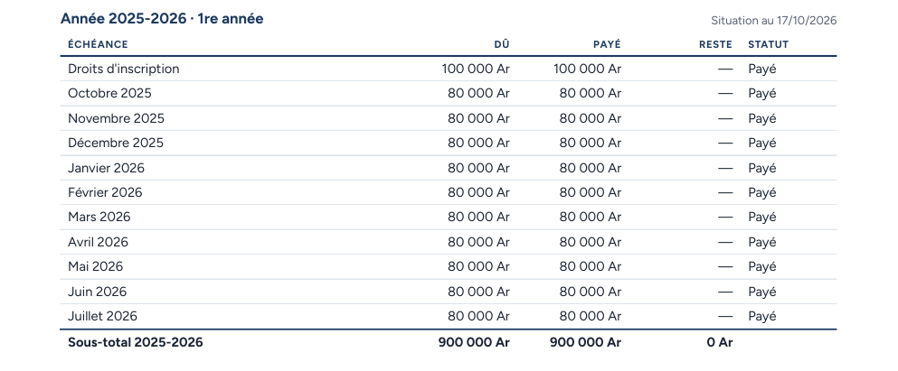
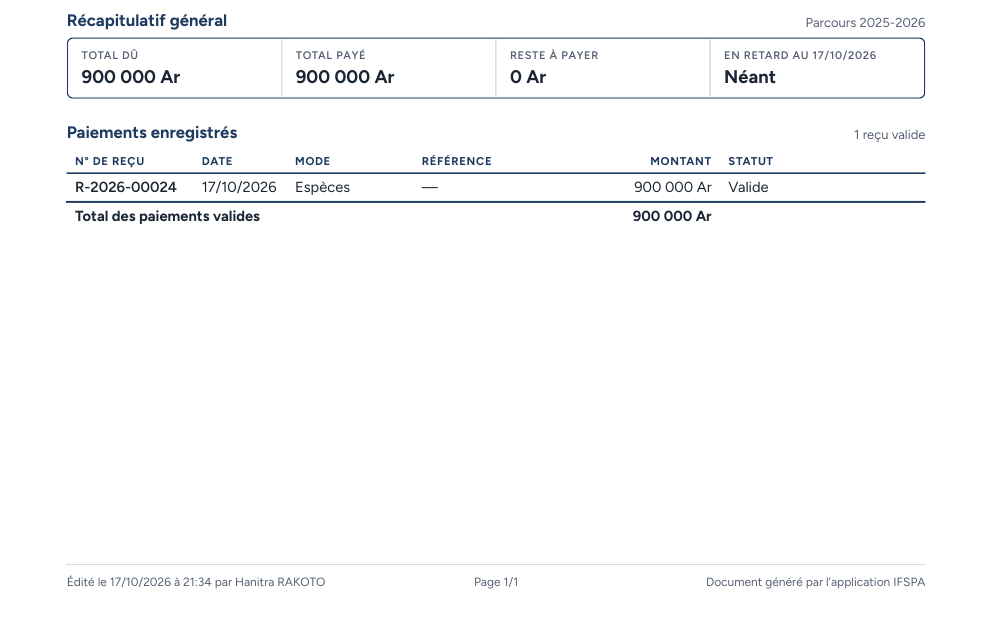

# UC09-03. Le relevé d'un étudiant à jour : tout est payé

| | |
|---|---|
| Use case | UC09. Remettre un relevé d'écolage |
| Règles couvertes | R-REL, R-RET (onze échéances « Payé », aucun retard) |
| Rôle | Secrétariat, compte « Hanitra RAKOTO » |
| Durée estimée | 4 minutes |

## La situation

Le père de ANDRIANARISOA Tiana a tout soldé et demande un justificatif de fin d'année. Le relevé montre onze échéances payées et « Néant » en retard.

## Avant de commencer

1. `pnpm db:up`, `pnpm recette:base`, `pnpm build`, `pnpm recette:app`, puis ouvrir `http://localhost:3200`.
2. Avoir déroulé [00-PREPARATION.md](../00-PREPARATION.md), **sections A, B, C puis G**, puis [UC08-05](../UC08-impayes/UC08-05-solde-disparait.md) (Tiana paie 900 000 Ar, reçu R-2026-00024).
3. Se connecter avec le compte **secrétariat** (identifiants `SEED_USER_*` de `.env`).

## Étapes

| # | Qui | Action | Résultat attendu | Capture | ✓ |
|---|---|---|---|---|---|
| 1 | Secrétariat | Menu **Étudiants**, ouvrir ANDRIANARISOA Tiana, cliquer **Télécharger**. | Fichier **releve-IF-2025-0003.pdf**, une page A4. | | |
| 2 | Secrétariat | Lire le tableau « Année 2025-2026 · 1re année ». | Les onze lignes (droits d'inscription, octobre 2025 à juillet 2026) sont « **Payé** », colonne Reste « — », aucun « En retard ». Sous-total 2025-2026 : 900 000 Ar, 900 000 Ar, **0 Ar**. |  | |
| 3 | Secrétariat | Lire le récapitulatif et les paiements. | Total dû 900 000 Ar, Total payé 900 000 Ar, Reste à payer **0 Ar**, « En retard au (date) » **Néant**. Un reçu : **R-2026-00024**, 17/10/2026, Espèces, —, 900 000 Ar, Valide. |  | |

## Ce que ce scénario ne couvre pas

- Observation : la fiche écran affiche « Rien à payer » alors que le relevé affiche « 0 Ar » (deux libellés pour la même situation, voir le rapport).
- Impression directe : voir [UC09-01](UC09-01-releve-fanja.md). Ordinateur seulement.

## Dernière exécution par l'agent

- 17/10/2026 : ✅ 3 étapes sur 3. Voir [RAPPORT_2026-10-17_UC09](../../rapports/RAPPORT_2026-10-17_UC09.md).
- Parcours : [UC09-03-releve-solde.recette.ts](../../parcours/UC09-03-releve-solde.recette.ts).
