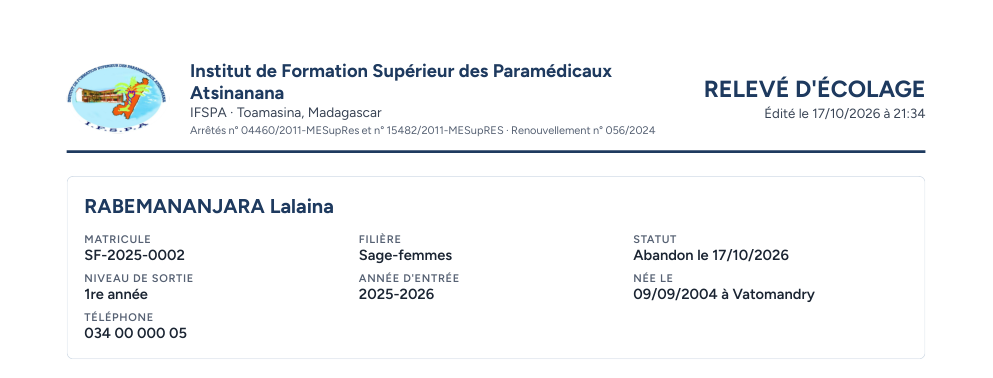
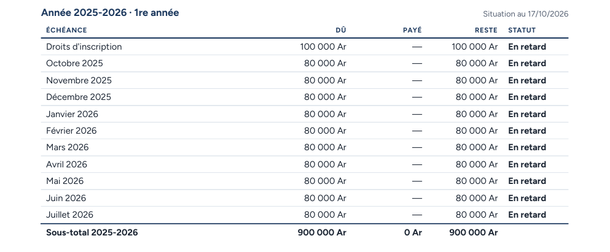
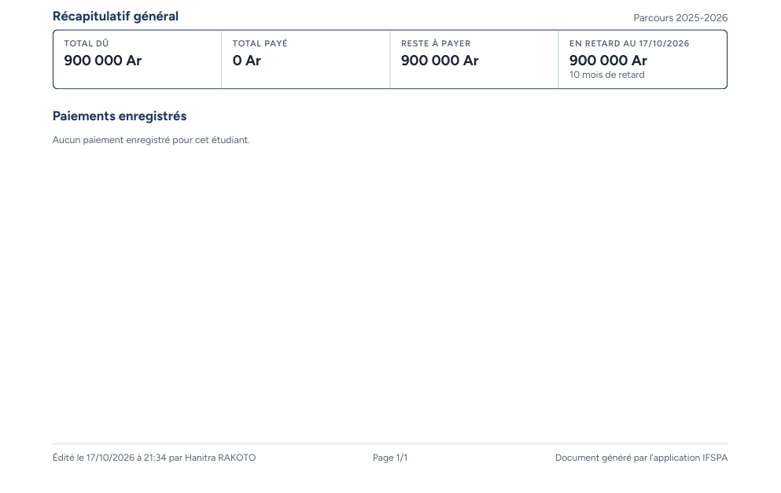

# UC09-04. Le relevé d'une étudiante sortie (abandon), sans aucun paiement

| | |
|---|---|
| Use case | UC09. Remettre un relevé d'écolage |
| Règles couvertes | R-REL (statut de sortie, niveau de sortie, « Aucun paiement enregistré »), R-RET, R-SOR (la dette de sortie reste due), décision provisoire n° 32 (accords au féminin) |
| Rôle | Secrétariat, compte « Hanitra RAKOTO » |
| Durée estimée | 4 minutes |

## La situation

Après l'abandon de RABEMANANJARA Lalaina, l'institut veut remettre à sa famille un relevé de ce qui reste dû. Le relevé indique le statut « Abandon le … », le niveau de sortie, et les onze échéances toujours dues.

## Avant de commencer

1. `pnpm db:up`, `pnpm recette:base`, `pnpm build`, `pnpm recette:app`, puis ouvrir `http://localhost:3200`.
2. Avoir déroulé [00-PREPARATION.md](../00-PREPARATION.md), **sections A, B, C puis G**, puis [UC08-07](../UC08-impayes/UC08-07-abandon-hors-liste.md) (abandon de Lalaina enregistré par l'administrateur).
3. Se connecter avec le compte **secrétariat** (identifiants `SEED_USER_*` de `.env`).

## Étapes

| # | Qui | Action | Résultat attendu | Capture | ✓ |
|---|---|---|---|---|---|
| 1 | Secrétariat | Menu **Étudiants**, ouvrir RABEMANANJARA Lalaina, cliquer **Télécharger**. | Fichier **releve-SF-2025-0002.pdf**, une page A4. | | |
| 2 | Secrétariat | Lire l'identité. | « RABEMANANJARA Lalaina », SF-2025-0002, Filière Sage-femmes, Statut « **Abandon le (date du jour)** », « **Niveau de sortie** 1re année » (au lieu de « Niveau actuel »), Année d'entrée 2025-2026, « Née le 09/09/2004 à Vatomandry », Téléphone 034 00 000 05. |  | |
| 3 | Secrétariat | Lire le tableau « Année 2025-2026 · 1re année ». | Les onze échéances : Payé « — », Reste égal au Dû, Statut « **En retard** ». Sous-total 2025-2026 : 900 000 Ar, 0 Ar, 900 000 Ar. |  | |
| 4 | Secrétariat | Lire le récapitulatif et les paiements. | Total dû 900 000 Ar, Total payé 0 Ar, Reste à payer 900 000 Ar, « En retard au (date) » 900 000 Ar et « 10 mois de retard ». « Paiements enregistrés » : « Aucun paiement enregistré pour cet étudiant. » (au masculin, même pour une étudiante). |  | |

## Ce que ce scénario ne couvre pas

- **Anomalie mineure** : dans ce PDF, le point final de « Aucun paiement enregistré pour cet étudiant. » s'affiche bien mais est extrait comme « 5 » (« étudiant5 ») quand on copie ou recherche le texte. Voir « Corrections à faire » du rapport. Le parcours ne compare donc pas ce point.
- Une exclusion (statut « Exclue » / « Exclu ») et un diplômé : non déroulés (aucune de ces sorties n'est faite dans cette recette).
- Ordinateur seulement.

## Dernière exécution par l'agent

- 17/10/2026 : ✅ 4 étapes sur 4 (avec le constat mineur ci-dessus). Voir [RAPPORT_2026-10-17_UC09](../../rapports/RAPPORT_2026-10-17_UC09.md).
- Parcours : [UC09-04-releve-abandon.recette.ts](../../parcours/UC09-04-releve-abandon.recette.ts).
