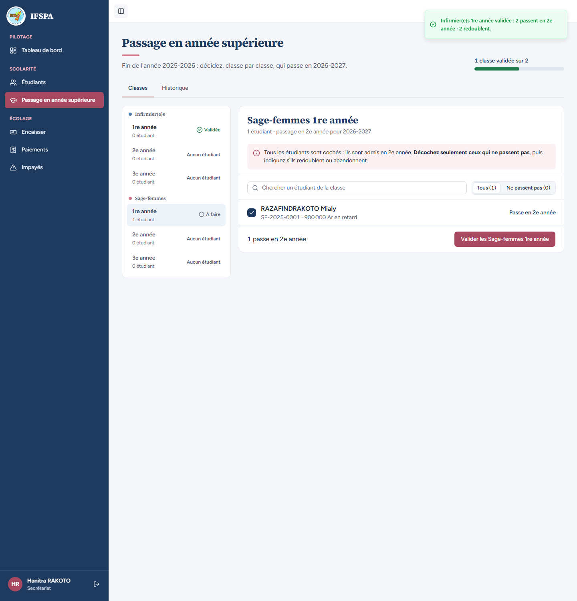
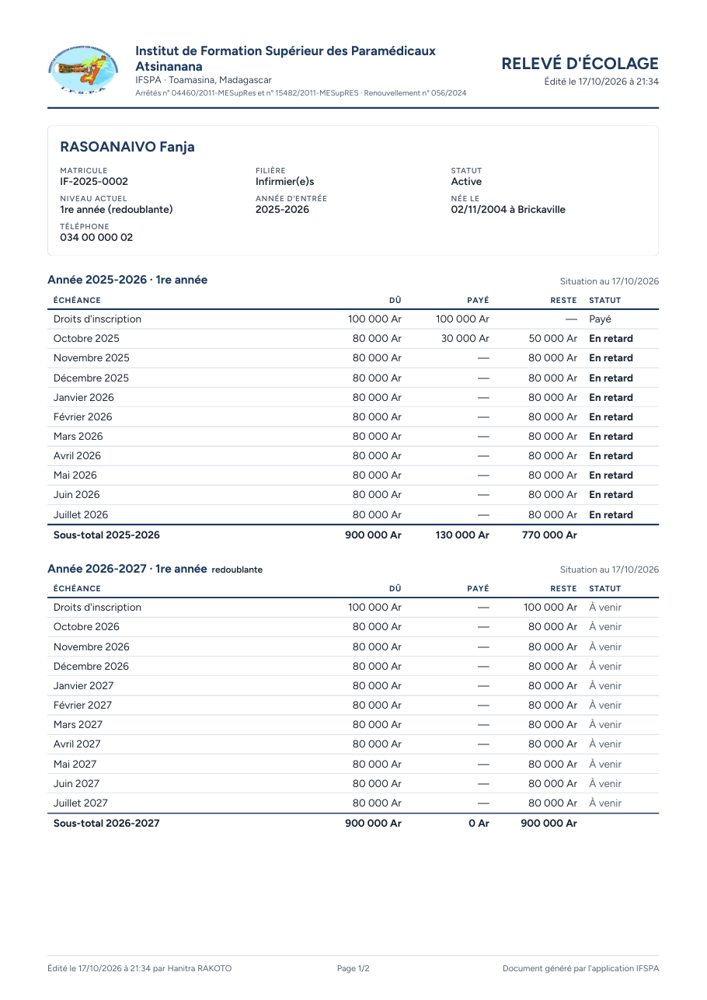
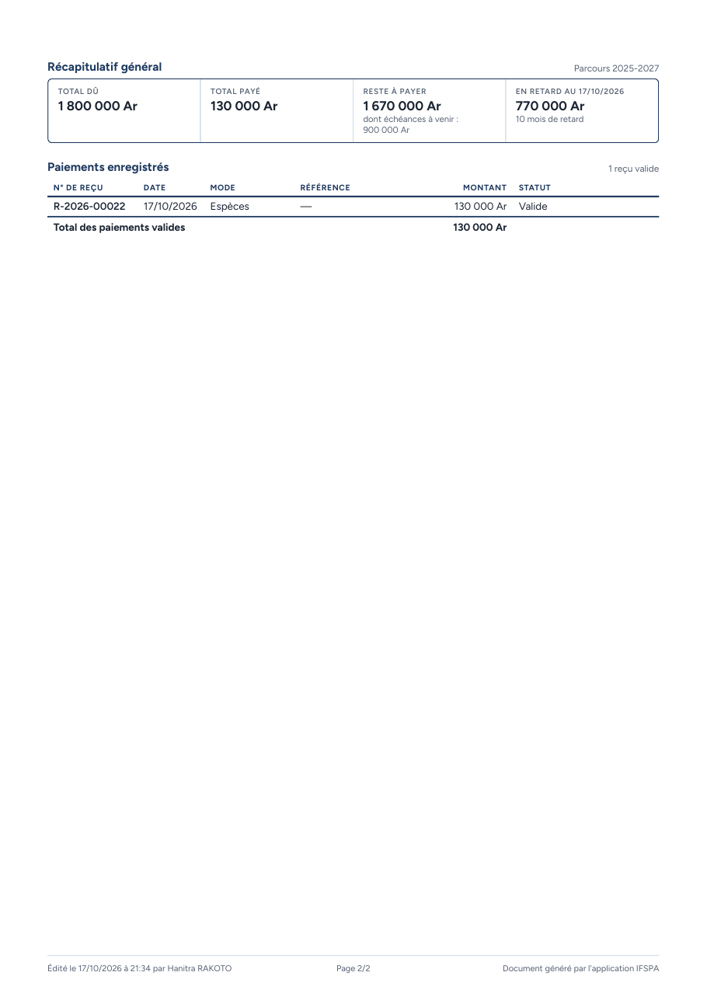
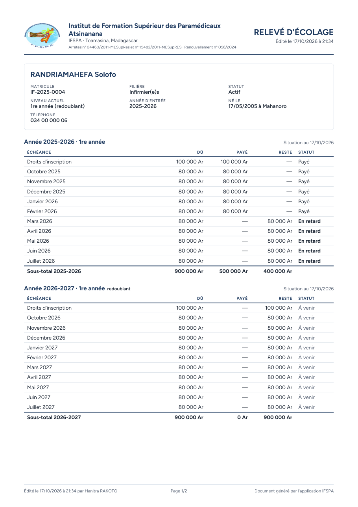
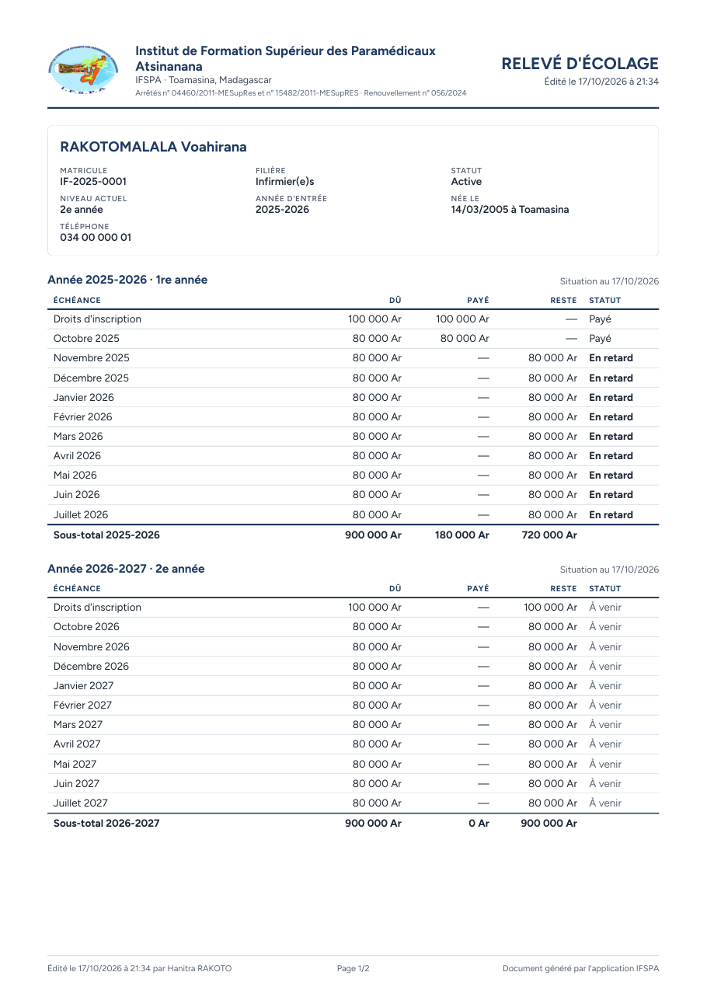

# UC09-05. Après le passage en année supérieure : une grille par année, la mention « redoublant »

| | |
|---|---|
| Use case | UC09. Remettre un relevé d'écolage |
| Règles couvertes | R-REL (une grille par année scolaire du parcours, niveau, mention redoublant, sous-totaux, récapitulatif sur l'ensemble du parcours, deux pages), R-ADM (passage en lot, décocher = redouble), R-RET (« À venir » pour 2026-2027), décision provisoire n° 32 (« redoublante » au féminin) |
| Rôle | Secrétariat, compte « Hanitra RAKOTO » |
| Durée estimée | 12 minutes |

## La situation

La classe des Infirmier(e)s 1re année passe en 2e année. RASOANAIVO Fanja et RANDRIAMAHEFA Solofo redoublent. La secrétaire remet ensuite aux familles des relevés qui montrent les deux années : ce qui reste dû de 2025-2026 et la nouvelle année 2026-2027.

## Avant de commencer

1. `pnpm db:up`, `pnpm recette:base`, `pnpm build`, `pnpm recette:app`, puis ouvrir `http://localhost:3200`.
2. Avoir déroulé [00-PREPARATION.md](../00-PREPARATION.md), **sections A, B, C puis G**, les cas [UC08-05](../UC08-impayes/UC08-05-solde-disparait.md) à [UC08-07](../UC08-impayes/UC08-07-abandon-hors-liste.md), puis [UC09-01](UC09-01-releve-fanja.md) à [UC09-04](UC09-04-releve-abandon.md). **Ce cas fait le passage** : il ne peut se dérouler qu'une fois (pour le rejouer, repartir de `pnpm recette:base`).
3. Se connecter avec le compte **secrétariat** (identifiants `SEED_USER_*` de `.env`).

## Étapes

| # | Qui | Action | Résultat attendu | Capture | ✓ |
|---|---|---|---|---|---|
| 1 | Secrétariat | Menu **Passage en année supérieure**, classe **Infirmier(e)s › 1re année**. Décocher **RASOANAIVO Fanja** puis **RANDRIAMAHEFA Solofo** (ils passent en « Redouble » par défaut). Cliquer **Valider les Infirmier(e)s 1re année**, puis **Valider le passage de 4 étudiants** dans la fenêtre. | Barre « 2 passent en 2e année · 2 redoublent ». Message « Infirmier(e)s 1re année validée : 2 passent en 2e année · 2 redoublent. » ; « 1 classe validée sur 2 » ; la classe Infirmier(e)s 1re année est « Validée » et l'écran passe aux Sage-femmes 1re année (un étudiant, RAZAFINDRAKOTO Mialy). |  | |
| 2 | Secrétariat | Menu **Étudiants**, ouvrir RASOANAIVO Fanja, cliquer **Télécharger**. | Fichier **releve-IF-2025-0002.pdf**, **deux pages** A4. |  | |
| 3 | Secrétariat | Lire la page 1 : identité et deux grilles. | « Niveau actuel **1re année (redoublante)** ». Première grille « Année 2025-2026 · 1re année » (droits Payé, octobre 2025 30 000 Ar payés / 50 000 Ar restants « En retard », novembre 2025 à juillet 2026 « En retard » ; sous-total 900 000 Ar, 130 000 Ar, 770 000 Ar). Seconde grille « Année 2026-2027 · 1re année **redoublante** » : onze lignes « À venir » ; sous-total 900 000 Ar, 0 Ar, 900 000 Ar. Pied de page « Page 1/2 ». |  | |
| 4 | Secrétariat | Lire la page 2. | « Récapitulatif général », « Parcours 2025-2027 » : Total dû **1 800 000 Ar**, Total payé **130 000 Ar**, Reste à payer **1 670 000 Ar** avec « dont échéances à venir : 900 000 Ar », « En retard au (date) » **770 000 Ar**, « 10 mois de retard ». « Paiements enregistrés » : « 1 reçu valide », R-2026-00022, 130 000 Ar, Valide. « Page 2/2 ». |  | |
| 5 | Secrétariat | Ouvrir la fiche de RANDRIAMAHEFA Solofo, **Télécharger**, lire la page 1. | releve-IF-2025-0004.pdf, deux pages. « Niveau actuel **1re année (redoublant)** » (masculin), « Né le 17/05/2005 à Mahanoro », grille « Année 2026-2027 · 1re année **redoublant** ». Sous-total 2025-2026 : 900 000 Ar, 500 000 Ar, 400 000 Ar. Récapitulatif : Total dû 1 800 000 Ar, Total payé 500 000 Ar, Reste à payer 1 300 000 Ar. |  | |
| 6 | Secrétariat | Ouvrir la fiche de RAKOTOMALALA Voahirana, **Télécharger**, lire la page 1. | releve-IF-2025-0001.pdf, deux pages. « Niveau actuel **2e année** », grilles « Année 2025-2026 · 1re année » et « Année 2026-2027 · 2e année », **aucune mention de redoublement**. Récapitulatif : Total dû 1 800 000 Ar, Total payé 180 000 Ar, Reste à payer 1 620 000 Ar. |  | |

## Ce que ce scénario ne couvre pas

- Le détail du passage (fenêtre de confirmation, historique, annulation) : [UC10](../UC10-passage/UC10-01-nominal-redoublant.md).
- Les grilles sont rangées de la plus ancienne à la plus récente sur le relevé (2025-2026 puis 2026-2027) ; la fiche à l'écran affiche l'inverse. Voir le rapport (question).
- Le récapitulatif général est seul sur la page 2 (il ne tient pas en bas de la page 1) : constaté, sans anomalie de contenu.
- Plus de deux pages, impression directe : non déroulés. Ordinateur seulement.

## Dernière exécution par l'agent

- 17/10/2026 : ✅ 6 étapes sur 6. Voir [RAPPORT_2026-10-17_UC09](../../rapports/RAPPORT_2026-10-17_UC09.md).
- Parcours : [UC09-05-releve-deux-annees.recette.ts](../../parcours/UC09-05-releve-deux-annees.recette.ts).
