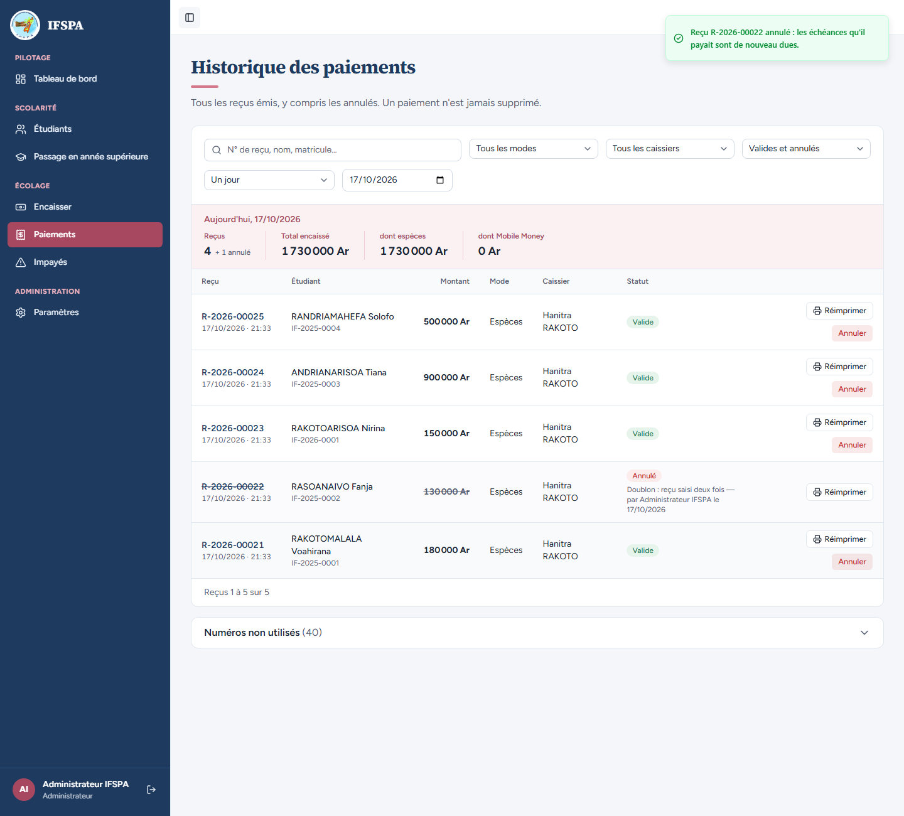
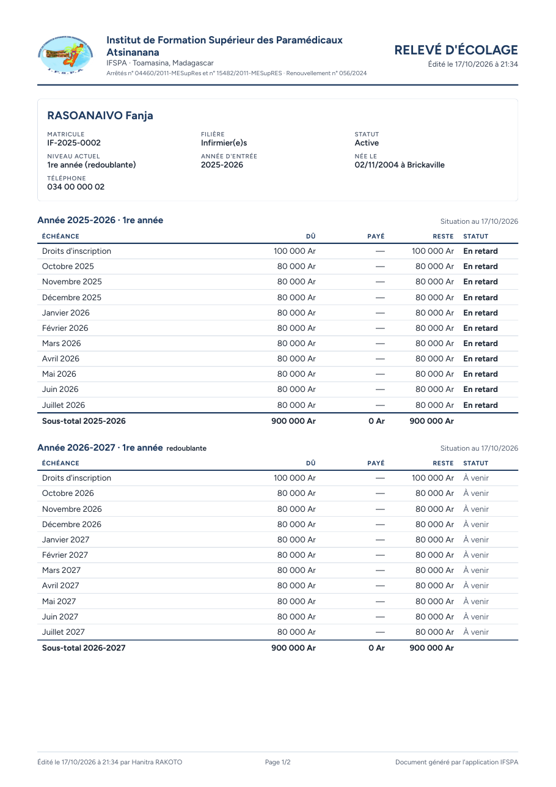
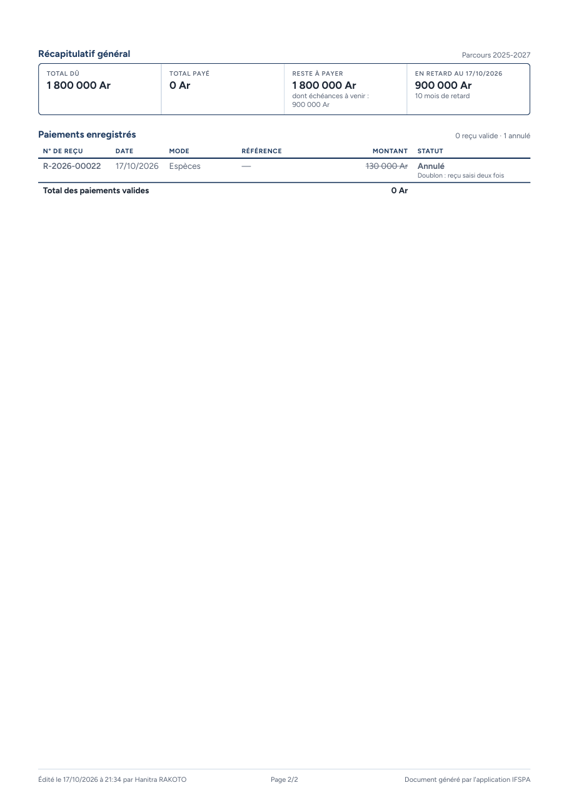

# UC09-06. Un reçu annulé reste visible sur le relevé, mais ne compte plus

| | |
|---|---|
| Use case | UC09. Remettre un relevé d'écolage |
| Règles couvertes | R-REL (liste des paiements avec n° de reçu, reçu annulé barré avec son motif), R-ANN (un paiement ne se supprime jamais, l'administrateur l'annule avec un motif), R-ROLE (l'annulation est faite par l'administrateur, le relevé remis par le secrétariat) |
| Rôle | Administrateur, compte « Administrateur IFSPA », puis Secrétariat, compte « Hanitra RAKOTO » |
| Durée estimée | 8 minutes |

## La situation

Le reçu de 130 000 Ar de RASOANAIVO Fanja a été saisi en double : l'administrateur l'annule avec son motif. La secrétaire remet ensuite un relevé à jour : le reçu annulé est toujours lisible (barré, avec le motif), mais l'argent n'est plus compté et Fanja doit de nouveau 900 000 Ar de retard.

## Avant de commencer

1. `pnpm db:up`, `pnpm recette:base`, `pnpm build`, `pnpm recette:app`, puis ouvrir `http://localhost:3200`.
2. Avoir déroulé [00-PREPARATION.md](../00-PREPARATION.md), **sections A, B, C puis G**, [UC08-05](../UC08-impayes/UC08-05-solde-disparait.md) à [UC08-07](../UC08-impayes/UC08-07-abandon-hors-liste.md) et [UC09-01](UC09-01-releve-fanja.md) à [UC09-05](UC09-05-releve-deux-annees.md).
3. Deux fenêtres : le compte **administrateur** (`SEED_ADMIN_*`, fenêtre de navigation privée) et le compte **secrétariat** (`SEED_USER_*`), identifiants de `.env`.

## Étapes

| # | Qui | Action | Résultat attendu | Capture | ✓ |
|---|---|---|---|---|---|
| 1 | Administrateur | Menu **Paiements**, ligne **R-2026-00022** (RASOANAIVO Fanja, 130 000 Ar) : cliquer « Annuler le reçu R-2026-00022 », saisir le motif `Doublon : reçu saisi deux fois`, cliquer « Annuler le reçu R-2026-00022 » dans la fenêtre. | La fenêtre se ferme ; la ligne R-2026-00022 est marquée « Annulé ». « Administrateur IFSPA » en bas de la barre latérale. |  | |
| 2 | Secrétariat | Menu **Étudiants**, ouvrir RASOANAIVO Fanja, cliquer **Télécharger**, lire la page 1. | releve-IF-2025-0002.pdf, deux pages. Grille « Année 2025-2026 · 1re année » : droits d'inscription 100 000 Ar, payé « — », reste 100 000 Ar, « En retard » ; octobre 2025 80 000 Ar, —, 80 000 Ar, « En retard ». Sous-total 2025-2026 : 900 000 Ar, **0 Ar**, 900 000 Ar. |  | |
| 3 | Secrétariat | Lire la page 2. | Total dû 1 800 000 Ar, Total payé **0 Ar**, Reste à payer 1 800 000 Ar (« dont échéances à venir : 900 000 Ar »), « En retard au (date) » 900 000 Ar, « 10 mois de retard ». « Paiements enregistrés » : « **0 reçu valide · 1 annulé** ». Ligne R-2026-00022, 17/10/2026, Espèces, —, **130 000 Ar barré**, statut « **Annulé** » avec le motif « Doublon : reçu saisi deux fois ». « Total des paiements valides » **0 Ar**. |  | |

## Ce que ce scénario ne couvre pas

- Le détail de l'annulation (motif obligatoire, refus, secrétariat sans bouton) : [UC07](../UC07-paiements/UC07-02-annulation-motif.md) à [UC07-04](../UC07-paiements/UC07-04-secretariat-sans-annulation.md).
- Un reçu « à vérifier » (paiement hors ligne) sur le relevé : la décision provisoire n° 32 dit que ces paiements ne sont pas signalés aux parents ; non déroulé ici.
- Ordinateur seulement.

## Dernière exécution par l'agent

- 17/10/2026 : ✅ 3 étapes sur 3. Voir [RAPPORT_2026-10-17_UC09](../../rapports/RAPPORT_2026-10-17_UC09.md).
- Parcours : [UC09-06-releve-recu-annule.recette.ts](../../parcours/UC09-06-releve-recu-annule.recette.ts).
