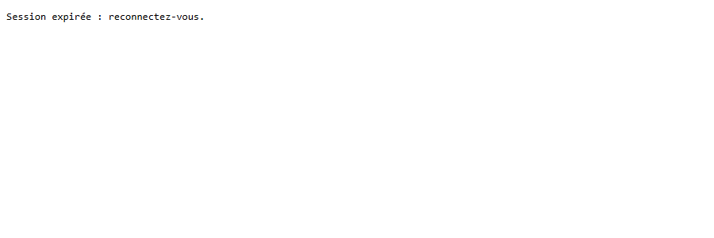
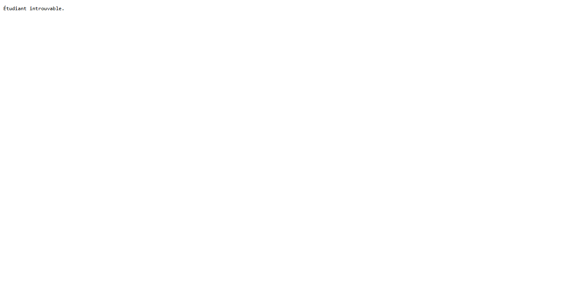
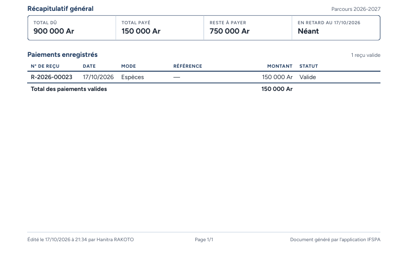
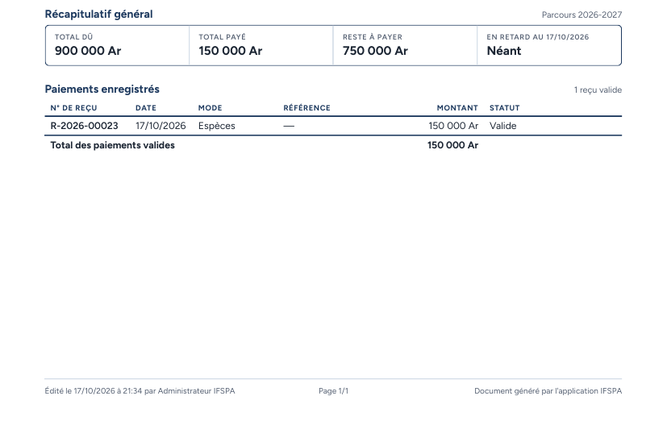

# UC09-07. Le relevé est réservé aux utilisateurs connectés ; une adresse inconnue répond clairement

| | |
|---|---|
| Use case | UC09. Remettre un relevé d'écolage |
| Règles couvertes | R-REL (le relevé sert aussi au secrétariat et à l'administrateur), R-ROLE (accès réservé aux comptes connectés, nom de l'éditeur en pied de page) |
| Rôle | Secrétariat, compte « Hanitra RAKOTO », puis Administrateur, compte « Administrateur IFSPA » ; un visiteur non connecté |
| Durée estimée | 6 minutes |

## La situation

Quelqu'un copie l'adresse d'un relevé et l'ouvre sans être connecté, ou tape une adresse au hasard : il ne doit rien voir et le message doit être clair. Les comptes secrétariat et administrateur obtiennent le même relevé, chacun signé de son nom en pied de page.

## Avant de commencer

1. `pnpm db:up`, `pnpm recette:base`, `pnpm build`, `pnpm recette:app`, puis ouvrir `http://localhost:3200`.
2. Avoir déroulé [00-PREPARATION.md](../00-PREPARATION.md), **sections A, B, C puis G**, et les cas UC08-05 à UC08-07 (pour un état identique) ; le cas se déroule après [UC09-06](UC09-06-releve-recu-annule.md) mais n'en dépend pas.
3. Copier l'adresse du relevé de RAKOTOARISOA Nirina : sur sa fiche, clic droit sur « Télécharger » puis copier l'adresse du lien, sans `?telecharger=1` (de la forme `http://localhost:3200/api/pdf/releve/(identifiant)`).

## Étapes

| # | Qui | Action | Résultat attendu | Capture | ✓ |
|---|---|---|---|---|---|
| 1 | Visiteur non connecté | Dans une fenêtre de navigation privée, ouvrir l'adresse copiée. | Réponse 401. Page blanche avec le seul texte « Session expirée : reconnectez-vous. » Aucun PDF. |  | |
| 2 | Secrétariat | Connecté, ouvrir `http://localhost:3200/api/pdf/releve/inexistant`. | Réponse 404, texte « Étudiant introuvable. » |  | |
| 3 | Secrétariat | Ouvrir l'adresse copiée, puis la même avec `?telecharger=1` à la fin. | Sans paramètre : le PDF s'affiche dans le navigateur (en-tête `inline`, nom `releve-IF-2026-0001.pdf`). Avec `?telecharger=1` : il se télécharge (`attachment`, même nom). Pied de page : « Édité le (date) à (heure) par **Hanitra RAKOTO** », « Page 1/1 ». |  | |
| 4 | Administrateur | Dans l'autre fenêtre, connecté en administrateur, ouvrir l'adresse copiée. | Le même relevé (RAKOTOARISOA Nirina, IF-2026-0001) s'affiche. Pied de page : « Édité le (date) à (heure) par **Administrateur IFSPA** ». |  | |

## Ce que ce scénario ne couvre pas

- Le contenu du relevé : [UC09-01](UC09-01-releve-fanja.md) à [UC09-06](UC09-06-releve-recu-annule.md).
- Les captures 3 et 4 montrent le pied de page du PDF relu (l'agent a lu le fichier reçu par requête, il n'a pas affiché le PDF dans le navigateur de recette, qui n'a pas de visionneuse PDF) ; l'affichage « inline » dans un vrai navigateur est à voir à la main (étape 3).
- Aucun rôle n'est refusé : admin et secrétariat ont les mêmes droits sur le relevé. Les autres rôles n'existent pas.
- Ordinateur seulement.

## Dernière exécution par l'agent

- 17/10/2026 : ✅ 4 étapes sur 4. Voir [RAPPORT_2026-10-17_UC09](../../rapports/RAPPORT_2026-10-17_UC09.md).
- Parcours : [UC09-07-releve-acces.recette.ts](../../parcours/UC09-07-releve-acces.recette.ts).
