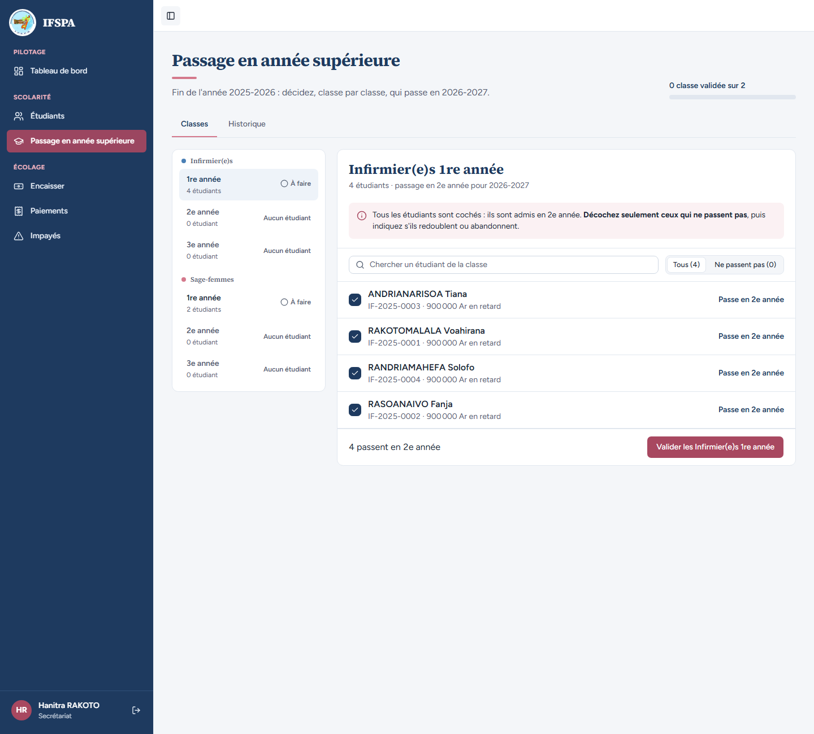
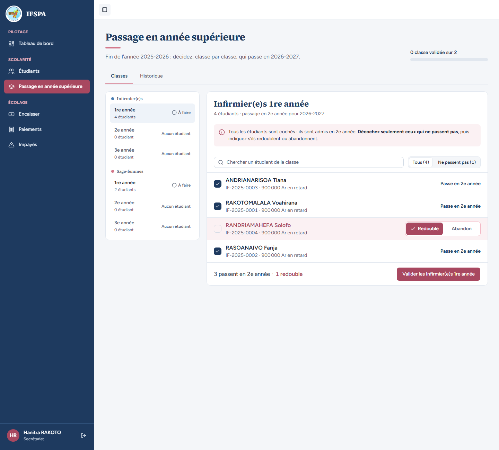
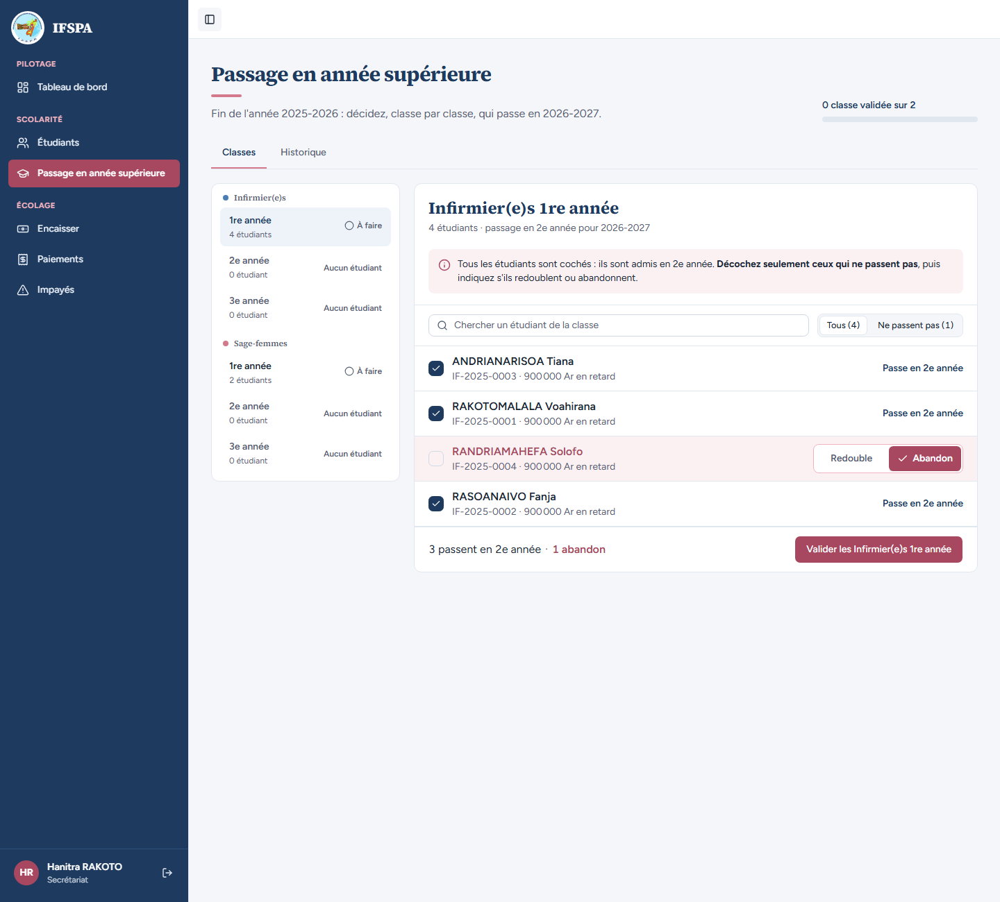
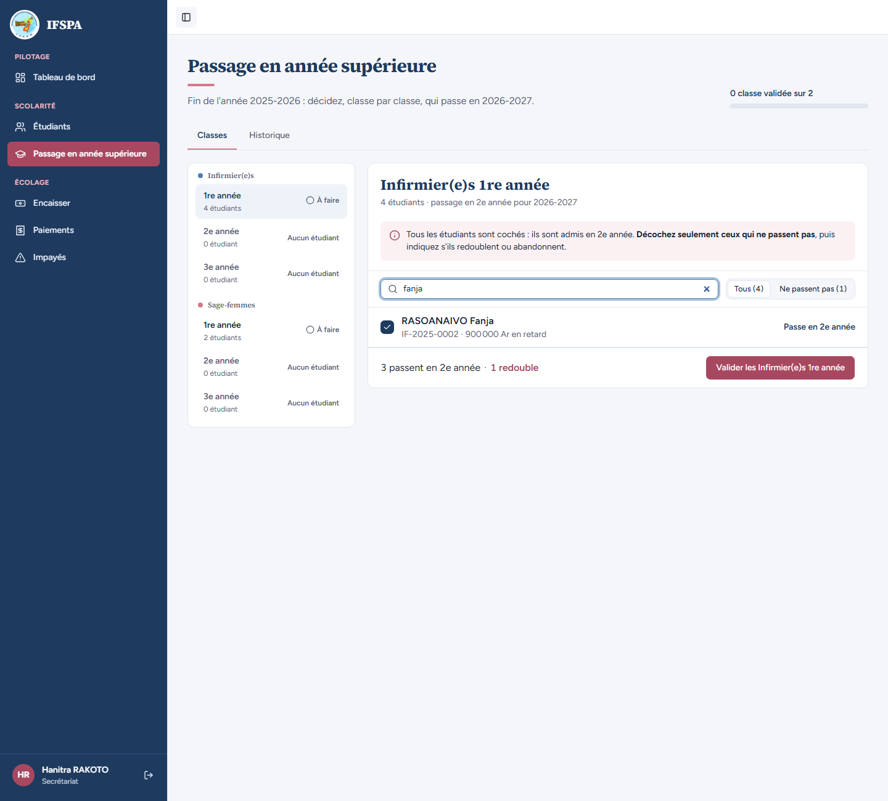
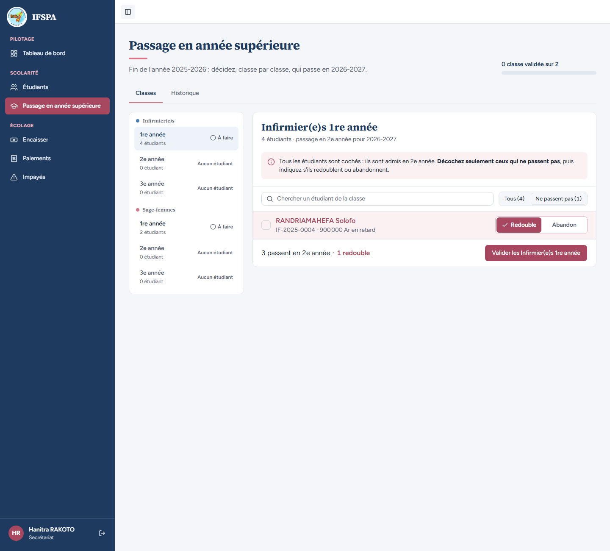
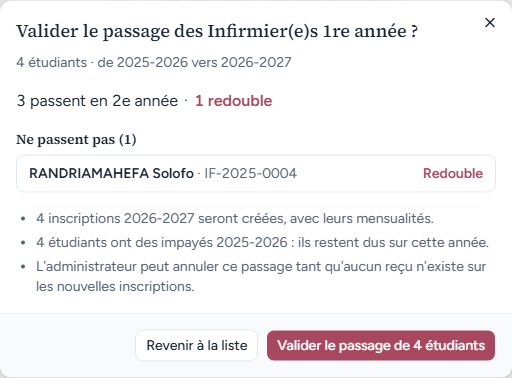
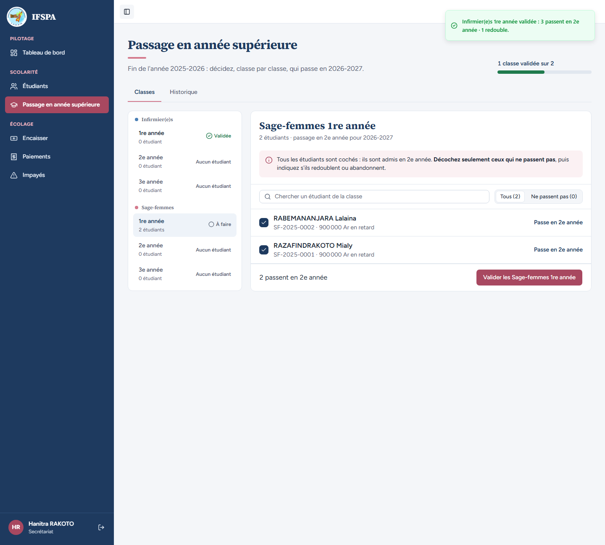
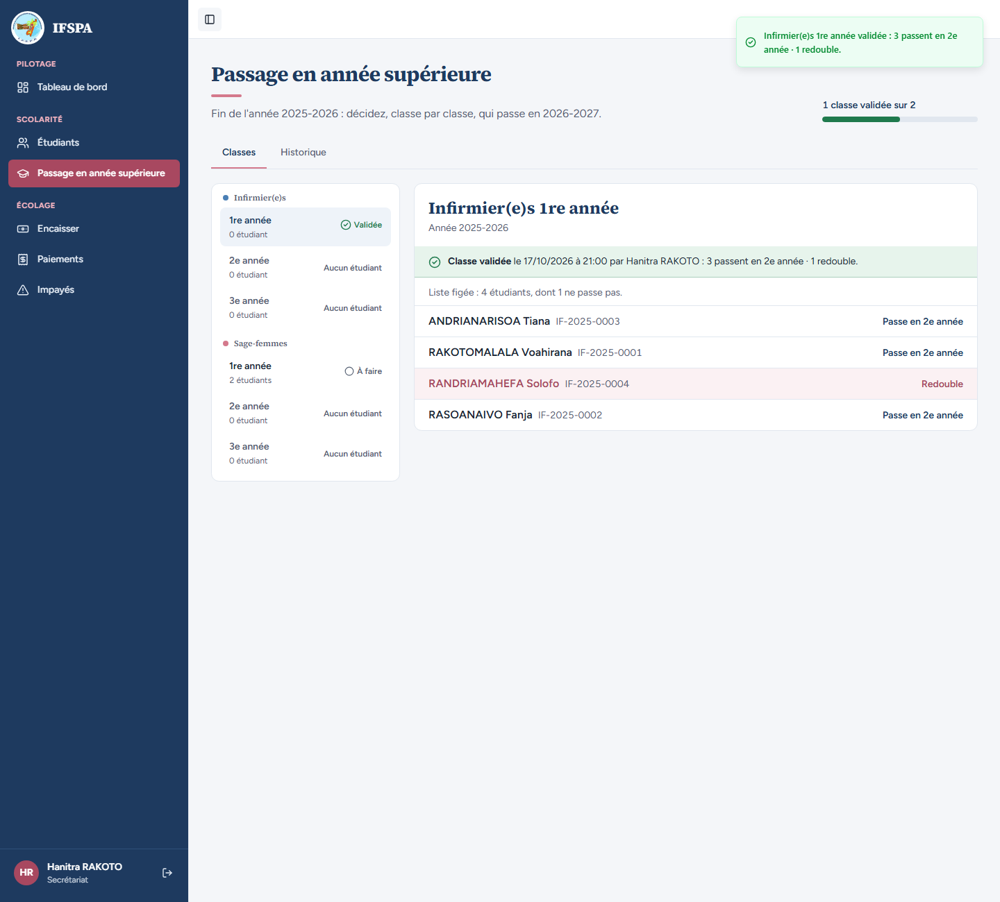

# UC10-01. La classe Infirmier(e)s 1re année passe en 2e année, un étudiant redouble

| | |
|---|---|
| Use case | UC10. Passer les étudiants en année supérieure |
| Règles couvertes | R-ADM (passage en lot, tous cochés, une seule confirmation nominative, classe « Validée »), R-MAT (le matricule ne change pas, voir UC10-02), R-ECH (échéances de l'année cible, voir UC10-02) |
| Rôle | Secrétariat, compte « Hanitra RAKOTO » |
| Durée estimée | 10 minutes |

## La situation

C'est la fin de l'année 2025-2026. La secrétaire ouvre le passage en année supérieure : l'écran propose la classe des Infirmier(e)s 1re année avec ses quatre étudiants, tous cochés « Passe en 2e année ». RANDRIAMAHEFA Solofo doit redoubler : elle le décoche, vérifie qu'elle ne s'est pas trompée, puis valide toute la classe en une seule confirmation qui nomme Solofo.

## Avant de commencer

1. `pnpm db:up` (si Postgres ne tourne pas), `pnpm recette:base`, `pnpm build`, `pnpm recette:app`, puis ouvrir `http://localhost:3200`.
2. Avoir déroulé [00-PREPARATION.md](../00-PREPARATION.md), **sections A, B et C seulement** (pas la section D : c'est ce cas qui fait passer la classe IF 1re année). Il y a alors sept étudiants : quatre IF et deux SF inscrits en 2025-2026, un IF inscrit en 2026-2027.
3. Se connecter avec le compte **secrétariat** (identifiants `SEED_USER_*` de `.env`) ; « Hanitra RAKOTO », « Secrétariat » s'affichent en bas de la barre latérale.

## Étapes

| # | Qui | Action | Résultat attendu | Capture | ✓ |
|---|---|---|---|---|---|
| 1 | Secrétariat | Cliquer **Passage en année supérieure** dans le menu (rubrique Scolarité). | Titre « Passage en année supérieure », « Fin de l'année 2025-2026 : décidez, classe par classe, qui passe en 2026-2027. » En haut à droite : « 0 classe validée sur 2 ». Deux onglets : Classes, Historique. Liste de gauche : **Infirmier(e)s** 1re année « À faire » 4 étudiants, 2e et 3e année « Aucun étudiant » ; **Sage-femmes** 1re année « À faire » 2 étudiants, 2e et 3e année « Aucun étudiant ». |  | |
| 2 | Secrétariat | Regarder la classe ouverte d'office (Infirmier(e)s 1re année). | Titre « Infirmier(e)s 1re année », « 4 étudiants · passage en 2e année pour 2026-2027 ». Message « Tous les étudiants sont cochés : ils sont admis en 2e année. Décochez seulement ceux qui ne passent pas, puis indiquez s'ils redoublent ou abandonnent. » Quatre lignes par ordre alphabétique, toutes cochées « Passe en 2e année » : ANDRIANARISOA Tiana (IF-2025-0003), RAKOTOMALALA Voahirana (IF-2025-0001), RANDRIAMAHEFA Solofo (IF-2025-0004), RASOANAIVO Fanja (IF-2025-0002), chacune avec « 900 000 Ar en retard » (impayés donnés pour information). Barre du bas : « 4 passent en 2e année » et le bouton « Valider les Infirmier(e)s 1re année ». |  | |
| 3 | Secrétariat | Décocher la case de **RANDRIAMAHEFA Solofo**. | La ligne devient rose. Deux choix apparaissent à droite : **Redouble** (déjà choisi) et **Abandon**. Barre du bas : « 3 passent en 2e année · 1 redouble ». Le filtre indique « Ne passent pas (1) ». |  | |
| 4 | Secrétariat | Cliquer **Abandon** sur la ligne de Solofo, lire la barre, puis revenir sur **Redouble**. | Avec Abandon : « 3 passent en 2e année · 1 abandon ». Avec Redouble : « 3 passent en 2e année · 1 redouble ». (Rien n'est enregistré tant que la classe n'est pas validée.) |  | |
| 5 | Secrétariat | Taper `fanja` dans « Chercher un étudiant de la classe ». Puis taper `zzz`, puis vider le champ. | `fanja` : une seule ligne, RASOANAIVO Fanja ; la barre du bas continue de compter toute la classe (« 3 passent en 2e année · 1 redouble »). `zzz` : « Aucun étudiant de la classe ne correspond à « zzz ». » Champ vidé : les quatre lignes reviennent. |  | |
| 6 | Secrétariat | Cliquer **Ne passent pas (1)**, puis **Tous (4)**. | Ne passent pas (1) : une seule ligne, RANDRIAMAHEFA Solofo, avec Redouble / Abandon. Tous (4) : les quatre lignes reviennent. |  | |
| 7 | Secrétariat | Cliquer **Valider les Infirmier(e)s 1re année**. | Fenêtre « Valider le passage des Infirmier(e)s 1re année ? » : « 4 étudiants · de 2025-2026 vers 2026-2027 », « 3 passent en 2e année · 1 redouble », rubrique « Ne passent pas (1) » : **RANDRIAMAHEFA Solofo · IF-2025-0004** « Redouble ». Puces : « 4 inscriptions 2026-2027 seront créées, avec leurs mensualités. », « 4 étudiants ont des impayés 2025-2026 : ils restent dus sur cette année. », « L'administrateur peut annuler ce passage tant qu'aucun reçu n'existe sur les nouvelles inscriptions. » Boutons « Revenir à la liste » et « Valider le passage de 4 étudiants ». |  | |
| 8 | Secrétariat | Cliquer **Valider le passage de 4 étudiants**. | Message « Infirmier(e)s 1re année validée : 3 passent en 2e année · 1 redouble. » L'avancement passe à « 1 classe validée sur 2 » (barre verte). Infirmier(e)s 1re année est « Validée ». L'écran passe tout seul à la classe suivante : **Sage-femmes 1re année**, « À faire », ses deux étudiantes cochées (RABEMANANJARA Lalaina, RAZAFINDRAKOTO Mialy). |  | |
| 9 | Secrétariat | Cliquer **Infirmier(e)s › 1re année** dans la liste de gauche. | « Classe validée le (date) à (heure) par Hanitra RAKOTO : 3 passent en 2e année · 1 redouble. » « Liste figée : 4 étudiants, dont 1 ne passe pas. » Quatre lignes ; Solofo en rose avec « Redouble », les trois autres « Passe en 2e année ». **Aucun bouton « Annuler »** (réservé à l'administrateur, voir UC10-03). |  | |

## Ce que ce scénario ne couvre pas

- Les effets du passage sur les fiches (parcours, grilles, matricules, guichet) : [UC10-02](UC10-02-resultat-fiches-guichet.md).
- Le choix « Abandon » validé : [UC10-05](UC10-05-abandon-au-passage.md). Le diplôme en dernière année (étudiants de 3e année) n'est pas déroulé à l'écran, faute d'étudiant en 3e année ; le calcul est couvert par Vitest, `tests/integration/actions-admissions.test.ts` (« dernière année : diplômés sortis le jour du passage sans motif, redoublant réinscrit au tarif du même niveau »).
- Le refus serveur d'une liste incomplète ou d'une classe déjà validée par quelqu'un d'autre : couvert par Vitest (`tests/integration/actions-admissions.test.ts`, bloc `validerClasse : refus`, « double validation séquentielle » et « liste incomplète, en trop ou année source périmée »).
- Ordinateur seulement (pas de projet `mobile`, maquette `prototype/captures/m12`).
- Observation : une fois validée, la classe affiche « 0 étudiant » dans la liste de gauche (étape 9), alors que la liste figée en compte quatre (voir le rapport).

## Dernière exécution par l'agent

- 17/10/2026 : ✅ 9 étapes sur 9. Voir [RAPPORT_2026-10-17_UC10](../../rapports/RAPPORT_2026-10-17_UC10.md).
- Parcours : [UC10-01-nominal-redoublant.recette.ts](../../parcours/UC10-01-nominal-redoublant.recette.ts).
