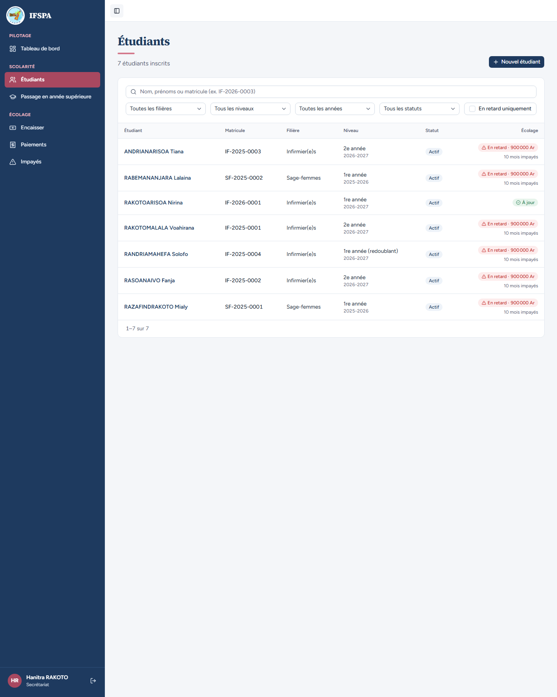
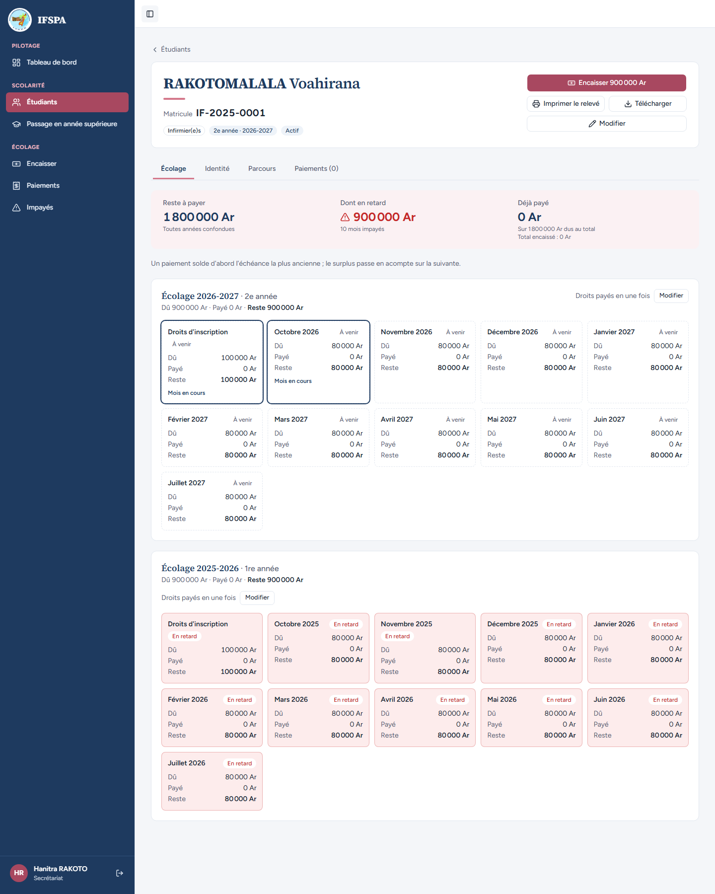
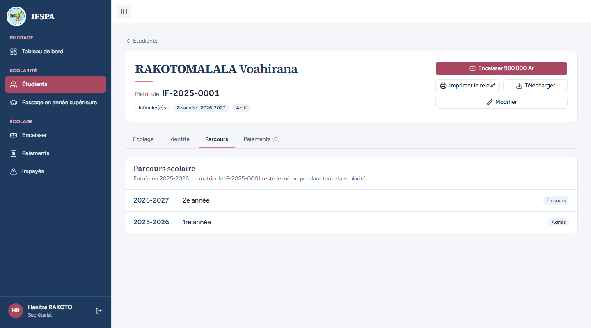
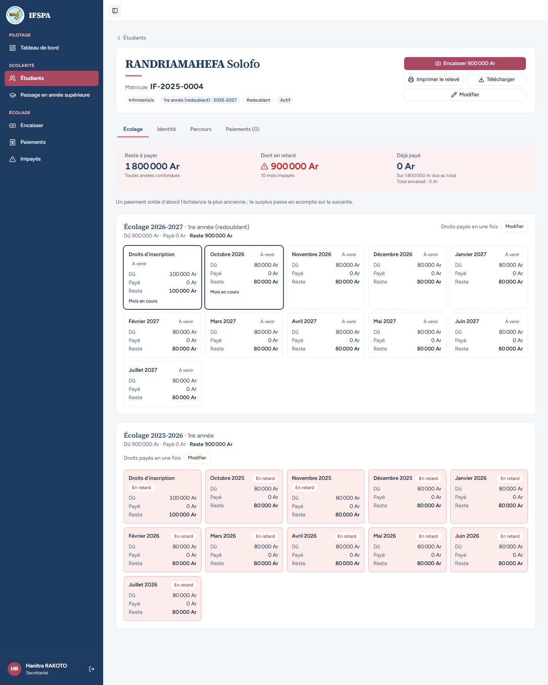
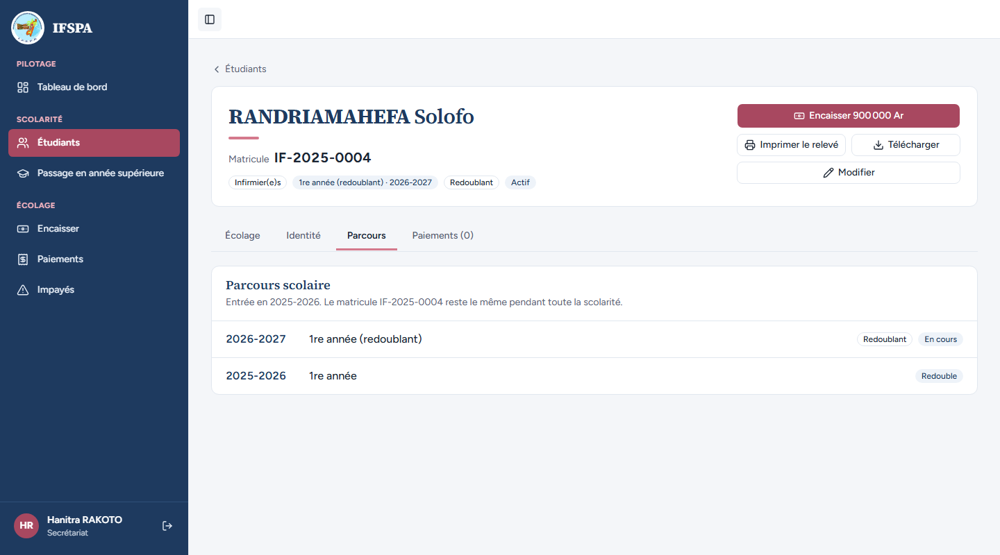
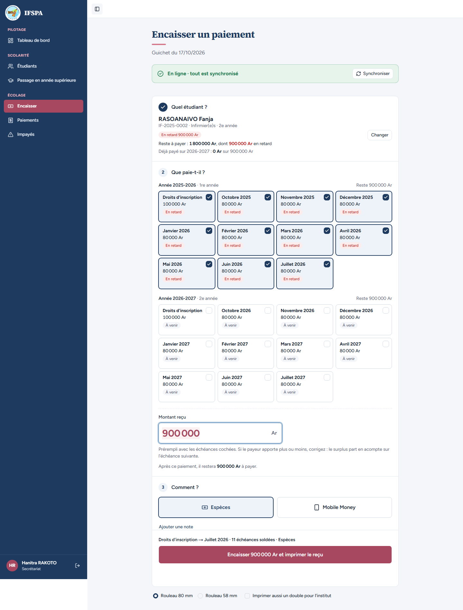

# UC10-02. Après le passage : les fiches montrent les deux années et le guichet encaisse d'abord l'ancienne

| | |
|---|---|
| Use case | UC10. Passer les étudiants en année supérieure |
| Règles couvertes | R-ADM (inscriptions et échéances de l'année cible, redoublant au même niveau), R-MAT (le matricule ne change jamais), R-ECH (échéances au tarif du niveau cible), R-REP et R-RET (les impayés de l'année précédente restent dus et sont réglés d'abord) |
| Rôle | Secrétariat, compte « Hanitra RAKOTO » |
| Durée estimée | 8 minutes |

## La situation

Le passage des Infirmier(e)s 1re année vient d'être validé. La secrétaire vérifie, sur les fiches, que chacun est bien à sa place : Voahirana est en 2e année, Solofo redouble la 1re année, et tous gardent leur matricule. Elle ouvre ensuite le guichet pour Fanja : ses impayés de 2025-2026 sont cochés d'office et passent avant la nouvelle année.

## Avant de commencer

1. `pnpm db:up`, `pnpm recette:base`, `pnpm build`, `pnpm recette:app`, puis ouvrir `http://localhost:3200`.
2. Avoir déroulé [00-PREPARATION.md](../00-PREPARATION.md), sections A, B, C, puis [UC10-01](UC10-01-nominal-redoublant.md) (classe IF 1re année validée, Solofo redoublant).
3. Se connecter avec le compte **secrétariat** (identifiants `SEED_USER_*` de `.env`).

## Étapes

| # | Qui | Action | Résultat attendu | Capture | ✓ |
|---|---|---|---|---|---|
| 1 | Secrétariat | Menu **Étudiants**. | « 7 étudiants inscrits ». IF-2025-0001, IF-2025-0002 et IF-2025-0003 : « 2e année · 2026-2027 ». **IF-2025-0004 RANDRIAMAHEFA Solofo : « 1re année (redoublant) · 2026-2027 »**. SF-2025-0001 et SF-2025-0002 : toujours « 1re année · 2025-2026 » (leur classe n'est pas encore passée). IF-2026-0001 RAKOTOARISOA Nirina : « 1re année · 2026-2027 », « À jour ». Les matricules sont ceux d'avant le passage. |  | |
| 2 | Secrétariat | Ouvrir **RAKOTOMALALA Voahirana**. | Matricule **IF-2025-0001**, « 2e année · 2026-2027 », « Actif ». Reste à payer **1 800 000 Ar** (« Toutes années confondues »), dont en retard 900 000 Ar. Deux grilles : « Écolage 2026-2027 · 2e année » (900 000 Ar, droits d'inscription et dix mensualités d'octobre 2026 à juillet 2027, « À venir » ; octobre 2026 « Mois en cours ») et « Écolage 2025-2026 · 1re année » (900 000 Ar, toutes « En retard »). |  | |
| 3 | Secrétariat | Cliquer l'onglet **Parcours**. | « Entrée en 2025-2026. Le matricule IF-2025-0001 reste le même pendant toute la scolarité. » Deux lignes : « 2026-2027 · 2e année · En cours » et « 2025-2026 · 1re année · Admis ». |  | |
| 4 | Secrétariat | Menu **Étudiants**, ouvrir **RANDRIAMAHEFA Solofo**, regarder la fiche puis l'onglet **Parcours**. | Matricule **IF-2025-0004**, « 1re année (redoublant) · 2026-2027 », pastille « Redoublant », « Actif ». Deux grilles : « Écolage 2026-2027 · 1re année (redoublant) » et « Écolage 2025-2026 · 1re année » ; reste à payer 1 800 000 Ar. Parcours : « 2026-2027 · 1re année (redoublant) · Redoublant · En cours » et « 2025-2026 · 1re année · Redouble ». |   | |
| 5 | Secrétariat | Menu **Encaisser**, chercher `RASOANAIVO`, Entrée. | Fanja (IF-2025-0002, Infirmier(e)s, 2e année) : « En retard 900 000 Ar », « Reste à payer : 1 800 000 Ar, dont 900 000 Ar en retard », « Déjà payé sur 2026-2027 : 0 Ar sur 900 000 Ar ». Les onze échéances de « Année 2025-2026 · 1re année » (droits d'inscription à juillet 2026, « En retard ») sont **cochées d'office** ; celles de « Année 2026-2027 · 2e année » (« À venir ») ne le sont pas. Montant reçu prérempli : **900 000**. Résumé « Droits d'inscription → Juillet 2026 · 11 échéances soldées · Espèces », bouton « Encaisser 900 000 Ar et imprimer le reçu ». **Ne pas encaisser.** |  | |

## Ce que ce scénario ne couvre pas

- Les tarifs de l'année cible sont ici identiques à ceux de l'année source (seed : 100 000 Ar + 10 × 80 000 Ar pour chaque niveau) : on ne peut donc pas voir à l'écran que la grille 2026-2027 prend le tarif du niveau cible plutôt que celui de la source. La copie du tarif cible est couverte par Vitest, `tests/integration/actions-admissions.test.ts` (« échéances copiées du tarif cible » et « un changement de tarif cible après la validation ne réécrit pas les échéances créées »).
- Le bouton de la fiche affiche « Encaisser 900 000 Ar » (le retard), pas le reste total de 1 800 000 Ar : c'est le montant coché d'office au guichet.
- Ordinateur seulement.

## Dernière exécution par l'agent

- 17/10/2026 : ✅ 5 étapes sur 5. Voir [RAPPORT_2026-10-17_UC10](../../rapports/RAPPORT_2026-10-17_UC10.md).
- Parcours : [UC10-02-resultat-fiches-guichet.recette.ts](../../parcours/UC10-02-resultat-fiches-guichet.recette.ts).
