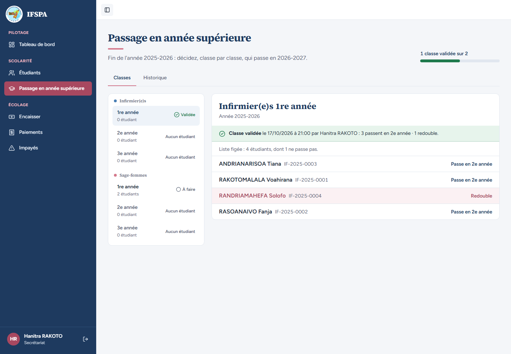
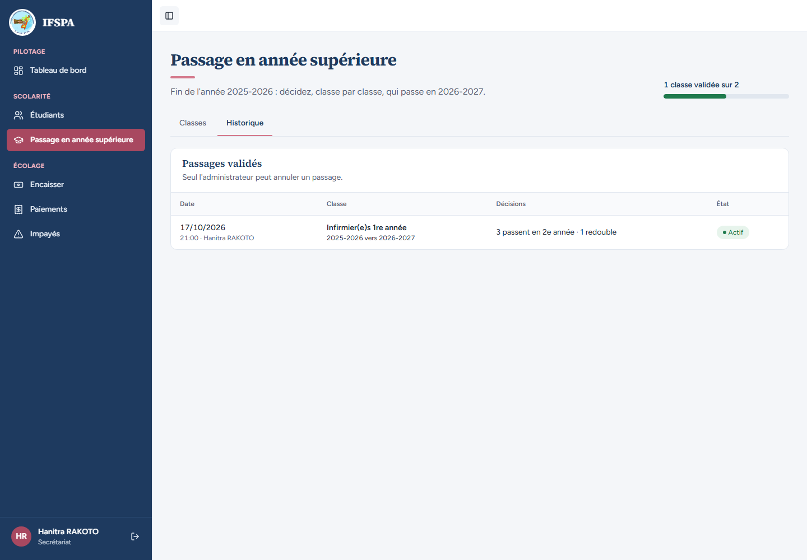

# UC10-03. Le secrétariat lance un passage mais ne peut pas l'annuler

| | |
|---|---|
| Use case | UC10. Passer les étudiants en année supérieure |
| Règles couvertes | R-ROLE (le secrétariat n'annule rien), R-ADM (seul l'administrateur annule un passage) |
| Rôle | Secrétariat, compte « Hanitra RAKOTO » |
| Durée estimée | 3 minutes |

## La situation

La secrétaire s'aperçoit qu'elle s'est trompée de décision pour un étudiant. Elle cherche comment annuler le passage : ni sur la classe validée, ni dans l'historique, elle ne trouve de bouton. Il faut appeler l'administrateur.

## Avant de commencer

1. `pnpm db:up`, `pnpm recette:base`, `pnpm build`, `pnpm recette:app`, puis ouvrir `http://localhost:3200`.
2. Avoir déroulé [00-PREPARATION.md](../00-PREPARATION.md), sections A, B, C, puis [UC10-01](UC10-01-nominal-redoublant.md) et [UC10-02](UC10-02-resultat-fiches-guichet.md).
3. Se connecter avec le compte **secrétariat** (identifiants `SEED_USER_*` de `.env`) ; « Hanitra RAKOTO », « Secrétariat » s'affichent en bas de la barre latérale.

## Étapes

| # | Qui | Action | Résultat attendu | Capture | ✓ |
|---|---|---|---|---|---|
| 1 | Secrétariat | Menu **Passage en année supérieure**, cliquer **Infirmier(e)s › 1re année** (« Validée »). | « Classe validée le (date) à (heure) par Hanitra RAKOTO : 3 passent en 2e année · 1 redouble. » et la liste figée de quatre étudiants. **Pas de bouton « Annuler ce passage »** : la bande verte ne contient que le texte. |  | |
| 2 | Secrétariat | Cliquer l'onglet **Historique**. | « Passages validés » et la phrase « Seul l'administrateur peut annuler un passage. » Une ligne : Infirmier(e)s 1re année, « 2025-2026 vers 2026-2027 », « 3 passent en 2e année · 1 redouble », « Hanitra RAKOTO », état « Actif ». **Aucun bouton « Annuler »**, pas de colonne d'actions. |  | |

## Ce que ce scénario ne couvre pas

- **Refus côté serveur** : un appel direct à l'action d'annulation avec le rôle secrétariat ne se démontre pas dans le navigateur. Il est couvert par Vitest : `tests/integration/actions-admissions.test.ts`, bloc `annulerOperation`, « refuse le rôle user, même appelée directement avec une entrée invalide, sans rien modifier » (message « Cette action est réservée à l'administrateur. », rien n'est modifié, aucune revalidation) et « sans session : redirigé vers la connexion ». Le test « un administrateur valide aussi, et l'auteur est celui de la session » du bloc `validerClasse : refus` couvre l'autre sens (l'administrateur peut aussi lancer).
- Ce que voit l'administrateur à la place : [UC10-04](UC10-04-annulation-admin.md).
- Ordinateur seulement.

## Dernière exécution par l'agent

- 17/10/2026 : ✅ 2 étapes sur 2. Voir [RAPPORT_2026-10-17_UC10](../../rapports/RAPPORT_2026-10-17_UC10.md).
- Parcours : [UC10-03-secretariat-sans-annulation.recette.ts](../../parcours/UC10-03-secretariat-sans-annulation.recette.ts).
