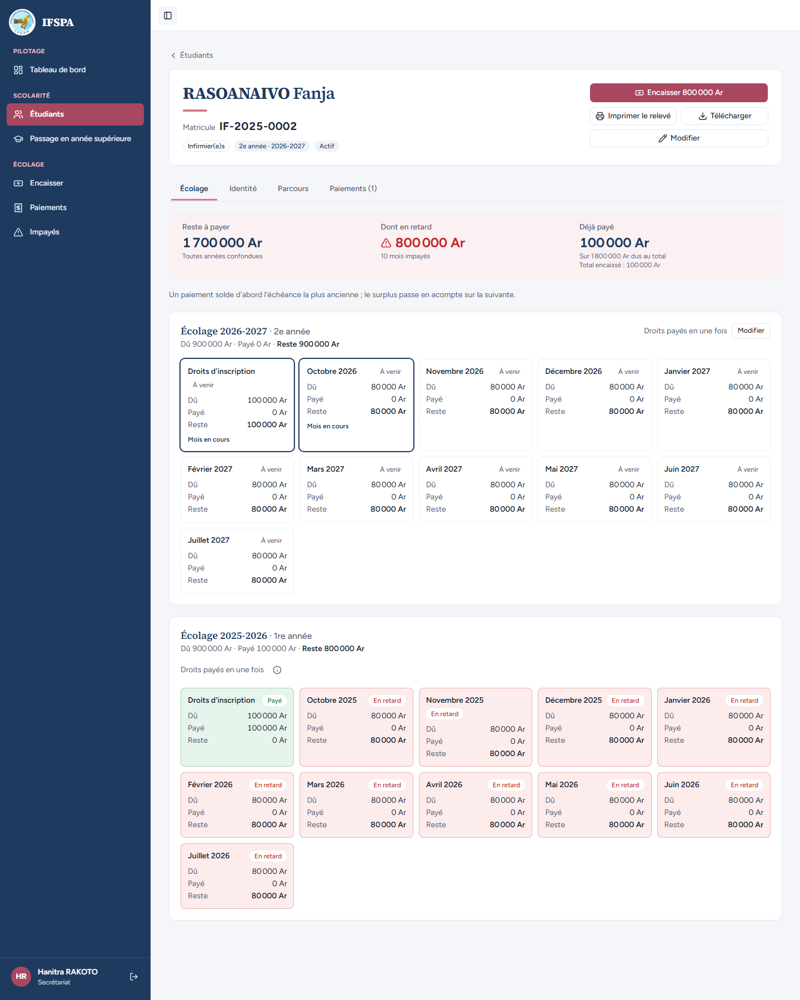
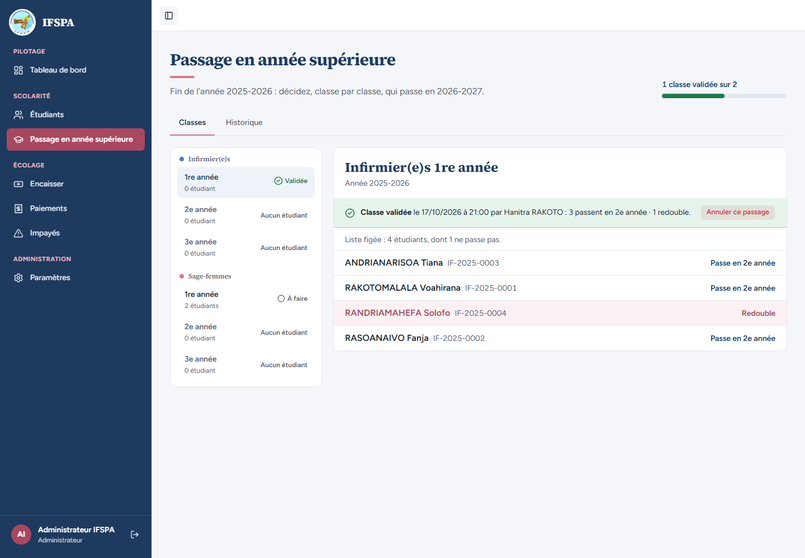
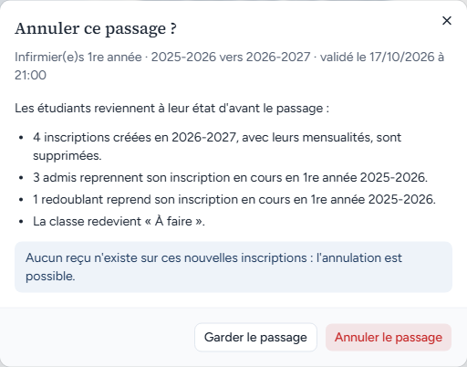
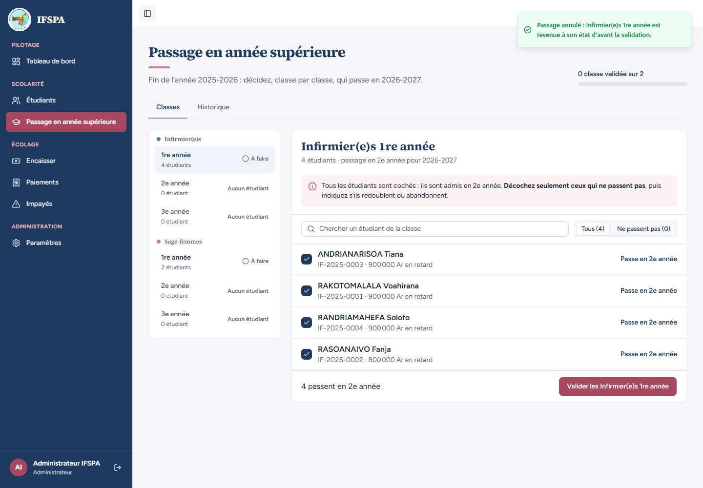
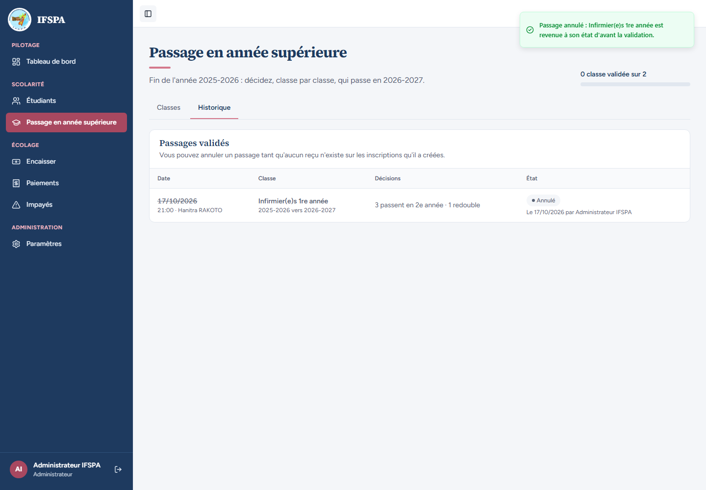
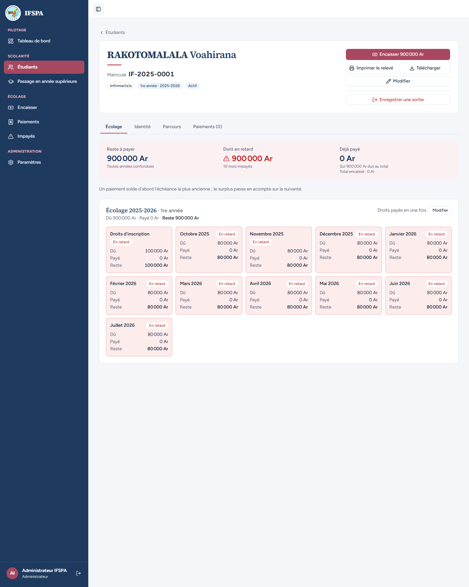
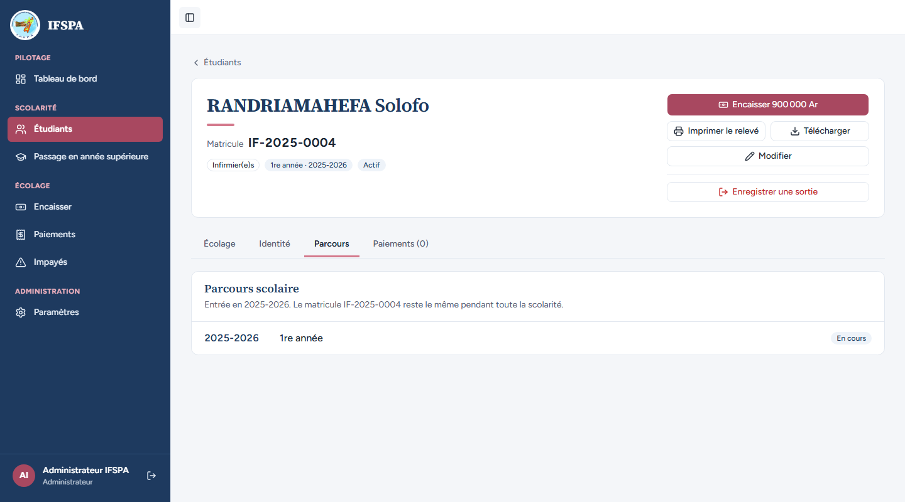
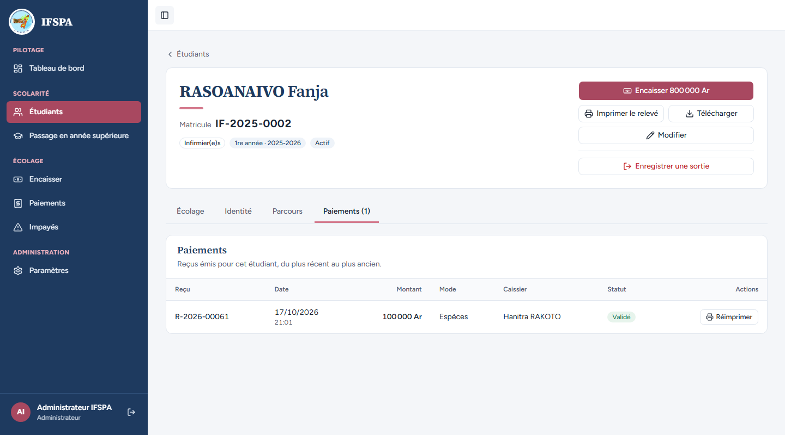

# UC10-04. L'administrateur annule un passage : l'état d'avant est restauré, un paiement sur l'ancienne année est conservé

| | |
|---|---|
| Use case | UC10. Passer les étudiants en année supérieure |
| Règles couvertes | R-ADM (annulation par l'administrateur depuis la classe validée, restauration exacte), R-ROLE (l'administrateur voit le bouton), R-MAT (matricules inchangés), R-REP (le paiement va d'abord sur l'année la plus ancienne) |
| Rôle | Secrétariat (étape 1), puis administrateur « Administrateur IFSPA » (étapes 2 à 8) |
| Durée estimée | 12 minutes |

## La situation

Après le passage, la mère de RASOANAIVO Fanja verse 100 000 Ar : ils vont sur les droits de 2025-2026 (l'ancienne année d'abord). Puis la direction constate une erreur de décision sur la classe et demande l'annulation. L'administrateur annule le passage depuis la classe validée : tout revient comme avant (une seule inscription par étudiant, plus de redoublant), et le versement de Fanja, fait sur l'ancienne année, est intact.

## Avant de commencer

1. `pnpm db:up`, `pnpm recette:base`, `pnpm build`, `pnpm recette:app`, puis ouvrir `http://localhost:3200`.
2. Avoir déroulé [00-PREPARATION.md](../00-PREPARATION.md), sections A, B, C, puis [UC10-01](UC10-01-nominal-redoublant.md), [UC10-02](UC10-02-resultat-fiches-guichet.md) et [UC10-03](UC10-03-secretariat-sans-annulation.md).
3. Étape 1 avec le compte **secrétariat** (`SEED_USER_*`), étapes 2 à 8 avec le compte **administrateur** (`SEED_ADMIN_*`, une autre fenêtre ou après déconnexion) : « Administrateur IFSPA » s'affiche en bas de la barre latérale.

## Étapes

| # | Qui | Action | Résultat attendu | Capture | ✓ |
|---|---|---|---|---|---|
| 1 | Secrétariat | Menu **Encaisser**, chercher `RASOANAIVO`, Entrée, saisir `100000` dans « Montant reçu », **Encaisser 100 000 Ar et imprimer le reçu**. Puis ouvrir la fiche de RASOANAIVO Fanja (menu **Étudiants**). | Message « Paiement enregistré : reçu R-2026-00061. » (le n° dépend des postes déjà ouverts : lire celui affiché). Fiche IF-2025-0002, « 2e année · 2026-2027 » : reste à payer **1 700 000 Ar**, dont en retard 800 000 Ar, déjà payé 100 000 Ar. « Écolage 2026-2027 · 2e année » : « Dû 900 000 Ar · Payé 0 Ar · Reste 900 000 Ar ». « Écolage 2025-2026 · 1re année » : « Dû 900 000 Ar · Payé 100 000 Ar · Reste 800 000 Ar », droits d'inscription « Payé ». |  | |
| 2 | Administrateur | Se connecter en administrateur. Menu **Passage en année supérieure**, cliquer **Infirmier(e)s › 1re année** (« Validée »). | « Administrateur IFSPA » en bas de la barre latérale, rubrique **Paramètres** visible. « Classe validée le (date) à (heure) par Hanitra RAKOTO : 3 passent en 2e année · 1 redouble. » avec, à droite, le bouton **Annuler ce passage**. |  | |
| 3 | Administrateur | Cliquer **Annuler ce passage**. | Fenêtre « Annuler ce passage ? » : « Infirmier(e)s 1re année · 2025-2026 vers 2026-2027 · validé le (date) à (heure) ». « Les étudiants reviennent à leur état d'avant le passage : » « 4 inscriptions créées en 2026-2027, avec leurs mensualités, sont supprimées. », « 3 admis reprennent son inscription en cours en 1re année 2025-2026. », « 1 redoublant reprend son inscription en cours en 1re année 2025-2026. », « La classe redevient « À faire ». » Encadré « Aucun reçu n'existe sur ces nouvelles inscriptions : l'annulation est possible. » Boutons « Garder le passage » et « Annuler le passage ». (Le versement de Fanja porte sur 2025-2026 : il ne bloque pas.) |  | |
| 4 | Administrateur | Cliquer **Annuler le passage**. | Message « Passage annulé : Infirmier(e)s 1re année est revenue à son état d'avant la validation. » L'avancement revient à « 0 classe validée sur 2 ». Infirmier(e)s 1re année est de nouveau « À faire », « 4 étudiants », les quatre étudiants cochés « Passe en 2e année » (Solofo n'est plus décochée), « 4 passent en 2e année ». Fanja n'affiche plus que « 800 000 Ar en retard ». |  | |
| 5 | Administrateur | Cliquer l'onglet **Historique**. | La ligne Infirmier(e)s 1re année (date barrée) « 3 passent en 2e année · 1 redouble » est à l'état « Annulé », « Le (date) par Administrateur IFSPA ». Plus de bouton « Annuler » sur cette ligne. |  | |
| 6 | Administrateur | Menu **Étudiants**, ouvrir **RAKOTOMALALA Voahirana**. | Matricule IF-2025-0001, « 1re année · 2025-2026 », « Actif ». Reste à payer **900 000 Ar** (et non plus 1 800 000 Ar), « Écolage 2025-2026 · 1re année » seule : **plus de grille 2026-2027**. Bouton « Enregistrer une sortie » visible (administrateur). |  | |
| 7 | Administrateur | Ouvrir **RANDRIAMAHEFA Solofo**, onglet **Parcours**. | « 1re année · 2025-2026 », « Actif », **plus de pastille « Redoublant »**. Parcours : une seule ligne « 2025-2026 · 1re année · En cours ». Matricule IF-2025-0004 inchangé. |  | |
| 8 | Administrateur | Ouvrir **RASOANAIVO Fanja**, onglet **Paiements (1)**. | Reste à payer 800 000 Ar (« Encaisser 800 000 Ar »). Un reçu, R-2026-00061, 100 000 Ar, Espèces, Hanitra RAKOTO, « Validé » : le versement fait sur 2025-2026 est resté intact. |  | |

## Ce que ce scénario ne couvre pas

- Annulation depuis l'onglet **Historique** : [UC10-09](UC10-09-annulation-historique.md) (réussie) et [UC10-06](UC10-06-annulation-bloquee-paiement.md) (bloquée par un reçu).
- Restauration de tous les champs (compteurs, date et motif de sortie d'un abandon remis à zéro, ancien statut) : couverte par Vitest, `tests/integration/actions-admissions.test.ts` (« restaure exactement l'état d'avant : étudiants, inscriptions, échéances, paiements et compteurs identiques », « l'annulation libère la classe : elle peut être validée de nouveau », « un paiement sur l'année source ne bloque pas l'annulation »).
- Refus de l'annulation par le secrétariat côté serveur : voir [UC10-03](UC10-03-secretariat-sans-annulation.md).
- Ordinateur seulement.

## Dernière exécution par l'agent

- 17/10/2026 : ✅ 8 étapes sur 8. Voir [RAPPORT_2026-10-17_UC10](../../rapports/RAPPORT_2026-10-17_UC10.md).
- Parcours : [UC10-04-annulation-admin.recette.ts](../../parcours/UC10-04-annulation-admin.recette.ts).
