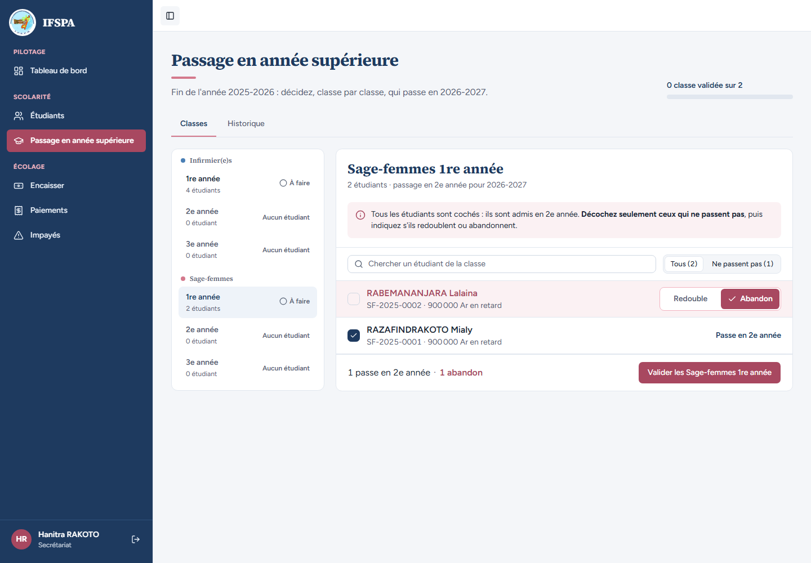
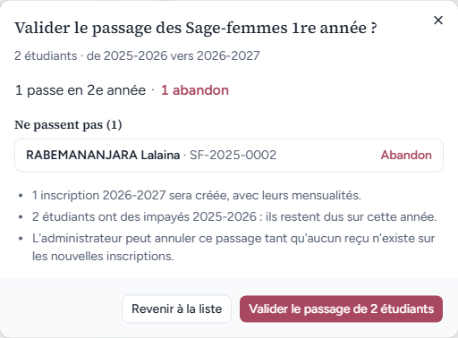
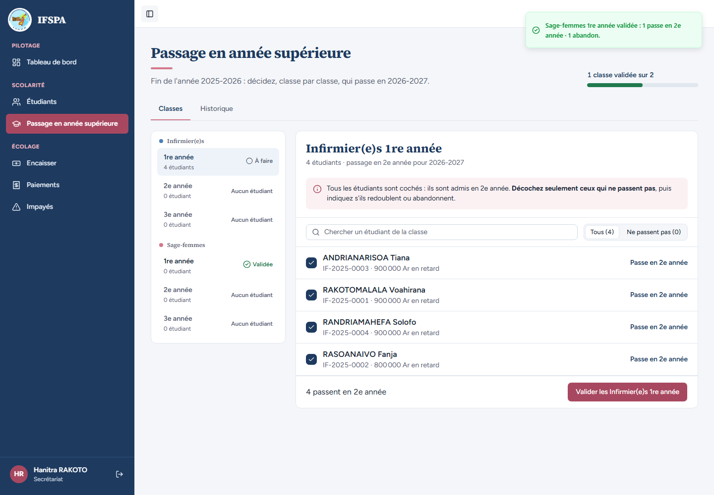
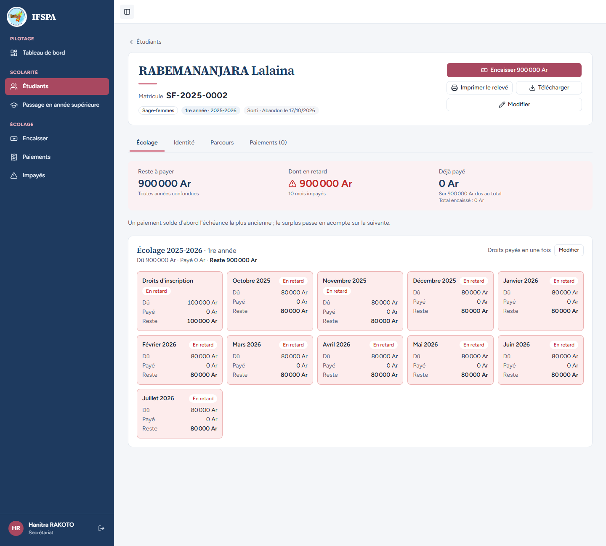
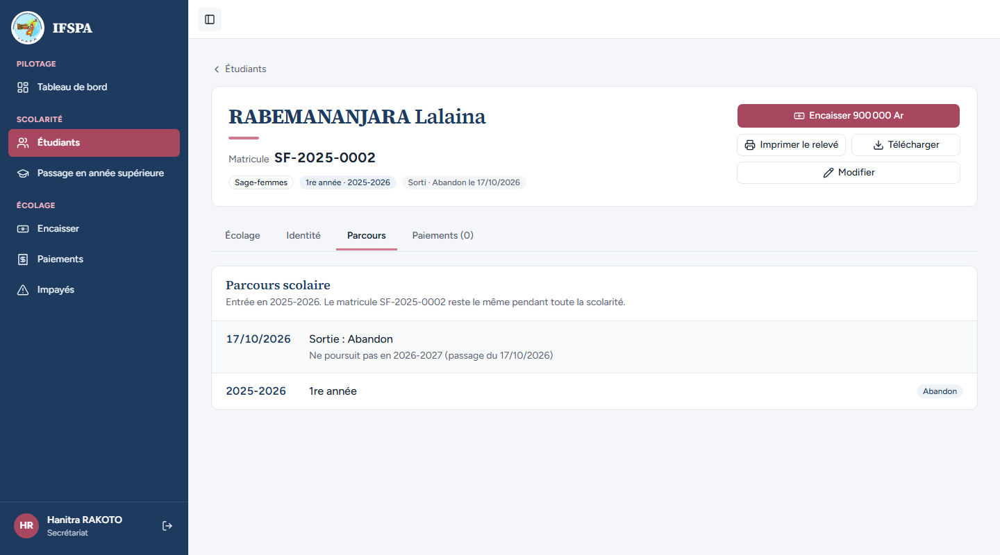
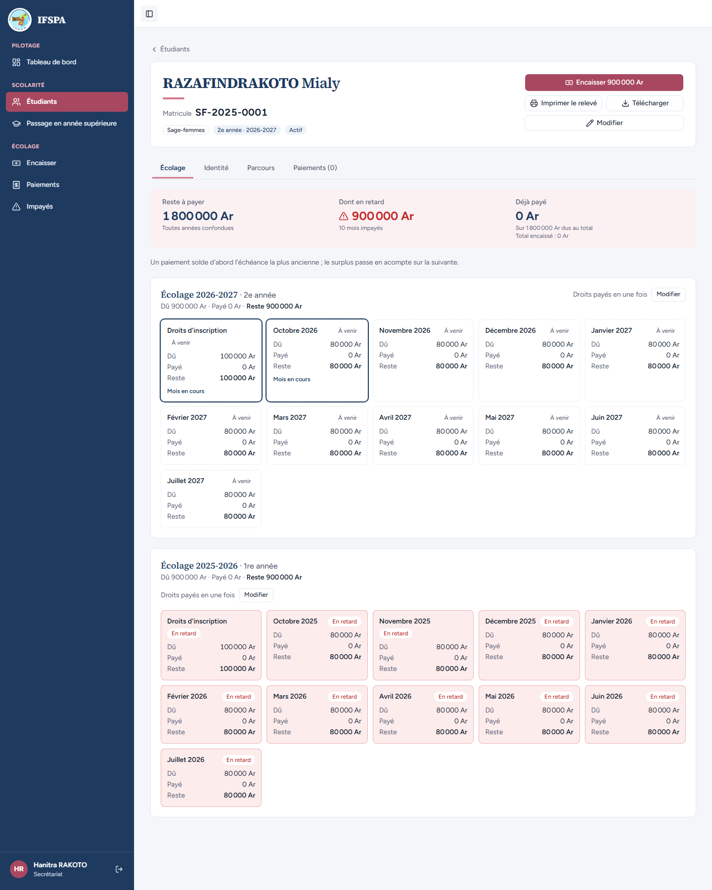

# UC10-05. Une sage-femme abandonne au moment du passage

| | |
|---|---|
| Use case | UC10. Passer les étudiants en année supérieure |
| Règles couvertes | R-ADM (décision « Abandon » au passage, confirmation nominative, « Validée »), R-MAT (matricule inchangé) |
| Rôle | Secrétariat, compte « Hanitra RAKOTO » |
| Durée estimée | 8 minutes |

## La situation

Dans la classe Sage-femmes 1re année, RABEMANANJARA Lalaina a informé l'institut qu'elle ne continue pas. La secrétaire la décoche et choisit « Abandon ». RAZAFINDRAKOTO Mialy passe en 2e année. La confirmation cite Lalaina nommément ; après validation, Lalaina est sortie avec la date du jour et le motif « Ne poursuit pas en 2026-2027 ».

## Avant de commencer

1. `pnpm db:up`, `pnpm recette:base`, `pnpm build`, `pnpm recette:app`, puis ouvrir `http://localhost:3200`.
2. Avoir déroulé [00-PREPARATION.md](../00-PREPARATION.md), sections A, B, C, puis [UC10-01](UC10-01-nominal-redoublant.md) à [UC10-04](UC10-04-annulation-admin.md) **dans l'ordre**. Après UC10-04, la classe Infirmier(e)s 1re année est de nouveau « À faire » et Sage-femmes 1re année n'a pas encore été passée.
3. Se connecter avec le compte **secrétariat** (identifiants `SEED_USER_*` de `.env`).

## Étapes

| # | Qui | Action | Résultat attendu | Capture | ✓ |
|---|---|---|---|---|---|
| 1 | Secrétariat | Menu **Passage en année supérieure**, **Sage-femmes › 1re année**. Décocher **RABEMANANJARA Lalaina**, puis cliquer **Abandon** sur sa ligne. | « 2 étudiants · passage en 2e année pour 2026-2027 ». Lalaina : ligne rose, choix Redouble (par défaut) puis **Abandon** sélectionné. Barre du bas : « 1 passe en 2e année · 1 abandon ». Le bouton « Valider les Sage-femmes 1re année » est actif. |  | |
| 2 | Secrétariat | Cliquer **Valider les Sage-femmes 1re année**. | Fenêtre « Valider le passage des Sage-femmes 1re année ? » : « 2 étudiants · de 2025-2026 vers 2026-2027 », « 1 passe en 2e année · 1 abandon », « Ne passent pas (1) » : **RABEMANANJARA Lalaina · SF-2025-0002** « Abandon ». Puces : « 1 inscription 2026-2027 sera créée, avec leurs mensualités. » (accord « leurs » : constat mineur du rapport), « 2 étudiants ont des impayés 2025-2026 : ils restent dus sur cette année. », « L'administrateur peut annuler ce passage tant qu'aucun reçu n'existe sur les nouvelles inscriptions. » |  | |
| 3 | Secrétariat | Cliquer **Valider le passage de 2 étudiants**. | Message « Sage-femmes 1re année validée : 1 passe en 2e année · 1 abandon. » Sage-femmes 1re année « Validée », avancement « 1 classe validée sur 2 » (la classe Infirmier(e)s 1re année, annulée en UC10-04, est encore « À faire » : l'écran passe sur elle). |  | |
| 4 | Secrétariat | Menu **Étudiants**, ouvrir **RABEMANANJARA Lalaina** puis l'onglet **Parcours**. | Matricule SF-2025-0002, « 1re année · 2025-2026 », pastille « Sorti · Abandon le (date du jour) ». Une seule grille, « Écolage 2025-2026 · 1re année » (900 000 Ar encore dus : l'abandon ne les efface pas) ; **pas d'écolage 2026-2027**. Parcours : « Sortie : Abandon », « Ne poursuit pas en 2026-2027 (passage du (date)) », « 2025-2026 · 1re année · Abandon ». Dans la liste des étudiants, son statut est « Abandon ». |   | |
| 5 | Secrétariat | Ouvrir **RAZAFINDRAKOTO Mialy**. | Matricule SF-2025-0001, « 2e année · 2026-2027 », deux grilles : « Écolage 2026-2027 · 2e année » et « Écolage 2025-2026 · 1re année ». Reste à payer 1 800 000 Ar. |  | |

## Ce que ce scénario ne couvre pas

- Le retour à « Actif » et la remise à zéro de la date et du motif de sortie quand le passage est annulé : couverts par Vitest, `tests/integration/actions-admissions.test.ts` (« l'opération et ses lignes gardent l'état d'avant pour chaque étudiant » et « restaure exactement l'état d'avant »).
- La sortie enregistrée à la main (abandon ou exclusion en cours d'année) : UC11.
- Décision provisoire n° 27 (STATUS.md) : la date de sortie d'un abandon décidé au passage est le jour de l'opération et les échéances ne sont pas marquées « non dues ».
- Ordinateur seulement.

## Dernière exécution par l'agent

- 17/10/2026 : ✅ 5 étapes sur 5. Voir [RAPPORT_2026-10-17_UC10](../../rapports/RAPPORT_2026-10-17_UC10.md).
- Parcours : [UC10-05-abandon-au-passage.recette.ts](../../parcours/UC10-05-abandon-au-passage.recette.ts).
