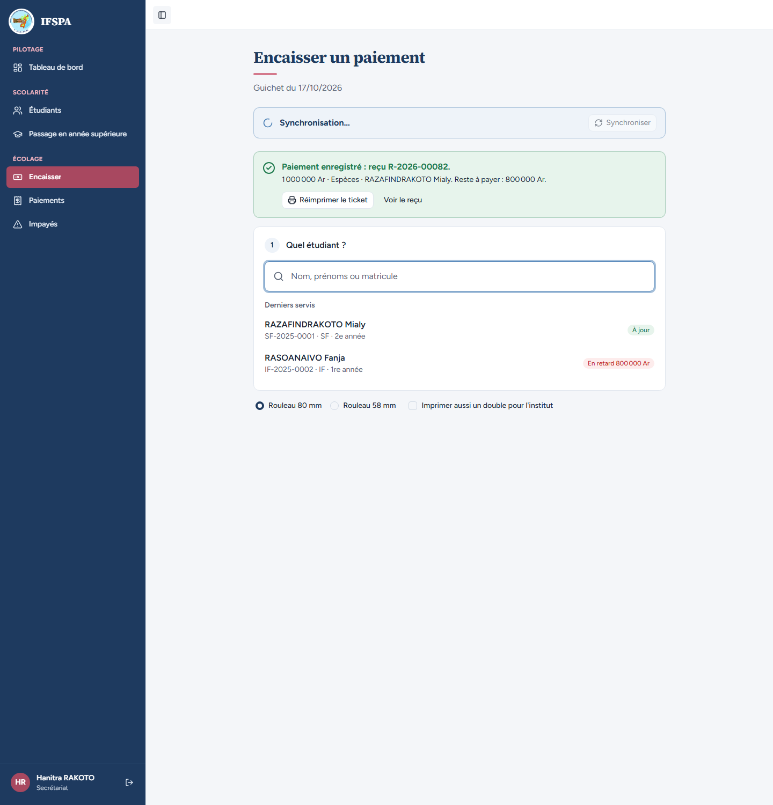
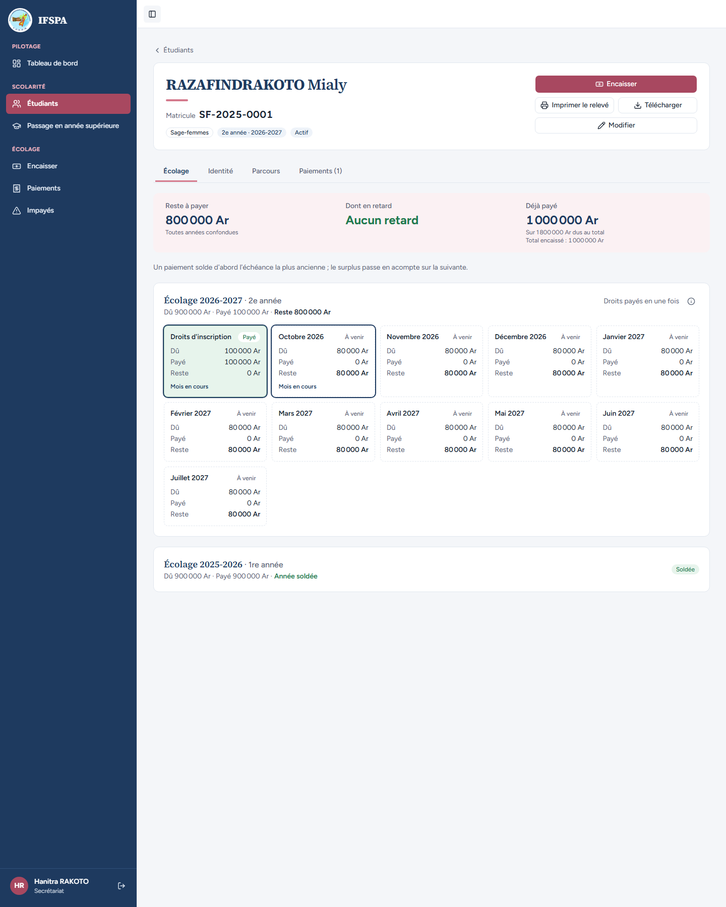
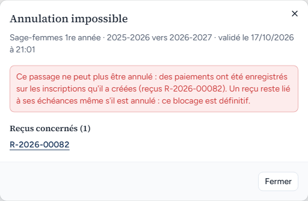
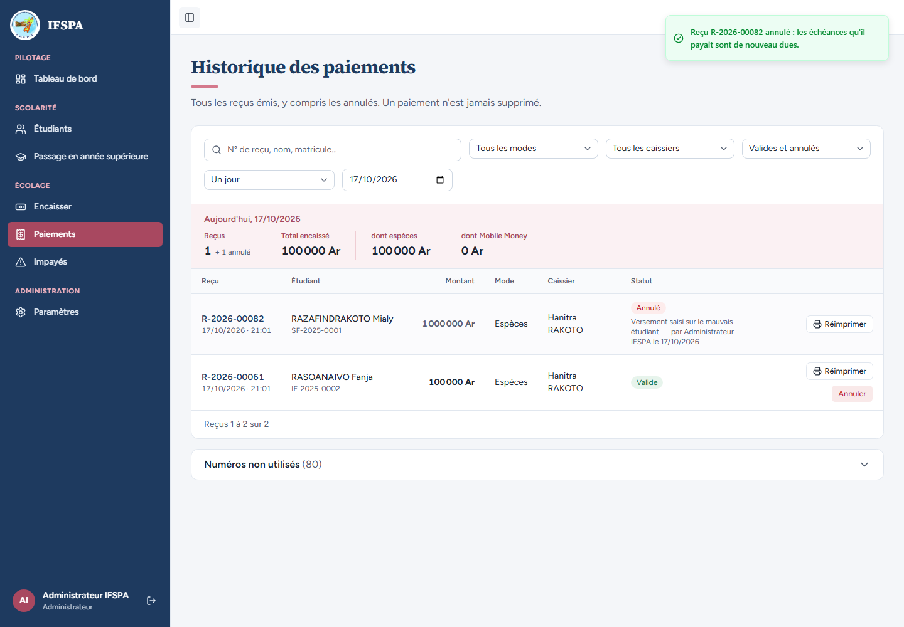

# UC10-06. Un reçu existe sur la nouvelle année : l'annulation du passage est bloquée, même si le reçu est annulé ensuite

| | |
|---|---|
| Use case | UC10. Passer les étudiants en année supérieure |
| Règles couvertes | R-ADM (annulation bloquée dès qu'un paiement existe sur les inscriptions créées, message qui liste les reçus), R-ANN (un reçu annulé reste dans l'historique), R-REP (le surplus d'un paiement passe sur l'année suivante), R-ROLE (annulation par l'administrateur) |
| Rôle | Secrétariat (étapes 1 et 2), puis administrateur « Administrateur IFSPA » (étapes 3 à 6) |
| Durée estimée | 10 minutes |

## La situation

RAZAFINDRAKOTO Mialy est passée en 2e année. Sa mère verse 1 000 000 Ar : 900 000 Ar soldent l'année 2025-2026 et les 100 000 Ar restants tombent sur les droits d'inscription 2026-2027, c'est-à-dire sur l'inscription créée par le passage. Plus tard, l'administrateur veut annuler le passage des Sage-femmes : l'écran le lui refuse et cite le reçu. Il annule alors le reçu, mais le passage reste impossible à annuler.

## Avant de commencer

1. `pnpm db:up`, `pnpm recette:base`, `pnpm build`, `pnpm recette:app`, puis ouvrir `http://localhost:3200`.
2. Avoir déroulé [00-PREPARATION.md](../00-PREPARATION.md), sections A, B, C, puis [UC10-01](UC10-01-nominal-redoublant.md) à [UC10-05](UC10-05-abandon-au-passage.md) **dans l'ordre** (la classe Sage-femmes 1re année doit être validée, Mialy en 2e année).
3. Étapes 1 et 2 avec le compte **secrétariat** (`SEED_USER_*`), étapes 3 à 6 avec le compte **administrateur** (`SEED_ADMIN_*`).

## Étapes

| # | Qui | Action | Résultat attendu | Capture | ✓ |
|---|---|---|---|---|---|
| 1 | Secrétariat | Menu **Encaisser**, chercher `RAZAFINDRAKOTO`, Entrée. Vérifier « Reste à payer : 1 800 000 Ar ». Saisir `1000000` dans « Montant reçu », **Encaisser 1 000 000 Ar et imprimer le reçu**. | Message « Paiement enregistré : reçu R-2026-00082. » (le n° dépend des postes déjà ouverts : lire celui affiché ; il est noté **R** ci-dessous) puis « 1 000 000 Ar · Espèces · RAZAFINDRAKOTO Mialy. Reste à payer : 800 000 Ar. » |  | |
| 2 | Secrétariat | Menu **Étudiants**, ouvrir **RAZAFINDRAKOTO Mialy**. | Reste à payer **800 000 Ar**, « Aucun retard », déjà payé 1 000 000 Ar. « Écolage 2026-2027 · 2e année » : « Dû 900 000 Ar · Payé 100 000 Ar · Reste 800 000 Ar », droits d'inscription « Payé ». « Écolage 2025-2026 · 1re année » : « Dû 900 000 Ar · Payé 900 000 Ar · Année soldée », badge « Soldée ». |  | |
| 3 | Administrateur | Se connecter en administrateur. **Passage en année supérieure**, onglet **Historique**. Sur la ligne « Sage-femmes 1re année », cliquer **Annuler**. | « Vous pouvez annuler un passage tant qu'aucun reçu n'existe sur les inscriptions qu'il a créées. » Fenêtre **« Annulation impossible »** : « Sage-femmes 1re année · 2025-2026 vers 2026-2027 · validé le (date) à (heure) ». Message rouge : « Ce passage ne peut plus être annulé : des paiements ont été enregistrés sur les inscriptions qu'il a créées (reçus **R**). Un reçu reste lié à ses échéances même s'il est annulé : ce blocage est définitif. » Rubrique « Reçus concernés (1) » avec le lien **R**. Seul bouton : « Fermer » (pas de « Annuler le passage »). |  | |
| 4 | Administrateur | Cliquer **Fermer**. | La fenêtre se ferme. (Le lien du reçu, visible à l'étape 3, n'est pas ouvert dans ce parcours.) | | |
| 5 | Administrateur | Menu **Paiements**, **Annuler** sur le reçu **R**, saisir le motif `Versement saisi sur le mauvais étudiant`, **Annuler le reçu R**. | Message « Reçu **R** annulé : les échéances qu'il payait sont de nouveau dues. » Le reçu reste dans la liste, « Annulé », montant barré, « Versement saisi sur le mauvais étudiant — par Administrateur IFSPA le (date) ». |  | |
| 6 | Administrateur | Retourner dans **Passage en année supérieure › Historique**, **Annuler** sur « Sage-femmes 1re année ». | **Toujours « Annulation impossible »**, même message et même reçu **R** cité (« Reçus concernés (1) ») : le reçu annulé garde ses lignes d'échéance, le blocage est définitif (décision provisoire n° 24). |  | |

## Ce que ce scénario ne couvre pas

- Le blocage par un paiement actif et par un paiement annulé côté serveur, sans passer par l'écran : couvert par Vitest, `tests/integration/actions-admissions.test.ts` (« bloquée par un paiement actif sur une inscription créée : rien n'est modifié, le reçu est cité », « bloquée aussi par un paiement annulé : blocage définitif, l'historique du reçu est conservé », « un paiement réel (encaisser) sur l'inscription créée bloque l'annulation »).
- Décision provisoire n° 24 (STATUS.md) : un paiement annulé bloque aussi, définitivement, par écart avec la maquette 12h. La maquette proposait d'annuler d'abord les reçus.
- Le passage reste intact après ces tentatives (rien n'est modifié) : non vérifié à l'écran, couvert par Vitest, même fichier ("rien n'est modifié").
- Ordinateur seulement.

## Dernière exécution par l'agent

- 17/10/2026 : ✅ 6 étapes sur 6. Voir [RAPPORT_2026-10-17_UC10](../../rapports/RAPPORT_2026-10-17_UC10.md).
- Parcours : [UC10-06-annulation-bloquee-paiement.recette.ts](../../parcours/UC10-06-annulation-bloquee-paiement.recette.ts).
