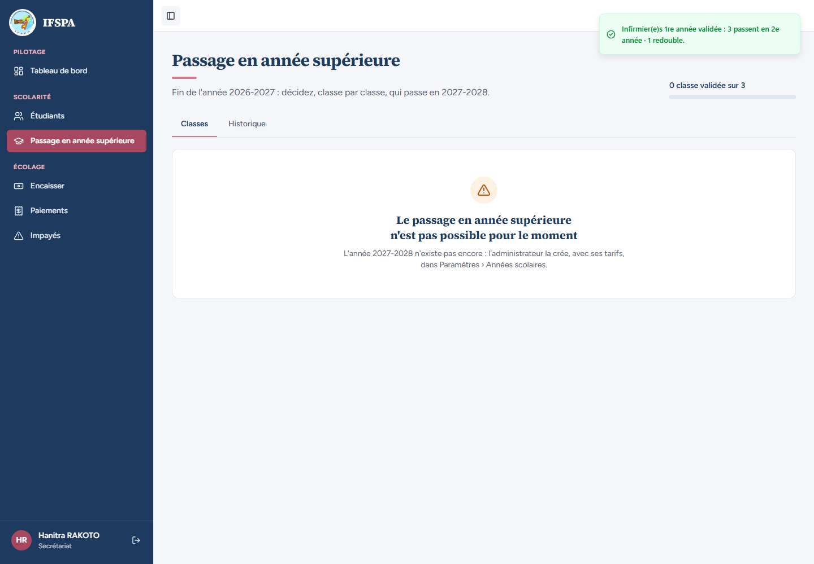
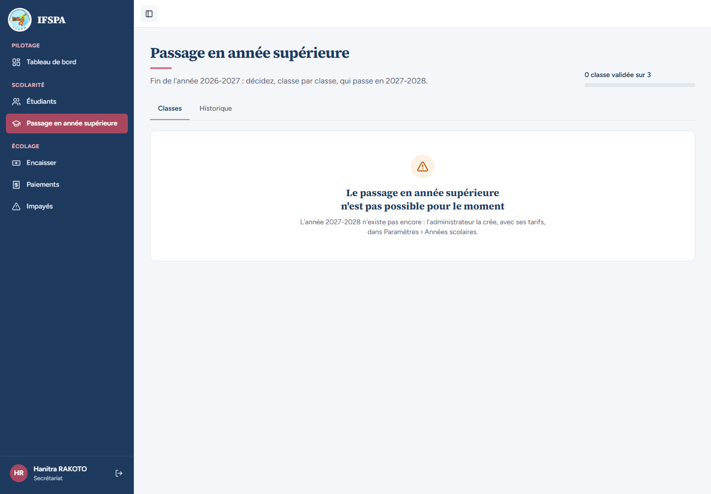
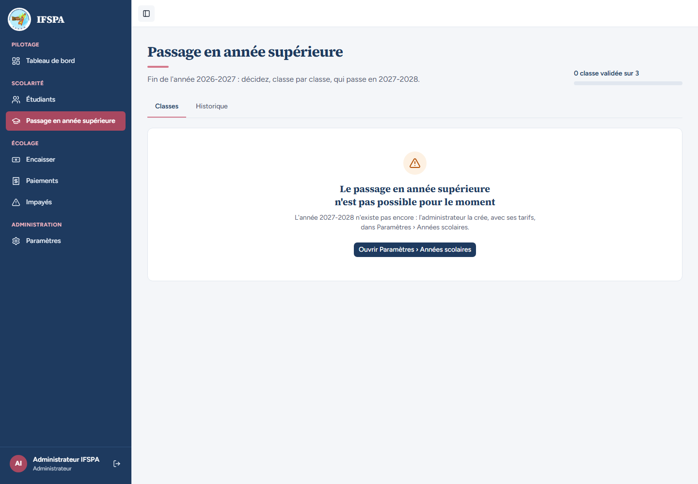
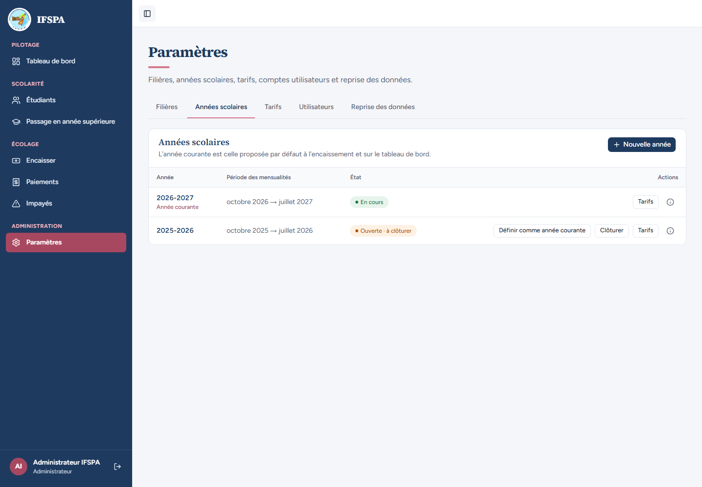

# UC10-07. L'année suivante n'existe pas : le passage est bloqué, avec un lien vers les Paramètres pour l'administrateur

| | |
|---|---|
| Use case | UC10. Passer les étudiants en année supérieure |
| Règles couvertes | R-ADM (années déduites : l'année cible doit exister), R-ROLE (lien vers les Paramètres réservé à l'administrateur) |
| Rôle | Secrétariat (étapes 1 et 2), puis administrateur (étapes 3 et 4) |
| Durée estimée | 6 minutes |

## La situation

Toutes les classes de 2025-2026 sont passées. L'écran se met alors à la fin de l'année suivante, 2026-2027, mais l'année 2027-2028 n'a pas encore été créée. La secrétaire ne peut rien faire que prévenir l'administrateur ; l'administrateur, lui, a un bouton vers les Paramètres.

## Avant de commencer

1. `pnpm db:up`, `pnpm recette:base`, `pnpm build`, `pnpm recette:app`, puis ouvrir `http://localhost:3200`.
2. Avoir déroulé [00-PREPARATION.md](../00-PREPARATION.md), sections A, B, C, puis [UC10-01](UC10-01-nominal-redoublant.md) à [UC10-06](UC10-06-annulation-bloquee-paiement.md) **dans l'ordre**. À ce stade la classe Sage-femmes 1re année est validée et la classe Infirmier(e)s 1re année, annulée en UC10-04, est de nouveau « À faire ».
3. Étapes 1 et 2 avec le compte **secrétariat** (`SEED_USER_*`), étapes 3 et 4 avec le compte **administrateur** (`SEED_ADMIN_*`).

## Étapes

| # | Qui | Action | Résultat attendu | Capture | ✓ |
|---|---|---|---|---|---|
| 1 | Secrétariat | Menu **Passage en année supérieure**. Vérifier « Fin de l'année 2025-2026 … » et « 1 classe validée sur 2 ». Ouvrir **Infirmier(e)s › 1re année**, décocher **RANDRIAMAHEFA Solofo**, **Valider les Infirmier(e)s 1re année**, **Valider le passage de 4 étudiants** (comme en UC10-01). | Message « Infirmier(e)s 1re année validée : 3 passent en 2e année · 1 redouble. » C'était la dernière classe de 2025-2026 : **l'écran bascule aussitôt** sur « Fin de l'année 2026-2027 : décidez, classe par classe, qui passe en 2027-2028. », avec « 0 classe validée sur 3 », et un écran « Le passage en année supérieure n'est pas possible pour le moment ». Les classes validées n'apparaissent plus dans l'onglet Classes (voir « Questions » du rapport). |  | |
| 2 | Secrétariat | Recharger **Passage en année supérieure**. | Titre « Le passage en année supérieure n'est pas possible pour le moment » et « L'année 2027-2028 n'existe pas encore : l'administrateur la crée, avec ses tarifs, dans Paramètres › Années scolaires. » **Aucun lien ni bouton vers les Paramètres** (le secrétariat n'y a pas accès). |  | |
| 3 | Administrateur | Se connecter en administrateur, menu **Passage en année supérieure**. | Même écran, avec en plus le bouton **Ouvrir Paramètres › Années scolaires**. « Administrateur IFSPA » en bas de la barre latérale. |  | |
| 4 | Administrateur | Cliquer **Ouvrir Paramètres › Années scolaires**. | La page Paramètres › Années scolaires s'ouvre (adresse `/app/parametres/annees`), avec les années existantes et le bouton « Nouvelle année ». |  | |

## Ce que ce scénario ne couvre pas

- Le refus serveur de valider quand l'année cible est absente ou clôturée : couvert par Vitest, `tests/integration/actions-admissions.test.ts` (« année cible absente ou clôturée : refusé »).
- Les années voisines (2028, 2030 déjà créées) : Vitest, même fichier, bloc « années voisines ».
- La suite (créer 2027-2028 et saisir ses tarifs) : [UC10-08](UC10-08-tarif-manquant.md).
- Décision provisoire n° 25 (STATUS.md) : l'année source est la plus ancienne année non clôturée ayant encore des inscriptions en cours, la cible est l'année suivante, jamais créée automatiquement.
- Ordinateur seulement.

## Dernière exécution par l'agent

- 17/10/2026 : ✅ 4 étapes sur 4. Voir [RAPPORT_2026-10-17_UC10](../../rapports/RAPPORT_2026-10-17_UC10.md).
- Parcours : [UC10-07-annee-cible-absente.recette.ts](../../parcours/UC10-07-annee-cible-absente.recette.ts).
