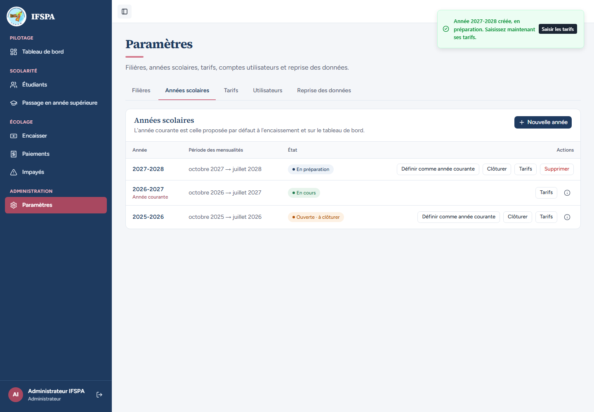
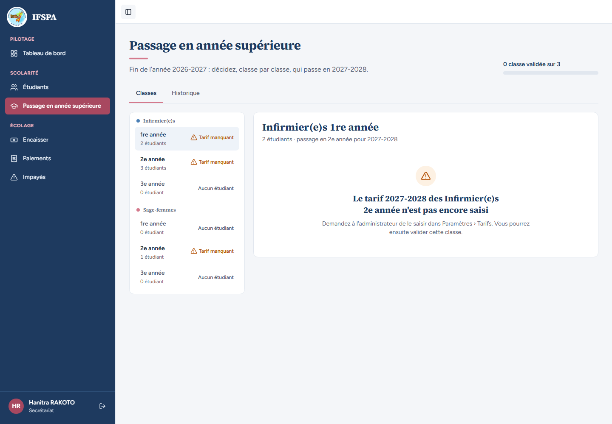
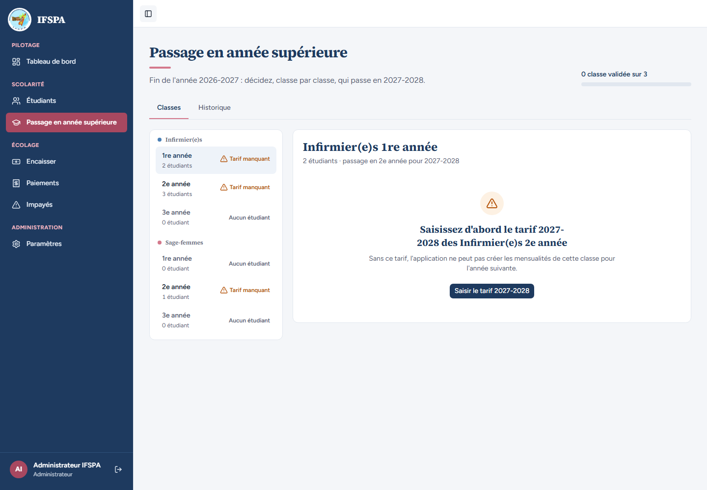
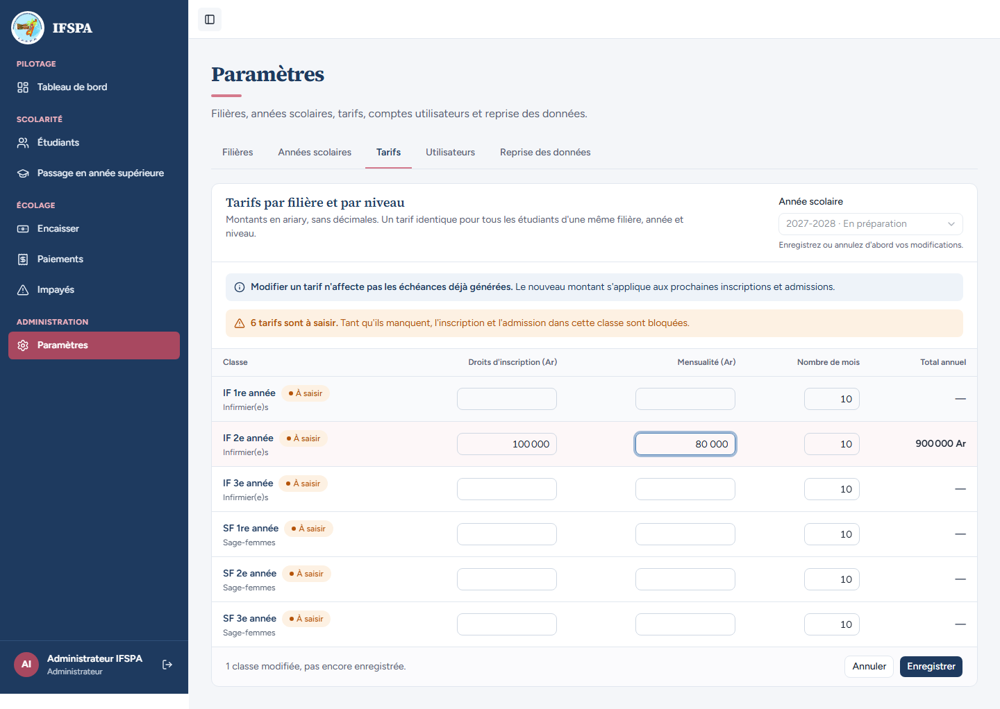
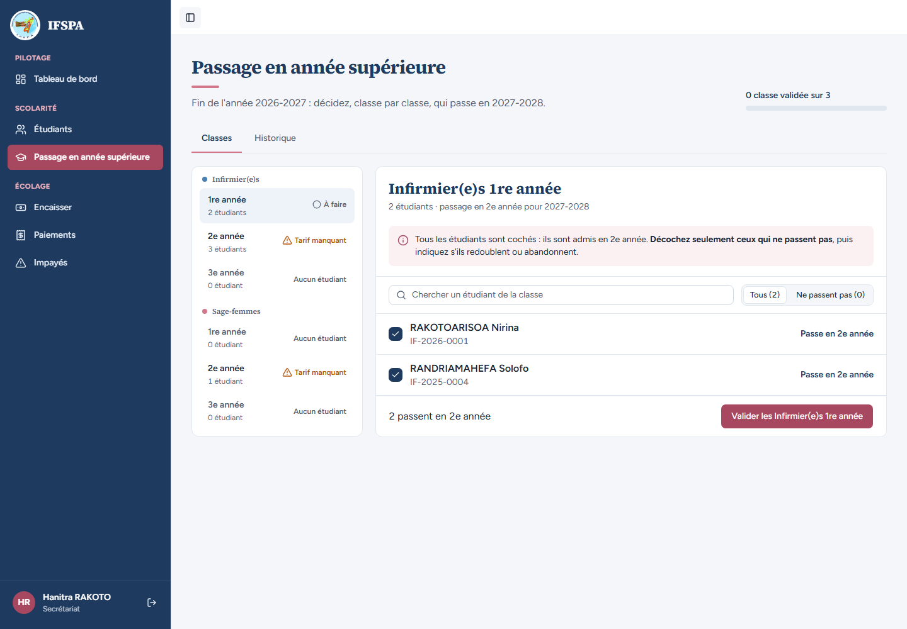
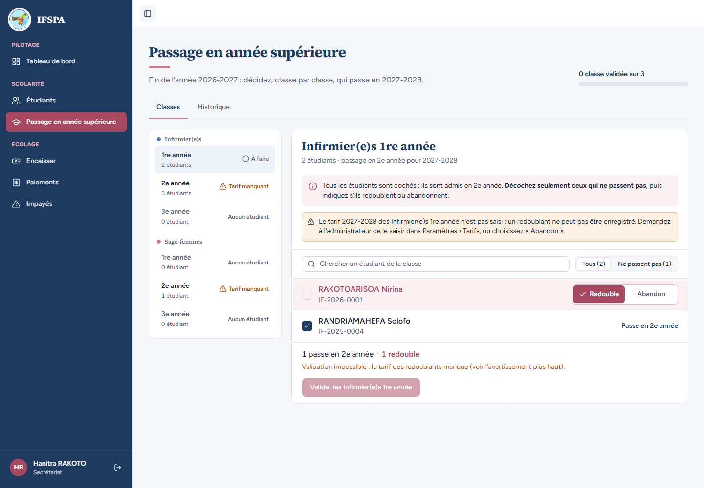
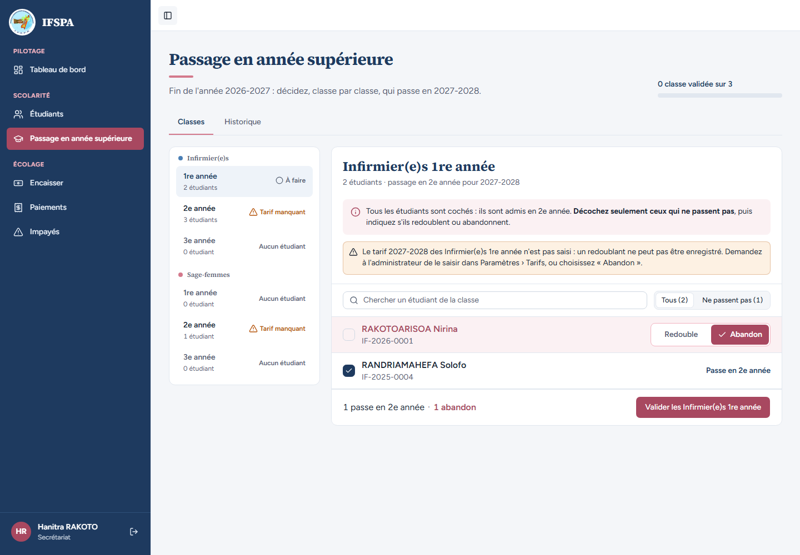

# UC10-08. Tarif manquant : la classe est bloquée tant que le tarif du niveau suivant manque, et un redoublant exige le tarif du même niveau

| | |
|---|---|
| Use case | UC10. Passer les étudiants en année supérieure |
| Règles couvertes | R-ADM (« Tarif manquant » bloquant, lien vers les tarifs, redoublement bloqué sans tarif du même niveau), R-ROLE (la saisie des tarifs est réservée à l'administrateur), R-ECH |
| Rôle | Administrateur (étapes 1, 4 et 5), secrétariat (étapes 2, 3, 6, 7 et 8) |
| Durée estimée | 12 minutes |

## La situation

L'administrateur crée l'année 2027-2028, sans encore saisir ses tarifs. Le passage en année supérieure de 2026-2027 vers 2027-2028 est alors bloqué classe par classe. La secrétaire voit « Tarif manquant » et doit demander le tarif à l'administrateur. L'administrateur saisit le tarif de la 2e année : la classe Infirmier(e)s 1re année devient « À faire ». Mais si la secrétaire veut qu'un étudiant redouble, il faut aussi le tarif de la 1re année de 2027-2028, qui manque encore : elle ne peut que choisir « Abandon ».

## Avant de commencer

1. `pnpm db:up`, `pnpm recette:base`, `pnpm build`, `pnpm recette:app`, puis ouvrir `http://localhost:3200`.
2. Avoir déroulé [00-PREPARATION.md](../00-PREPARATION.md), sections A, B, C, puis [UC10-01](UC10-01-nominal-redoublant.md) à [UC10-07](UC10-07-annee-cible-absente.md) **dans l'ordre**. À ce stade, l'année source est 2026-2027 et l'année 2027-2028 n'existe pas.
3. Étapes 1, 4 et 5 avec le compte **administrateur** (`SEED_ADMIN_*`), étapes 2, 3, 6, 7 et 8 avec le compte **secrétariat** (`SEED_USER_*`).

## Étapes

| # | Qui | Action | Résultat attendu | Capture | ✓ |
|---|---|---|---|---|---|
| 1 | Administrateur | Menu **Paramètres**, onglet **Années scolaires**, **Nouvelle année**, saisir `2027` dans « Année de début », **Créer l'année**. | Aperçu « Année 2027-2028 : mensualités de octobre 2027 → juillet 2028. » Message « Année 2027-2028 créée, en préparation. Saisissez maintenant ses tarifs. » ; la ligne 2027-2028 « En préparation » (octobre 2027 → juillet 2028) apparaît, avec le lien « Tarifs de l'année 2027-2028 ». **Ne pas saisir de tarif.** |  | |
| 2 | Secrétariat | Menu **Passage en année supérieure**. | « Fin de l'année 2026-2027 : décidez, classe par classe, qui passe en 2027-2028. », « 0 classe validée sur 3 ». Trois classes en « Tarif manquant » : Infirmier(e)s 1re année (2 étudiants), Infirmier(e)s 2e année (3 étudiants), Sage-femmes 2e année (1 étudiant). |  | |
| 3 | Secrétariat | Cliquer **Infirmier(e)s › 1re année**. | « 2 étudiants · passage en 2e année pour 2027-2028 ». Titre « Le tarif 2027-2028 des Infirmier(e)s 2e année n'est pas encore saisi » et « Demandez à l'administrateur de le saisir dans Paramètres › Tarifs. Vous pourrez ensuite valider cette classe. » **Aucun bouton « Saisir le tarif »**, aucun bouton « Valider ». |  | |
| 4 | Administrateur | Se connecter en administrateur, **Passage en année supérieure**, **Infirmier(e)s › 1re année**. | Titre « Saisissez d'abord le tarif 2027-2028 des Infirmier(e)s 2e année », « Sans ce tarif, l'application ne peut pas créer les mensualités de cette classe pour l'année suivante. » et le bouton **Saisir le tarif 2027-2028**. |  | |
| 5 | Administrateur | Cliquer **Saisir le tarif 2027-2028**. Dans la grille de l'année 2027-2028, pour **IF 2e année** : « Droits d'inscription (Ar) » `100 000`, « Mensualité (Ar) » `80 000`, « Nombre de mois » `10`. **Enregistrer**, puis recharger. | La grille s'ouvre sur « 2027-2028 · En préparation » (adresse `/app/parametres/tarifs?annee=…`) avec « 6 tarifs sont à saisir ». Après saisie : « 1 classe modifiée, pas encore enregistrée. », total annuel **900 000 Ar** pour IF 2e année. Après Enregistrer et rechargement, la mensualité IF 2e année reste 80 000. |  | |
| 6 | Secrétariat | Retourner dans **Passage en année supérieure**. | Infirmier(e)s 1re année est **« À faire »** ; Infirmier(e)s 2e année et Sage-femmes 2e année restent « Tarif manquant ». Dans la classe : « 2 étudiants · passage en 2e année pour 2027-2028 », deux étudiants cochés, **RAKOTOARISOA Nirina** puis **RANDRIAMAHEFA Solofo**. |  | |
| 7 | Secrétariat | Décocher **RAKOTOARISOA Nirina** (« Redouble » par défaut). | Avertissement orange : « Le tarif 2027-2028 des Infirmier(e)s 1re année n'est pas saisi : un redoublant ne peut pas être enregistré. Demandez à l'administrateur de le saisir dans Paramètres › Tarifs, ou choisissez « Abandon ». » Barre du bas : « 1 passe en 2e année · 1 redouble » et « Validation impossible : le tarif des redoublants manque (voir l'avertissement plus haut). » Le bouton « Valider les Infirmier(e)s 1re année » est **grisé**. |  | |
| 8 | Secrétariat | Cliquer **Abandon** sur la ligne de Nirina. | « 1 passe en 2e année · 1 abandon ». Le message « Validation impossible… » disparaît et le bouton « Valider les Infirmier(e)s 1re année » est de nouveau actif (l'avertissement de tarif reste affiché au-dessus de la liste). **Ne pas valider.** |  | |

## Ce que ce scénario ne couvre pas

- Le refus serveur d'un tarif manquant (niveau suivant, ou même niveau pour un redoublant) : couvert par Vitest, `tests/integration/actions-admissions.test.ts` (« tarif du niveau suivant manquant dans l'année cible : refusé, rien n'est écrit » et « tarif du même niveau manquant : n'empêche que les redoublants »).
- Le passage effectif vers 2027-2028 n'est pas déroulé ici (la classe n'est pas validée).
- Décision provisoire n° 26 (STATUS.md) : « Tarif manquant » bloquant = tarif niveau+1 de l'année cible ; le tarif du même niveau ne bloque que si un redoublant est choisi. Décision n° 29 : les filières désactivées qui ont des étudiants restent listées (non déroulé).
- Ordinateur seulement.

## Dernière exécution par l'agent

- 17/10/2026 : ✅ 8 étapes sur 8. Voir [RAPPORT_2026-10-17_UC10](../../rapports/RAPPORT_2026-10-17_UC10.md). Constat mineur : à l'étape 8, l'avertissement « un redoublant ne peut pas être enregistré » reste affiché alors qu'il n'y a plus de redoublant.
- Parcours : [UC10-08-tarif-manquant.recette.ts](../../parcours/UC10-08-tarif-manquant.recette.ts).
