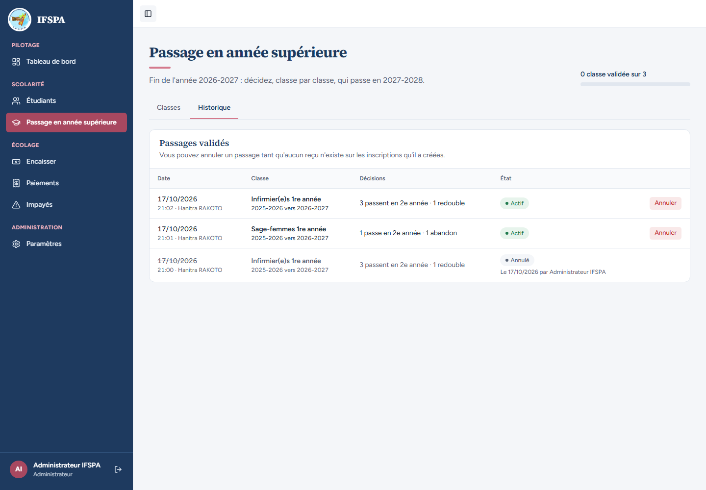
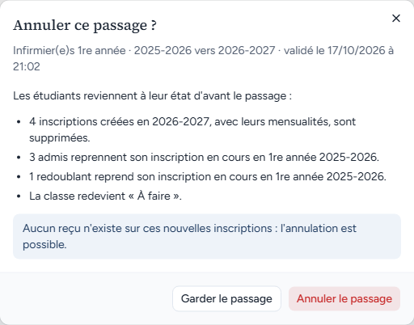
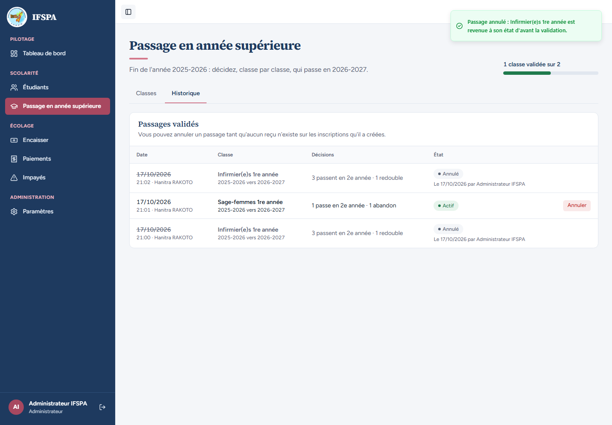
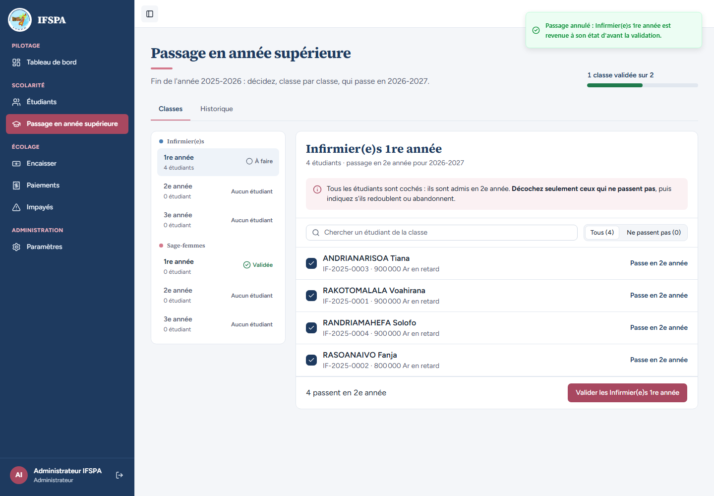

# UC10-09. L'administrateur annule un passage depuis l'historique : l'écran revient à l'année précédente

| | |
|---|---|
| Use case | UC10. Passer les étudiants en année supérieure |
| Règles couvertes | R-ADM (annulation depuis l'historique, restauration de l'état d'avant, classe de nouveau « À faire »), R-ROLE (boutons « Annuler » réservés à l'administrateur) |
| Rôle | Administrateur, compte « Administrateur IFSPA » |
| Durée estimée | 6 minutes |

## La situation

L'année 2027-2028 a été créée, mais une erreur est découverte sur le passage des Infirmier(e)s 1re année refait lors de la clôture de 2025-2026. L'administrateur ouvre l'historique des passages et annule ce passage-là, sans repasser par l'écran de la classe. Aucun reçu n'existe sur les inscriptions qu'il a créées : l'annulation est acceptée. L'écran redevient celui de la fin de 2025-2026.

## Avant de commencer

1. `pnpm db:up`, `pnpm recette:base`, `pnpm build`, `pnpm recette:app`, puis ouvrir `http://localhost:3200`.
2. Avoir déroulé [00-PREPARATION.md](../00-PREPARATION.md), sections A, B, C, puis [UC10-01](UC10-01-nominal-redoublant.md) à [UC10-08](UC10-08-tarif-manquant.md) **dans l'ordre**. À ce stade l'historique contient trois passages : Infirmier(e)s 1re année annulé (UC10-04), Sage-femmes 1re année actif (UC10-05, avec un reçu sur la nouvelle année, UC10-06), Infirmier(e)s 1re année actif (rétabli en UC10-07).
3. Se connecter avec le compte **administrateur** (identifiants `SEED_ADMIN_*` de `.env`) ; « Administrateur IFSPA » s'affiche en bas de la barre latérale.

## Étapes

| # | Qui | Action | Résultat attendu | Capture | ✓ |
|---|---|---|---|---|---|
| 1 | Administrateur | Menu **Passage en année supérieure** (l'écran dit « Fin de l'année 2026-2027 : décidez, classe par classe, qui passe en 2027-2028. »), onglet **Historique**. | « Passages validés » et « Vous pouvez annuler un passage tant qu'aucun reçu n'existe sur les inscriptions qu'il a créées. » Trois lignes : Infirmier(e)s 1re année « 3 passent en 2e année · 1 redouble » **Actif**, Sage-femmes 1re année « 1 passe en 2e année · 1 abandon » **Actif**, et Infirmier(e)s 1re année (date barrée) **Annulé**, « Le (date) par Administrateur IFSPA ». Un bouton **Annuler** sur chacune des deux lignes actives. |  | |
| 2 | Administrateur | Cliquer **Annuler** sur la ligne **Infirmier(e)s 1re année** « Actif ». | Fenêtre « Annuler ce passage ? » : « Infirmier(e)s 1re année · 2025-2026 vers 2026-2027 · validé le (date) à (heure) », « 4 inscriptions créées en 2026-2027, avec leurs mensualités, sont supprimées. », encadré « Aucun reçu n'existe sur ces nouvelles inscriptions : l'annulation est possible. » |  | |
| 3 | Administrateur | Cliquer **Annuler le passage**. | Message « Passage annulé : Infirmier(e)s 1re année est revenue à son état d'avant la validation. » Dans l'historique : deux lignes « Annulé » (date barrée) et une ligne « Actif » (Sage-femmes 1re année). |  | |
| 4 | Administrateur | Cliquer l'onglet **Classes**, puis **Infirmier(e)s › 1re année**. | L'écran revient à « Fin de l'année 2025-2026 : décidez, classe par classe, qui passe en 2026-2027. » et « 1 classe validée sur 2 ». Infirmier(e)s 1re année « À faire », 4 étudiants, tous cochés « Passe en 2e année », « 4 passent en 2e année » ; Sage-femmes 1re année « Validée ». |  | |

## Ce que ce scénario ne couvre pas

- La restauration fine des champs (statuts, compteurs, motif de sortie) : couverte par Vitest, `tests/integration/actions-admissions.test.ts` (« restaure exactement l'état d'avant »).
- L'annulation depuis la classe validée : [UC10-04](UC10-04-annulation-admin.md). Le refus de l'annulation par un reçu : [UC10-06](UC10-06-annulation-bloquee-paiement.md).
- Les fiches des étudiants après cette annulation (déjà vues après UC10-04).
- Le blocage « tant que le passage suivant est validé » (annuler d'abord le plus récent) : couvert par Vitest (« bloquée tant que le passage suivant est validé : on annule d'abord celui-là, puis le premier »).
- Ordinateur seulement.

## Dernière exécution par l'agent

- 17/10/2026 : ✅ 4 étapes sur 4. Voir [RAPPORT_2026-10-17_UC10](../../rapports/RAPPORT_2026-10-17_UC10.md).
- Parcours : [UC10-09-annulation-historique.recette.ts](../../parcours/UC10-09-annulation-historique.recette.ts).
