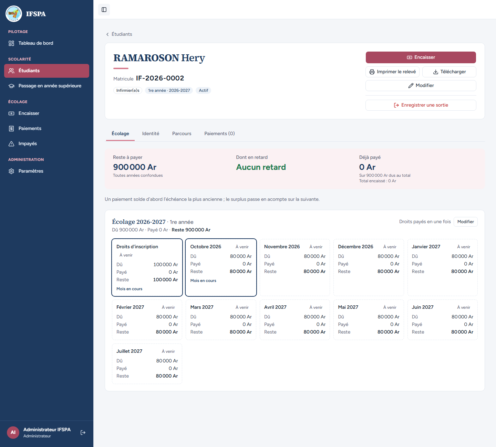
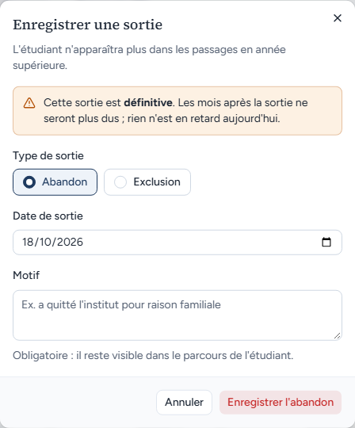
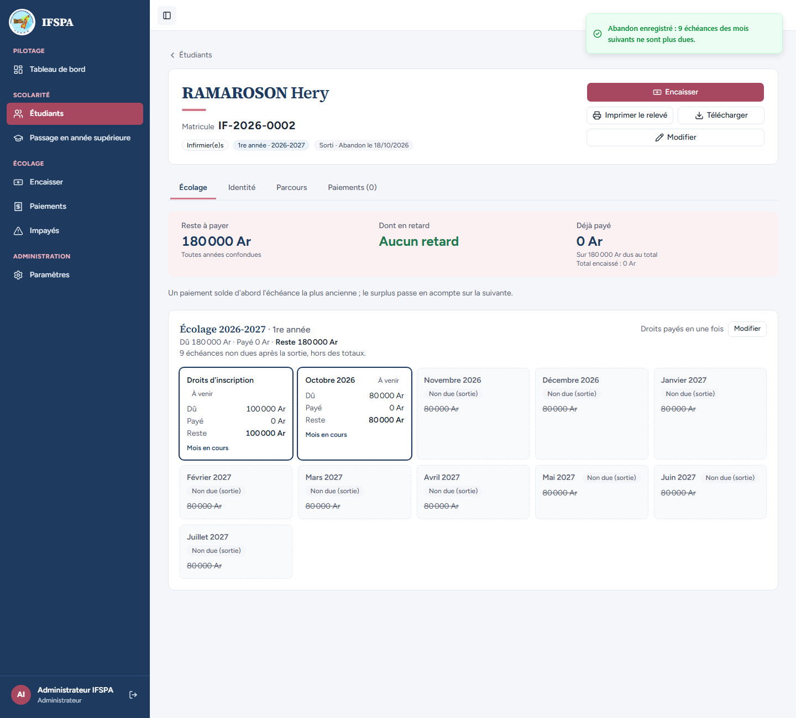
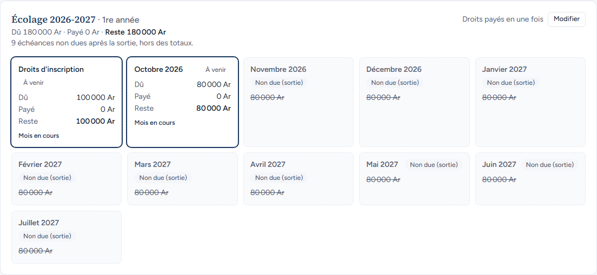
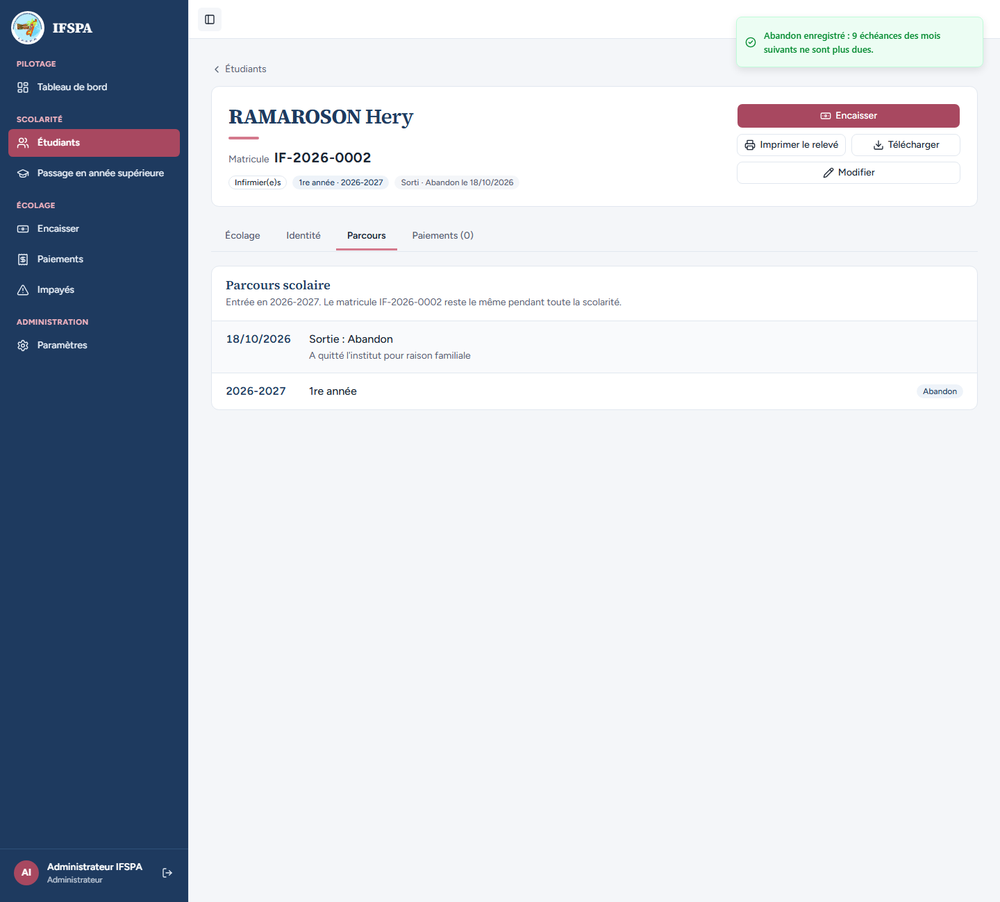

# UC11-01. Un étudiant de 1re année abandonne en octobre : sa sortie est enregistrée, les mois suivants ne sont plus dus

| | |
|---|---|
| Use case | UC11. Enregistrer une sortie (abandon, exclusion) |
| Règles couvertes | R-SOR (sortie réservée à l'administrateur, abandon, date et motif), décision provisoire n° 23 (les mois postérieurs au mois de sortie, sans paiement, ne sont plus dus ; le mois de sortie reste dû) |
| Rôle | Administrateur, compte « Administrateur IFSPA » |
| Durée estimée | 6 minutes |

## La situation

RAMAROSON Hery, inscrit en 1re année d'infirmier depuis la rentrée, n'a encore rien payé. Sa famille annonce qu'il arrête ses études. L'administrateur enregistre l'abandon à la date du jour : Hery ne doit plus que ce qui est déjà échu ou en cours (les droits d'inscription et octobre), les neuf mois suivants disparaissent de sa dette.

## Avant de commencer

1. `pnpm db:up`, `pnpm recette:base`, `pnpm build`, `pnpm recette:app`, puis ouvrir `http://localhost:3200`.
2. Avoir déroulé [00-PREPARATION.md](../00-PREPARATION.md), **sections A, B, C puis H** (RAMAROSON Hery, IF-2026-0002, 900 000 Ar à payer, droits en 1 fois).
3. Se connecter avec le compte **administrateur** (identifiants `SEED_ADMIN_*` de `.env`).

## Étapes

| # | Qui | Action | Résultat attendu | Capture | ✓ |
|---|---|---|---|---|---|
| 1 | Administrateur | Menu **Étudiants**, chercher `IF-2026-0002`, ouvrir RAMAROSON Hery. | Fiche IF-2026-0002, badges « Infirmier(e)s », « 1re année · 2026-2027 », « Actif ». « Reste à payer 900 000 Ar », « Aucun retard ». Bouton **Enregistrer une sortie** en bas de la colonne de boutons (« Administrateur IFSPA » en bas de la barre latérale). |  | |
| 2 | Administrateur | Cliquer **Enregistrer une sortie**. | Fenêtre « Enregistrer une sortie » : « L'étudiant n'apparaîtra plus dans les passages en année supérieure. » Avertissement « Cette sortie est définitive. Les mois après la sortie ne seront plus dus ; rien n'est en retard aujourd'hui. » « Abandon » est choisi (l'autre choix est « Exclusion »), « Date de sortie » vaut la date du jour, « Motif » est vide avec l'aide « Obligatoire : il reste visible dans le parcours de l'étudiant. » Boutons « Annuler » et « Enregistrer l'abandon ». |  | |
| 3 | Administrateur | Saisir le motif `A quitté l'institut pour raison familiale`, cliquer **Enregistrer l'abandon**. | Message « Abandon enregistré : 9 échéances des mois suivants ne sont plus dues. » La fenêtre se ferme. |  | |
| 4 | Administrateur | Regarder la fiche. | Badge « **Sorti · Abandon le (date du jour)** » à la place de « Actif ». Plus de bouton « Enregistrer une sortie ». « Reste à payer **180 000 Ar** » (droits 100 000 Ar + octobre 80 000 Ar), « Aucun retard », « Sur 180 000 Ar dus au total ». « 9 échéances non dues après la sortie, hors des totaux. » Le bouton « Encaisser » reste proposé. |  | |
| 5 | Administrateur | Regarder la grille « Écolage 2026-2027 · 1re année ». | « Droits d'inscription » et « Octobre 2026 » restent « À venir » (octobre « Mois en cours ») avec leurs montants. De « Novembre 2026 » à « Juillet 2027 » : 9 cartes pointillées « **Non due (sortie)** » dont le montant (80 000 Ar) est barré. |  | |
| 6 | Administrateur | Ouvrir l'onglet **Parcours**. | Une ligne « (date du jour) · Sortie : Abandon » avec le motif « A quitté l'institut pour raison familiale », puis « 2026-2027 · 1re année » avec le statut « Abandon ». |  | |

## Ce que ce scénario ne couvre pas

- **Refus du serveur** pour le secrétariat : voir [UC11-04](UC11-04-secretariat-sans-bouton.md) (couvert par Vitest, `tests/integration/actions-sorties.test.ts`).
- **Pas d'annulation d'une sortie** (décision provisoire n° 23) : voir [UC11-09](UC11-09-sortie-definitive.md).
- Constat de l'agent, hors scénario : après la sortie, la fiche garde le bouton « Modifier » des droits (« Droits payés en une fois ») tant qu'aucun paiement n'a été fait ; son effet sur un étudiant sorti n'a pas été exploré (voir le rapport, « Questions »).
- Ordinateur seulement.

## Dernière exécution par l'agent

- 18/10/2026 : ✅ 6 étapes sur 6. Voir [RAPPORT_2026-10-18_UC11](../../rapports/RAPPORT_2026-10-18_UC11.md).
- Parcours : [UC11-01-abandon-nominal.recette.ts](../../parcours/UC11-01-abandon-nominal.recette.ts).
