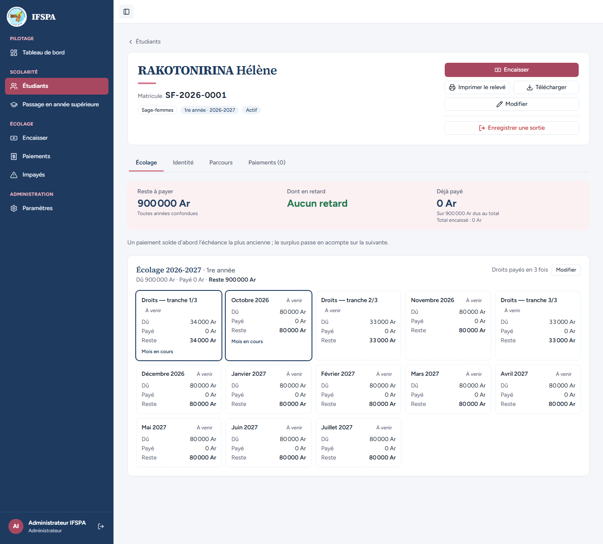
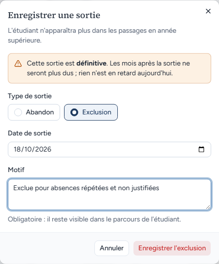
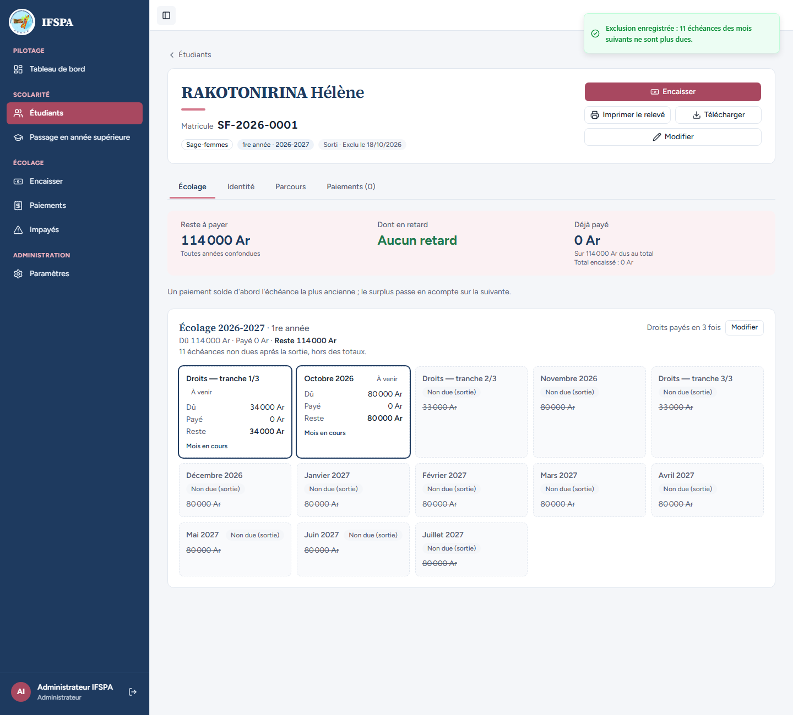
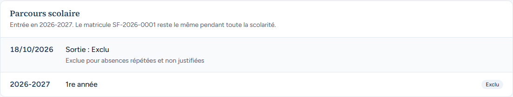

# UC11-02. Une étudiante dont les droits sont en 3 fois est exclue : deux tranches de droits et neuf mensualités ne sont plus dues

| | |
|---|---|
| Use case | UC11. Enregistrer une sortie (abandon, exclusion) |
| Règles couvertes | R-SOR (exclusion, motif), R-TRA (tranches de droits en octobre, novembre, décembre), décision provisoire n° 23 |
| Rôle | Administrateur, compte « Administrateur IFSPA » |
| Durée estimée | 6 minutes |

## La situation

RAKOTONIRINA Hélène, sage-femme de 1re année, paie ses droits d'inscription en trois fois (34 000 / 33 000 / 33 000 Ar). Elle n'a encore rien versé quand le conseil de l'institut prononce son exclusion pour absences répétées. L'administrateur enregistre l'exclusion : elle ne doit plus que la première tranche et octobre, les tranches de novembre et de décembre disparaissent avec les mensualités suivantes.

## Avant de commencer

1. `pnpm recette:base`, `pnpm build`, `pnpm recette:app`, puis ouvrir `http://localhost:3200`.
2. Avoir déroulé [00-PREPARATION.md](../00-PREPARATION.md), **sections A, B, C puis H**. [UC11-01](UC11-01-abandon-nominal.md) a été déroulé avant (cas indépendant de celui-ci).
3. Se connecter avec le compte **administrateur** (identifiants `SEED_ADMIN_*` de `.env`).

## Étapes

| # | Qui | Action | Résultat attendu | Capture | ✓ |
|---|---|---|---|---|---|
| 1 | Administrateur | Menu **Étudiants**, chercher `SF-2026-0001`, ouvrir RAKOTONIRINA Hélène. | Fiche SF-2026-0001, « Droits payés en 3 fois », « Reste à payer 900 000 Ar », 13 cartes d'échéances (3 tranches de droits et 10 mensualités). |  | |
| 2 | Administrateur | Cliquer **Enregistrer une sortie**, choisir **Exclusion**, saisir le motif `Exclue pour absences répétées et non justifiées`. | Le bouton rouge de la fenêtre devient « **Enregistrer l'exclusion** » (il disait « Enregistrer l'abandon »). |  | |
| 3 | Administrateur | Cliquer **Enregistrer l'exclusion**. | Message « Exclusion enregistrée : **11 échéances** des mois suivants ne sont plus dues. » (2 tranches de droits et 9 mensualités). |  | |
| 4 | Administrateur | Regarder la fiche. | Badge « **Sorti · Exclu le (date du jour)** ». « Reste à payer **114 000 Ar** » (tranche 1/3 de 34 000 Ar + octobre 80 000 Ar), « Aucun retard ». « 11 échéances non dues après la sortie, hors des totaux. » « Droits — tranche 1/3 » et « Octobre 2026 » restent dues ; « Droits — tranche 2/3 », « Droits — tranche 3/3 » et les mois de novembre 2026 à juillet 2027 sont « Non due (sortie) ». |  | |
| 5 | Administrateur | Ouvrir l'onglet **Parcours**. | « Sortie : Exclu » avec le motif et la date du jour. |  | |

## Ce que ce scénario ne couvre pas

- Le libellé du statut est « Exclu » (au masculin) même pour une étudiante : accord au masculin partout dans l'application hors relevé (décision provisoire n° 32).
- Refus serveur pour le secrétariat : [UC11-04](UC11-04-secretariat-sans-bouton.md).
- Ordinateur seulement.

## Dernière exécution par l'agent

- 18/10/2026 : ✅ 5 étapes sur 5. Voir [RAPPORT_2026-10-18_UC11](../../rapports/RAPPORT_2026-10-18_UC11.md).
- Parcours : [UC11-02-exclusion-trois-tranches.recette.ts](../../parcours/UC11-02-exclusion-trois-tranches.recette.ts).
