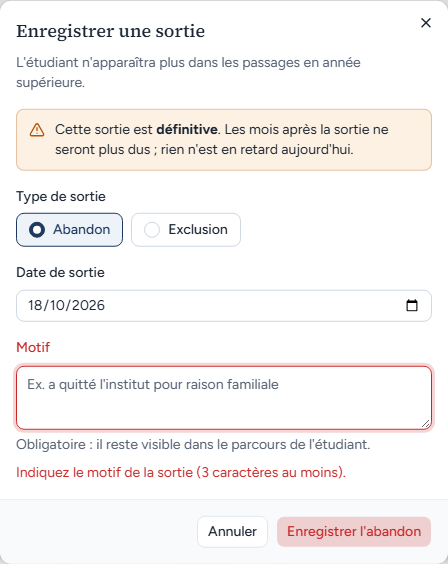
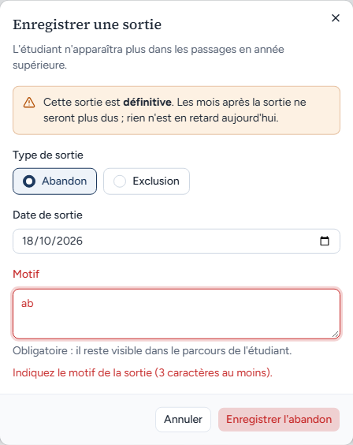
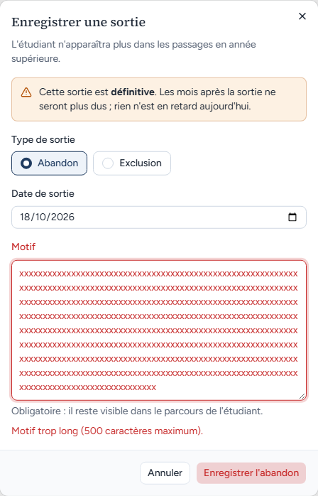
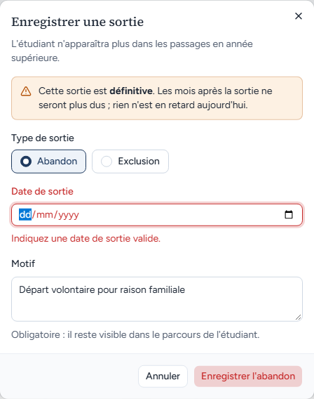
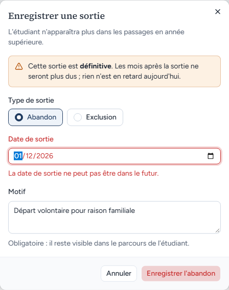
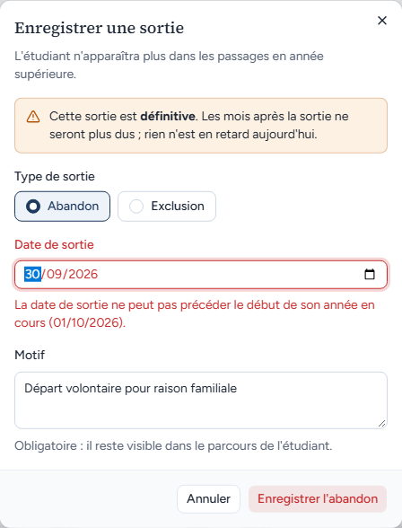
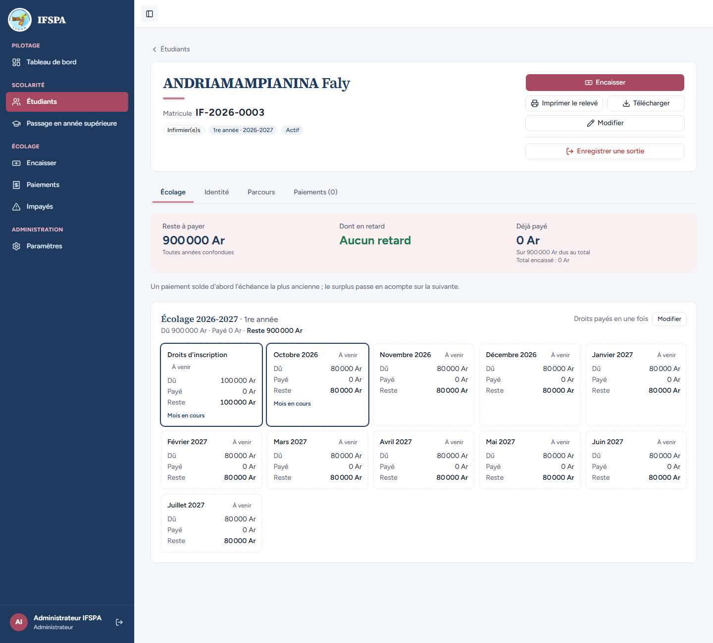

# UC11-03. Les saisies refusées par la fenêtre de sortie : motif absent, motif trop court ou trop long, date absente, future ou trop ancienne

| | |
|---|---|
| Use case | UC11. Enregistrer une sortie (abandon, exclusion) |
| Règles couvertes | R-SOR (motif obligatoire, date bornée), décision provisoire n° 30 (la date ne peut pas précéder le début de l'année en cours) |
| Rôle | Administrateur, compte « Administrateur IFSPA » |
| Durée estimée | 6 minutes |

## La situation

L'administrateur ouvre la fenêtre de sortie d'ANDRIAMAMPIANINA Faly, mais la remplit mal : motif oublié, motif de deux lettres, date effacée, date dans le futur, date d'avant la rentrée. Chaque erreur est expliquée sous le champ et rien n'est enregistré : Faly reste actif.

## Avant de commencer

1. `pnpm recette:base`, `pnpm build`, `pnpm recette:app`, puis ouvrir `http://localhost:3200`.
2. Avoir déroulé [00-PREPARATION.md](../00-PREPARATION.md), **sections A, B, C puis H** (ANDRIAMAMPIANINA Faly, IF-2026-0003, 900 000 Ar).
3. Se connecter avec le compte **administrateur**.

## Étapes

| # | Qui | Action | Résultat attendu | Capture | ✓ |
|---|---|---|---|---|---|
| 1 | Administrateur | Menu **Étudiants**, chercher `IF-2026-0003`, ouvrir ANDRIAMAMPIANINA Faly, cliquer **Enregistrer une sortie**, puis **Enregistrer l'abandon** sans rien saisir. | Sous « Motif », en rouge : « **Indiquez le motif de la sortie (3 caractères au moins).** » La fenêtre reste ouverte. |  | |
| 2 | Administrateur | Saisir `ab` dans « Motif », cliquer **Enregistrer l'abandon**. | Même message : « Indiquez le motif de la sortie (3 caractères au moins). » |  | |
| 3 | Administrateur | Saisir 501 caractères dans « Motif » (par exemple la lettre `x` répétée), cliquer **Enregistrer l'abandon**. | « **Motif trop long (500 caractères maximum).** » |  | |
| 4 | Administrateur | Saisir le motif `Départ volontaire pour raison familiale`, effacer la « Date de sortie » (touche Retour arrière sur chaque partie jj / mm / aaaa), cliquer **Enregistrer l'abandon**. | Sous « Date de sortie » : « **Indiquez une date de sortie valide.** » |  | |
| 5 | Administrateur | Saisir la date `01/12/2026` (dans le futur), cliquer **Enregistrer l'abandon**. | « **La date de sortie ne peut pas être dans le futur.** » (refus renvoyé par le serveur, affiché sous la date). |  | |
| 6 | Administrateur | Saisir la date `30/09/2026` (veille de la rentrée), cliquer **Enregistrer l'abandon**. | « **La date de sortie ne peut pas précéder le début de son année en cours (01/10/2026).** » |  | |
| 7 | Administrateur | Cliquer **Annuler**, recharger la page. | La fiche affiche toujours « Actif », « Reste à payer 900 000 Ar » et le bouton « Enregistrer une sortie ». Rouvrir la fenêtre : elle est neuve (date du jour, motif vide). |  | |

## Ce que ce scénario ne couvre pas

- Les refus du serveur pour une entrée invalide (type inconnu, date inexistante comme le 30/02, étudiant inconnu) : couverts par Vitest, `tests/integration/actions-sorties.test.ts` (bloc « entrée invalide ») et `tests/unit/sorties.test.ts` ; non reproduisibles dans l'interface.
- Les bornes exactes (premier jour de l'année et jour même acceptés) : Vitest, même fichier (« le premier jour de l'année et le jour même sont acceptés »).
- Ordinateur seulement.

## Dernière exécution par l'agent

- 18/10/2026 : ✅ 7 étapes sur 7. Voir [RAPPORT_2026-10-18_UC11](../../rapports/RAPPORT_2026-10-18_UC11.md).
- Parcours : [UC11-03-refus-saisies.recette.ts](../../parcours/UC11-03-refus-saisies.recette.ts).
