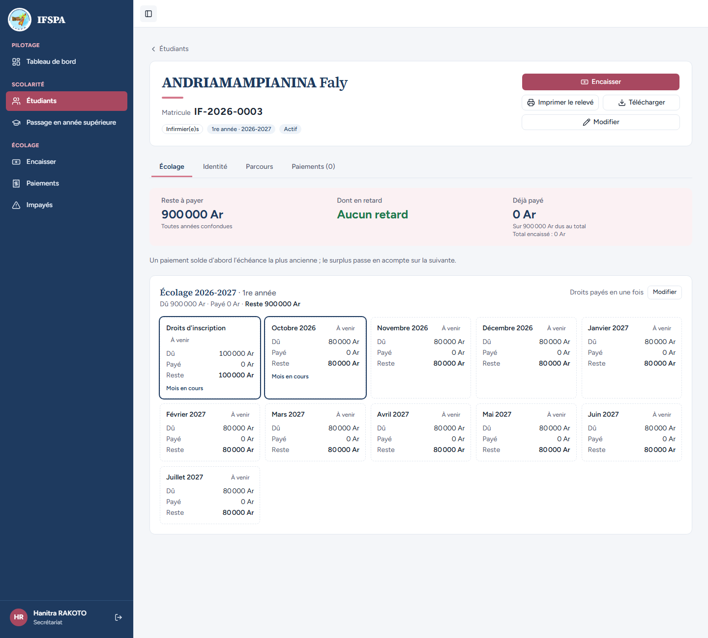
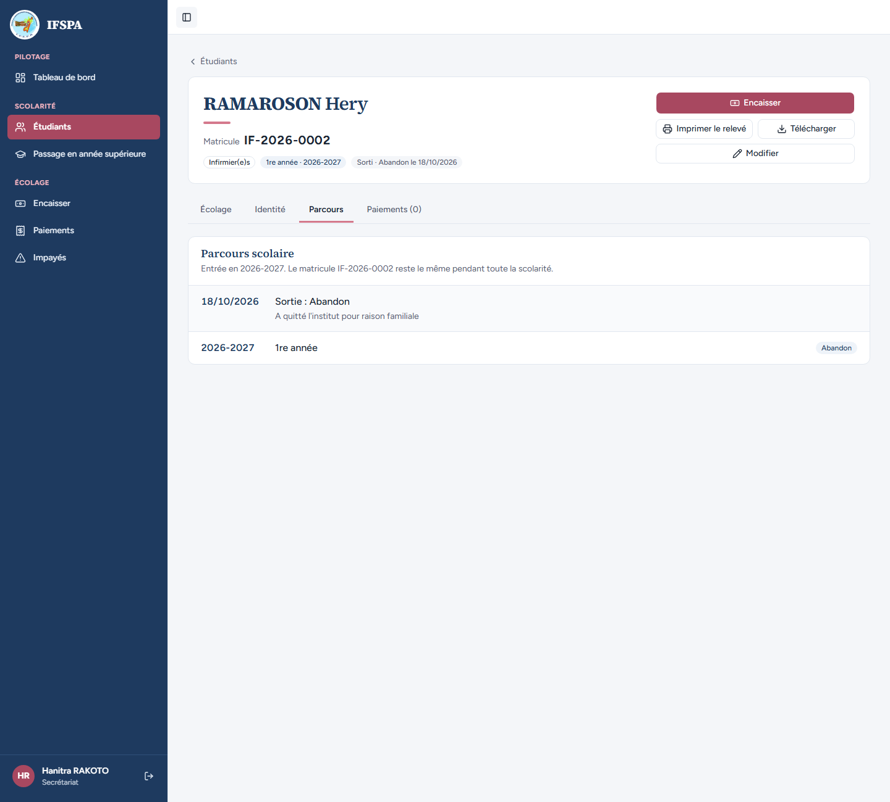

# UC11-04. Le secrétariat ne peut pas enregistrer une sortie : le bouton n'existe pas pour lui

| | |
|---|---|
| Use case | UC11. Enregistrer une sortie (abandon, exclusion) |
| Règles couvertes | R-SOR (sortie réservée à l'administrateur), R-ROLE |
| Rôle | Secrétariat, compte « Hanitra RAKOTO » |
| Durée estimée | 3 minutes |

## La situation

La secrétaire apprend qu'un étudiant ne reviendra pas. Elle ouvre sa fiche pour l'encaisser ou le corriger, mais ne peut pas enregistrer l'abandon : c'est le travail de l'administrateur. Elle peut en revanche lire la sortie d'un étudiant déjà sorti.

## Avant de commencer

1. `pnpm recette:base`, `pnpm build`, `pnpm recette:app`, puis ouvrir `http://localhost:3200`.
2. Avoir déroulé [00-PREPARATION.md](../00-PREPARATION.md), **sections A, B, C puis H**, puis [UC11-01](UC11-01-abandon-nominal.md) (RAMAROSON Hery est sorti ; ANDRIAMAMPIANINA Faly est actif).
3. Se connecter avec le compte **secrétariat** (identifiants `SEED_USER_*` de `.env`).

## Étapes

| # | Qui | Action | Résultat attendu | Capture | ✓ |
|---|---|---|---|---|---|
| 1 | Secrétariat | Menu **Étudiants**, chercher `IF-2026-0003`, ouvrir ANDRIAMAMPIANINA Faly. | Fiche « Actif » avec « Encaisser », « Imprimer le relevé », « Télécharger », « Modifier ». **Aucun bouton « Enregistrer une sortie »** (ni abandon, ni exclusion). « Hanitra RAKOTO » en bas de la barre latérale. |  | |
| 2 | Secrétariat | Ouvrir la fiche de RAMAROSON Hery (sorti), onglet **Parcours**. | Badge « Sorti · Abandon le (date) » ; toujours pas de bouton de sortie ; l'onglet Parcours montre « Sortie : Abandon ». |  | |
| 3 | Secrétariat | Regarder le menu de gauche. | Pas de rubrique « Paramètres » ; « Étudiants » est présent. | | |

## Ce que ce scénario ne couvre pas

- **Refus côté serveur** (appel direct de l'action `enregistrerSortie` par un compte `user`) : non démontrable dans le navigateur. **Couvert par Vitest** : `tests/integration/actions-sorties.test.ts`, test « refuse le rôle user avec le message réel, même avec une entrée invalide, sans rien modifier » (aucune modification, aucun rafraîchissement) ; « sans session : redirigé vers la connexion ».
- Ordinateur seulement.

## Dernière exécution par l'agent

- 18/10/2026 : ✅ 3 étapes sur 3 (l'étape 3 sans capture). Voir [RAPPORT_2026-10-18_UC11](../../rapports/RAPPORT_2026-10-18_UC11.md).
- Parcours : [UC11-04-secretariat-sans-bouton.recette.ts](../../parcours/UC11-04-secretariat-sans-bouton.recette.ts).
