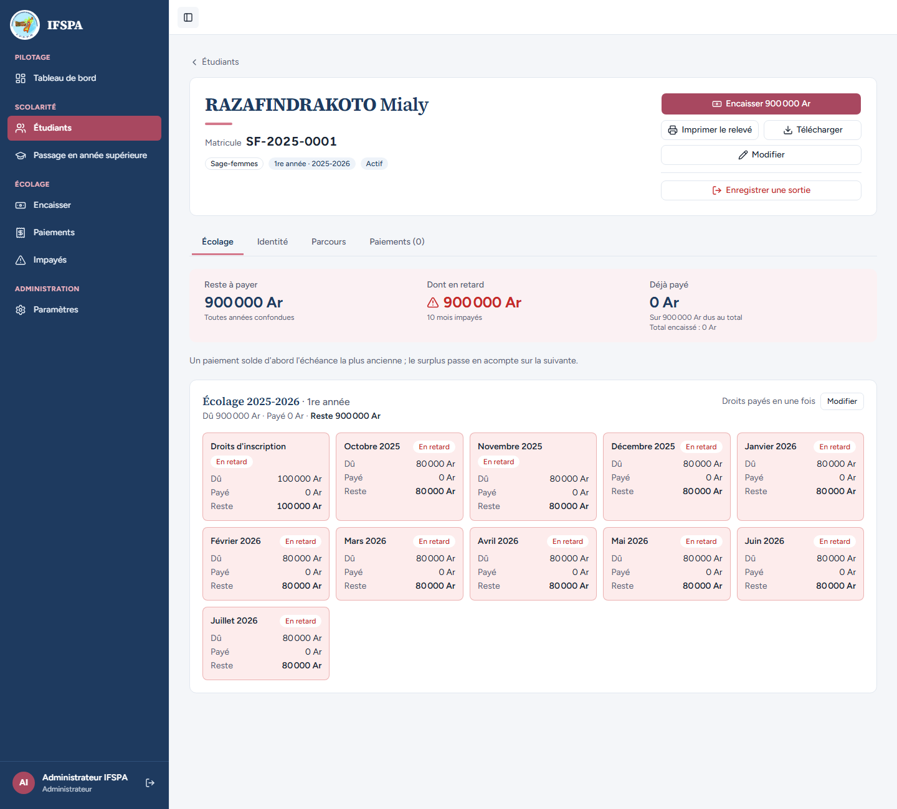
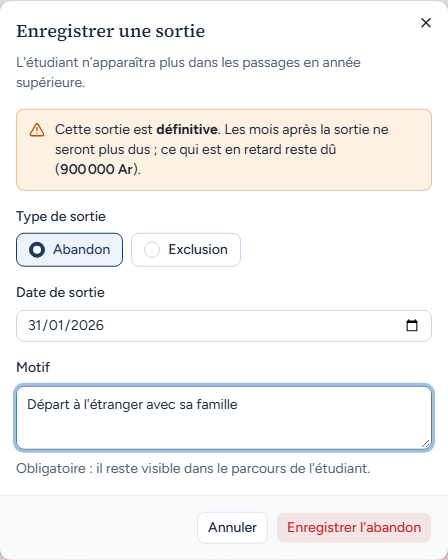
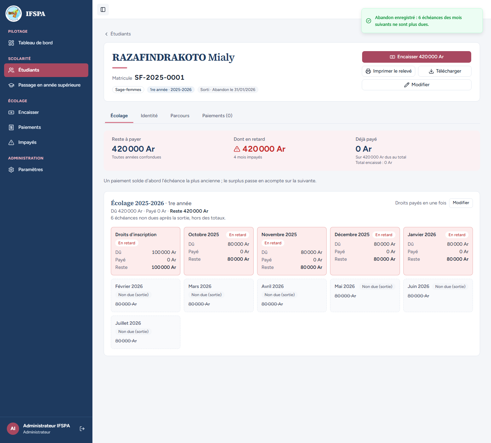
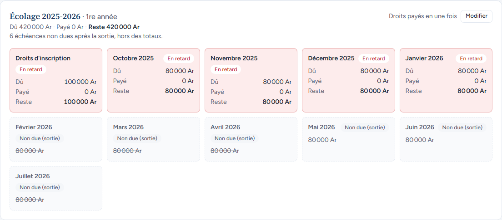
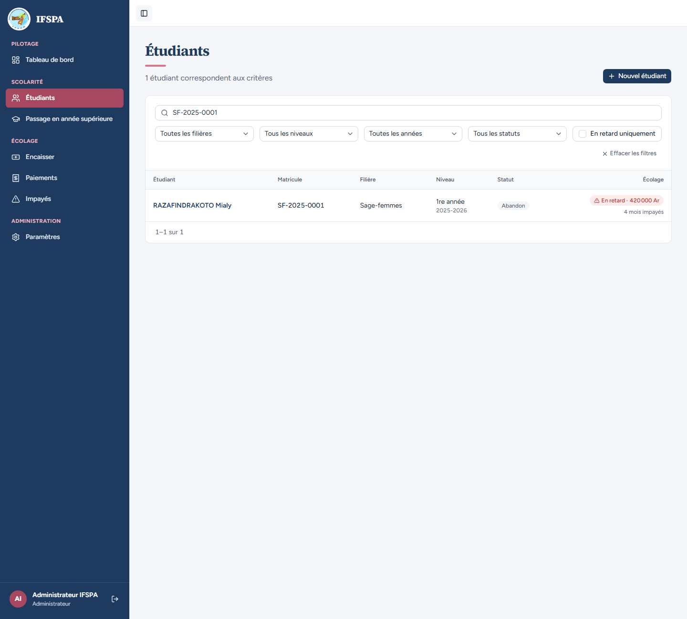

# UC11-05. Un abandon du 31 janvier saisi en octobre : les mois suivants ne sont plus dus, même déjà échus

| | |
|---|---|
| Use case | UC11. Enregistrer une sortie (abandon, exclusion) |
| Règles couvertes | R-SOR (date de sortie choisie par l'administrateur), décision provisoire n° 33 (sortie antidatée : les mois après le mois de sortie déclaré deviennent non dus, même échus), R-RET (retard) |
| Rôle | Administrateur, compte « Administrateur IFSPA » |
| Durée estimée | 6 minutes |

## La situation

RAZAFINDRAKOTO Mialy, sage-femme de 1re année en 2025-2026, n'a jamais payé ni suivi les cours après janvier. L'institut apprend seulement en octobre 2026 qu'elle a abandonné le 31 janvier 2026. L'administrateur saisit cette date : les mois de février à juillet 2026 ne lui sont plus réclamés, même s'ils étaient déjà en retard. Elle garde pourtant à sa charge les droits et octobre à janvier.

## Avant de commencer

1. `pnpm recette:base`, `pnpm build`, `pnpm recette:app`, puis ouvrir `http://localhost:3200`.
2. Avoir déroulé [00-PREPARATION.md](../00-PREPARATION.md), **sections A, B, C puis H** (RAZAFINDRAKOTO Mialy, SF-2025-0001, 900 000 Ar en retard, 10 mois impayés).
3. Se connecter avec le compte **administrateur**.

## Étapes

| # | Qui | Action | Résultat attendu | Capture | ✓ |
|---|---|---|---|---|---|
| 1 | Administrateur | Menu **Étudiants**, chercher `SF-2025-0001`, ouvrir RAZAFINDRAKOTO Mialy. | « Reste à payer 900 000 Ar », « Dont en retard 900 000 Ar », « 10 mois impayés ». |  | |
| 2 | Administrateur | Cliquer **Enregistrer une sortie**. Laisser « Abandon », saisir la date `31/01/2026` et le motif `Départ à l'étranger avec sa famille`. | L'avertissement dit « … ce qui est en retard reste dû (900 000 Ar). » |  | |
| 3 | Administrateur | Cliquer **Enregistrer l'abandon**. | Message « Abandon enregistré : **6 échéances** des mois suivants ne sont plus dues. » (février à juillet 2026). |  | |
| 4 | Administrateur | Regarder la fiche. | Badge « Sorti · Abandon le **31/01/2026** ». « Reste à payer **420 000 Ar** » (droits 100 000 Ar + octobre, novembre, décembre 2025 et janvier 2026), « Dont en retard 420 000 Ar », « 4 mois impayés ». « 6 échéances non dues après la sortie, hors des totaux. » Le bouton devient « Encaisser 420 000 Ar ». |  | |
| 5 | Administrateur | Regarder la grille « Écolage 2025-2026 · 1re année ». | « Droits d'inscription », « Octobre 2025 », « Novembre 2025 », « Décembre 2025 » et « Janvier 2026 » : « En retard ». « Février 2026 » à « Juillet 2026 » : « Non due (sortie) » (montants barrés), alors qu'ils étaient échus. |  | |
| 6 | Administrateur | Menu **Étudiants**, chercher `SF-2025-0001`. | La ligne de RAZAFINDRAKOTO Mialy : statut « Abandon », « En retard · 420 000 Ar », « 4 mois impayés ». |  | |

## Ce que ce scénario ne couvre pas

- Le calcul exact du marquage « non due » pour d'autres dates et pour les tranches de droits : couvert par Vitest, `tests/integration/actions-sorties.test.ts` (« sortie antidatée : les mois postérieurs à la date de sortie sont rendus même s'ils sont déjà échus aujourd'hui », « droits en 3 tranches »).
- L'alternative « ne rendre non dus que les mois après la date d'enregistrement » n'est pas retenue : la décision n° 33 laisse l'administrateur maître de l'effet par la date qu'il saisit.
- Ordinateur seulement.

## Dernière exécution par l'agent

- 18/10/2026 : ✅ 6 étapes sur 6. Voir [RAPPORT_2026-10-18_UC11](../../rapports/RAPPORT_2026-10-18_UC11.md).
- Parcours : [UC11-05-sortie-antidatee.recette.ts](../../parcours/UC11-05-sortie-antidatee.recette.ts).
