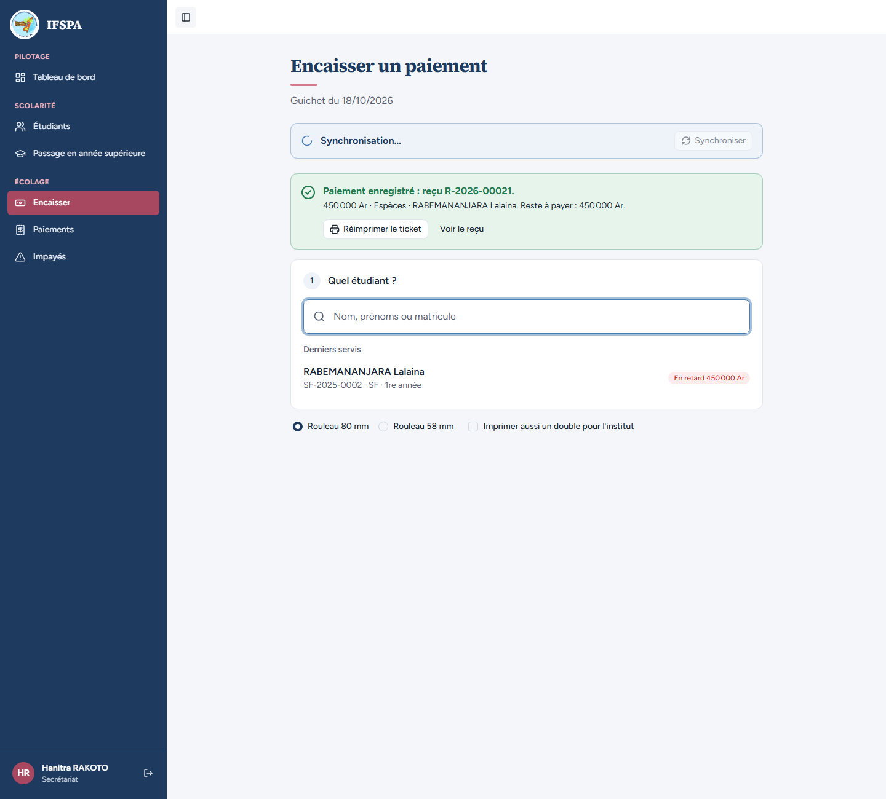
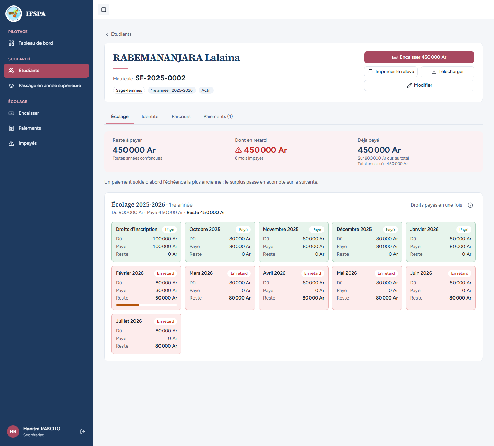
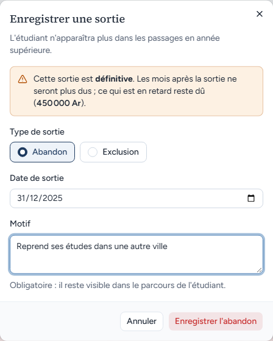
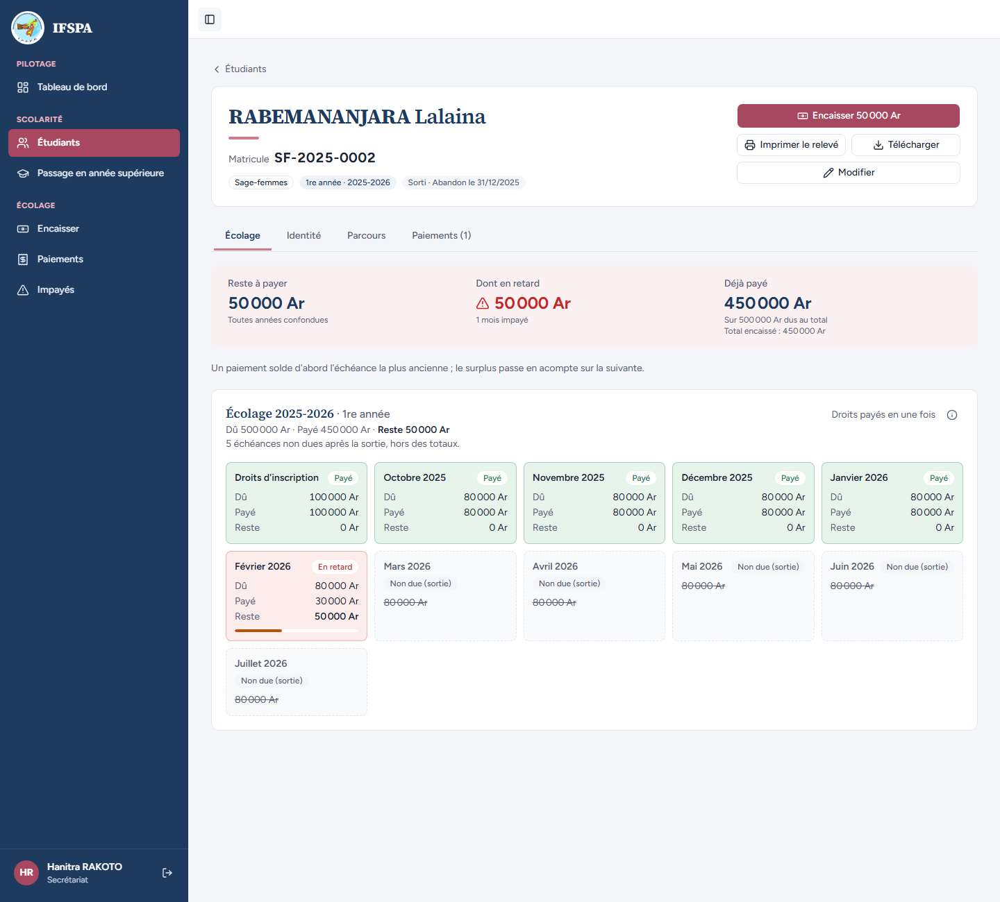

# UC11-06. Un mois payé après la date de sortie reste dû, et un acompte garde son mois

| | |
|---|---|
| Use case | UC11. Enregistrer une sortie (abandon, exclusion) |
| Règles couvertes | R-SOR, décision provisoire n° 23 (seules les échéances **sans aucun paiement** deviennent non dues), R-PAR (acompte), R-REP (répartition de la plus ancienne à la plus récente) |
| Rôle | Secrétariat (compte « Hanitra RAKOTO ») pour l'encaissement, Administrateur (compte « Administrateur IFSPA », autre fenêtre) pour la sortie |
| Durée estimée | 8 minutes |

## La situation

La mère de RABEMANANJARA Lalaina a avancé 450 000 Ar d'écolage 2025-2026 : les droits, octobre à janvier, et 30 000 Ar sur février. Lalaina abandonne finalement avec effet au 31 décembre 2025. Janvier est payé et février a reçu un acompte : ils restent dus. Seuls les mois de mars à juillet, sans aucun paiement, ne sont plus réclamés. Il lui reste 50 000 Ar à payer (le solde de février).

## Avant de commencer

1. `pnpm recette:base`, `pnpm build`, `pnpm recette:app`, puis ouvrir `http://localhost:3200`.
2. Avoir déroulé [00-PREPARATION.md](../00-PREPARATION.md), **sections A, B, C puis H**, puis [UC11-05](UC11-05-sortie-antidatee.md) (indépendant de ce cas, mais ce sont les mêmes numéros de reçu).
3. Deux fenêtres : le compte **secrétariat** (`SEED_USER_*`) et, en navigation privée, le compte **administrateur** (`SEED_ADMIN_*`), tous deux de `.env`.

## Étapes

| # | Qui | Action | Résultat attendu | Capture | ✓ |
|---|---|---|---|---|---|
| 1 | Secrétariat | Menu **Encaisser**, chercher `RABEMANANJARA`, Entrée. Saisir `450000` dans « Montant reçu », cliquer **Encaisser 450 000 Ar et imprimer le reçu**. | « Paiement enregistré : reçu **R-2026-00021**. » (sur une base fraîche ; lire le numéro à l'écran) et « 450 000 Ar · Espèces · RABEMANANJARA Lalaina. Reste à payer : 450 000 Ar. » |  | |
| 2 | Secrétariat | Ouvrir la fiche de RABEMANANJARA Lalaina (Étudiants, `SF-2025-0002`). | « Reste à payer 450 000 Ar ». « Février 2026 » est « En retard » avec « Payé 30 000 Ar » et « Reste 50 000 Ar ». |  | |
| 3 | Administrateur | Ouvrir la fiche de Lalaina, **Enregistrer une sortie**. L'avertissement dit « … ce qui est en retard reste dû (450 000 Ar). » Saisir la date `31/12/2025`, le motif `Reprend ses études dans une autre ville`, cliquer **Enregistrer l'abandon**. | Message « Abandon enregistré : **5 échéances** des mois suivants ne sont plus dues. » (mars à juillet 2026). |  | |
| 4 | Secrétariat | Recharger la fiche de Lalaina. | Badge « Sorti · Abandon le **31/12/2025** ». « Reste à payer **50 000 Ar** », « Dont en retard 50 000 Ar », « 1 mois impayé », « Déjà payé 450 000 Ar », « Sur 500 000 Ar dus au total ». « 5 échéances non dues après la sortie, hors des totaux. » Droits, octobre, novembre, décembre 2025 et **janvier 2026 : « Payé »** (janvier est après la sortie mais reste dû). **Février 2026 : « En retard »**, reste 50 000 Ar. Mars à juillet 2026 : « Non due (sortie) ». Bouton « **Encaisser 50 000 Ar** ». |  | |

## Ce que ce scénario ne couvre pas

- Un paiement **annulé** n'empêche pas le marquage, et annuler un paiement après la sortie ne rend pas les échéances non dues : couvert par Vitest, `tests/integration/actions-sorties.test.ts` (« un paiement non annulé, même partiel, garde son échéance due ; un paiement annulé n'empêche pas », « annuler un paiement après la sortie ne rend pas les échéances non dues »).
- Sortie et encaissement simultanés (jamais d'échéance non due portant un paiement) : Vitest, même fichier.
- Ordinateur seulement.

## Dernière exécution par l'agent

- 18/10/2026 : ✅ 4 étapes sur 4. Voir [RAPPORT_2026-10-18_UC11](../../rapports/RAPPORT_2026-10-18_UC11.md).
- Parcours : [UC11-06-mois-paye-reste-du.recette.ts](../../parcours/UC11-06-mois-paye-reste-du.recette.ts).
