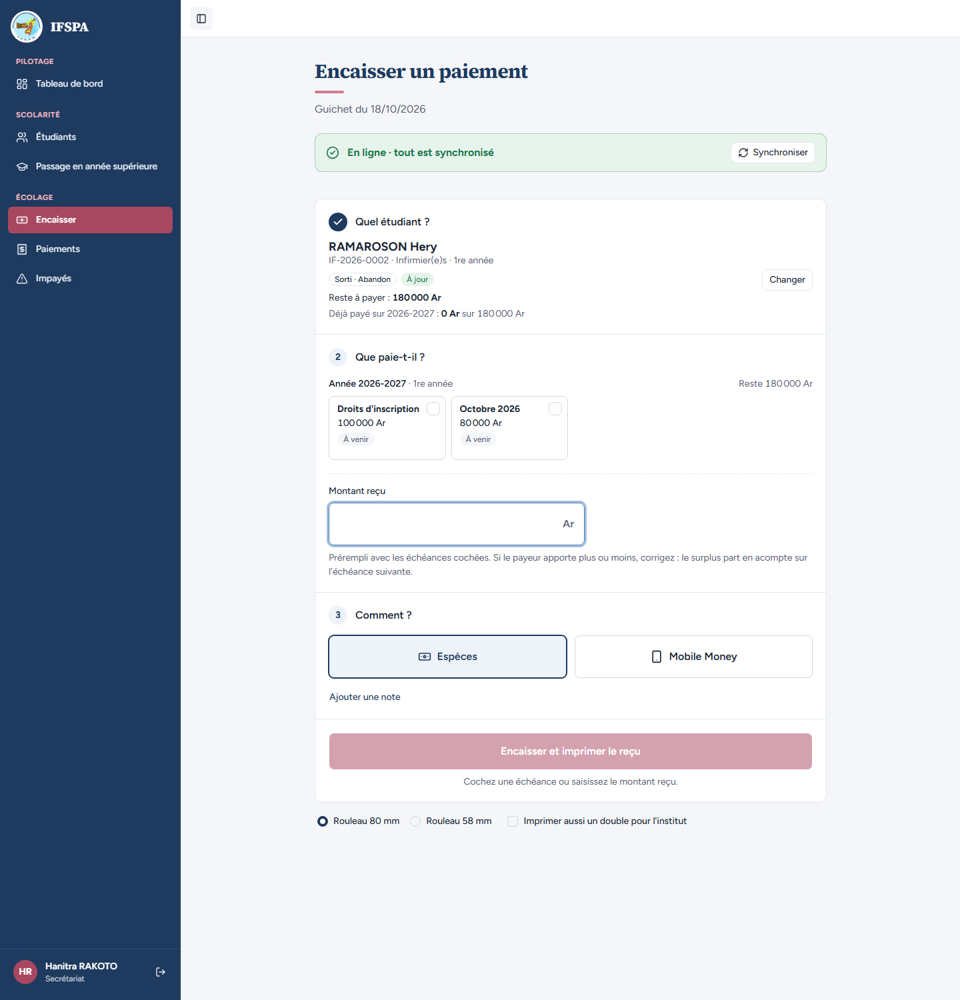
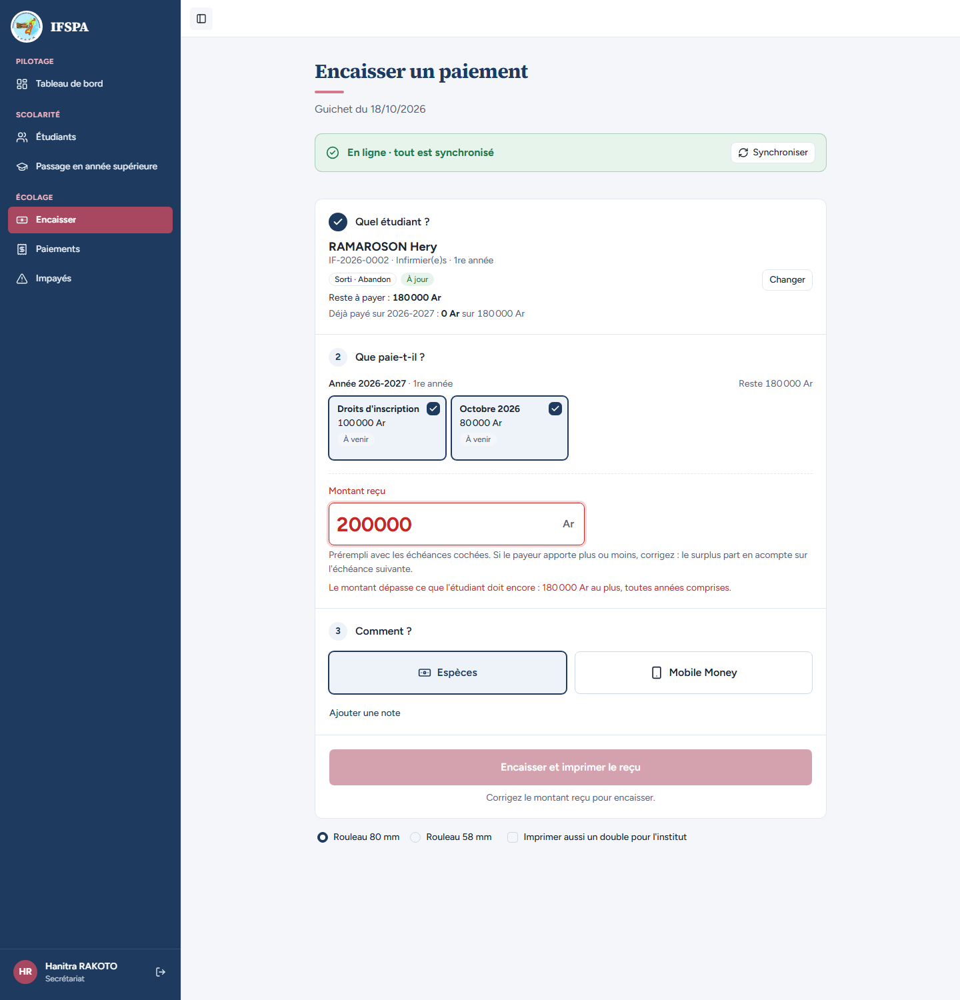
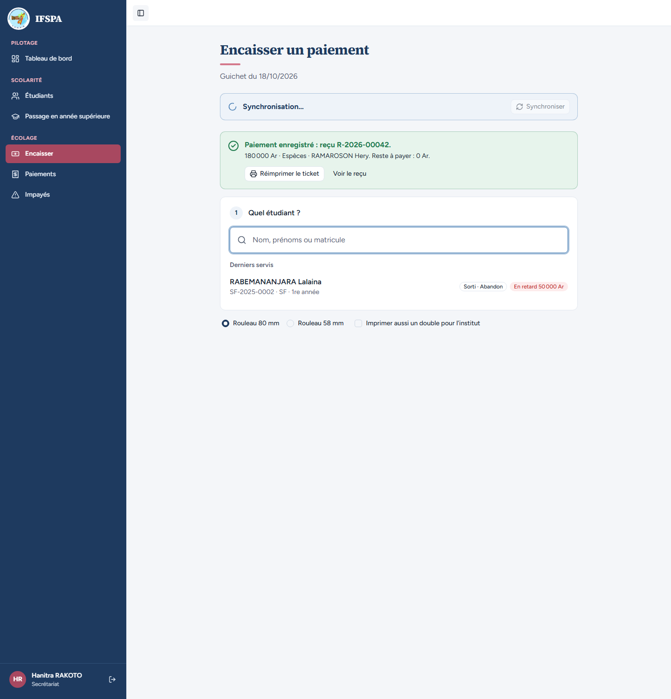
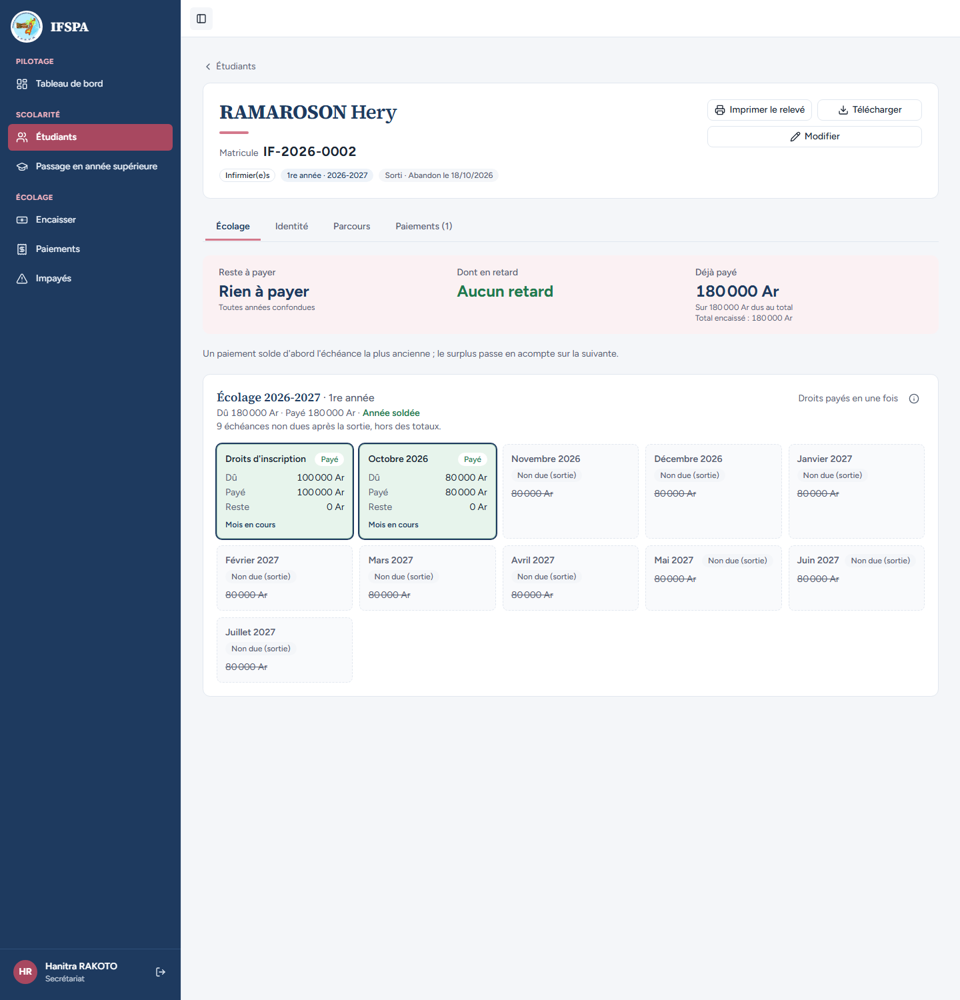

# UC11-07. Un étudiant sorti reste encaissable au guichet tant qu'il doit, avec le badge « Sorti »

| | |
|---|---|
| Use case | UC11. Enregistrer une sortie (abandon, exclusion) |
| Règles couvertes | Décision provisoire n° 20 (un étudiant sorti reste encaissable tant qu'il reste un dû, badge « Sorti »), décision n° 23 (les mois non dus ne sont pas proposés), R-TROP (le trop-perçu se mesure sur ce qui est encore dû), R-REP |
| Rôle | Secrétariat, compte « Hanitra RAKOTO » |
| Durée estimée | 6 minutes |

## La situation

La famille de RAMAROSON Hery, qui a abandonné, vient régler ce qu'il doit encore : les droits d'inscription et octobre. La secrétaire le retrouve au guichet, voit qu'il est « Sorti » et qu'il doit 180 000 Ar, et l'encaisse. Une fois soldé, sa fiche ne propose plus d'encaisser.

## Avant de commencer

1. `pnpm recette:base`, `pnpm build`, `pnpm recette:app`, puis ouvrir `http://localhost:3200`.
2. Avoir déroulé [00-PREPARATION.md](../00-PREPARATION.md), **sections A, B, C puis H**, puis [UC11-01](UC11-01-abandon-nominal.md) (RAMAROSON Hery est sorti, il doit 180 000 Ar).
3. Se connecter avec le compte **secrétariat** (identifiants `SEED_USER_*` de `.env`).

## Étapes

| # | Qui | Action | Résultat attendu | Capture | ✓ |
|---|---|---|---|---|---|
| 1 | Secrétariat | Menu **Encaisser**, chercher `RAMAROSON`, Entrée. | Étudiant choisi : « RAMAROSON Hery », « IF-2026-0002 · Infirmier(e)s · 1re année », badges « **Sorti · Abandon** » et « À jour » (aucun retard), « Reste à payer : 180 000 Ar », « Déjà payé sur 2026-2027 : 0 Ar sur 180 000 Ar ». |  | |
| 2 | Secrétariat | Regarder les cartes d'échéances. | Seulement « Droits d'inscription » (100 000 Ar) et « Octobre 2026 » (80 000 Ar), « À venir », non cochées. **Aucune carte** pour novembre 2026 à juillet 2027 (« non dues »). | (voir capture de l'étape 1) | |
| 3 | Secrétariat | Saisir `200000` dans « Montant reçu ». | Champ en rouge : « **Le montant dépasse ce que l'étudiant doit encore : 180 000 Ar au plus, toutes années comprises.** » Le bouton « Encaisser et imprimer le reçu » est grisé : « Corrigez le montant reçu pour encaisser. » |  | |
| 4 | Secrétariat | Saisir `180000`, cliquer **Encaisser 180 000 Ar et imprimer le reçu**. | « Ce paiement solde tout ce que l'étudiant doit. » puis « Paiement enregistré : reçu **R-2026-00042**. » (numéro à lire à l'écran) et « 180 000 Ar · Espèces · RAMAROSON Hery. Reste à payer : 0 Ar. » |  | |
| 5 | Secrétariat | Ouvrir la fiche de RAMAROSON Hery. | Badge « Sorti · Abandon le (date) ». « Reste à payer **Rien à payer** », « Aucun retard », « Déjà payé 180 000 Ar », « Année soldée ». **Plus de bouton « Encaisser »**. « Paiements (1) ». Droits et octobre « Payé », 9 mois « Non due (sortie) ». |  | |

## Ce que ce scénario ne couvre pas

- Le refus serveur du trop-perçu : couvert par Vitest, `tests/integration/actions-sorties.test.ts` (« encaisser : la répartition ignore les mois non dus, le trop-perçu est mesuré sur le dû restant »). Le cas général est dans [UC06-05](../UC06-encaisser/UC06-05-refus-trop-percu.md).
- Constat de l'agent : le badge « À jour » s'affiche à côté de « Sorti · Abandon » alors que l'étudiant doit 180 000 Ar (pas encore en retard) : même règle que pour un actif.
- L'étudiant sorti disparaît de la liste des Impayés : [UC11-08](UC11-08-hors-impayes-et-passage.md).
- Ordinateur seulement (le guichet sur téléphone est couvert par UC06).

## Dernière exécution par l'agent

- 18/10/2026 : ✅ 5 étapes sur 5. Voir [RAPPORT_2026-10-18_UC11](../../rapports/RAPPORT_2026-10-18_UC11.md).
- Parcours : [UC11-07-guichet-etudiant-sorti.recette.ts](../../parcours/UC11-07-guichet-etudiant-sorti.recette.ts).
