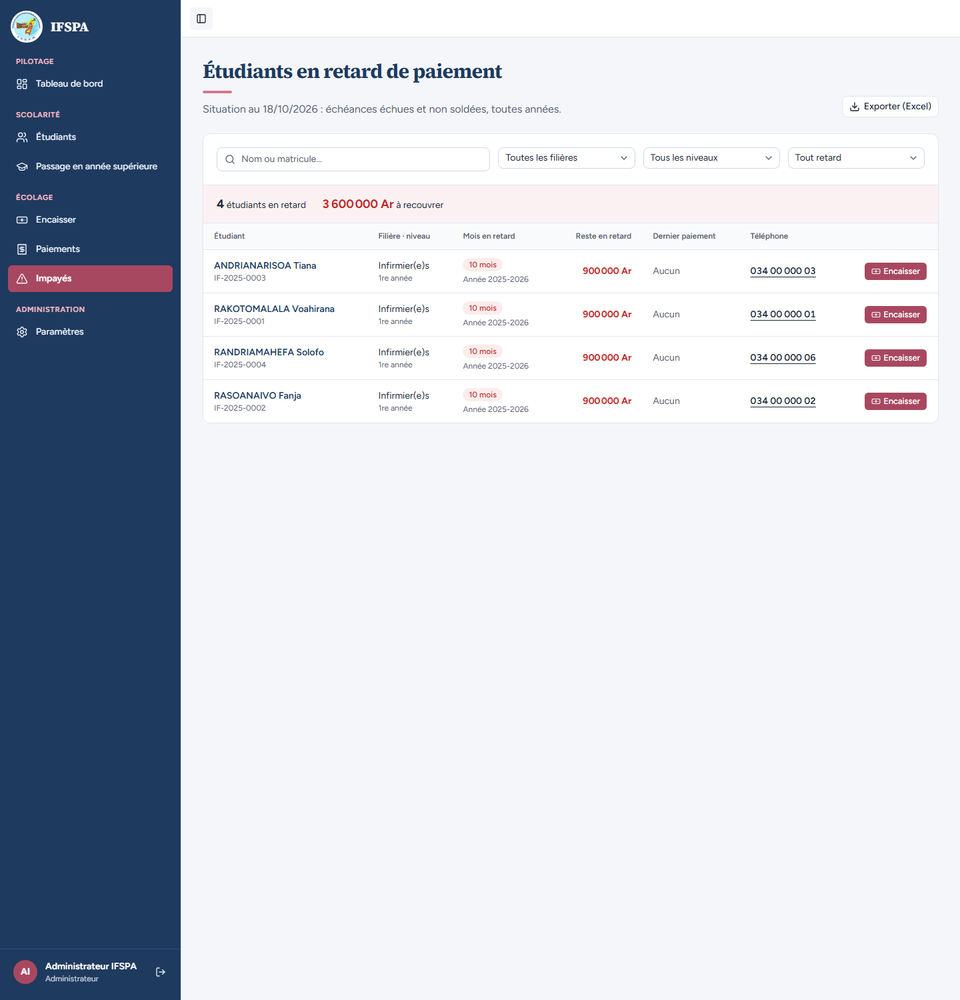
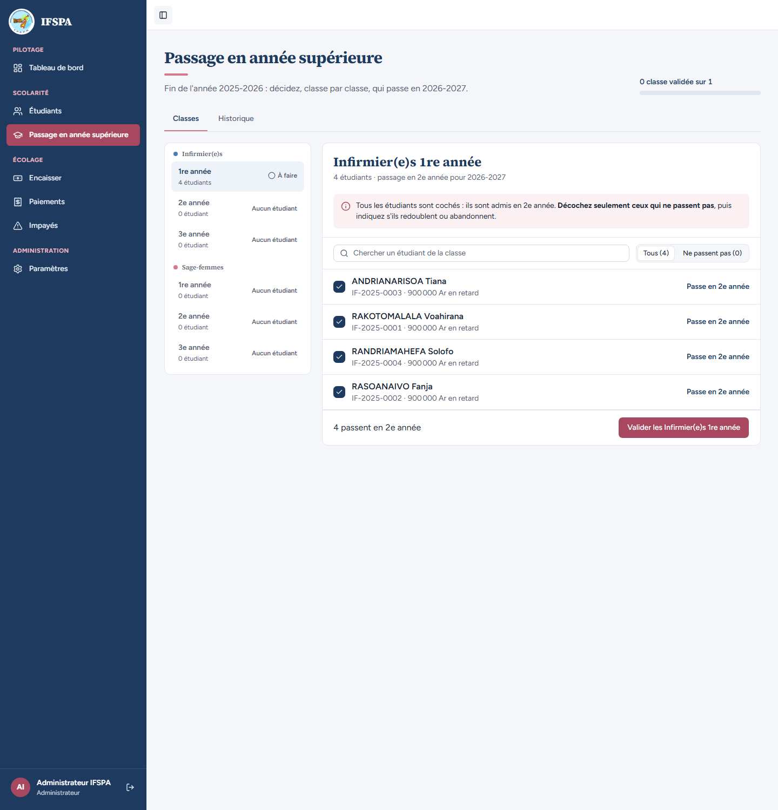
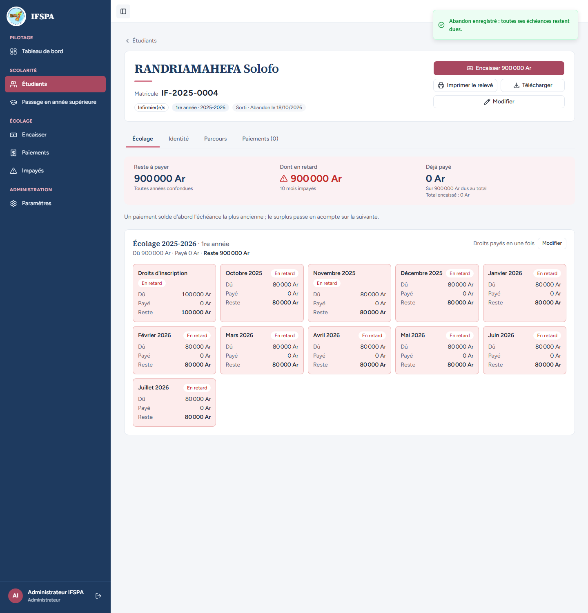
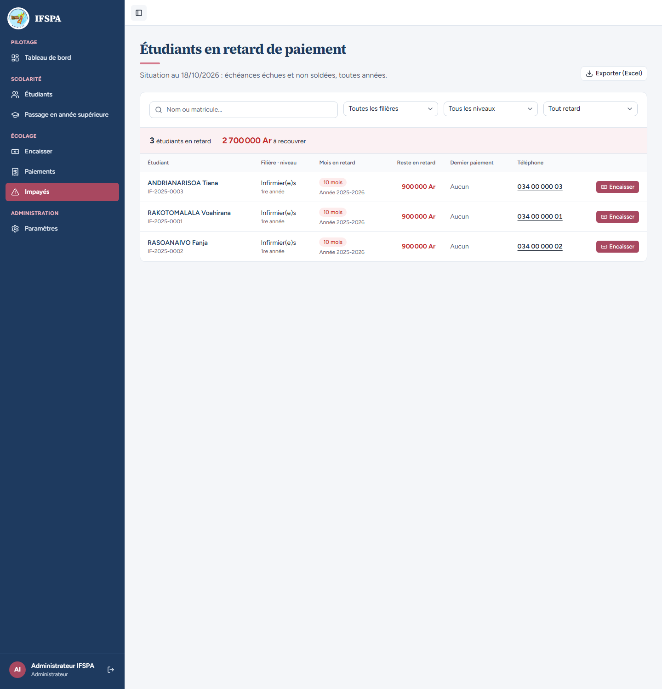
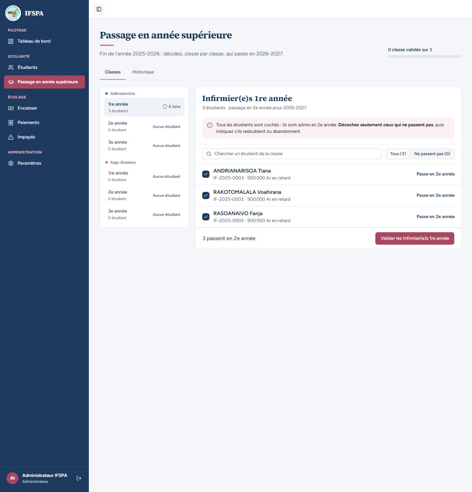

# UC11-08. Un étudiant qui abandonne disparaît des Impayés et du passage en année supérieure

| | |
|---|---|
| Use case | UC11. Enregistrer une sortie (abandon, exclusion) |
| Règles couvertes | R-SOR, R-IMP (la liste ne compte que les étudiants actifs, décision provisoire n° 20), R-ADM (un étudiant sorti n'est plus proposé au passage) |
| Rôle | Administrateur, compte « Administrateur IFSPA » |
| Durée estimée | 6 minutes |

## La situation

RANDRIAMAHEFA Solofo, étudiant de 1re année d'infirmier en 2025-2026, doit 900 000 Ar et figure dans les relances. En fin d'année, l'administrateur apprend qu'il abandonne. Dès l'enregistrement, Solofo n'est plus relancé et n'est plus proposé au passage en année supérieure.

## Avant de commencer

1. `pnpm recette:base`, `pnpm build`, `pnpm recette:app`, puis ouvrir `http://localhost:3200`.
2. Avoir déroulé [00-PREPARATION.md](../00-PREPARATION.md), **sections A, B, C puis H**, puis [UC11-05](UC11-05-sortie-antidatee.md) et [UC11-06](UC11-06-mois-paye-reste-du.md) : Mialy et Lalaina sont déjà sorties, d'où les 4 étudiants et les 3 600 000 Ar ci-dessous. (Sans ces deux cas, lire 6 étudiants et 5 400 000 Ar, puis 5 et 4 500 000 Ar.)
3. Se connecter avec le compte **administrateur**.

## Étapes

| # | Qui | Action | Résultat attendu | Capture | ✓ |
|---|---|---|---|---|---|
| 1 | Administrateur | Menu **Impayés**. | « **4** étudiants en retard », « **3 600 000 Ar** à recouvrer » ; RANDRIAMAHEFA Solofo est listé. |  | |
| 2 | Administrateur | Menu **Passage en année supérieure**, classe **Infirmier(e)s 1re année**. | « 4 étudiants · passage en 2e année pour 2026-2027 », dont RANDRIAMAHEFA Solofo, tous cochés. |  | |
| 3 | Administrateur | Ouvrir la fiche de RANDRIAMAHEFA Solofo (Étudiants, `IF-2025-0004`), **Enregistrer une sortie**, saisir le motif `Ne reprend pas les cours, raison de santé`, **Enregistrer l'abandon** (date du jour). | Message « Abandon enregistré : **toutes ses échéances restent dues.** » (l'année 2025-2026 est terminée : aucun mois postérieur). Badge « Sorti · Abandon le (date du jour) », « Reste à payer 900 000 Ar ». |  | |
| 4 | Administrateur | Menu **Impayés**. | « **3** étudiants en retard », « **2 700 000 Ar** à recouvrer » ; **Solofo n'est plus dans la liste**. |  | |
| 5 | Administrateur | Menu **Passage en année supérieure**, classe **Infirmier(e)s 1re année**. | « **3** étudiants · passage en 2e année pour 2026-2027 » ; RANDRIAMAHEFA Solofo n'est plus proposé. Les classes de Sage-femmes sont à « Aucun étudiant » (Mialy et Lalaina étant sorties). |  | |

## Ce que ce scénario ne couvre pas

- Le même effet pour une exclusion : même règle côté serveur, couvert par Vitest, `tests/integration/actions-sorties.test.ts` (« Impayés : les étudiants sortis n'y figurent pas ») et `tests/integration/lectures-paiements.test.ts` (« ne liste que les étudiants ACTIF en retard »).
- La dette de Solofo reste encaissable : [UC11-07](UC11-07-guichet-etudiant-sorti.md) et [UC08-07](../UC08-impayes/UC08-07-abandon-hors-liste.md).
- Ordinateur seulement.

## Dernière exécution par l'agent

- 18/10/2026 : ✅ 5 étapes sur 5. Voir [RAPPORT_2026-10-18_UC11](../../rapports/RAPPORT_2026-10-18_UC11.md).
- Parcours : [UC11-08-hors-impayes-et-passage.recette.ts](../../parcours/UC11-08-hors-impayes-et-passage.recette.ts).
