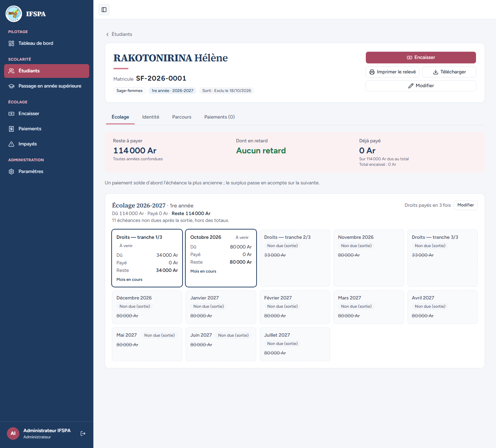
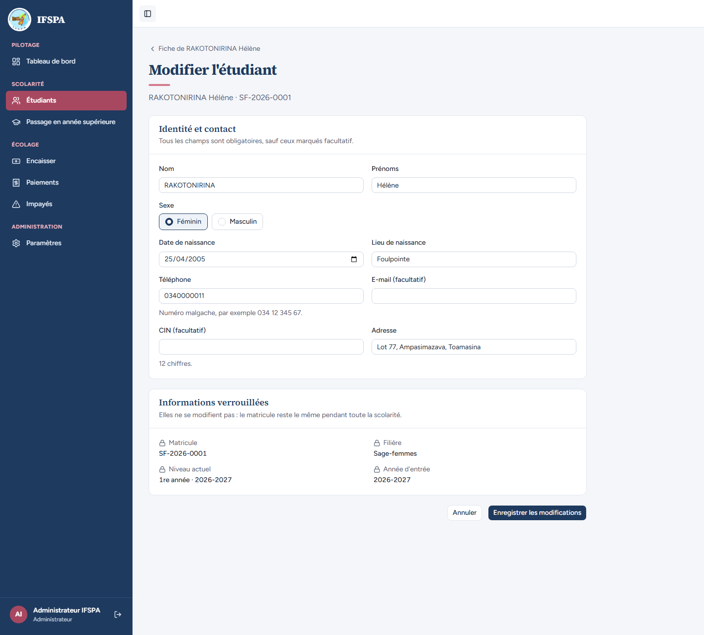

# UC11-09. Une sortie enregistrée est définitive : même l'administrateur ne peut ni l'annuler ni en saisir une seconde

| | |
|---|---|
| Use case | UC11. Enregistrer une sortie (abandon, exclusion) |
| Règles couvertes | R-SOR, décision provisoire n° 23 (pas d'annulation d'une sortie) |
| Rôle | Administrateur, compte « Administrateur IFSPA » |
| Durée estimée | 3 minutes |

## La situation

L'administrateur se rend compte qu'il a exclu RAKOTONIRINA Hélène par erreur. Il cherche comment annuler : l'application n'offre rien pour cela (la sortie est « définitive », la fenêtre le disait). La fiche ne propose ni nouvelle sortie, ni retour en arrière, et la page de modification ne touche pas au statut.

## Avant de commencer

1. `pnpm recette:base`, `pnpm build`, `pnpm recette:app`, puis ouvrir `http://localhost:3200`.
2. Avoir déroulé [00-PREPARATION.md](../00-PREPARATION.md), **sections A, B, C puis H**, puis [UC11-02](UC11-02-exclusion-trois-tranches.md) (RAKOTONIRINA Hélène, SF-2026-0001, est exclue).
3. Se connecter avec le compte **administrateur**.

## Étapes

| # | Qui | Action | Résultat attendu | Capture | ✓ |
|---|---|---|---|---|---|
| 1 | Administrateur | Menu **Étudiants**, chercher `SF-2026-0001`, ouvrir RAKOTONIRINA Hélène. | Badge « Sorti · Exclu le (date) ». **Aucun bouton « Enregistrer une sortie »**, ni « Annuler la sortie », « Rétablir », « Réintégrer », « Réinscrire » ou « Rouvrir ». Restent « Encaisser » (114 000 Ar encore dus), « Imprimer le relevé », « Télécharger », « Modifier ». |  | |
| 2 | Administrateur | Cliquer **Modifier**. | Page « Modifier l'étudiant » : identité et contact modifiables ; « Informations verrouillées » (matricule, filière, niveau actuel, année d'entrée). **Aucun champ de statut**. |  | |

## Ce que ce scénario ne couvre pas

- **Seconde sortie par un appel direct** : non démontrable à l'écran (le bouton a disparu). **Couvert par Vitest** : `tests/integration/actions-sorties.test.ts` (« étudiant DIPLOME / ABANDON / EXCLU : refusé, sa sortie déjà enregistrée n'est pas écrasée », message « Cet étudiant n'est plus actif (…) : sa sortie est déjà enregistrée. ») et `tests/unit/sorties.test.ts`.
- L'absence d'annulation est la décision provisoire n° 23 : une erreur de saisie de sortie ne se corrige pas à l'écran (voir le rapport, « Questions »).
- Ordinateur seulement.

## Dernière exécution par l'agent

- 18/10/2026 : ✅ 2 étapes sur 2. Voir [RAPPORT_2026-10-18_UC11](../../rapports/RAPPORT_2026-10-18_UC11.md).
- Parcours : [UC11-09-sortie-definitive.recette.ts](../../parcours/UC11-09-sortie-definitive.recette.ts).
