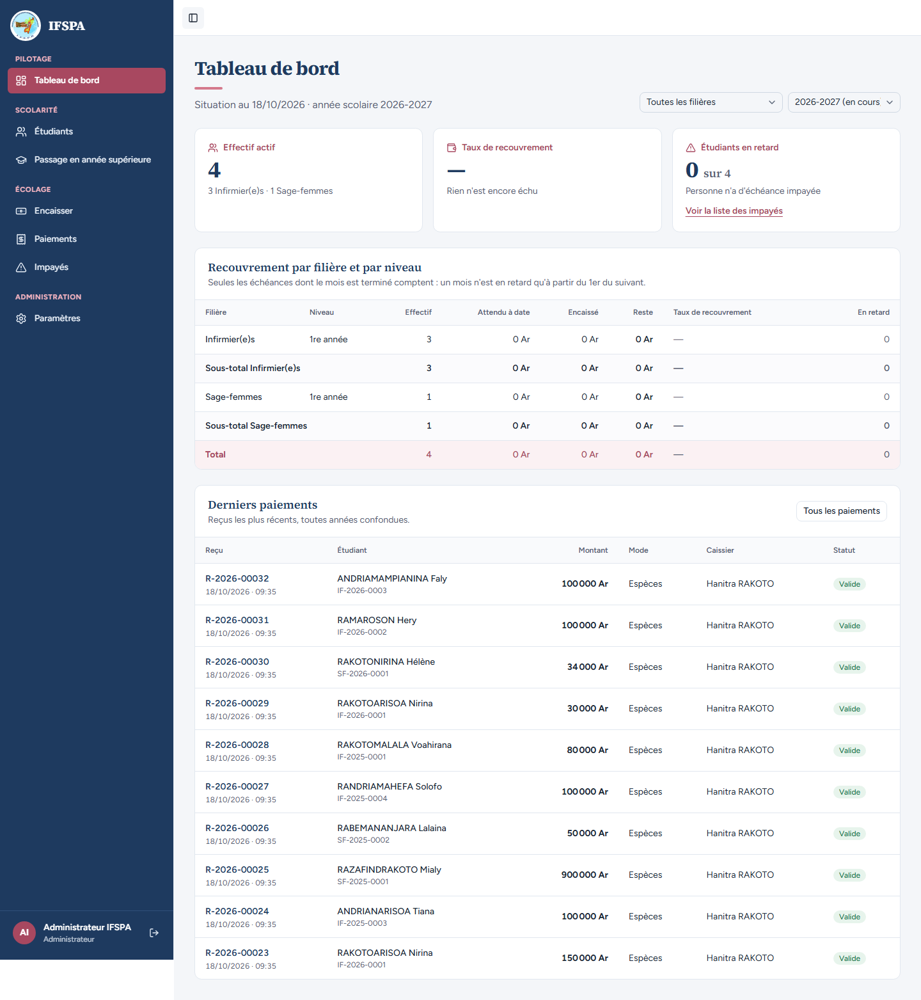
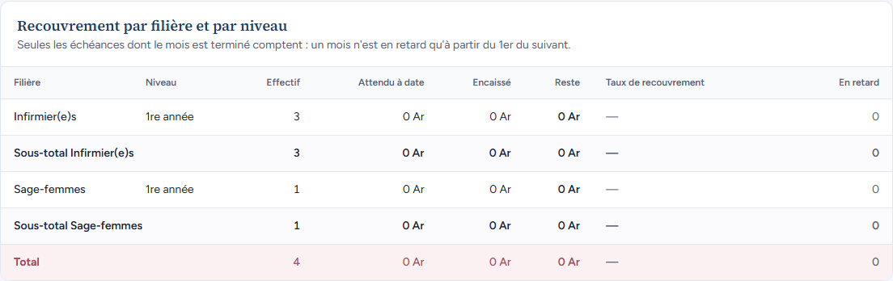
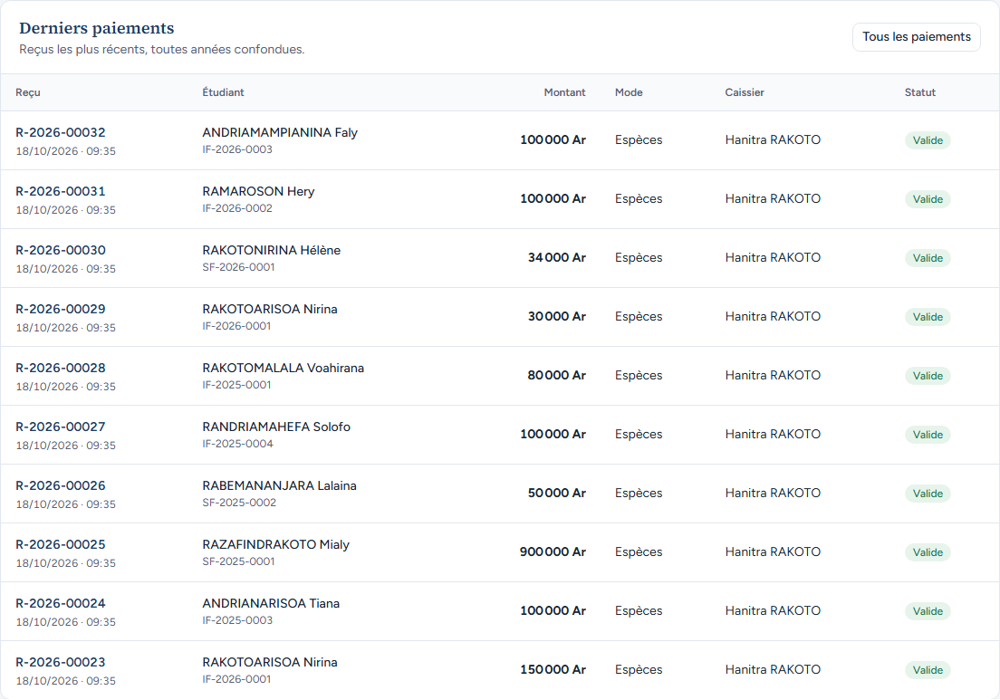
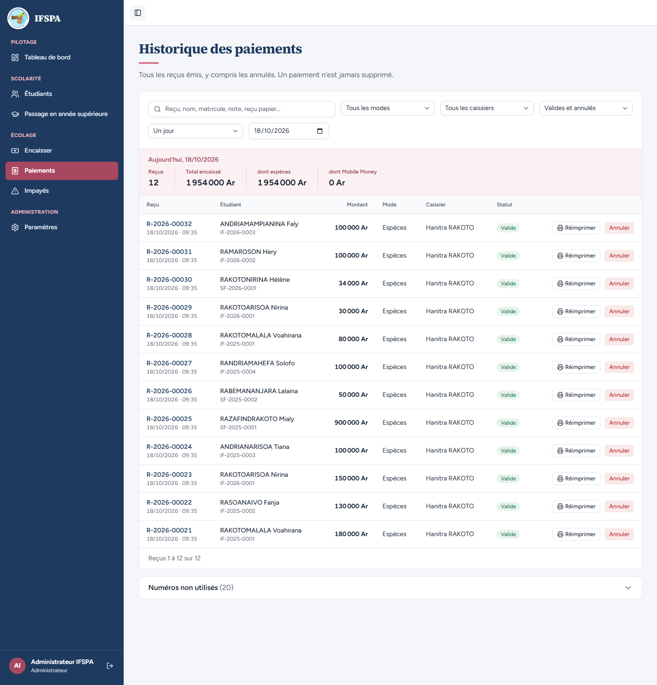

# UC12-01. L'administrateur ouvre le tableau de bord le matin, sur l'année en cours

| | |
|---|---|
| Use case | UC12. Suivre le recouvrement |
| Règles couvertes | R-DASH (trois cartes, tableau filière × niveau, 10 derniers paiements), R-RET (« attendu à date » : un mois n'est en retard qu'à partir du 1er du suivant) |
| Rôle | Administrateur, compte « Administrateur IFSPA » |
| Durée estimée | 5 minutes |

## La situation

L'administrateur de l'institut ouvre le tableau de bord le 18 octobre 2026. Il veut l'effectif, le taux de recouvrement et les derniers reçus. Comme octobre 2026 n'est pas terminé, rien n'est encore « échu » sur l'année en cours : le taux est inconnu (« — »). Les reçus, eux, sont déjà là.

## Avant de commencer

1. `pnpm db:up`, `pnpm recette:base`, `pnpm build`, `pnpm recette:app`, ouvrir `http://localhost:3200`.
2. Avoir déroulé [00-PREPARATION.md](../00-PREPARATION.md) : sections A, B, C, H, G puis **I** (12 reçus, 1 954 000 Ar). Pas de section D.
3. Se connecter avec le compte **administrateur** (identifiants `SEED_ADMIN_*` de `.env`).
4. Les montants de l'année 2026-2027 de ce scénario valent **tant que la date du jour est avant le 1er novembre 2026** (après, octobre 2026 devient échu et le tableau se remplit).

## Étapes

| # | Qui | Action | Résultat attendu | Capture | ✓ |
|---|---|---|---|---|---|
| 1 | Administrateur | Ouvrir **Tableau de bord** (adresse `/app/dashboard`). | Titre « Tableau de bord », « Situation au 18/10/2026 · année scolaire 2026-2027 ». Filtres « Toutes les filières » et « 2026-2027 (en cours) ». Trois cartes : « Effectif actif » **4** (« 3 Infirmier(e)s · 1 Sage-femmes »), « Taux de recouvrement » **—** (« Rien n'est encore échu »), « Étudiants en retard » **0 sur 4** (« Personne n'a d'échéance impayée ») avec le lien « Voir la liste des impayés ». « Administrateur IFSPA » en bas de la barre latérale. |  | |
| 2 | Administrateur | Lire le tableau « Recouvrement par filière et par niveau ». | Phrase « Seules les échéances dont le mois est terminé comptent : un mois n'est en retard qu'à partir du 1er du suivant. » Lignes : Infirmier(e)s 1re année (effectif 3), Sous-total Infirmier(e)s (3), Sage-femmes 1re année (1), Sous-total Sage-femmes (1), Total (4). Partout « Attendu à date » 0 Ar, « Encaissé » 0 Ar, « Reste » 0 Ar, taux « — », « En retard » 0. |  | |
| 3 | Administrateur | Lire « Derniers paiements » (« Reçus les plus récents, toutes années confondues. »). | **10 reçus**, du plus récent au plus ancien : R-2026-00032 (ANDRIAMAMPIANINA Faly, IF-2026-0003, 100 000 Ar, Espèces, Hanitra RAKOTO, « Valide »), 00031, 00030, 00029, 00028, 00027, 00026, 00025, 00024, 00023. Les deux plus anciens, R-2026-00022 et R-2026-00021, n'y sont pas. |  | |
| 4 | Administrateur | Cliquer **Tous les paiements**. | « Historique des paiements » : « Aujourd'hui, 18/10/2026 », **12 reçus**, Total encaissé **1 954 000 Ar** ; R-2026-00022 et R-2026-00021 sont dans la liste. |  | |

## Ce que ce scénario ne couvre pas

- Le passage au 1er novembre (octobre 2026 échu) : couvert par Vitest, `tests/integration/lectures-dashboard.test.ts` (« 31/10 : octobre n'est pas échu, rien d'attendu, pas de retard ; 01/11 : droits et octobre attendus, étudiant en retard »). Non démontré à l'écran (le serveur prend la vraie date).
- L'encaissé de 2026-2027 (414 000 Ar payés) n'apparaît pas dans le tableau : il ne compte que les échéances échues (question dans le [rapport](../../rapports/RAPPORT_2026-10-18_UC12.md)).
- Le sélecteur d'année tronque « (en cours) » (« 2026-2027 (en cours ») : constat mineur du rapport.

## Dernière exécution par l'agent

- 18/10/2026 : ✅ 4 étapes sur 4. Voir [RAPPORT_2026-10-18_UC12](../../rapports/RAPPORT_2026-10-18_UC12.md).
- Parcours : [UC12-01-vue-du-jour.recette.ts](../../parcours/UC12-01-vue-du-jour.recette.ts) (`pnpm recette:parcours UC12-01 --project ordinateur`).
