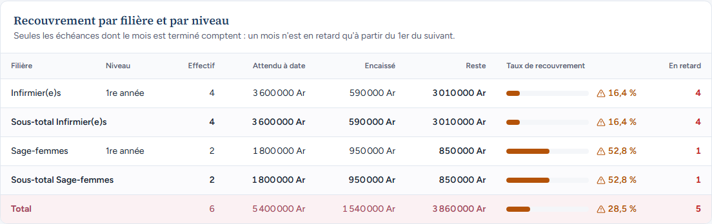
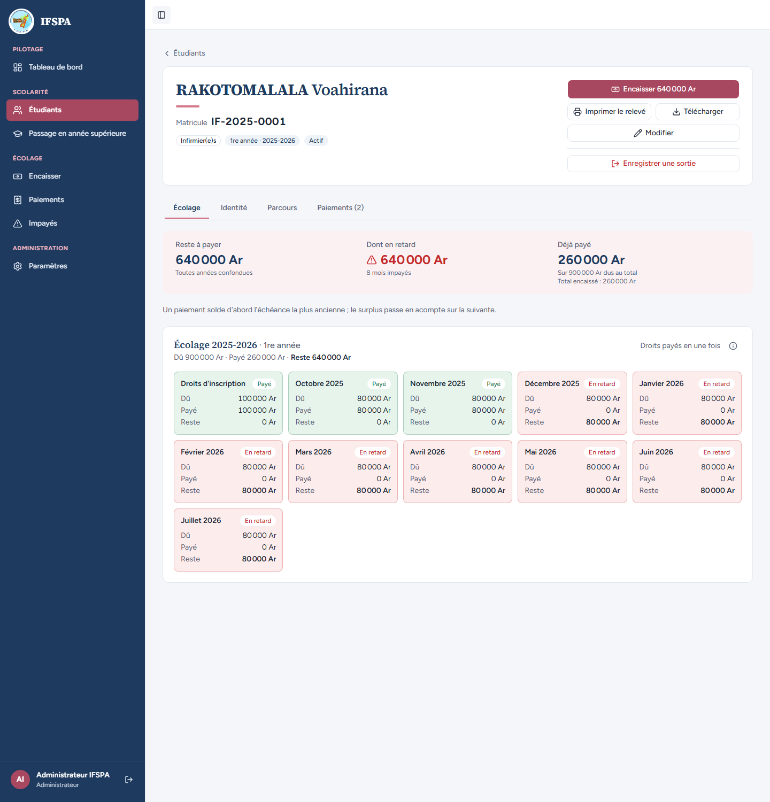
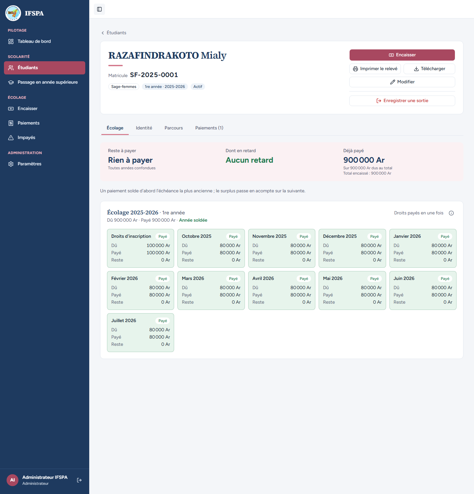
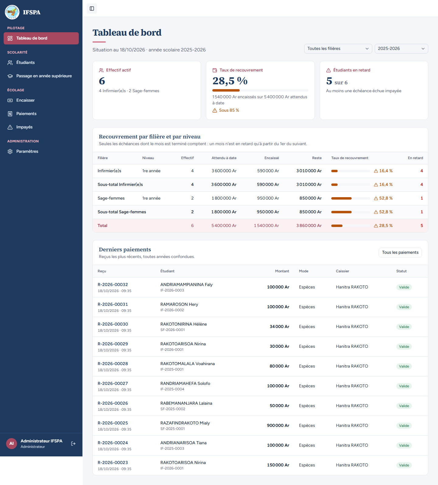

# UC12-02. L'année 2025-2026 : des chiffres qu'on peut refaire à la main

| | |
|---|---|
| Use case | UC12. Suivre le recouvrement |
| Règles couvertes | R-DASH (cartes, tableau, taux = encaissé / attendu à date, filtre année), R-RET (échu), R-PAR (acompte compté sur l'échu) |
| Rôle | Administrateur, compte « Administrateur IFSPA » |
| Durée estimée | 10 minutes |

## La situation

Les six étudiants inscrits en 2025-2026 ont tous leurs échéances d'octobre 2025 à juillet 2026 échues : l'attendu est de 6 × 900 000 = 5 400 000 Ar. L'administrateur choisit cette année et recompte à la main, fiche par fiche, ce que les six ont payé : 1 540 000 Ar, soit 28,5 %.

## Avant de commencer

1. `pnpm db:up`, `pnpm recette:base`, `pnpm build`, `pnpm recette:app`.
2. Avoir déroulé [00-PREPARATION.md](../00-PREPARATION.md) sections A, B, C, H, G, I, puis [UC12-01](UC12-01-vue-du-jour.md).
3. Compte **administrateur** (`SEED_ADMIN_*`).

## Étapes

| # | Qui | Action | Résultat attendu | Capture | ✓ |
|---|---|---|---|---|---|
| 1 | Administrateur | Sur le Tableau de bord, choisir **2025-2026** dans le filtre « Année scolaire ». | « Situation au 18/10/2026 · année scolaire 2025-2026 », l'adresse contient `anneeId=`. « Effectif actif » **6** (« 4 Infirmier(e)s · 2 Sage-femmes »). « Taux de recouvrement » **28,5 %**, barre orange, « 1 540 000 Ar encaissés sur 5 400 000 Ar attendus à date », « Sous 85 % ». « Étudiants en retard » **5 sur 6** (« Au moins une échéance échue impayée »), **pas** de lien « Voir la liste des impayés ». |  | |
| 2 | Administrateur | Lire le tableau. | Infirmier(e)s 1re année : effectif 4, attendu 3 600 000 Ar, encaissé 590 000 Ar, reste 3 010 000 Ar, **16,4 %**, 4 en retard (même chiffres au Sous-total). Sage-femmes 1re année : 2, 1 800 000 Ar, 950 000 Ar, 850 000 Ar, **52,8 %**, 1 en retard. Total : 6, 5 400 000 Ar, 1 540 000 Ar, 3 860 000 Ar, **28,5 %**, 5. |  | |
| 3 | Administrateur | **Étudiants**, chercher chacun des six par son matricule et ouvrir sa fiche (IF-2025-0001 à 0004, SF-2025-0001 et 0002) ; lire « Déjà payé » et « Reste à payer ». | Voahirana : payé 260 000 Ar, reste 640 000 Ar ; Fanja : 130 000 / 770 000 ; Tiana : 100 000 / 800 000 ; Solofo : 100 000 / 800 000 ; Mialy : 900 000 / « Rien à payer » ; Lalaina : 50 000 / 850 000. Somme des payés **1 540 000 Ar**, somme des restes **3 860 000 Ar** : celles du tableau. 1 540 000 / 5 400 000 = 28,5 %. |   | |
| 4 | Administrateur | Revenir au Tableau de bord, choisir 2025-2026, puis recharger la page (F5). | L'année reste 2025-2026 (elle est dans l'adresse), taux total 28,5 %. |  | |

## Ce que ce scénario ne couvre pas

- Le taux de 85 % et plus (sans alerte orange) : aucun jeu de données ne l'atteint ici ; couvert par Vitest, `tests/unit/dashboard.test.ts` (« seuil à 85 % : 85 n'est pas bas, 84,9 l'est »).
- L'arrondi : 28,5 % = 28,518… ; 16,4 % = 16,388… ; 52,8 % = 52,777… (arrondi au dixième, couvert par `tests/unit/dashboard.test.ts`).

## Dernière exécution par l'agent

- 18/10/2026 : ✅ 4 étapes sur 4. Voir [RAPPORT_2026-10-18_UC12](../../rapports/RAPPORT_2026-10-18_UC12.md).
- Parcours : [UC12-02-annee-2025-a-la-main.recette.ts](../../parcours/UC12-02-annee-2025-a-la-main.recette.ts) (`pnpm recette:parcours UC12-02 --project ordinateur`).
