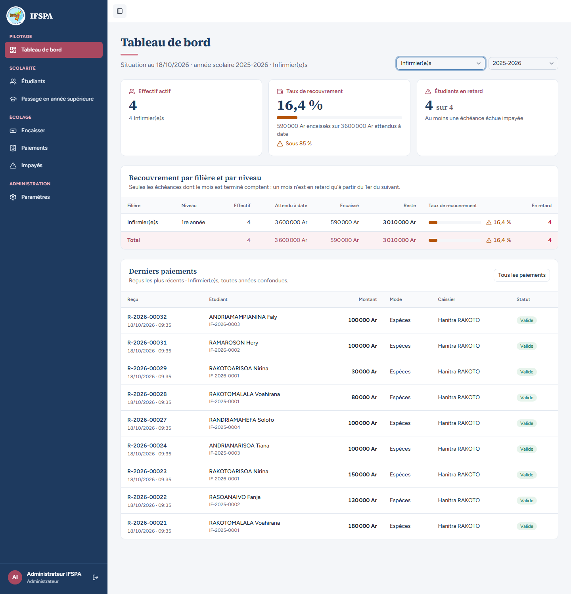
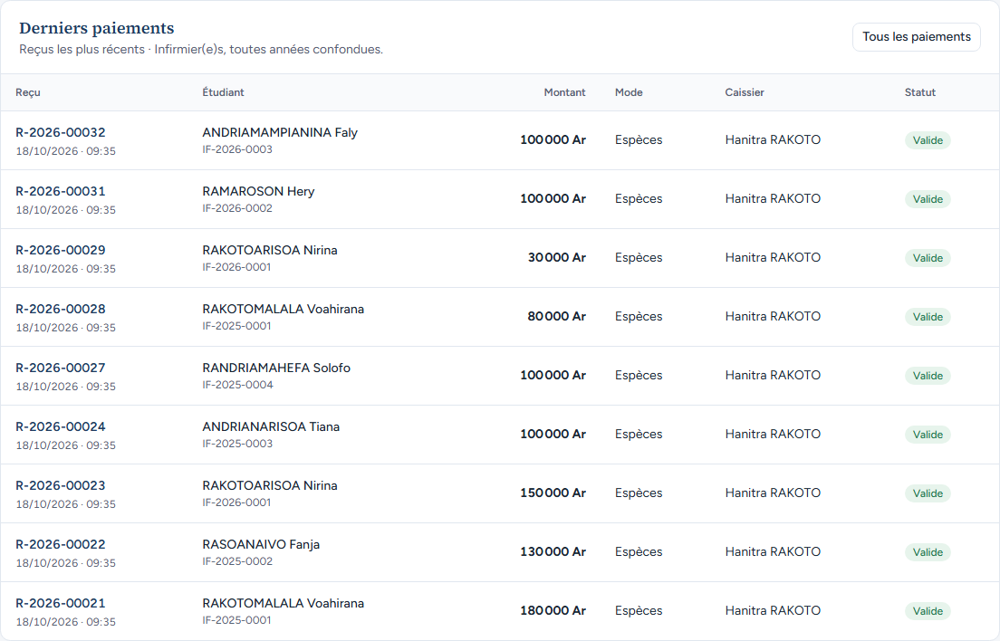
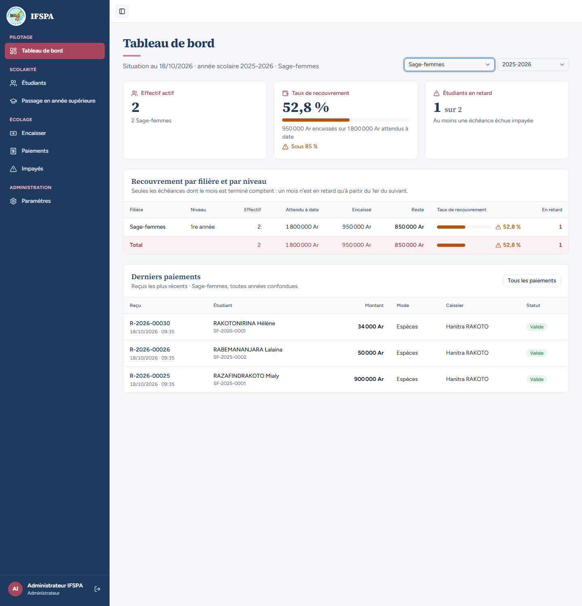
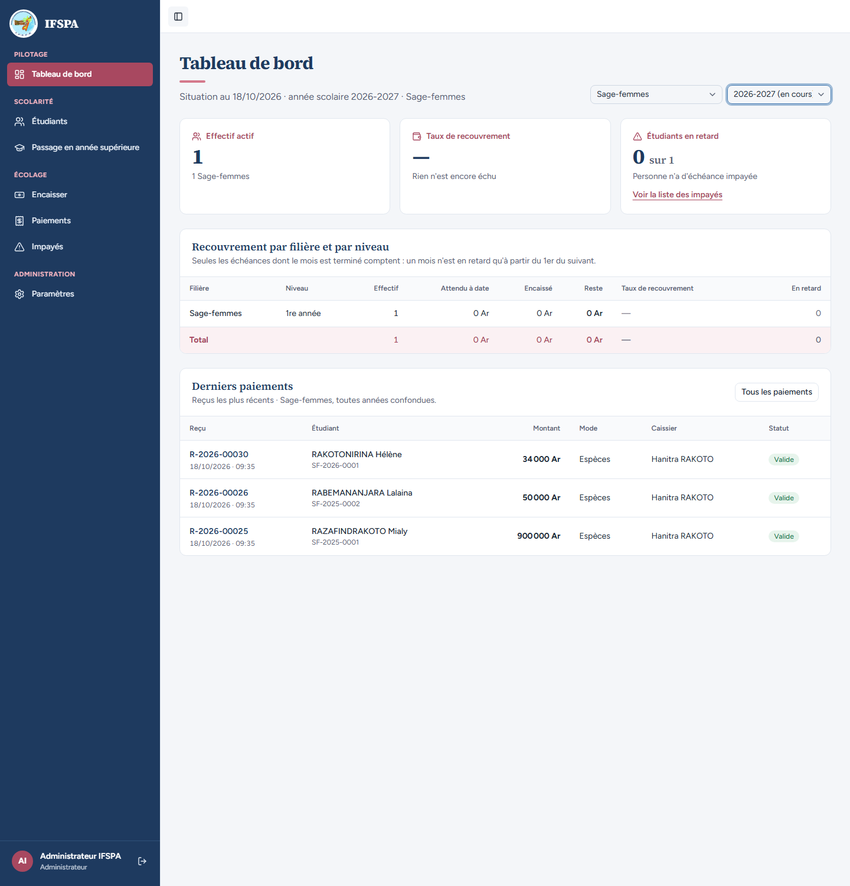
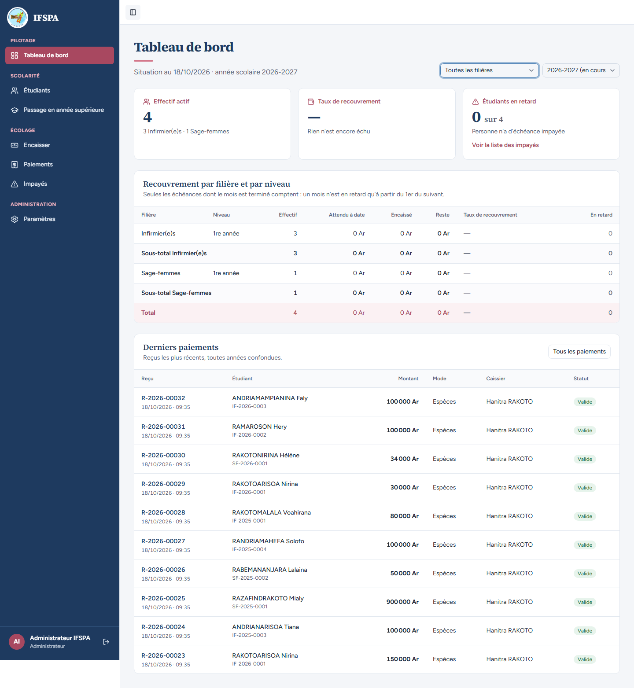

# UC12-03. La directrice regarde une filière à la fois, et les derniers paiements suivent la filière

| | |
|---|---|
| Use case | UC12. Suivre le recouvrement |
| Règles couvertes | R-DASH (filtre global année et filière, 10 derniers paiements) |
| Rôle | Administrateur, compte « Administrateur IFSPA » |
| Durée estimée | 6 minutes |

## La situation

L'administrateur veut savoir comment vont les Infirmier(e)s puis les Sage-femmes. Les chiffres se restreignent à la filière choisie ; la liste des derniers paiements suit la filière mais **pas l'année** (toutes années confondues).

## Avant de commencer

1. `pnpm recette:base`, `pnpm build`, `pnpm recette:app`.
2. Avoir déroulé [00-PREPARATION.md](../00-PREPARATION.md) sections A, B, C, H, G, I, puis [UC12-01](UC12-01-vue-du-jour.md) et [UC12-02](UC12-02-annee-2025-a-la-main.md) (ce cas ne modifie rien).
3. Compte **administrateur**.

## Étapes

| # | Qui | Action | Résultat attendu | Capture | ✓ |
|---|---|---|---|---|---|
| 1 | Administrateur | Tableau de bord, année **2025-2026**, filière **Infirmier(e)s**. | « Situation au 18/10/2026 · année scolaire 2025-2026 · Infirmier(e)s ». Effectif **4** (« 4 Infirmier(e)s »), taux **16,4 %** (« 590 000 Ar encaissés sur 3 600 000 Ar attendus à date »), « 4 sur 4 ». Le tableau ne montre que la ligne Infirmier(e)s 1re année et le Total (pas de sous-total, pas de Sage-femmes) : 4, 3 600 000 Ar, 590 000 Ar, 3 010 000 Ar, 16,4 %, 4. |  | |
| 2 | Administrateur | Lire « Derniers paiements ». | « Reçus les plus récents · Infirmier(e)s, toutes années confondues. » **9 reçus** (tous ceux des Infirmier(e)s, ceux de 2026-2027 compris) : R-2026-00032, 00031, 00029, 00028, 00027, 00024, 00023, 00022, 00021. Aucun reçu de Sage-femme (00025, 00026, 00030). |  | |
| 3 | Administrateur | Choisir la filière **Sage-femmes** (année 2025-2026). | Effectif **2**, taux **52,8 %**, « 1 sur 2 ». Total : 2, 1 800 000 Ar, 950 000 Ar, 850 000 Ar, 52,8 %, 1. Derniers paiements : **3 reçus**, R-2026-00030, 00026, 00025. |  | |
| 4 | Administrateur | Choisir l'année **2026-2027** (filière Sage-femmes). | « … année scolaire 2026-2027 · Sage-femmes ». Effectif **1** (« 1 Sage-femmes »), taux « — », « 0 sur 1 », lien « Voir la liste des impayés ». Les 3 mêmes reçus restent affichés (la liste ne suit pas l'année). |  | |
| 5 | Administrateur | Choisir **Toutes les filières**. | La filière disparaît de l'adresse, l'année 2026-2027 reste choisie. Effectif **4** (« 3 Infirmier(e)s · 1 Sage-femmes »), **10** derniers paiements. |  | |

## Ce que ce scénario ne couvre pas

- Une filière inconnue ou une année invalide dans l'adresse (repli sur « toutes » et sur l'année courante) : couvert par Vitest, `tests/integration/lectures-dashboard.test.ts` (bloc « filtres »).
- Une troisième filière.

## Dernière exécution par l'agent

- 18/10/2026 : ✅ 5 étapes sur 5. Voir [RAPPORT_2026-10-18_UC12](../../rapports/RAPPORT_2026-10-18_UC12.md).
- Parcours : [UC12-03-filtres-filiere.recette.ts](../../parcours/UC12-03-filtres-filiere.recette.ts) (`pnpm recette:parcours UC12-03 --project ordinateur`).
