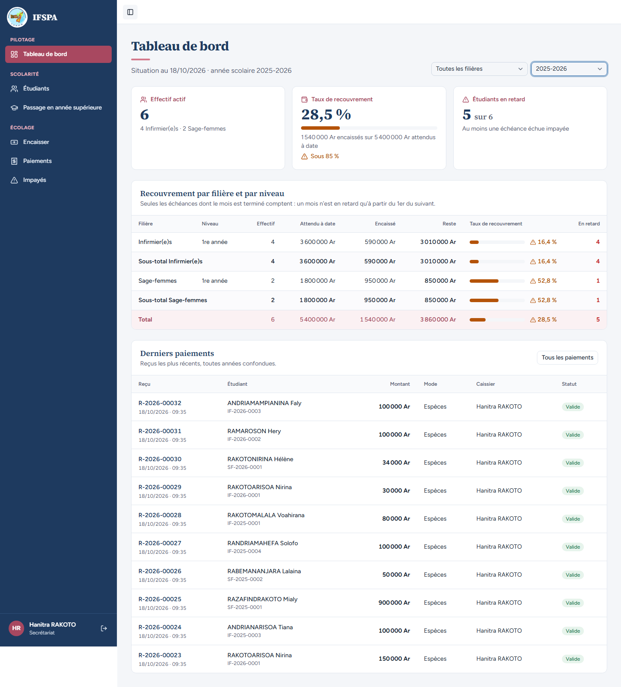
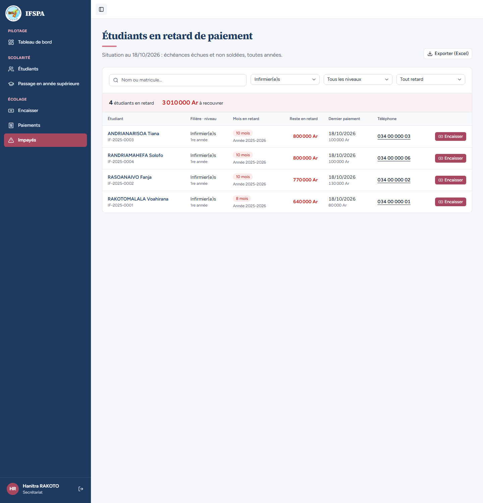
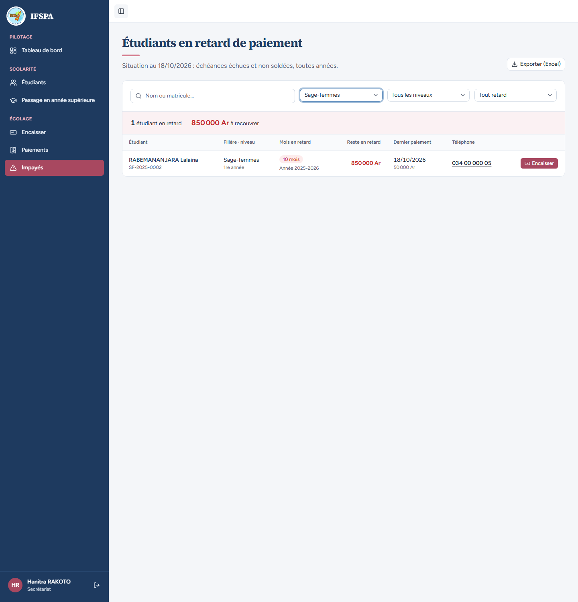
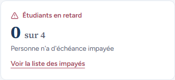
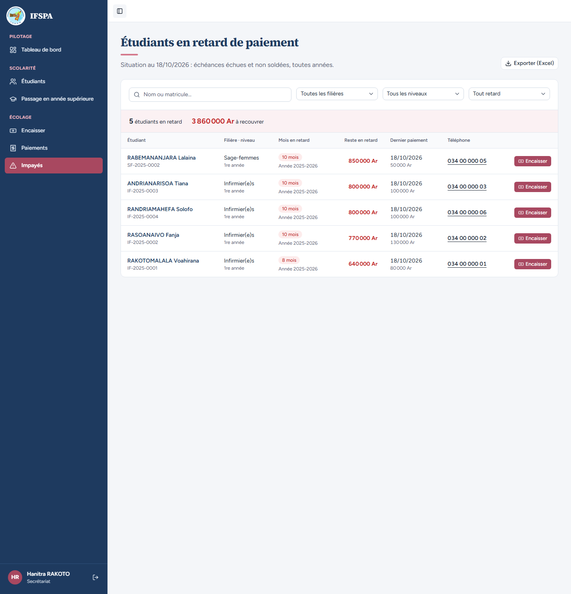
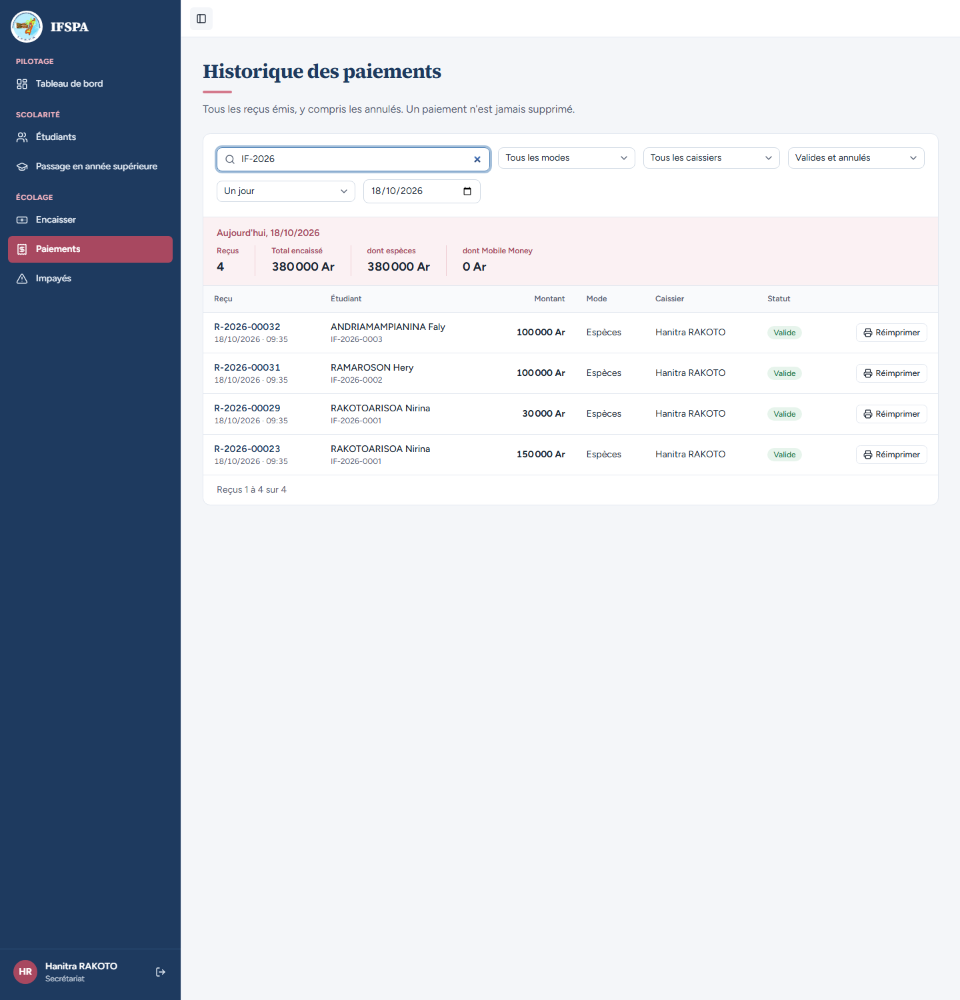

# UC12-04. Le tableau de bord, Impayés et Paiements racontent la même histoire

| | |
|---|---|
| Use case | UC12. Suivre le recouvrement |
| Règles couvertes | R-DASH, R-IMP (mêmes retards et mêmes montants), R-RET |
| Rôle | Secrétariat, compte « Hanitra RAKOTO » |
| Durée estimée | 10 minutes |

## La situation

La secrétaire prépare ses relances. Elle regarde le tableau de bord, puis la liste des impayés, puis l'historique des paiements, et vérifie que les trois donnent les mêmes totaux : 3 860 000 Ar de reste sur 5 étudiants en retard, 1 954 000 Ar encaissés dont 414 000 Ar sur l'année 2026-2027.

## Avant de commencer

1. `pnpm recette:base`, `pnpm build`, `pnpm recette:app`.
2. Avoir déroulé [00-PREPARATION.md](../00-PREPARATION.md) sections A, B, C, H, G, I, puis UC12-01 à [UC12-03](UC12-03-filtres-filiere.md) (ce cas ne modifie rien).
3. Compte **secrétariat** (identifiants `SEED_USER_*`).

## Étapes

| # | Qui | Action | Résultat attendu | Capture | ✓ |
|---|---|---|---|---|---|
| 1 | Secrétariat | **Tableau de bord**, année **2025-2026**. | « Hanitra RAKOTO » en bas de la barre latérale. « 5 sur 6 » en retard ; total : 5 400 000 Ar attendus, 1 540 000 Ar encaissés, reste **3 860 000 Ar**, 28,5 %. |  | |
| 2 | Secrétariat | Menu **Impayés**. | « 5 étudiants en retard », « **3 860 000 Ar** à recouvrer » : RABEMANANJARA Lalaina 850 000 Ar (10 mois), ANDRIANARISOA Tiana 800 000 Ar, RANDRIAMAHEFA Solofo 800 000 Ar, RASOANAIVO Fanja 770 000 Ar, RAKOTOMALALA Voahirana 640 000 Ar (8 mois). RAZAFINDRAKOTO Mialy (soldée) n'y est pas. |  | |
| 3 | Secrétariat | Filtre « Filière » : **Infirmier(e)s**, puis **Sage-femmes**. | Infirmier(e)s : « 4 étudiants en retard », **3 010 000 Ar**. Sage-femmes : « 1 étudiant en retard », **850 000 Ar** (RABEMANANJARA Lalaina). |   | |
| 4 | Secrétariat | Revenir au Tableau de bord, année 2025-2026, filière Infirmier(e)s puis Sage-femmes. | Infirmier(e)s : reste **3 010 000 Ar**, 4 en retard. Sage-femmes : reste **850 000 Ar**, 1 en retard. Les mêmes que dans Impayés. | | |
| 5 | Secrétariat | Tableau de bord (année en cours 2026-2027) : lire la carte « Étudiants en retard », cliquer **Voir la liste des impayés**. | La carte dit « **0 sur 4** », mais le lien ouvre Impayés avec « **5 étudiants en retard** », « 3 860 000 Ar à recouvrer » : la liste couvre toutes les années, la carte seulement l'année affichée (voir la question 2 du rapport). |   | |
| 6 | Secrétariat | Menu **Paiements**, puis taper `IF-2026` dans la recherche, puis `SF-2026`. | Sans recherche : « Reçus 12 », Total encaissé **1 954 000 Ar**. `IF-2026` : 4 reçus, **380 000 Ar** (Nirina 150 000 + 30 000, Hery 100 000, Faly 100 000). `SF-2026` : 1 reçu, **34 000 Ar** (Hélène). 380 000 + 34 000 = 414 000 Ar pour 2026-2027 ; 1 540 000 + 414 000 = 1 954 000 Ar. |  | |

## Ce que ce scénario ne couvre pas

- Plusieurs années en retard dans Impayés : couvert par Vitest, `tests/integration/lectures-paiements.test.ts` (bloc `lireImpayes`).
- Les 414 000 Ar de 2026-2027 n'ont aucune trace dans le tableau de bord tant que leurs mois ne sont pas échus (le tableau ne compte que l'échu) : à lire avec Paiements, voir la question 1 du rapport.

## Dernière exécution par l'agent

- 18/10/2026 : ✅ 6 étapes sur 6. Voir [RAPPORT_2026-10-18_UC12](../../rapports/RAPPORT_2026-10-18_UC12.md).
- Parcours : [UC12-04-coherence-impayes-paiements.recette.ts](../../parcours/UC12-04-coherence-impayes-paiements.recette.ts) (`pnpm recette:parcours UC12-04 --project ordinateur`).
