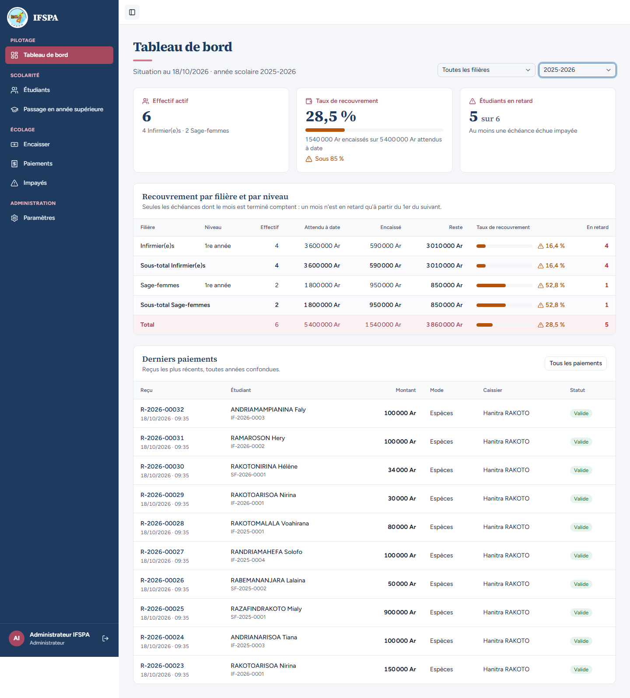
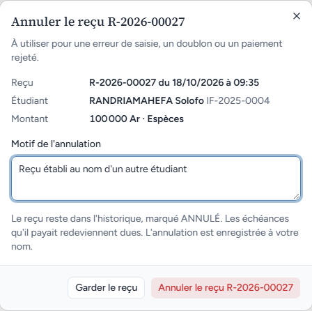
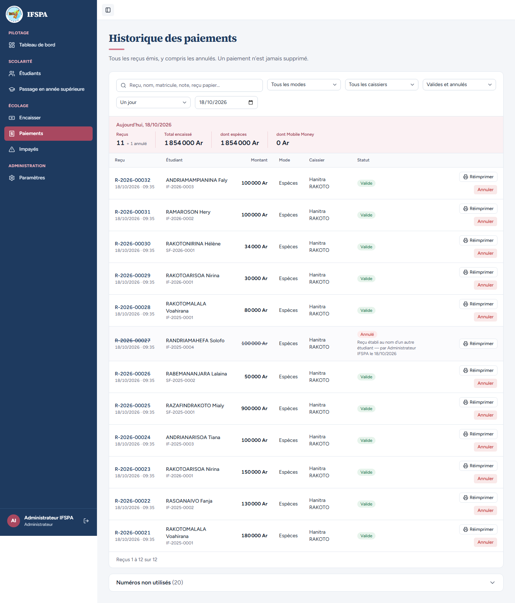
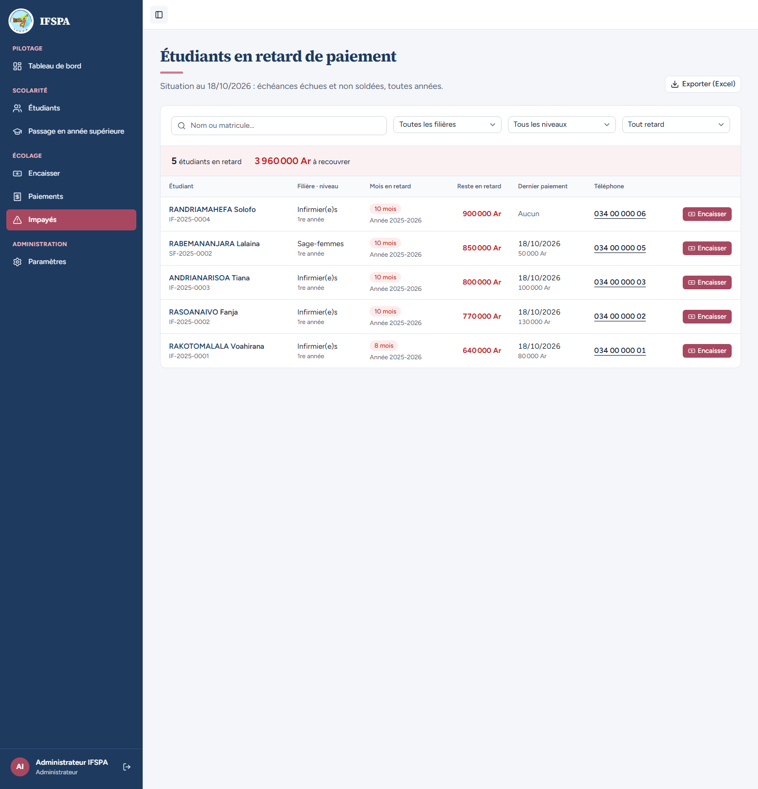

# UC12-05. Un reçu annulé sort des chiffres, mais reste dans les derniers paiements

| | |
|---|---|
| Use case | UC12. Suivre le recouvrement |
| Règles couvertes | R-DASH (encaissé = paiements non annulés), R-ANN (le reçu annulé reste dans l'historique), R-IMP |
| Rôle | Administrateur, compte « Administrateur IFSPA » |
| Durée estimée | 8 minutes |

## La situation

Le reçu R-2026-00027 (100 000 Ar de RANDRIAMAHEFA Solofo) a été établi au nom d'un autre étudiant. L'administrateur l'annule. Le tableau de bord doit enlever ces 100 000 Ar de l'encaissé (1 540 000 → 1 440 000 Ar, 28,5 % → 26,7 %), garder le reçu dans les derniers paiements marqué « Annulé », et rester d'accord avec Impayés et Paiements.

## Avant de commencer

1. `pnpm recette:base`, `pnpm build`, `pnpm recette:app`.
2. Avoir déroulé [00-PREPARATION.md](../00-PREPARATION.md) sections A, B, C, H, G, I, puis UC12-01 à [UC12-04](UC12-04-coherence-impayes-paiements.md). **Ce cas modifie les données** (un reçu annulé ne se « désannule » pas) : les cas suivants en dépendent.
3. Compte **administrateur**.

## Étapes

| # | Qui | Action | Résultat attendu | Capture | ✓ |
|---|---|---|---|---|---|
| 1 | Administrateur | Tableau de bord, année 2025-2026. | Avant : taux **28,5 %**, Infirmier(e)s 1re année : encaissé 590 000 Ar, 16,4 %. |  | |
| 2 | Administrateur | Menu **Paiements**. Sur la ligne R-2026-00027, cliquer **Annuler**. Saisir le motif `Reçu établi au nom d'un autre étudiant`, cliquer **Annuler le reçu R-2026-00027**. | Fenêtre « Annuler le reçu R-2026-00027 » avec « RANDRIAMAHEFA Solofo IF-2025-0004 ». Message « Reçu R-2026-00027 annulé : les échéances qu'il payait sont de nouveau dues. » Avant l'annulation, le Total encaissé du jour était 1 954 000 Ar. |  | |
| 3 | Administrateur | Tableau de bord, année 2025-2026. | « Taux de recouvrement » **26,7 %**, « 1 440 000 Ar encaissés sur 5 400 000 Ar attendus à date », toujours « 5 sur 6 ». Infirmier(e)s 1re année : encaissé **490 000 Ar**, reste 3 110 000 Ar, **13,6 %**. Total : 1 440 000 Ar, reste **3 960 000 Ar**, 26,7 %, 5 en retard. |  | |
| 4 | Administrateur | Lire « Derniers paiements ». | Toujours 10 lignes. R-2026-00027 est à sa place, numéro et montant barrés, statut **Annulé** (en rouge) ; les 9 autres sont « Valide ». |  | |
| 5 | Administrateur | Menu **Paiements**. | « Reçus 11 », « + 1 annulé », Total encaissé **1 854 000 Ar** (1 954 000 − 100 000). La ligne R-2026-00027 est « Annulé ». |  | |
| 6 | Administrateur | Menu **Impayés**. | « 5 étudiants en retard », « **3 960 000 Ar** à recouvrer » (comme le reste du tableau de bord) ; RANDRIAMAHEFA Solofo redoit **900 000 Ar**. |  | |
| 7 | Administrateur | Tableau de bord, année 2025-2026, filière Infirmier(e)s. | Taux **13,6 %**, « 490 000 Ar encaissés sur 3 600 000 Ar attendus à date ». | | |

## Ce que ce scénario ne couvre pas

- Annuler un reçu de l'année 2026-2027 (octobre pas échu) : il ne change aucun chiffre du tableau (rien n'y est compté avant l'échéance).
- Le refus d'annuler par le secrétariat : [UC07-04](../UC07-paiements/UC07-04-secretariat-sans-annulation.md).
- « Paiement annulé : ne compte pas dans l'encaissé » : aussi couvert par Vitest, `tests/integration/lectures-dashboard.test.ts`.

## Dernière exécution par l'agent

- 18/10/2026 : ✅ 7 étapes sur 7. Voir [RAPPORT_2026-10-18_UC12](../../rapports/RAPPORT_2026-10-18_UC12.md).
- Parcours : [UC12-05-recu-annule.recette.ts](../../parcours/UC12-05-recu-annule.recette.ts) (`pnpm recette:parcours UC12-05 --project ordinateur`).
