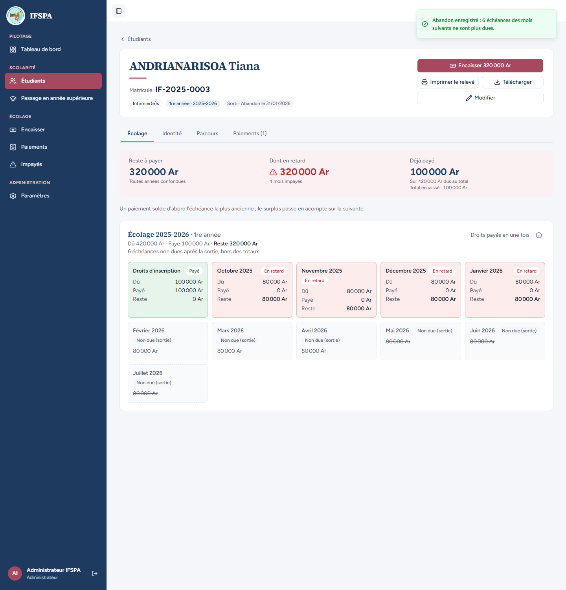
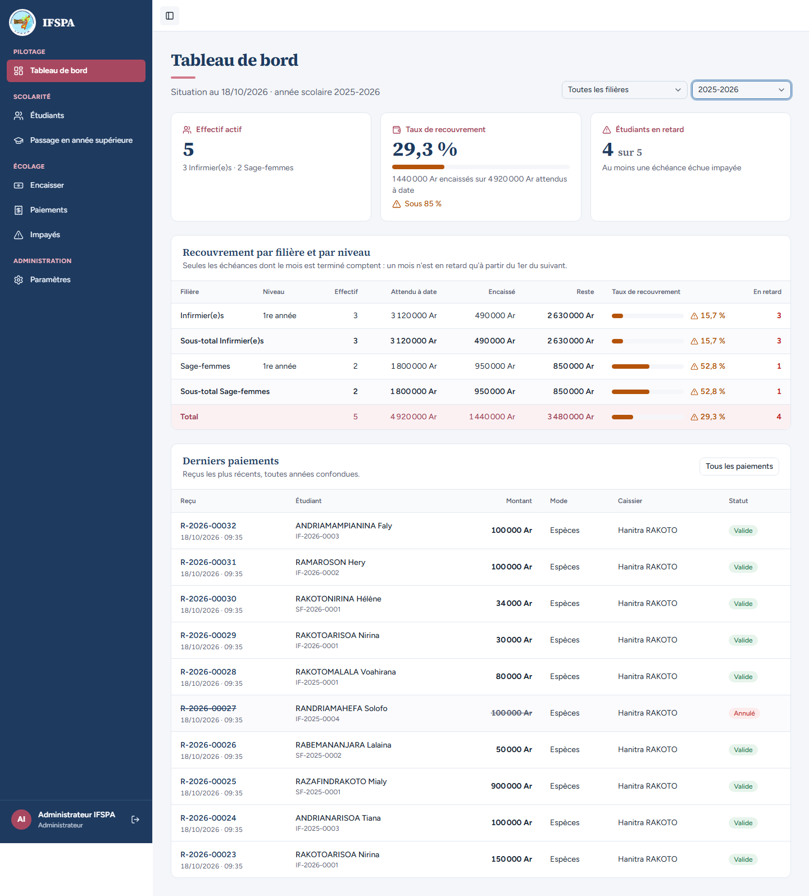
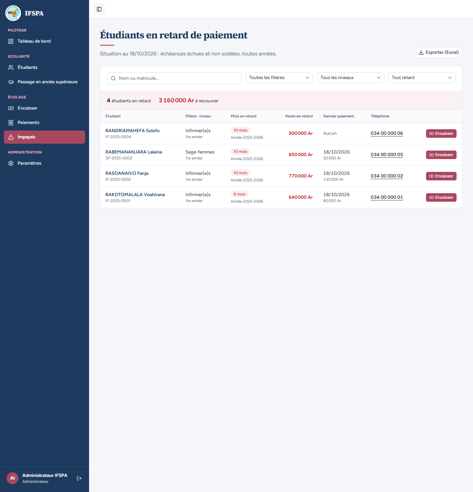

# UC12-06. Un abandon du 31 janvier : hors de l'effectif et des retards, son argent et son dû restent comptés

| | |
|---|---|
| Use case | UC12. Suivre le recouvrement |
| Règles couvertes | R-DASH (effectif actif, étudiants en retard), R-SOR (mois non dus après la sortie), R-IMP |
| Rôle | Administrateur, compte « Administrateur IFSPA » |
| Durée estimée | 8 minutes |

## La situation

ANDRIANARISOA Tiana (100 000 Ar payés sur 900 000 Ar) a abandonné ses études fin janvier 2026. L'administrateur enregistre la sortie au 31/01/2026. Les six mois suivants ne sont plus dus : l'attendu du tableau de bord baisse de 480 000 Ar. Tiana quitte l'effectif et la liste des retards, mais son argent (100 000 Ar) et ce qui lui reste dû (320 000 Ar) restent dans les chiffres du tableau.

## Avant de commencer

1. `pnpm recette:base`, `pnpm build`, `pnpm recette:app`.
2. Avoir déroulé [00-PREPARATION.md](../00-PREPARATION.md) sections A, B, C, H, G, I, puis UC12-01 à [UC12-05](UC12-05-recu-annule.md). **Ce cas modifie les données** (une sortie est définitive, décision n° 23).
3. Compte **administrateur**.

## Étapes

| # | Qui | Action | Résultat attendu | Capture | ✓ |
|---|---|---|---|---|---|
| 1 | Administrateur | **Étudiants**, ouvrir ANDRIANARISOA Tiana (IF-2025-0003). | « Reste à payer 800 000 Ar », « Dont en retard 800 000 Ar ». | | |
| 2 | Administrateur | Cliquer **Enregistrer une sortie**, saisir la date `31/01/2026`, le motif `Départ à l'étranger avec sa famille`, cliquer **Enregistrer l'abandon**. | Message « Abandon enregistré : 6 échéances des mois suivants ne sont plus dues. » Badge « Sorti · Abandon le 31/01/2026 ». « Reste à payer **320 000 Ar** » (420 000 Ar dus − 100 000 Ar payés), février à juillet 2026 « Non due (sortie) ». |  | |
| 3 | Administrateur | **Tableau de bord**, année **2025-2026**. | « Effectif actif » **5** (« 3 Infirmier(e)s · 2 Sage-femmes »). « Taux de recouvrement » **29,3 %** (« 1 440 000 Ar encaissés sur 4 920 000 Ar attendus à date »). « Étudiants en retard » **4 sur 5**. Infirmier(e)s 1re année : effectif 3, attendu **3 120 000 Ar**, encaissé 490 000 Ar, reste 2 630 000 Ar, **15,7 %**, 3 en retard. Sage-femmes inchangé (2, 1 800 000 Ar, 950 000 Ar, 850 000 Ar, 52,8 %, 1). Total : 5, **4 920 000 Ar**, 1 440 000 Ar, **3 480 000 Ar**, 29,3 %, 4. |  | |
| 4 | Administrateur | Dans « Derniers paiements », repérer R-2026-00024. | Le reçu de Tiana reste là, « Valide » : son paiement n'est pas annulé. | | |
| 5 | Administrateur | Menu **Impayés**. | « 4 étudiants en retard », « **3 160 000 Ar** à recouvrer » (Tiana n'y est plus). L'écart avec le reste du tableau de bord (3 480 000 − 3 160 000 = **320 000 Ar**) est exactement ce que Tiana doit encore (décision provisoire n° 20 : un sorti sort des Impayés). |  | |

## Ce que ce scénario ne couvre pas

- Une exclusion (même traitement que l'abandon) : couvert par Vitest, `tests/integration/lectures-dashboard.test.ts` (« abandon et exclusion : hors effectif et hors retards, mais leur argent et leur dû échu restent comptés » ; « abandon avec mois non dus : seul l'échu et le mois de sortie sont attendus »).
- Le refus de la sortie par le secrétariat : [UC11-04](../UC11-sortie/UC11-04-secretariat-sans-bouton.md).

## Dernière exécution par l'agent

- 18/10/2026 : ✅ 5 étapes sur 5. Voir [RAPPORT_2026-10-18_UC12](../../rapports/RAPPORT_2026-10-18_UC12.md).
- Parcours : [UC12-06-sortie-antidatee.recette.ts](../../parcours/UC12-06-sortie-antidatee.recette.ts) (`pnpm recette:parcours UC12-06 --project ordinateur`).
