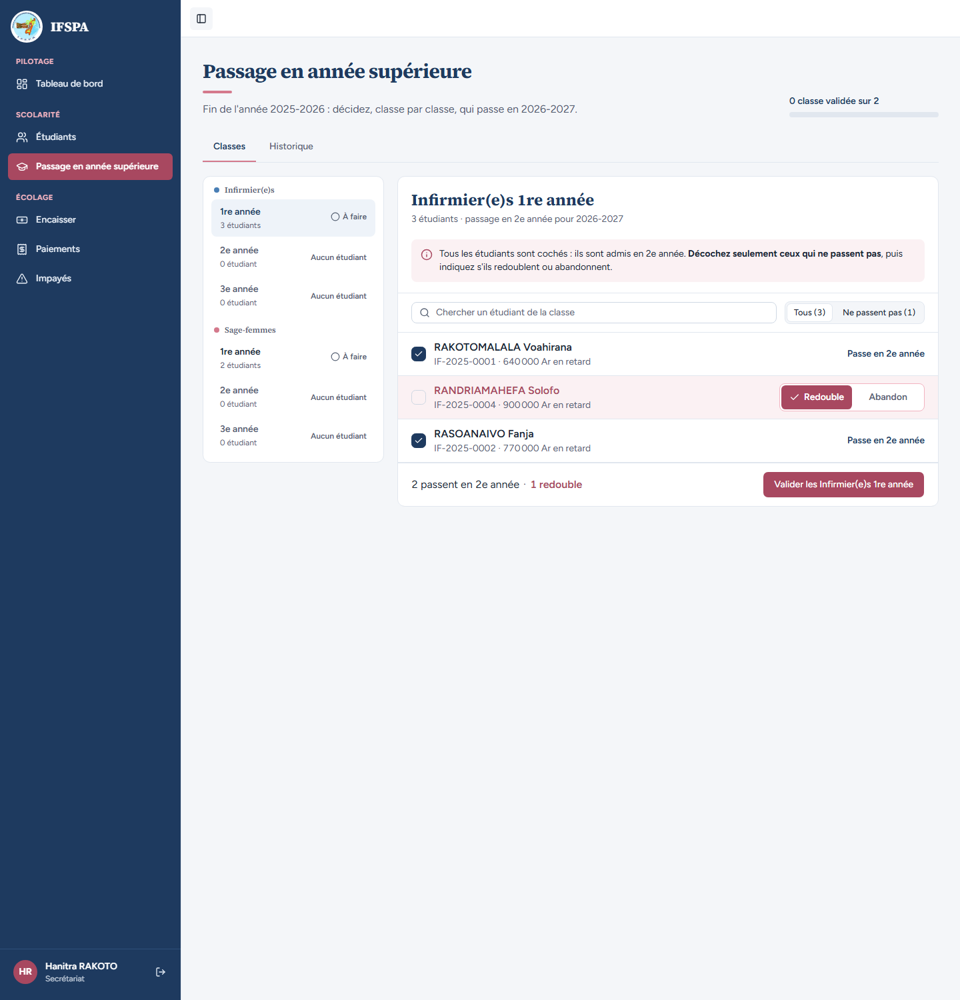
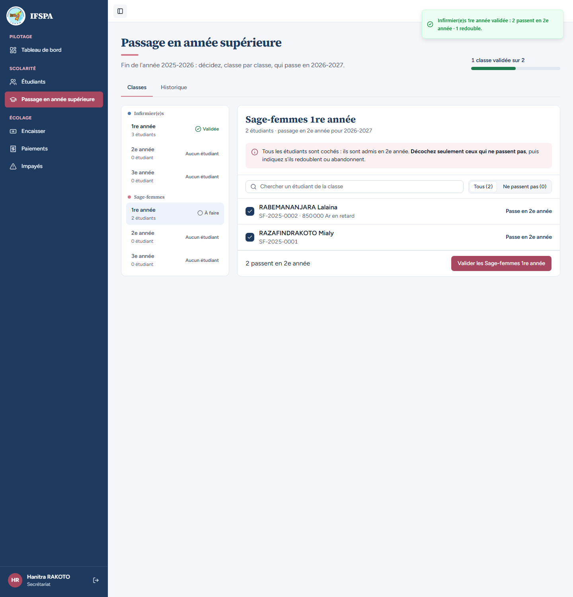
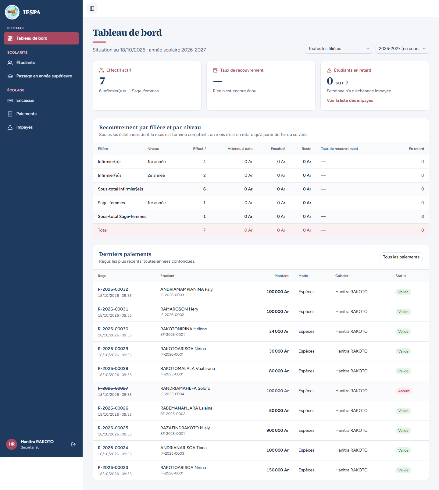
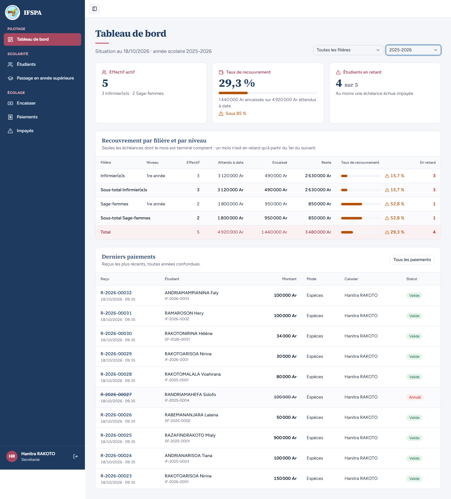
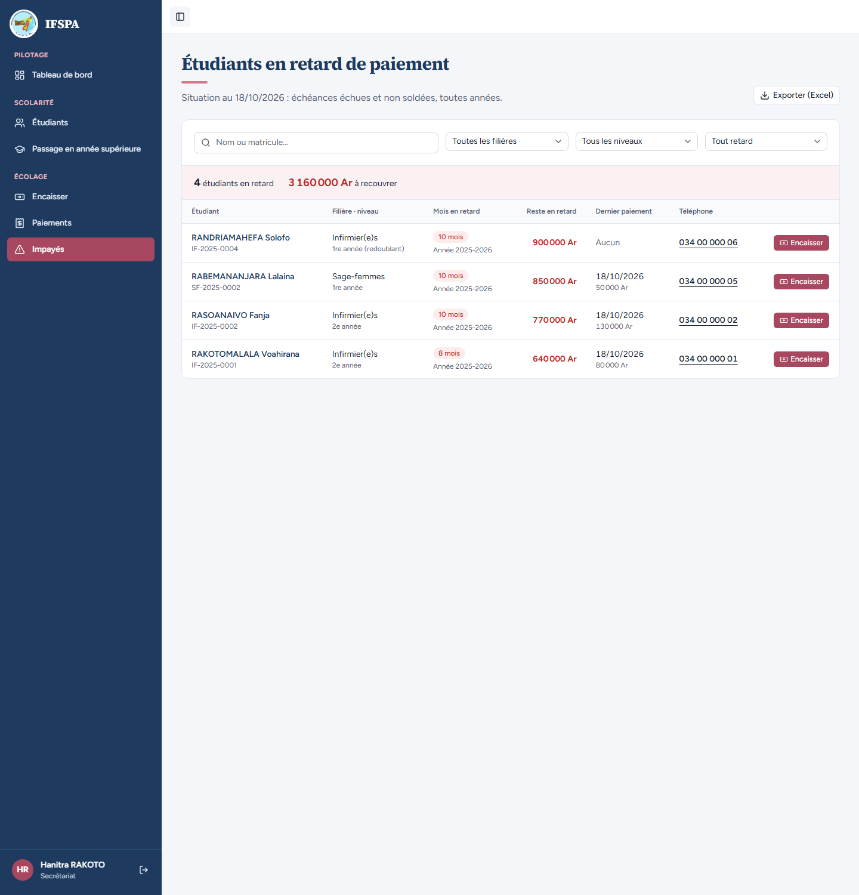

# UC12-07. Après le passage de la classe IF 1re année, 2026-2027 compte une ligne par niveau

| | |
|---|---|
| Use case | UC12. Suivre le recouvrement |
| Règles couvertes | R-DASH (tableau filière × niveau, effectif par année), R-ADM, R-RET (rien n'est reporté d'une année à l'autre) |
| Rôle | Secrétariat, compte « Hanitra RAKOTO » |
| Durée estimée | 8 minutes |

## La situation

La secrétaire passe la classe Infirmier(e)s 1re année en 2e année : Voahirana et Fanja passent, Solofo redouble (Tiana est sortie, elle n'est plus proposée). Le tableau de bord de 2026-2027 montre alors deux lignes de niveau pour les Infirmier(e)s (1re année : 4 dont le redoublant, 2e année : 2). Celui de 2025-2026 ne bouge pas.

## Avant de commencer

1. `pnpm recette:base`, `pnpm build`, `pnpm recette:app`.
2. Avoir déroulé [00-PREPARATION.md](../00-PREPARATION.md) sections A, B, C, H, G, I (**sans la D**), puis UC12-01 à [UC12-06](UC12-06-sortie-antidatee.md). **Ce cas modifie les données** (passage en année supérieure).
3. Compte **secrétariat**.

## Étapes

| # | Qui | Action | Résultat attendu | Capture | ✓ |
|---|---|---|---|---|---|
| 1 | Secrétariat | Menu **Passage en année supérieure**, classe **Infirmier(e)s 1re année**. Décocher RANDRIAMAHEFA Solofo. | « 3 étudiants · passage en 2e année pour 2026-2027 » (ANDRIANARISOA Tiana, sortie, n'est pas dans la liste). Solofo décoché : « Redouble » coché. En bas : « 2 passent en 2e année · 1 redouble ». |  | |
| 2 | Secrétariat | Cliquer **Valider les Infirmier(e)s 1re année**, puis le bouton de la fenêtre « Valider le passage de … étudiants ». | Message « … validée : 2 passent en 2e année … ». |  | |
| 3 | Secrétariat | **Tableau de bord** (année 2026-2027 par défaut). | « Effectif actif » **7** (« 6 Infirmier(e)s · 1 Sage-femmes »), taux « — », « 0 sur 7 ». Lignes : Infirmier(e)s 1re année **4** (Nirina, Hery, Faly, Solofo qui redouble), Infirmier(e)s 2e année **2** (Voahirana, Fanja), Sous-total Infirmier(e)s 6, Sage-femmes 1re année 1, Sous-total 1, Total **7** ; attendu, encaissé et reste à 0 Ar, « En retard » 0. |  | |
| 4 | Secrétariat | Choisir l'année **2025-2026**. | Inchangé : effectif **5**, taux **29,3 %**, « 4 sur 5 », total 5 / 4 920 000 Ar / 1 440 000 Ar / 3 480 000 Ar / 29,3 % / 4. Pas de ligne « 2e année » : les impayés de 2025-2026 restent sur 2025-2026, rien n'est reporté. |  | |
| 5 | Secrétariat | Menu **Impayés**. | « 4 étudiants en retard », « 3 160 000 Ar à recouvrer » : les retards de 2025-2026, alors que le tableau de bord de l'année en cours affiche « 0 sur 7 » (voir la question 2 du rapport). |  | |

## Ce que ce scénario ne couvre pas

- Le passage lui-même en détail : [UC10-01](../UC10-passage/UC10-01-nominal-redoublant.md) et suivants.
- Des échéances échues en 2026-2027 (avant le 1er novembre, aucune).

## Dernière exécution par l'agent

- 18/10/2026 : ✅ 5 étapes sur 5. Voir [RAPPORT_2026-10-18_UC12](../../rapports/RAPPORT_2026-10-18_UC12.md).
- Parcours : [UC12-07-passage-par-niveau.recette.ts](../../parcours/UC12-07-passage-par-niveau.recette.ts) (`pnpm recette:parcours UC12-07 --project ordinateur`).
